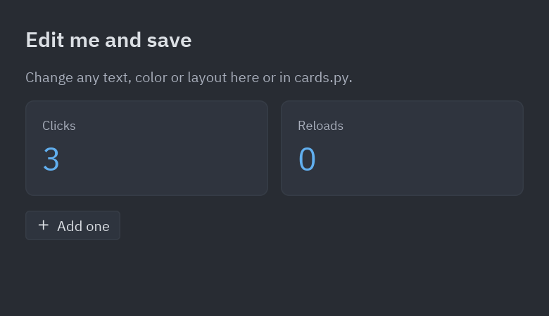
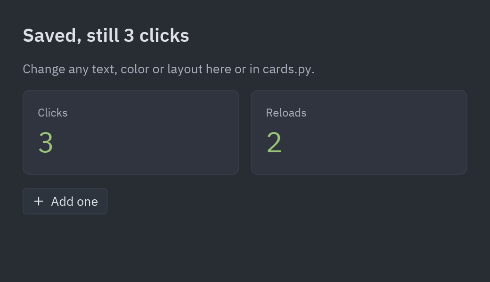
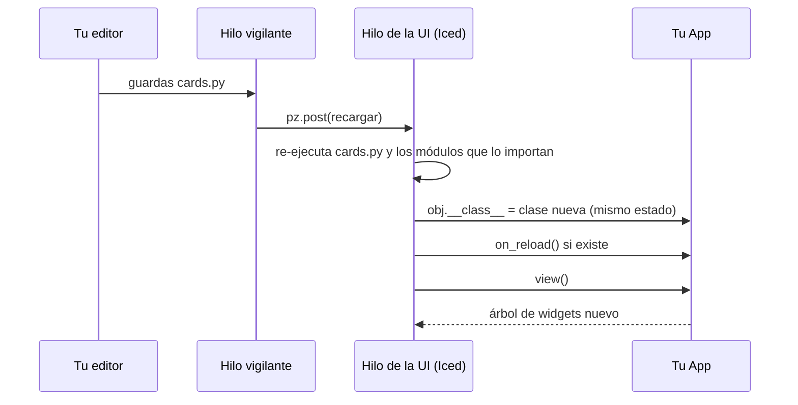

# Pyzed

**Interfaces modernas y rápidas en Python, renderizadas por [Iced](https://iced.rs) (Rust).**
Incluye componentes listos para usar inspirados en el editor [Zed](https://zed.dev).

📖 **Documentación:** [albakore.github.io/pyzed](https://albakore.github.io/pyzed/) · [Novedades](CHANGELOG.md)


> Esta captura es una app de Python ([`examples/zed_editor.py`](examples/zed_editor.py)):
> panel de proyecto, pestañas, editor con resaltado de sintaxis, marcadores de git,
> barra de estado, paleta de comandos y temas. Todo se dibuja con Iced.

## Por qué Pyzed

- **Rendimiento nativo.** Python solo describe la interfaz. El layout, el texto y el dibujado
  (wgpu, con tiny-skia como respaldo por software) los hace Iced 0.14 en Rust, mediante PyO3.
- **Sencillo.** Sigue la arquitectura Elm de Iced (estado, `update` y `view`). Un botón puede
  llamar directamente a un método: `on_press=self.guardar`.
- **Componentes listos.** Unos 40 componentes al estilo Zed (botones, pestañas, árbol de archivos,
  paleta de comandos, editor de código, terminal, menús, notificaciones…), todos personalizables.
- **Temas.** Incluye las familias One, Ayu y Gruvbox importadas de Zed, puede leer cualquier
  tema de Zed, generar uno a partir de tres colores y seguir el modo claro/oscuro del sistema.
- **Async y varias ventanas.** `async def`, generadores y streams en `update`, temporizadores con
  `pz.every` y tantas ventanas como quieras con `pz.Window`.
- **Multiplataforma.** Linux, macOS y Windows. Las fuentes (IBM Plex) y los iconos
  (Lucide, ~2000) van incluidos.
- **Capturas sin ventana.** `app.screenshot("ui.png")` renderiza fuera de pantalla, sin GPU ni
  display. Sirve para tests y documentación (así se generaron todas estas imágenes).

## Instalación

Por ahora se instala desde el código fuente. Necesitas Rust estable y Python 3.9 o superior.

```bash
uv add pyzed-ui             # en un proyecto de uv (o: pip install pyzed-ui)
```

Para desarrollar Pyzed con [uv](https://docs.astral.sh/uv/):

```bash
git clone https://github.com/albakore/pyzed && cd pyzed
uv sync                     # crea .venv, compila el núcleo de Rust en release e instala pyzed editable
uv run pytest tests
uv run python examples/gallery.py
```

Los cambios en Python se usan al momento, y tras tocar Rust el siguiente `uv run` recompila solo. Sin uv:
`pip install maturin && maturin develop --release` dentro de un venv.

## Inicio rápido

```python
import pyzed as pz
from pyzed import ui


class Counter(pz.App):
    title = "Counter"
    size = (360, 220)

    def __init__(self):
        self.count = 0

    def update(self, message):          # los mensajes pueden ser cualquier valor de Python
        if message == "increment":
            self.count += 1
        elif message == "decrement":
            self.count -= 1

    def view(self):
        return pz.center(
            pz.column([
                ui.heading(str(self.count)),
                pz.row([
                    ui.button("-1", "decrement", icon="minus"),
                    ui.button("+1", "increment", icon="plus", variant="solid"),
                    # ...o un callable, que se llama directamente
                    ui.icon_button("rotate-ccw", lambda: setattr(self, "count", 0), tooltip="Reset"),
                ], spacing=8),
            ], spacing=16, align="center"),
            bg=self.theme.editor,
        )


pz.run(Counter)
```


### Crear un proyecto nuevo

```bash
pyzed new mi-app          # proyecto de uv: UI en ui/, backend en src/, ruff, ty y git
cd mi-app
uv run pyzed design       # edita el form principal
uv run pyzed run          # ejecútalo
pyzed add httpx           # dependencias con uv (add, remove, upgrade, sync, deps)
uv run pyzed build        # ejecutable para esta plataforma (PyInstaller)
pyzed icons folder        # busca nombres de iconos
```

¿Ya usas `uv init`? Ejecuta `pyzed init` dentro del proyecto. `pyzed new mi-app --script` crea la app de un solo
archivo de siempre. Más en [Proyectos con uv](https://albakore.github.io/pyzed/es/guides/projects/) y
[Compilar y distribuir](https://albakore.github.io/pyzed/es/guides/packaging/).

### Hot reload

```bash
pyzed dev main.py     # como `python main.py`, pero cada vez que guardas se actualiza la ventana
```

También con `pz.run(MiApp, reload=True)` o la variable `PYZED_RELOAD=1`. Al guardar cualquier
`.py` del proyecto, la ventana muestra el cambio sin reiniciarse y **conserva el estado** (los
atributos de tu app). Si el código nuevo tiene un error, la ventana lo muestra hasta que guardas
la corrección.

| Antes | Después de guardar | Con un error |
| --- | --- | --- |
|  |  |  |



Los atributos que crea `__init__` no se vuelven a crear: dale un valor por defecto de clase a los
atributos nuevos, o define `on_reload(self)` para migrar el estado. Ver
[`examples/hot_reload/`](examples/hot_reload) y `pyzed.hot_reload` para vigilar otros archivos
(`Reloader.watch(ruta, callback)`).

## Conceptos

| Concepto | Cómo funciona |
| --- | --- |
| `App` | Tu estado vive en el objeto. `view()` devuelve widgets y `update(msg)` cambia el estado. |
| Mensajes | `on_press=valor` envía `valor` a `update`. Si es un callable (lambda, método), se llama directamente. Lo que devuelva, si no es `None`, se envía a `update`. |
| Callbacks con datos | `on_input`, `on_toggle`, `on_change`… reciben el valor nuevo: `on_input=lambda t: setattr(self, "query", t)`. |
| `Command` | Efectos que devuelve `update` o un callback: `Command.focus("id")`, `Command.exit()`, `Command.set_editor_text(id, txt)`, `Command.set_editor_cursor(id, línea, col)`, `Command.scroll_to(id, x, y)`, `Command.copy(txt)`, `Command.batch([...])` y `Command.perform(fn, then)`, que ejecuta `fn` (normal o `async def`) en segundo plano y entrega el resultado a `then`. |
| Async | `update` y los callbacks pueden devolver una corrutina, un generador o un generador `async`: cada resultado vuelve a `update`. Todo corre en un único loop de asyncio. |
| Suscripciones | `subscriptions()` devuelve `pz.every(segundos, msg)` (temporizador) y `pz.listen(gen)` (streams). Solo existen mientras las devuelves. |
| Ventanas | `class Ajustes(pz.Window)` con su propio `view()`, título, tamaño y tema; se abre con `return Ajustes().open()`. Ganchos: `on_open`, `on_close`, `on_resize`. |
| Atajos | `on_key(self, combo)` recibe cada tecla al estilo Zed: `"ctrl-shift-p"`, `"escape"`, `"up"`… |
| Hilos | `pz.post(mensaje)` envía un mensaje a la app desde cualquier hilo. |
| Inicio | `on_start()` se ejecuta una vez y puede devolver un `Command` o una corrutina. |
| Errores | Si `view()` lanza una excepción, la ventana muestra el traceback en vez de cerrarse. |

### Widgets base (`pyzed`)

`text`, `column`, `row`, `container`, `center`, `button`, `text_input`, `scrollable`, `space`,
`hspace`, `vspace`, `rule`, `mouse_area`, `stack`, `opaque`, `hover`, `tooltip`, `checkbox`,
`toggler`, `slider`, `vertical_slider`, `progress_bar`, `code_editor`, `svg`, `icon`,
`image` e `image_viewer` (PNG, JPEG… o píxeles RGBA), `canvas` (dibujo 2D con `pyzed.draw`),
`markdown`, `rich_text` + `span`, `qr_code`, `pick_list`, `radio`, `split`, `grid`, `pin` y
`responsive`. Los contenedores aceptan `gradient=(ángulo, [colores])`.

Los tamaños aceptan píxeles, `"fill"`, `"shrink"` o `"fill:2"` (proporción). El padding acepta
`8`, `(v, h)` o `(arriba, derecha, abajo, izquierda)`. Los colores aceptan `"#rrggbb[aa]"` o
tuplas `(r, g, b[, a])`.

## Componentes (`pyzed.ui`)


| Grupo | Componentes |
| --- | --- |
| Básicos | `label`, `muted`, `heading`, `button` (filled, ghost, outline, solid, error/warning/success; tamaños xs a lg; atajo opcional), `icon_button`, `badge`, `indicator`, `kbd`, `avatar`, `tooltip`, `divider`, `card` |
| Formularios | `input`, `search_input`, `switch`, `checkbox`, `slider`, `progress`, `segmented`, `field`, `select`, `radio_group`, `number_field`, `split_button`, `toggle_group`, `chip`, `disclosure` |
| Datos y feedback | `table` + `Column` (orden y selección), `callout`, `count_badge`, `facepile`, `diff_stat`, `keybinding_hint`, `empty_state`, `settings_group`, `stat`, `sparkline`, `bar_chart`, `donut`, `spinner`, `markdown`, `split` |
| Listas | `list_item`, `list_header`, `tree` + `TreeNode.from_paths(...)` (panel de proyecto con estados de git), `menu` + `MenuItem` |
| Navegación | `tab_bar` + `Tab.for_file(...)` (sucia, vista previa, estado git, cierre al pasar el ratón), `breadcrumbs`, `toolbar` |
| Workspace | `workspace` (layout con docks izquierdo, derecho e inferior), `title_bar`, `title_button`, `status_bar`, `status_item`, `panel`, `panel_header` |
| Overlays | `layer` (capa con fondo y cierre al hacer clic fuera), `modal`, `popover` (menús contextuales), `picker`, `command_palette` + `PaletteItem`, `fuzzy_filter`, `toast`, `toasts` |
| Código | `editor` (resaltado de sintaxis, números de línea, marcadores de git, scroll horizontal con números fijos, ajuste de línea, `on_change` y `on_cursor`), `terminal` (con colores ANSI), `ansi` |

Todos leen sus colores del tema actual y aceptan `theme=` u otros parámetros para cambiarlos.

## Eventos y componentes propios

Cualquier widget tiene los eventos habituales de un editor gráfico, implementados una sola vez
en Rust (no en cada componente):

```python
pz.container(nota, padding=12).on(
    click=self.seleccionar,          # sin argumento: solo se llama
    double_click=lambda e: ...,      # con uno: recibe un pz.Event (e.x, e.y, e.key...)
    drag=self.mover,                 # e.dx, e.dy
    key_down=self.atajo,             # cuando tiene el foco (tras un clic)
)
```

Son 18: `click`, `double_click`, `right_click`, `middle_click`, `mouse_down`/`mouse_up`,
`mouse_enter`/`mouse_leave`/`mouse_move`, `scroll`, `drag_start`/`drag`/`drag_end`,
`focus`/`blur`, `key_down`/`key_up` y `resize`.

Los componentes propios son clases, como en React: props anotados, estado que se conserva entre
renders, `render()` y eventos propios con `self.emit(...)`. Aparecen solos en la biblioteca del
diseñador.

```python
class Rating(pz.Component):
    value: int = 0
    events = {"change": "Se eligió una estrella"}

    def render(self):
        return pz.row([pz.text("★" if i <= self.value else "☆").on(click=lambda i=i: self.emit("change", i))
                       for i in range(1, 6)])

Rating(value=self.estrellas, on_change=lambda e: setattr(self, "estrellas", e.value))
```


Ver [`examples/components.py`](examples/components.py) y las guías de eventos y componentes.

## Diseñador visual

Un editor de formularios al estilo Visual Basic / Qt Designer, hecho con Pyzed: arrastras componentes a una
grilla de puntos con snapping, los alineas, editas sus propiedades y haces doble clic para escribir el código de
cada evento. **F5** ejecuta el formulario con toda su lógica.

```bash
pyzed design login.pzform   # abre el diseñador
pyzed run login.pzform      # ejecuta el formulario
```


Cada formulario son dos archivos: `login.pzform` (diseño en JSON) y `login.py` (handlers en Python). Ejemplo en
[`examples/designer`](examples/designer); guía completa en `docs/src/content/docs/guides/designer.md`.

El editor de código del diseñador autocompleta con **ty** y muestra errores con **ruff** (`uv add --dev ty ruff`),
usando el `.venv` de tu proyecto uv aunque la UI esté en su propia carpeta: iconos por tipo de símbolo con su
documentación, errores en línea, code lens y una configuración propia (tema, espacios visibles, tabulación...).


## Temas

```python
class MiApp(pz.App):
    theme = "Ayu Dark"                     # cualquier nombre de pz.themes.names()
    # theme = pz.themes.auto("One Light", "One Dark")   # sigue al sistema

oceano = pz.themes.ONE_DARK.derive(name="Océano", syntax={"keyword": "#ff79c6"}).with_accent("#4fb3ff")
propio = pz.Theme.generate("Propio", background="#1b1d23", text="#e6e6e6", accent="#ff8a65")
de_zed = pz.Theme.from_zed("catppuccin.json", name="Catppuccin Mocha")   # temas de Zed
```

Cambiar `self.theme` en `update` cambia el estilo de toda la interfaz al momento.

| One Light + terminal + outline | Paleta de comandos |
| --- | --- |
|  |  |
| **Buscador de archivos (Gruvbox)** | **Componentes (One Light)** |
|  |  |

## Ejemplos

| Archivo | Qué muestra |
| --- | --- |
| [`examples/counter.py`](examples/counter.py) | Lo mínimo: estado, mensajes y callables. |
| [`examples/todo.py`](examples/todo.py) | Lista de tareas: formularios, listas, filtros, foco y atajos. |
| [`examples/downloads.py`](examples/downloads.py) | Trabajo en segundo plano con `Command.perform` y `pz.post`, progreso y notificaciones. |
| [`examples/mini_editor.py`](examples/mini_editor.py) | Un editor tipo Zed en ~150 líneas (árbol, pestañas, editor, paleta). |
| [`examples/gallery.py`](examples/gallery.py) | Todos los componentes, interactivos, con selector de tema. |
| [`examples/zed_editor.py`](examples/zed_editor.py) | Un editor tipo Zed sobre una carpeta real: abrir, editar y guardar (`ctrl-s`), paleta (`ctrl-shift-p`), buscador (`ctrl-p`), docks (`ctrl-b`, `ctrl-j`, `ctrl-alt-b`) y temas. El panel de terminal muestra una salida de ejemplo; no ejecuta una shell. |
| [`examples/components.py`](examples/components.py) | Componentes propios (puntuación, etiquetas) y eventos comunes: arrastrar, doble clic, foco y teclas. |
| [`examples/hot_reload/`](examples/hot_reload) | Hot reload con dos módulos: ejecútalo con `pyzed dev examples/hot_reload/main.py` y edítalo. |
| [`examples/tutorial/`](examples/tutorial) | Tutorial en cinco pasos, de una ventana vacía a una app de notas. |
| [`examples/todos.py`](examples/todos.py) | Lista de tareas con edición, filtros y guardado (demo `todos` de Iced). |
| [`examples/game_of_life.py`](examples/game_of_life.py) | Juego de la vida en un `canvas` con `pz.every`. |
| [`examples/clock.py`](examples/clock.py), [`stopwatch.py`](examples/stopwatch.py) | Reloj analógico y cronómetro con vueltas. |
| [`examples/download_progress.py`](examples/download_progress.py) | Descargas concurrentes con generadores `async`. |
| [`examples/websocket_stream.py`](examples/websocket_stream.py) | Datos en vivo con `pz.listen`. |
| [`examples/multi_window.py`](examples/multi_window.py) | Varias ventanas con estado compartido y temas distintos. |
| [`examples/image_viewer.py`](examples/image_viewer.py) | `image` e `image_viewer` con zoom y desplazamiento. |
| [`examples/markdown_viewer.py`](examples/markdown_viewer.py) | Editor de Markdown con vista previa en un `split`. |
| [`examples/styling.py`](examples/styling.py) | Selector de temas, tema del sistema y temas generados. |
| [`examples/context_menu.py`](examples/context_menu.py), [`panes.py`](examples/panes.py), [`qr_code.py`](examples/qr_code.py) | Menú contextual, paneles redimensionables y códigos QR. |
| [`examples/screenshots.py`](examples/screenshots.py) | Regenera las imágenes de `docs/screenshots`. |

## Cómo funciona

```
Python                         Rust (pyzed._core, PyO3)                 Iced 0.14
App.view() ──► árbol de Widget ──► render.rs: Widget → iced::Element ──► layout + wgpu/tiny-skia
App.update() ◄── mensajes ◄────── app.rs: Message, Command → Task ◄──── eventos (ratón, teclado)
```

- Los nodos `Widget` son objetos inmutables de Rust, así que construir la vista desde Python es barato.
- El estado interno de cada editor (texto, cursor, deshacer) vive en Rust y se identifica por `id`.
- El resaltado usa syntect (gramáticas de `two-face`) con los colores del tema de Pyzed.
- El GIL se libera mientras corre el bucle de eventos, así que otros hilos de Python siguen funcionando.

## Estado y limitaciones

Es la versión 0.2. Limitaciones conocidas:

- `pz.run()` solo puede llamarse una vez por proceso (limitación de winit); usa `pz.Window`
  para más ventanas.
- Con `wrap=True`, el editor numera la primera fila de cada línea ajustada, como Zed.

## Licencia

MIT. Las fuentes incluidas son IBM Plex (SIL Open Font License) y Lucide (ISC); sus
licencias están en [`assets/fonts`](assets/fonts). Los temas One, Ayu y Gruvbox vienen del
repositorio de Zed (MIT); ver [`python/pyzed/zed_themes/LICENSE`](python/pyzed/zed_themes/LICENSE).
