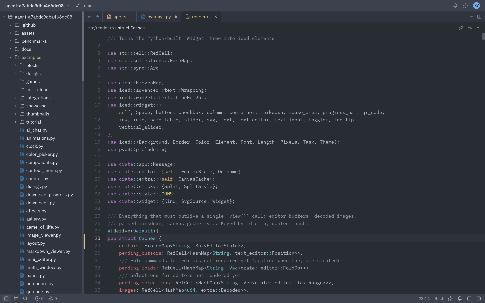
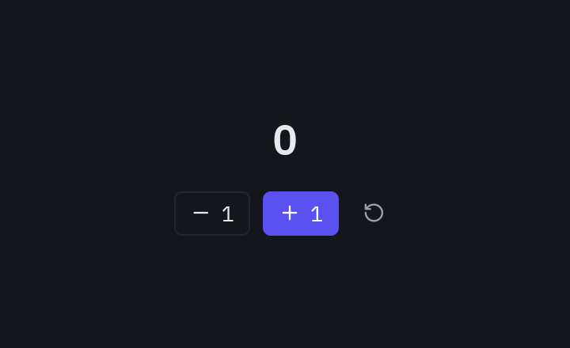
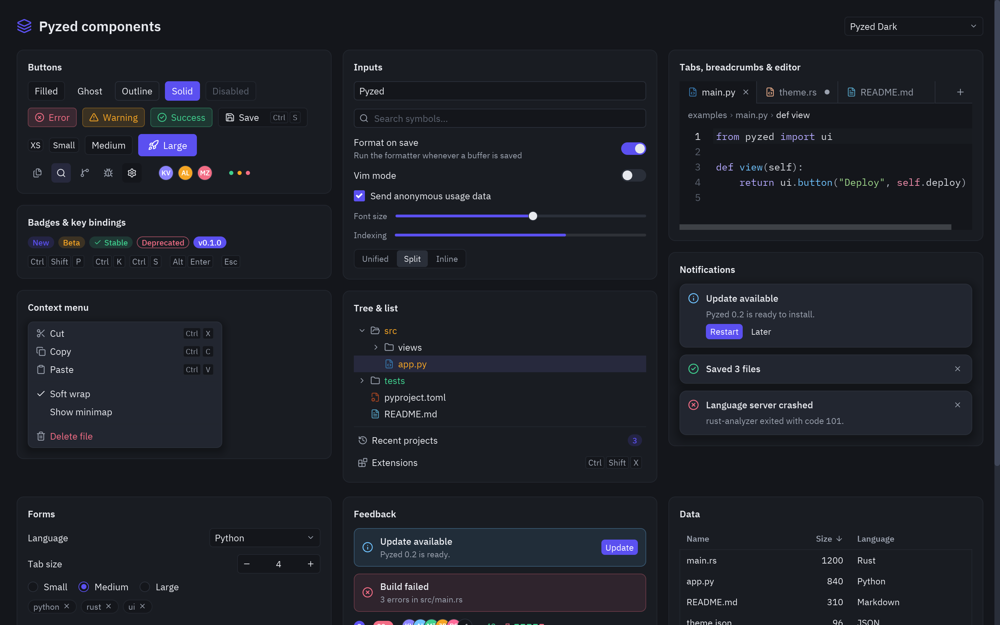
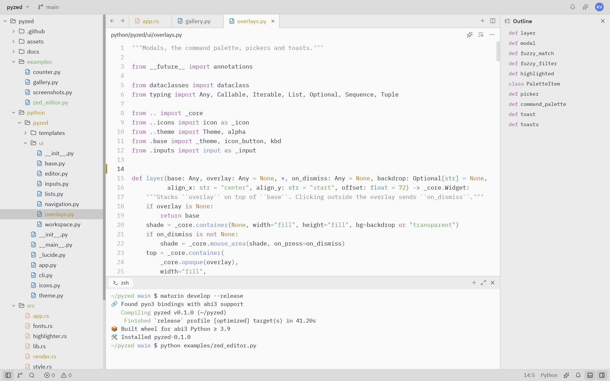
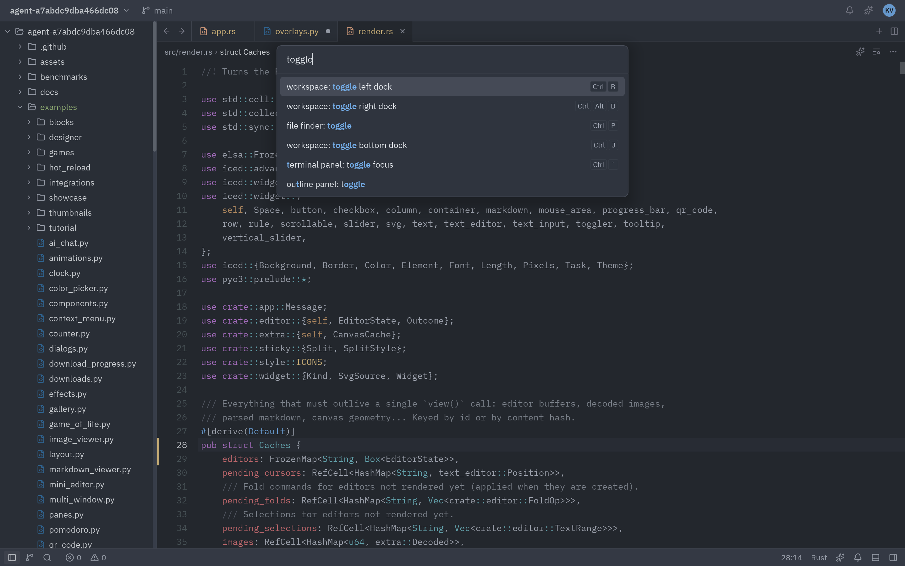
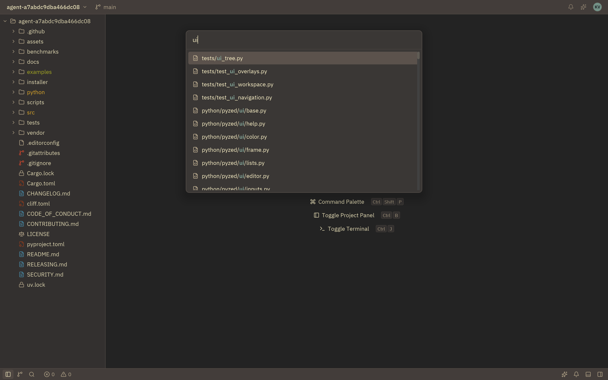
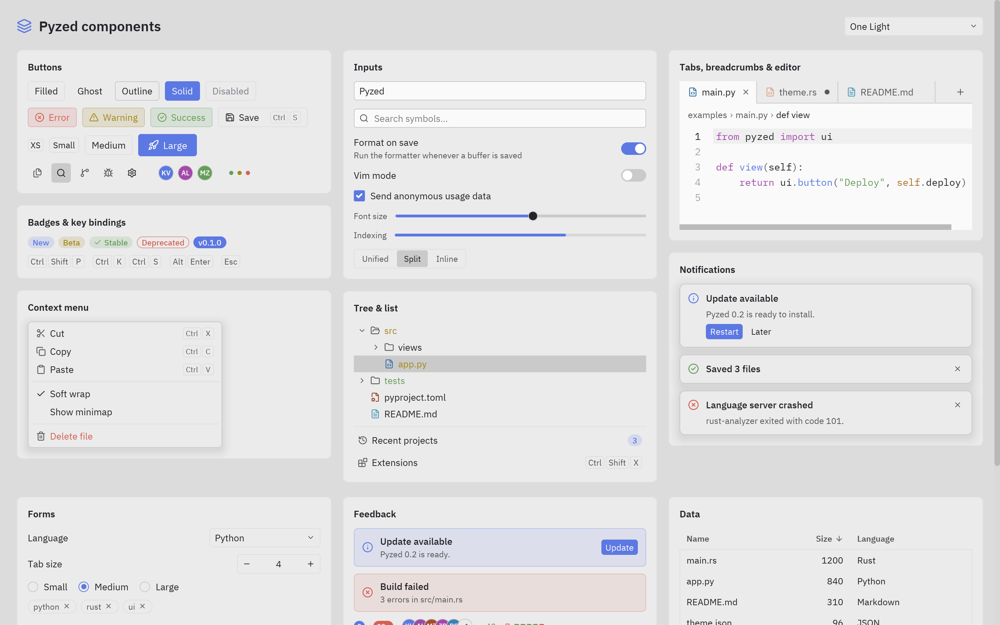

# Pyzed

**Interfaces modernas y rápidas en Python, renderizadas por [Iced](https://iced.rs) (Rust).**
Incluye componentes listos para usar inspirados en el editor [Zed](https://zed.dev).

📖 **Documentación:** [albakore.github.io/pyzed](https://albakore.github.io/pyzed/) · [Novedades](CHANGELOG.md)



> Esta captura es una app de Python ([`examples/zed_editor.py`](examples/zed_editor.py)):
> panel de proyecto, pestañas, editor con resaltado de sintaxis, marcadores de git,
> barra de estado, paleta de comandos y temas. Todo se dibuja con Iced.

## Por qué Pyzed

- **Rendimiento nativo.** Python solo describe la interfaz. El layout, el texto y el dibujado
  (wgpu, con tiny-skia como respaldo por software) los hace Iced 0.14 en Rust, mediante PyO3.
- **Sencillo.** Sigue la arquitectura Elm de Iced (estado, `update` y `view`). Un botón puede
  llamar directamente a un método: `on_press=self.guardar`.
- **Componentes listos.** Unos 40 componentes al estilo Zed (botones, pestañas, árbol de archivos,
  paleta de comandos, editor de código, terminal, menús, notificaciones…), todos personalizables.
- **Temas.** Incluye One Dark, One Light y Gruvbox Dark con los tokens de color de Zed.
  Puedes derivar los tuyos con una línea.
- **Multiplataforma.** Linux, macOS y Windows. Las fuentes (IBM Plex) y los iconos
  (Lucide, ~2000) van incluidos.
- **Capturas sin ventana.** `app.screenshot("ui.png")` renderiza fuera de pantalla, sin GPU ni
  display. Sirve para tests y documentación (así se generaron todas estas imágenes).

## Instalación

Por ahora se instala desde el código fuente. Necesitas Rust estable y Python 3.9 o superior.

```bash
pip install git+https://github.com/albakore/pyzed
```

Para desarrollar:

```bash
git clone https://github.com/albakore/pyzed && cd pyzed
python -m venv .venv && source .venv/bin/activate
pip install maturin
maturin develop --release   # usa --release: la build debug es mucho más lenta
```

## Inicio rápido

```python
import pyzed as pz
from pyzed import ui


class Counter(pz.App):
    title = "Counter"
    size = (360, 220)

    def __init__(self):
        self.count = 0

    def update(self, message):          # los mensajes pueden ser cualquier valor de Python
        if message == "increment":
            self.count += 1
        elif message == "decrement":
            self.count -= 1

    def view(self):
        return pz.center(
            pz.column([
                ui.heading(str(self.count)),
                pz.row([
                    ui.button("-1", "decrement", icon="minus"),
                    ui.button("+1", "increment", icon="plus", variant="solid"),
                    # ...o un callable, que se llama directamente
                    ui.icon_button("rotate-ccw", lambda: setattr(self, "count", 0), tooltip="Reset"),
                ], spacing=8),
            ], spacing=16, align="center"),
            bg=self.theme.editor,
        )


pz.run(Counter)
```



### Crear un proyecto nuevo

```bash
pyzed new mi-app      # crea mi-app/main.py con barra de título, sidebar, estado y paleta de comandos
cd mi-app && python main.py
pyzed icons folder    # busca nombres de iconos
```

## Conceptos

| Concepto | Cómo funciona |
| --- | --- |
| `App` | Tu estado vive en el objeto. `view()` devuelve widgets y `update(msg)` cambia el estado. |
| Mensajes | `on_press=valor` envía `valor` a `update`. Si es un callable (lambda, método), se llama directamente. Lo que devuelva, si no es `None`, se envía a `update`. |
| Callbacks con datos | `on_input`, `on_toggle`, `on_change`… reciben el valor nuevo: `on_input=lambda t: setattr(self, "query", t)`. |
| `Command` | Efectos que devuelve `update` o un callback: `Command.focus("id")`, `Command.exit()`, `Command.set_editor_text(id, txt)`, `Command.set_editor_cursor(id, línea, col)`, `Command.scroll_to_end(id)`, `Command.batch([...])` y `Command.perform(fn, then)`, que ejecuta `fn` en un hilo y entrega el resultado a `then`. |
| Atajos | `on_key(self, combo)` recibe cada tecla al estilo Zed: `"ctrl-shift-p"`, `"escape"`, `"up"`… |
| Hilos | `pz.post(mensaje)` envía un mensaje a la app desde cualquier hilo. |
| Inicio | `on_start()` se ejecuta una vez y puede devolver un `Command`. |
| Errores | Si `view()` lanza una excepción, la ventana muestra el traceback en vez de cerrarse. |

### Widgets base (`pyzed`)

`text`, `column`, `row`, `container`, `center`, `button`, `text_input`, `scrollable`, `space`,
`hspace`, `vspace`, `rule`, `mouse_area`, `stack`, `opaque`, `hover`, `tooltip`, `checkbox`,
`toggler`, `slider`, `progress_bar`, `code_editor`, `svg` e `icon`.

Los tamaños aceptan píxeles, `"fill"`, `"shrink"` o `"fill:2"` (proporción). El padding acepta
`8`, `(v, h)` o `(arriba, derecha, abajo, izquierda)`. Los colores aceptan `"#rrggbb[aa]"` o
tuplas `(r, g, b[, a])`.

## Componentes (`pyzed.ui`)



| Grupo | Componentes |
| --- | --- |
| Básicos | `label`, `muted`, `heading`, `button` (filled, ghost, outline, solid, error/warning/success; tamaños xs a lg; atajo opcional), `icon_button`, `badge`, `indicator`, `kbd`, `avatar`, `tooltip`, `divider`, `card` |
| Formularios | `input`, `search_input`, `switch`, `checkbox`, `slider`, `progress`, `segmented`, `field` |
| Listas | `list_item`, `list_header`, `tree` + `TreeNode.from_paths(...)` (panel de proyecto con estados de git), `menu` + `MenuItem` |
| Navegación | `tab_bar` + `Tab.for_file(...)` (sucia, vista previa, estado git, cierre al pasar el ratón), `breadcrumbs`, `toolbar` |
| Workspace | `workspace` (layout con docks izquierdo, derecho e inferior), `title_bar`, `title_button`, `status_bar`, `status_item`, `panel`, `panel_header` |
| Overlays | `layer` (capa con fondo y cierre al hacer clic fuera), `modal`, `picker`, `command_palette` + `PaletteItem`, `fuzzy_filter`, `toast`, `toasts` |
| Código | `editor` (resaltado de sintaxis, números de línea, marcadores de git, `on_change` y `on_cursor`), `terminal` (con colores ANSI), `ansi` |

Todos leen sus colores del tema actual y aceptan `theme=` u otros parámetros para cambiarlos.

## Temas

```python
class MiApp(pz.App):
    theme = pz.themes.ONE_LIGHT            # o ONE_DARK, GRUVBOX_DARK

oceano = pz.themes.ONE_DARK.derive(
    name="Océano",
    accent="#4fb3ff",
    syntax={"keyword": "#ff79c6"},
)
```

Cambiar `self.theme` en `update` cambia el estilo de toda la interfaz al momento.

| One Light + terminal + outline | Paleta de comandos |
| --- | --- |
|  |  |
| **Buscador de archivos (Gruvbox)** | **Componentes (One Light)** |
|  |  |

## Ejemplos

| Archivo | Qué muestra |
| --- | --- |
| [`examples/counter.py`](examples/counter.py) | Lo mínimo: estado, mensajes y callables. |
| [`examples/todo.py`](examples/todo.py) | Lista de tareas: formularios, listas, filtros, foco y atajos. |
| [`examples/downloads.py`](examples/downloads.py) | Trabajo en segundo plano con `Command.perform` y `pz.post`, progreso y notificaciones. |
| [`examples/mini_editor.py`](examples/mini_editor.py) | Un editor tipo Zed en ~150 líneas (árbol, pestañas, editor, paleta). |
| [`examples/gallery.py`](examples/gallery.py) | Todos los componentes, interactivos, con selector de tema. |
| [`examples/zed_editor.py`](examples/zed_editor.py) | Un editor tipo Zed sobre una carpeta real: abrir, editar y guardar (`ctrl-s`), paleta (`ctrl-shift-p`), buscador (`ctrl-p`), docks (`ctrl-b`, `ctrl-j`, `ctrl-alt-b`) y temas. El panel de terminal muestra una salida de ejemplo; no ejecuta una shell. |
| [`examples/screenshots.py`](examples/screenshots.py) | Regenera las imágenes de `docs/screenshots`. |

## Cómo funciona

```
Python                         Rust (pyzed._core, PyO3)                 Iced 0.14
App.view() ──► árbol de Widget ──► render.rs: Widget → iced::Element ──► layout + wgpu/tiny-skia
App.update() ◄── mensajes ◄────── app.rs: Message, Command → Task ◄──── eventos (ratón, teclado)
```

- Los nodos `Widget` son objetos inmutables de Rust, así que construir la vista desde Python es barato.
- El estado interno de cada editor (texto, cursor, deshacer) vive en Rust y se identifica por `id`.
- El resaltado usa syntect (gramáticas de `two-face`) con los colores del tema de Pyzed.
- El GIL se libera mientras corre el bucle de eventos, así que otros hilos de Python siguen funcionando.

## Estado y limitaciones

Es la versión 0.1, una base sólida, pero todavía faltan cosas:

- Aún no hay wheels en PyPI; la CI ya los genera para Linux, macOS y Windows.
- No hay widget de imágenes de mapa de bits todavía (sí `svg`).
- El editor no tiene scroll horizontal y los números de línea asumen que no hay ajuste de línea (`wrap=False`).
- Una sola ventana por app.

## Licencia

MIT. Las fuentes incluidas son IBM Plex (SIL Open Font License) y Lucide (ISC); sus
licencias están en [`assets/fonts`](assets/fonts).
