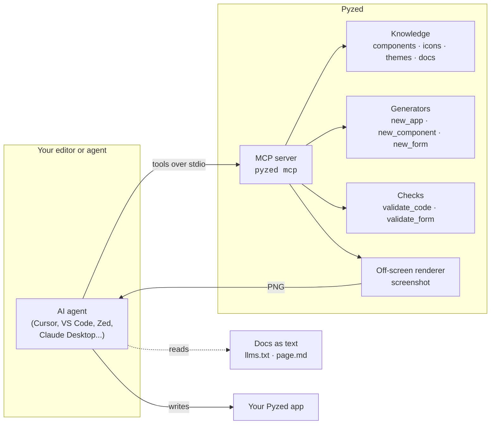

Pyzed is built to be written **with** AI agents, and to put AI **inside** your apps. An agent connected to Pyzed
does not guess an API from memory: it looks up the exact signature of every component, follows Pyzed's rules,
checks the code it writes and renders a screenshot of the window to see the result, all without opening a window.

## Three ways to work with AI

| | What it is | Start here |
| --- | --- | --- |
| **Agents that write Pyzed** | Connect any agent that speaks [MCP](https://modelcontextprotocol.io) and it gets Pyzed's components, docs, generators, checks and screenshots. Agents without MCP can read the docs as plain text. | [MCP server](/pyzed/ai/mcp/), [llms.txt and editor rules](/pyzed/ai/llms-txt/) |
| **The agent in Pyzed Design** | The visual designer has an agent panel that places controls, wires events, writes handlers and creates forms and components, with every change undoable. | [Agent composer](/pyzed/ai/agent-composer/) |
| **AI inside your app** | `pyzed.agents` talks to many model providers with tools and streaming, and Pyzed's async model streams answers into the UI without freezing it. | [Building AI apps](/pyzed/ai/ai-apps/) |

## Why agents write good Pyzed code

- **One way to build a UI.** State on the app, `view()` returns widgets, events call methods. There is no
  widget tree to mutate, no layout manager to pick and no `mainloop` threading rules to remember, so there are
  fewer ways for generated code to go wrong.
- **Everything is looked up, not guessed.** `describe_component("ui.table")` returns the real signature and
  parameter docs of the installed version, and `validate_code` rejects parameters that don't exist
  (`heigth=8`), side effects in `view()` and lambdas in loops before the code ever runs.
- **The agent can see.** The `screenshot` tool renders the app off-screen (no display, no GPU) and returns a PNG,
  so the agent can check the layout and fix it, like a person would.
- **Docs made for machines too.** Every page of this site exists as Markdown (`/pyzed/<page>.md`), the whole site
  as [`llms.txt`](/pyzed/llms.txt) and [`llms-full.txt`](/pyzed/llms-full.txt), and the package ships typed stubs
  (`.pyi`) that editors and agents read.
- **Blocks to start from.** The [Blocks](/pyzed/blocks/) are complete, tested screens an agent can read with
  `read_example("blocks/dashboard")` and adapt, instead of starting from a blank file.

## What an agent can do with Pyzed

| Ask | What happens |
| --- | --- |
| *"Build a Pomodoro timer with a progress bar"* | Reads the best practices, looks up `ui.progress`, writes the app, validates it and looks at a screenshot. See the [worked example](/pyzed/ai/prompting/#a-worked-example). |
| *"Make a reusable rating component"* | Generates a `pz.Component` with props, state and events that also shows up in Pyzed Design's toolbox. |
| *"Create a customer form with validation"* | Generates a `.pzform` and its handlers module, checks both with `validate_form`. |
| *"Start from the kanban block and load the cards from SQLite"* | Reads the block, keeps the UI and swaps the sample data for a query. |
| *"Why is my list not scrolling?"* | Reads the layout guide and the component docs, then fixes the code. |
| *"Add a chat with a local model"* | Uses `pyzed.agents` or an OpenAI-compatible HTTP call, streaming into the UI. |

## Quick start

1. Install Pyzed with the MCP extra: `pip install "pyzed-ui[mcp]"` (or let the agent run it with `uvx`).
2. Add the server to your agent, for example in `.cursor/mcp.json` or `.vscode/mcp.json`, as shown in
   [MCP server](/pyzed/ai/mcp/#connect-your-agent).
3. Drop the [`AGENTS.md` template](/pyzed/ai/llms-txt/#agentsmd-for-a-pyzed-project) in your project, then ask
   for what you want. The [prompting guide](/pyzed/ai/prompting/) has prompts that work well.
