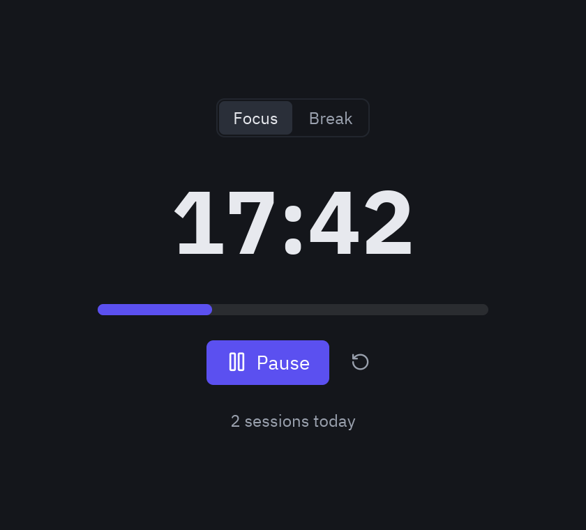

Agents write much better Pyzed code when the prompt gives them three things: **what the screen is for**, **what it
must do**, and **how to check the result**. This page has prompt patterns that work and a full session, with the
real outputs of the [MCP tools](/pyzed/ai/mcp/), of an agent building a small app.

## Anatomy of a good prompt

> Build a **Pomodoro timer** as a Pyzed app. *(what)*
> It has Focus (25 min) and Break (5 min) modes, a big countdown, a progress bar, Start/Pause and Reset, and counts
> finished sessions. *(behavior)*
> Use `pyzed.ui` components and theme tokens, keep `view()` free of side effects. *(constraints)*
> Use the pyzed MCP tools: check signatures with `describe_component`, run `validate_code`, and look at a
> `screenshot` before you answer. *(how to check)*

| Include | Why |
| --- | --- |
| The purpose and the user | *"A settings screen for a note-taking app"* gets better defaults than *"a form"*. |
| Behavior as a list | Each item becomes state and a method; nothing is forgotten. |
| Constraints | Theme, window size, components to use or avoid, Python version. |
| A starting point | *"Start from the settings block"* or *"follow examples/todo.py"*. |
| The check | Validation and a screenshot close the loop. Without them the agent stops at "it should work". |

## Prompts that work

**New app**
> Create a Pyzed app to browse a folder of Markdown notes: a searchable list on the left, the rendered note on the
> right, Ctrl+N for a new note. Read the best practices with get_guide first. Validate and screenshot it.

**From a block**
> Start from the dashboard block (`read_example("blocks/dashboard")`). Replace the sample data with numbers read
> from `sales.csv` with the csv module, loaded in a coroutine so the window never blocks.

**Component**
> Make a reusable `pz.Component` called TagInput: a text input that turns comma-separated words into removable
> chips. Props: `tags: list[str]`; event `change` with the new list. Show it in a `preview()` screenshot.

**Designer form**
> Create a designer form "invoice" with customer, date, a table of lines and a total; the total updates when a
> line changes. Use new_form and validate_form.

**Fixing**
> This list doesn't scroll and the window freezes while it loads. Read guides/layout and guides/async with
> read_docs, explain the cause, then fix it.

**Styling**
> Make this screen feel like a game launcher: dark theme with a purple accent, a glass panel over a gradient,
> a glowing Play button. Check the effects in animation/effects.

## Things to avoid

- **"Use tkinter-style code"** or pasting code from another toolkit: Pyzed has no `pack()`, `grid()` or widget
  objects to mutate. Describe the behavior instead and let the agent write it the Pyzed way.
- **Asking for everything at once** in a large app. Build the screen, check it, then add features: each step is
  validated and looked at.
- **Skipping the check.** An agent that never runs `validate_code` will sometimes invent a parameter; one call
  catches it.

## A worked example

What follows is a real session with the Pyzed MCP server (`python -m pyzed.mcp`), driven by an MCP client. The
outputs are exactly what the tools returned, shortened where marked.

**The prompt:** *Build a Pomodoro timer with Focus and Break modes, a progress bar, Start/Pause and Reset. Use the
pyzed MCP tools to check what you use, validate the code and look at a screenshot.*

### 1. Look up the components

The agent needs a progress bar, so it searches for one:

```text
list_components(query="progress")
```

```json
[
  {"name": "pz.progress_bar", "kind": "widget", "category": "Controls", "summary": "A progress bar."},
  {"name": "ui.progress", "kind": "ui", "category": "Inputs",
   "summary": "A thin rounded progress bar filled to ``value`` out of ``max``, in the ``tint`` color."},
  {"name": "designer:progress", "kind": "designer", "category": "Display", "summary": "Shows how far a task has got."}
]
```

It prefers the `ui` component and asks for its exact signature:

```text
describe_component(name="ui.progress")
```

```json
{
  "name": "ui.progress",
  "signature": "ui.progress(value: 'float', *, max: 'float' = 1.0, tint: 'str' = 'accent', height: 'float' = 4, width: 'Any' = 'fill', theme: 'Optional[Theme]' = None) -> '_core.Widget'",
  "parameters": [
    {"name": "value", "required": true, "description": "Current value."},
    {"name": "max", "default": "1.0", "description": "Maximum value."},
    {"name": "height", "default": "4", "description": "Thickness."},
    "…"
  ],
  "docs": "https://albakore.github.io/pyzed/reference/ui/"
}
```

And an icon name, since icons are Lucide names:

```text
search_icons(query="timer", limit=8)
```

```json
{"total": 3, "icons": ["timer", "timer-off", "timer-reset"]}
```

### 2. A first draft, and what the validator says

The first draft has three mistakes typical of generated code: a mutable class attribute, a state change inside
`view()` and a misspelled keyword argument.

```python
import pyzed as pz
from pyzed import ui


class Pomodoro(pz.App):
    title = "Pomodoro"
    size = (420, 360)
    tasks = []

    def __init__(self):
        self.left = 25 * 60
        self.running = False

    def subscriptions(self):
        return [pz.every(1, self.tick)] if self.running else []

    def tick(self):
        self.left -= 1

    def view(self):
        self.running = self.left > 0
        return pz.column([
            ui.heading(f"{self.left // 60:02d}:{self.left % 60:02d}"),
            ui.progress(1 - self.left / 1500, heigth=8),
            ui.button("Start", lambda: setattr(self, "running", True), icon="play"),
        ], spacing=16, padding=24)


pz.run(Pomodoro)
```

```text
validate_code(code=…)
```

```json
{
  "ok": false,
  "issues": [
    {"line": 8, "column": 5, "severity": "warning",
     "message": "mutable class attribute tasks on an App is shared state; initialize it in __init__"},
    {"line": 21, "column": 9, "severity": "warning",
     "message": "view() changes self.running; view() runs after every message and must not change state"},
    {"line": 24, "column": 47, "severity": "error",
     "message": "ui.progress() has no parameter 'heigth'; it takes: height, max, theme, tint, value, width"}
  ]
}
```

### 3. The fixed app

The agent fixes the three issues, adds the modes and the session counter, and validates again:

```json
{"ok": true, "issues": []}
```

```python title="examples/pomodoro.py"
"""A Pomodoro timer: the app built step by step in the AI prompting guide."""

import pyzed as pz
from pyzed import ui

WORK, BREAK = 25 * 60, 5 * 60


class Pomodoro(pz.App):
    title = "Pomodoro"
    size = (420, 380)

    def __init__(self):
        self.mode = "Focus"
        self.left = WORK
        self.running = False
        self.done = 0

    def subscriptions(self):
        return [pz.every(1, self.tick, key="timer")] if self.running else []

    def tick(self):
        self.left -= 1
        if self.left <= 0:
            if self.mode == "Focus":
                self.done += 1
            self.mode = "Break" if self.mode == "Focus" else "Focus"
            self.left = BREAK if self.mode == "Break" else WORK

    def switch(self, mode):
        self.mode, self.running = mode, False
        self.left = WORK if mode == "Focus" else BREAK

    def toggle(self):
        self.running = not self.running

    def reset(self):
        self.running, self.left = False, WORK if self.mode == "Focus" else BREAK

    def view(self):
        total = WORK if self.mode == "Focus" else BREAK
        return pz.center(pz.column([
            ui.segmented(["Focus", "Break"], self.mode, self.switch),
            pz.text(f"{self.left // 60:02d}:{self.left % 60:02d}", size=64, weight="bold"),
            ui.progress(1 - self.left / total, height=8, width=280),
            pz.row([
                ui.button("Pause" if self.running else "Start", self.toggle,
                          icon="pause" if self.running else "play", variant="solid", size="lg"),
                ui.icon_button("rotate-ccw", self.reset, tooltip="Reset"),
            ], spacing=8, align="center"),
            ui.muted(f"{self.done} sessions today", size="sm"),
        ], spacing=18, align="center")).style(background="editor")


if __name__ == "__main__":
    pz.run(Pomodoro)
```

### 4. Looking at the result

```text
screenshot(code=…, width=420, height=380, scale=2)
```

The tool rendered the app off-screen and returned this PNG, which the agent checks before answering:



The whole loop (look up, write, validate, look) took five tool calls. The app is in the repository as
[`examples/pomodoro.py`](https://github.com/albakore/pyzed/blob/main/examples/pomodoro.py) and runs with
`python examples/pomodoro.py`.

## Reproduce the session

The session above can be run with the MCP Python SDK, which is useful to test your own prompts or tools:

```python
import asyncio, sys
from mcp import ClientSession, StdioServerParameters
from mcp.client.stdio import stdio_client


async def main():
    server = StdioServerParameters(command=sys.executable, args=["-m", "pyzed.mcp"])
    async with stdio_client(server) as (read, write), ClientSession(read, write) as session:
        await session.initialize()
        result = await session.call_tool("describe_component", {"name": "ui.progress"})
        print(result.content[0].text)


asyncio.run(main())
```
