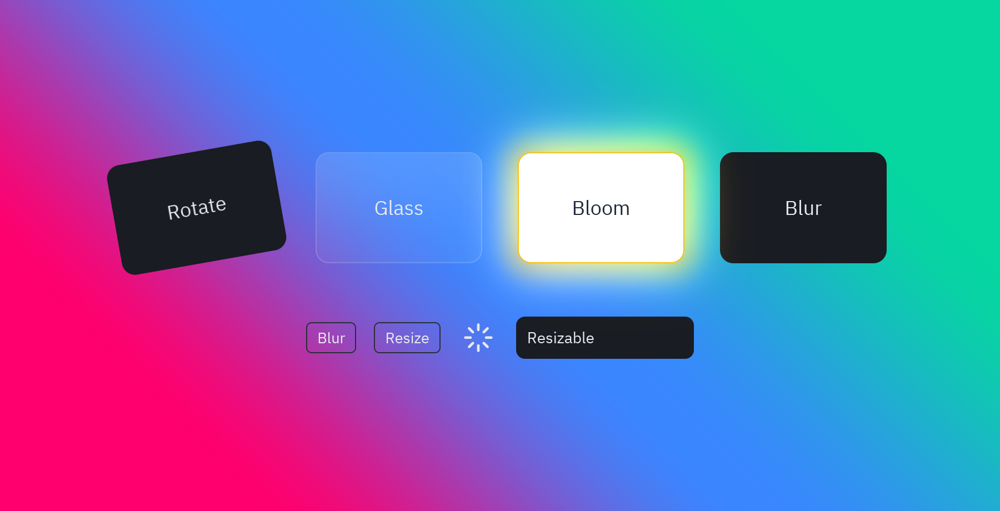

Effects are [style](/pyzed/theming/styles/) properties, so they work with `style()`, `pz.Style`
and named styles. Several of them are also [animatable properties](/pyzed/animation/properties/),
so an animation can change them over time.


| Property | What it does | Animatable |
| --- | --- | --- |
| `opacity` | 0 to 1. Fades the widget and everything inside it. | Yes |
| `rotate` | Degrees clockwise (or `"0.25turn"`, `"1rad"`): draws the widget turned around its center. | Yes |
| `blur` | Pixels: blurs the widget and everything inside it. | Yes |
| `backdrop_blur` | Pixels: blurs what is behind the box, inside its rounded corners. | No |
| `glow` | A soft halo around the box: a color, a size (accent color) or `(color, size)`. | Yes (`glow` and `glow_color`) |
| `bloom` | Light that spills from the bright parts of the widget: a color or `(color, intensity)` with an intensity from 0 to 1. | No |
| `glass` | A translucent panel that blurs what is behind it, with a light edge: `True`, a tint color or `{"tint": ..., "strength": 0.08, "blur": 20}`. | No (move it with `x`, `y`) |
| `translate` | `(x, y)` in pixels or `"50%"`: draws the widget moved, without changing the layout. | Yes (as `x`, `y`) |
| `scale` | Draws the widget bigger or smaller around its center. | Yes |

```python
pz.container(card).style(glass=True, radius=12, padding=16)
ui.button("Go", self.go).style(glow=("#22d3ee", 18))
badge.style(bloom=("accent", 0.8), opacity=0.9)
sticker.style(rotate=-8)
```



## How they're drawn

Rotation, blur, backdrop blur and bloom are drawn by the renderer: the widget is drawn on its own
layer, which is then turned, blurred or lit before it lands on the window.

- On a box (a widget with a background or glass), bloom also adds a soft halo and a lit edge; on a
  bare text or icon it only glows.
- Glass adds a tinted gradient, a border and a shadow; any of those you set yourself win. It shows
  best over a colorful background (a gradient or an image).
- The `glow`, `bloom`, `glow_pulse` and `glow_flash` presets animate `glow` and `glow_color`.

:::caution[Effects and input]
A rotated or blurred widget takes clicks where its box is laid out, not where it is drawn. A widget
with rotation, blur, backdrop blur or bloom is drawn above its siblings, so its bloom can light the
widgets next to it.
:::
