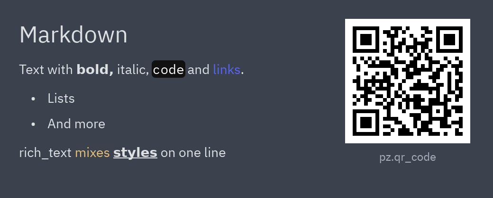
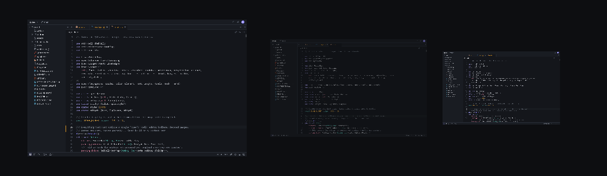
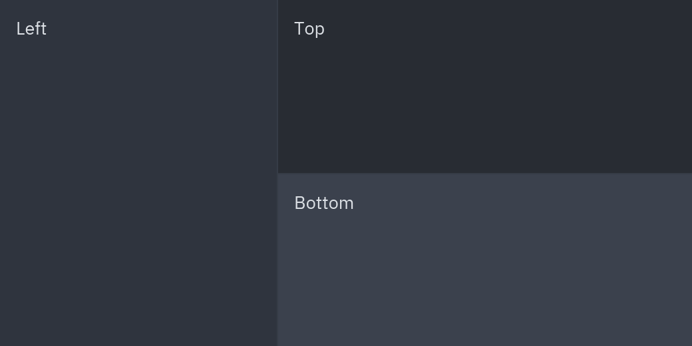
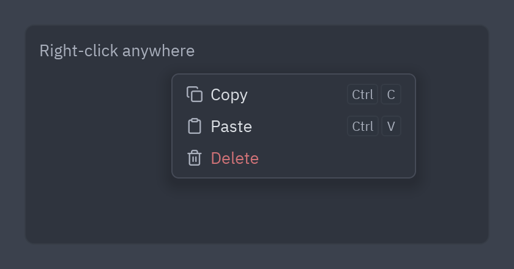

:::tip[Component library]
Every component now has its own page, with a live preview, examples and its full API, in the
[component library](/pyzed/library/). This page is kept as a summary.
:::

## Markdown, rich text and QR



```python
pz.markdown("## Markdown\n\nText with **bold**, `code` and [links](https://iced.rs).",
            on_link=webbrowser.open)   # import webbrowser

pz.rich_text([
    pz.span("rich_text "),
    pz.span("mixes ", color="#e5c07b"),
    pz.span("styles", weight="bold", underline=True),
    pz.span(" in one line", italic=True),
])

pz.qr_code("https://albakore.github.io/pyzed/", cell_size=4)
```

- `pz.markdown(source)` renders Markdown with the theme colors. `ui.markdown` is the same
  idea with the components' sizes and colors. `on_link(url)` receives clicked links.
- `pz.rich_text(spans)` combines `pz.span(text, color=, size=, font=, weight=, italic=,
  bg=, underline=, strikethrough=, link=)` fragments into a single block of text.
- `pz.qr_code(data)` draws a QR code; `color` and `bg` change its colors.

Full example: [`markdown_viewer.py`](https://github.com/albakore/pyzed/blob/main/examples/markdown_viewer.py).

## Images



```python
pz.image("screenshot.png", width=240, height=140, content_fit="contain")
pz.image("screenshot.png", width=160, height=140, opacity=0.5)
pz.image("pixel-art.png", width=120, height=140, filter="nearest")
pz.image_viewer("map.png", width="fill", height="fill")   # wheel to zoom, drag to pan
```

`source` can be a path, `bytes` with the file (PNG, JPEG, GIF, WebP, BMP…) or RGBA pixels
with `size=(width, height)`. Options: `content_fit` (`"contain"`, `"cover"`, `"fill"`, `"none"`,
`"scale_down"`), `filter` (`"linear"` or `"nearest"`), `opacity`, `radius`, `rotation` and `scale`.
For vector icons use `pz.svg`.

Full example: [`image_viewer.py`](https://github.com/albakore/pyzed/blob/main/examples/image_viewer.py).

## Resizable panels



```python
ui.split(
    sidebar,
    ui.split(editor, terminal, vertical=True, ratio=self.height, on_resize=self.set_height),
    ratio=self.width, on_resize=self.set_width,
)
```

`ui.split(first, second)` separates two widgets with a draggable divider. The ratio is yours:
store it in `on_resize(ratio)`. `vertical=True` stacks them. `pz.split` is the base version, with
configurable `color`, `hover_color`, `thickness` and `handle`.

## Grids

```python
pz.grid([card(p) for p in projects], columns=3, spacing=12)
pz.grid(thumbnails, max_width=180, spacing=8, aspect_ratio=1)   # columns based on width
```

`columns` sets the number of columns; `max_width` computes them from the available space.

## Popover



```python
def view(self):
    base = pz.mouse_area(content, on_move=self.track_pointer, on_right_press=self.open_menu)
    menu = ui.menu([ui.MenuItem("Copy", self.copy), ui.MenuItem("Paste", self.paste)]) if self.menu else None
    return ui.popover(base, menu, x=self.x, y=self.y, on_dismiss=self.close_menu)
```

`ui.popover(base, content, x=, y=)` shows `content` on top of `base` at that position; clicking
outside calls `on_dismiss`. With `content=None` only `base` is shown.

Full example: [`context_menu.py`](https://github.com/albakore/pyzed/blob/main/examples/context_menu.py).
Reference: [Base widgets](/pyzed/reference/widgets/) and [Overlays](/pyzed/reference/ui/#overlays).
