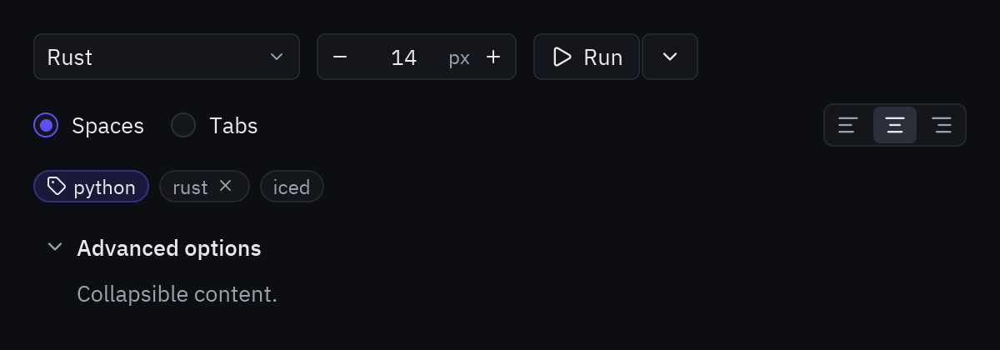

:::tip[Component library]
Every component now has its own page, with a live preview, examples and its full API, in the
[component library](/pyzed/library/). This page is kept as a summary.
:::



```python
class Settings(pz.App):
    def __init__(self):
        self.language = "Rust"
        self.font = 14
        self.indentation = "a"
        self.alignment = "c"
        self.advanced = True

    def view(self):
        return pz.column([
            pz.row([
                ui.select(["Python", "Rust", "TypeScript"], self.language,
                          lambda v: setattr(self, "language", v), width=160),
                ui.number_field(self.font, lambda v: setattr(self, "font", v), min=8, max=32, suffix="px"),
                ui.split_button("Run", self.run, self.open_menu, icon="play"),
            ], spacing=10, align="center"),
            ui.radio_group([("a", "Spaces"), ("b", "Tabs")], self.indentation,
                           lambda v: setattr(self, "indentation", v), horizontal=True),
            ui.toggle_group([("l", "align-left"), ("c", "align-center"), ("r", "align-right")],
                            self.alignment, lambda v: setattr(self, "alignment", v)),
            pz.row([ui.chip("python", icon="tag", selected=True),
                    ui.chip("rust", on_remove=self.remove_tag),
                    ui.chip("iced", on_press=self.filter)], spacing=6),
            ui.disclosure("Advanced options", ui.muted("Collapsible content."), open=self.advanced,
                          on_toggle=lambda: setattr(self, "advanced", not self.advanced)),
        ], spacing=14)
```

| Component | Purpose |
| --- | --- |
| `ui.select(options, selected, on_select)` | Zed-style dropdown (`DropdownMenu`). Calls `on_select` with the chosen option. |
| `ui.radio_group(options, selected, on_select)` | Mutually exclusive options. `options` are strings or `(value, label)` pairs. `horizontal=True` lays them out in a row. |
| `ui.number_field(value, on_change)` | Number with `−`/`+` buttons, `min`/`max` limits, `step` and `suffix`. |
| `ui.split_button(content, on_press, on_menu)` | Main action plus a chevron for more options (usually opens a [`ui.popover`](/pyzed/components/content/#popover)). |
| `ui.toggle_group(options, selected, on_select)` | Icon-only segmented group: `options` are `(value, icon)` pairs. |
| `ui.chip(content)` | Compact tag. `on_press` makes it clickable and `on_remove` adds an ✕. |
| `ui.disclosure(title, content, open=)` | Collapsible section. The open/closed state is yours: change it in `on_toggle`. |

For the basic controls (`input`, `switch`, `slider`…) see [Forms](/pyzed/components/forms/).
Full reference: [Controls](/pyzed/reference/ui/#controls).
