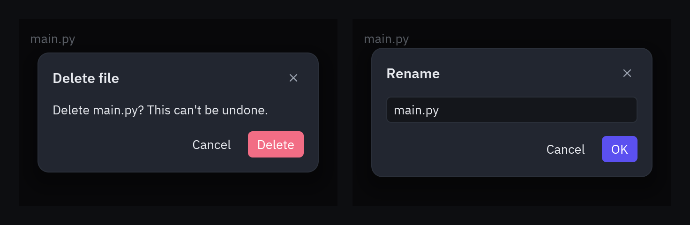
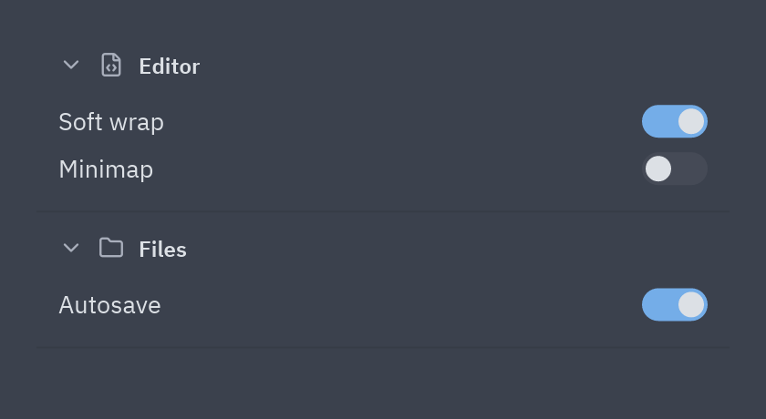
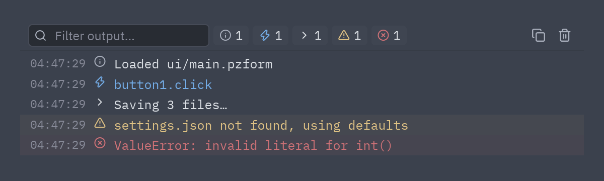
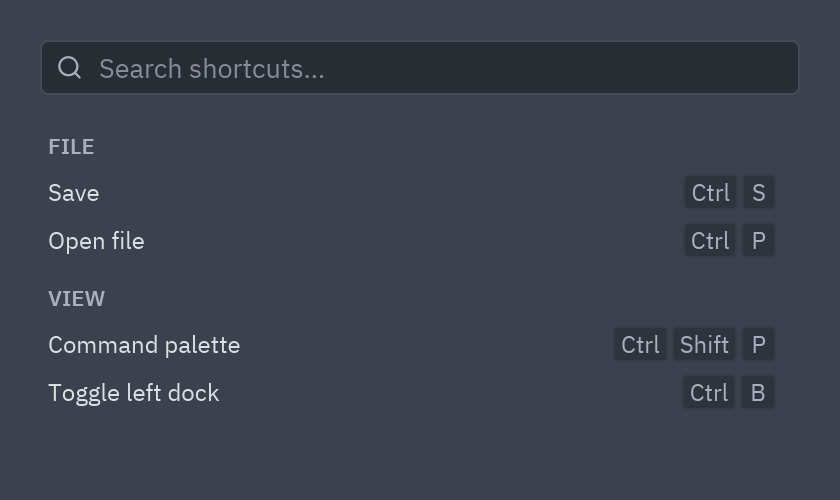
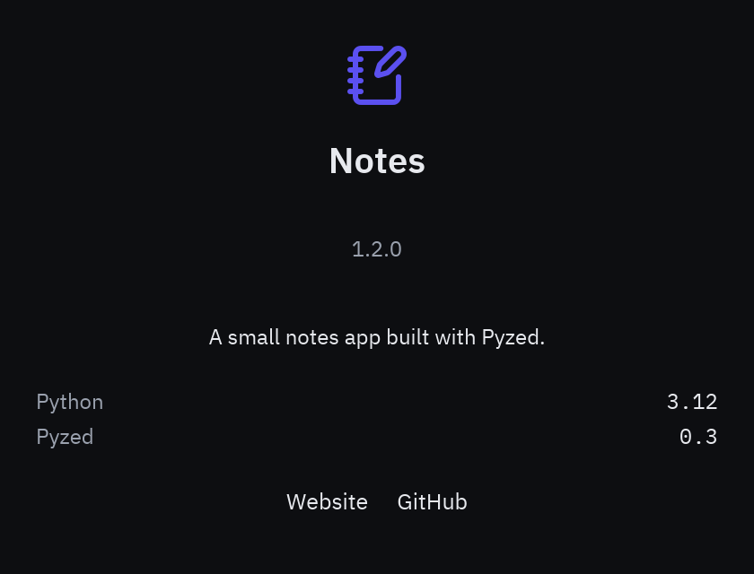
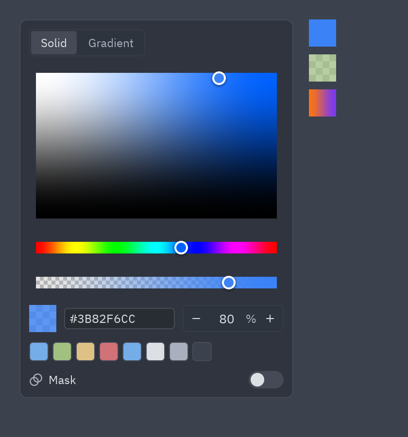

:::tip[Component library]
Every component now has its own page, with a live preview, examples and its full API, in the
[component library](/pyzed/library/). This page is kept as a summary.
:::

## Dialogs



Keep which dialog is open in your state and wrap the view with `ui.dialog_layer`, which dims the
window, centers the dialog and calls `on_dismiss` when the backdrop is clicked. With `dialog=None`
it returns the view unchanged, so it can always wrap it.

```python
class Files(pz.App):
    def __init__(self):
        self.asking = False
        self.renaming = None

    def view(self):
        dialog = None
        if self.asking:
            dialog = ui.confirm("Delete main.py? This can't be undone.", self.delete, self.close_dialog,
                                title="Delete file", danger=True)
        elif self.renaming is not None:
            dialog = ui.prompt("Rename", self.renaming, self.set_name, self.rename, self.close_dialog)
        return ui.dialog_layer(self.main_view(), dialog, on_dismiss=self.close_dialog)
```

| Dialog | What it does |
| --- | --- |
| `ui.alert(message, on_close, kind=)` | A message with one button; `kind` (`"info"`, `"success"`, `"warning"`, `"error"`) adds an icon. |
| `ui.confirm(message, on_confirm, on_cancel, danger=)` | A yes/no question; `danger=True` paints the confirm button red. |
| `ui.prompt(title, value, on_input, on_submit, on_cancel)` | Asks for a line of text; Enter or the button submits. |
| `ui.choice(message, [(label, on_press), ...], on_cancel)` | Your own buttons; the last one is the main one. |
| `ui.unsaved_changes(name, on_save, on_discard, on_cancel)` | "Save your changes before closing?" |

Button labels are translated with [`pyzed.i18n`](/pyzed/guides/i18n/). For anything else,
`ui.modal(content, title=, footer=[...])` is the same surface with your own content.

## Accordion



```python
ui.accordion(
    [("editor", "Editor", editor_settings), ("files", "Files", file_settings), ("git", "Git", git_settings)],
    open=self.open_sections,                       # a set of ids, a {id: bool} dict or True
    on_toggle=lambda key: self.open_sections.symmetric_difference_update({key}),
    icons={"editor": "file-code", "files": "folder", "git": "git-branch"},
)
```

Sections can also be `ui.AccordionSection(key, title, content, icon=, end=)`, where `end` adds
widgets to the right of the header. For a single collapsible block use
[`ui.disclosure`](/pyzed/components/controls/).

## Log console



`ui.Log` collects entries (thread-safe, capped, repeated lines folded) and `ui.console` shows them
like a browser's dev tools console: a filter box, one toggle per level with its count, copy and
clear.

```python
self.log = ui.Log(on_write=lambda: pz.post("log"))   # redraw when a line arrives
self.log.write("warning", "settings.json not found, using defaults")
self.log.capture()                                    # also collect print() and stderr

ui.console(self.log.entries, query=self.query, on_query=self.set_query,
           hidden=self.hidden, on_toggle_level=self.toggle_level,
           on_clear=self.log.clear, on_copy=lambda: pz.Command.copy(self.log.text()))
```

Levels are `info`, `event`, `stdout`, `stderr`, `warning` and `error` (`ui.LOG_LEVELS`).

## Shortcuts and About

| Keyboard shortcuts | About box |
| --- | --- |
|  |  |

```python
ui.shortcuts([("File", [("Save", "ctrl-s"), ("Open file", "ctrl-p")]),
              ("View", [("Command palette", "ctrl-shift-p")])],
             query=self.query, on_query=self.set_query)

ui.about("Notes", "1.2.0", "A small notes app built with Pyzed.", icon="notebook-pen",
         details=[("Python", "3.12")], links=[("Website", lambda: webbrowser.open(URL))])
```

Both fit well inside a `ui.modal`.

## Color picker



```python
ui.ColorPicker(value=self.fill, on_change=lambda e: setattr(self, "fill", e.value))
ui.color_swatch(self.fill, size=24, on_press=self.open_picker)
```

`ui.ColorPicker` is a component: it picks a color with alpha, a linear gradient or a fill with an
opacity mask, and `on_change` receives a `"#rrggbb[aa]"` string, a `pz.Gradient` or a `pz.Paint`,
all valid as a `background`. `ui.color_swatch` shows any of them over a checkerboard. See
[Styles](/pyzed/theming/styles/#color-picker).

Full reference: [Dialogs](/pyzed/reference/ui/#dialogs), [Console and help](/pyzed/reference/ui/#console-and-help)
and [Color picker](/pyzed/reference/ui/#color-picker).
