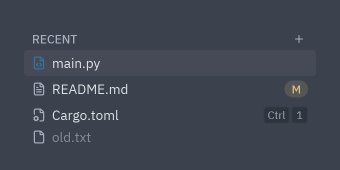
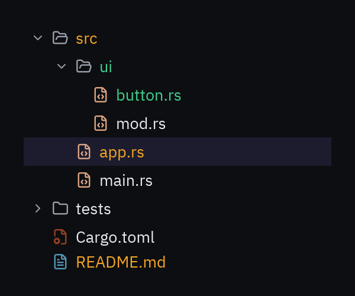
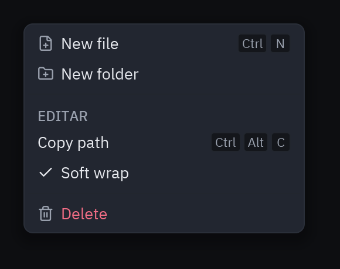

:::tip[Component library]
Every component now has its own page, with a live preview, examples and its full API, in the
[component library](/pyzed/library/). This page is kept as a summary.
:::

## List items



```python
pz.column([
    ui.list_header("RECENT", end=ui.icon_button("plus", self.new, size="xs")),
    ui.list_item("main.py", self.open, icon="file-code", icon_color="#3572a5", selected=True, inset=True),
    ui.list_item("README.md", self.open, icon="file-text", inset=True, end=ui.badge("M", tint="warning")),
    ui.list_item("Cargo.toml", self.open, icon="file-cog", inset=True, end=ui.kbd("ctrl-1", size="xs")),
    ui.list_item("old.txt", self.open, icon="file", inset=True, disabled=True),
], width=300)
```

`list_item` has `start` and `end` slots for any widget, `indent` for nesting,
`focused` for the focus border and `on_right_press` to open a context menu.

To pass the item to the callback, use a default argument in the lambda:

```python
[ui.list_item(f, lambda f=f: self.open(f), selected=f == self.current) for f in self.files]
```

## File tree

A project panel like the one in code editors: collapsible folders, per-file-type icons and git colors.



```python
class Explorer(pz.App):
    def __init__(self):
        self.nodes = ui.TreeNode.from_paths(
            ["src/main.rs", "src/app.rs", "src/ui/button.rs", "src/ui/mod.rs",
             "tests/app.rs", "Cargo.toml", "README.md"],
            status={"src/app.rs": "modified", "src/ui/button.rs": "created", "README.md": "modified"},
        )
        self.expanded = {"src", "src/ui"}
        self.selected = "src/app.rs"

    def toggle(self, folder):
        self.expanded ^= {folder}

    def select(self, path):
        self.selected = path

    def view(self):
        return ui.tree(self.nodes, expanded=self.expanded, selected=self.selected,
                       on_toggle=self.toggle, on_select=self.select)
```

- `TreeNode.from_paths(paths, status=...)` builds the tree, puts folders first and propagates
  git status to the folders that contain changes.
- Each node's id is its path (`"src/ui/button.rs"`).
- `status`: `"modified"`, `"created"`, `"deleted"`, `"conflict"` or `"ignored"`.
- You can build the nodes by hand: `TreeNode("src", children=[TreeNode("main.rs", id="src/main.rs")])`.

To read a real folder:

```python
from pathlib import Path

root = Path(".")
paths = [p.relative_to(root).as_posix() for p in root.rglob("*") if p.is_file() and ".git" not in p.parts]
nodes = ui.TreeNode.from_paths(paths)
```

## Context menu



```python
ui.menu([
    ui.MenuItem("New file", self.new, icon="file-plus", keys="ctrl-n"),
    ui.MenuItem("New folder", self.new_folder, icon="folder-plus"),
    ui.SEPARATOR,
    "EDIT",                                     # a plain string is a header
    ui.MenuItem("Copy path", self.copy, keys="ctrl-alt-c"),
    ui.MenuItem("Soft wrap", self.toggle_wrap, checked=self.wrap),
    ui.SEPARATOR,
    ui.MenuItem("Delete", self.delete, icon="trash-2", danger=True),
])
```

To show it floating, use it as the overlay of [`ui.layer`](/pyzed/components/overlays/#layers):

```python
layout = ui.layer(layout, self.menu_open and ui.menu(...) or None,
                  on_dismiss=self.close_menu, align_x="start", offset=120)
```

Full reference: [Lists, tree and menus](/pyzed/reference/ui/#lists-tree-and-menus).
