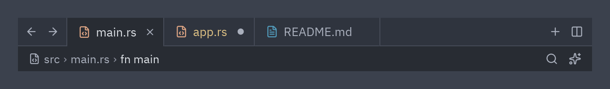

:::tip[Component library]
Every component now has its own page, with a live preview, examples and its full API, in the
[component library](/pyzed/library/). This page is kept as a summary.
:::



```python
pz.column([
    ui.tab_bar(
        [
            ui.Tab.for_file("src/main.rs"),
            ui.Tab.for_file("src/app.rs", dirty=True, status="modified"),
            ui.Tab.for_file("README.md", preview=True),
        ],
        active="src/main.rs",
        on_select=self.activate,
        on_close=self.close,
        start=[ui.icon_button("arrow-left", self.back, size="sm"),
               ui.icon_button("arrow-right", self.forward, size="sm")],
        end=[ui.icon_button("plus", self.new, size="sm"),
             ui.icon_button("columns-2", self.split, size="sm")],
    ),
    ui.toolbar(
        [ui.breadcrumbs([("file-code", "src"), "main.rs", "fn main"])],
        [ui.icon_button("search", self.search, size="sm")],
    ),
])
```

## Tabs

- `Tab(id, label, icon=None, icon_color=None, dirty=False, preview=False, status=None)`.
- `Tab.for_file(path)` uses the file name as label, the path as id and the icon for its type.
- `dirty=True` shows a dot; on hover it turns into the close button.
- `preview=True` draws the name in italics (preview tab).
- `status` tints the name with the git color.
- `on_select(id)` and `on_close(id)` receive the tab id.

A common pattern for managing tabs:

```python
def open(self, path):
    if path not in self.open_tabs:
        self.open_tabs.append(path)
    self.active = path

def close(self, path):
    i = self.open_tabs.index(path)
    self.open_tabs.remove(path)
    if self.active == path:
        self.active = self.open_tabs[min(i, len(self.open_tabs) - 1)] if self.open_tabs else None
```

## Breadcrumbs

```python
ui.breadcrumbs(["src", "ui", "button.rs"])
ui.breadcrumbs([("folder", "src"), ("file-code", "main.rs")], on_press=self.go_to_level)
```

Parts can be strings or `(icon, text)` tuples. `on_press` receives the index.

## Toolbar

`ui.toolbar(start, end)` is the bar below the tabs of a code editor: usually breadcrumbs on the left and
buffer actions on the right.

Full reference: [Navigation](/pyzed/reference/ui/#navigation).
