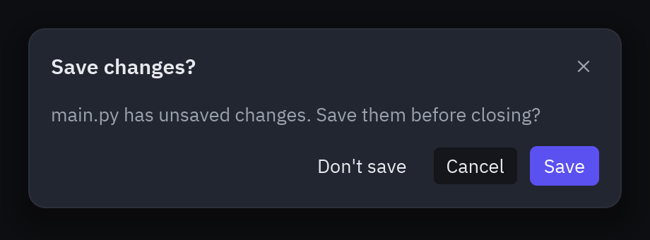
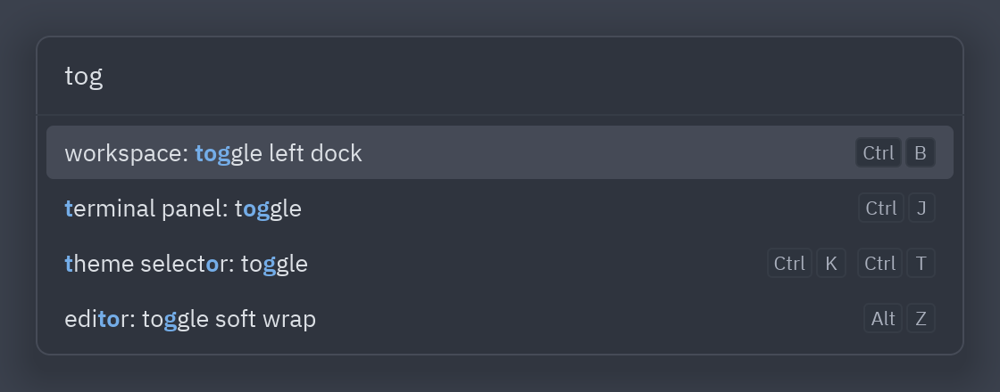
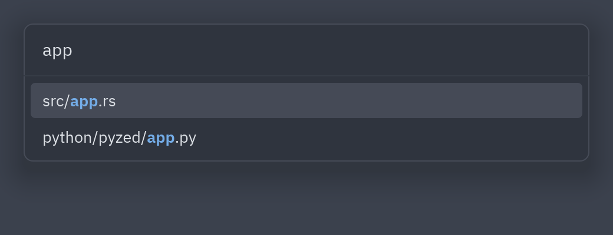
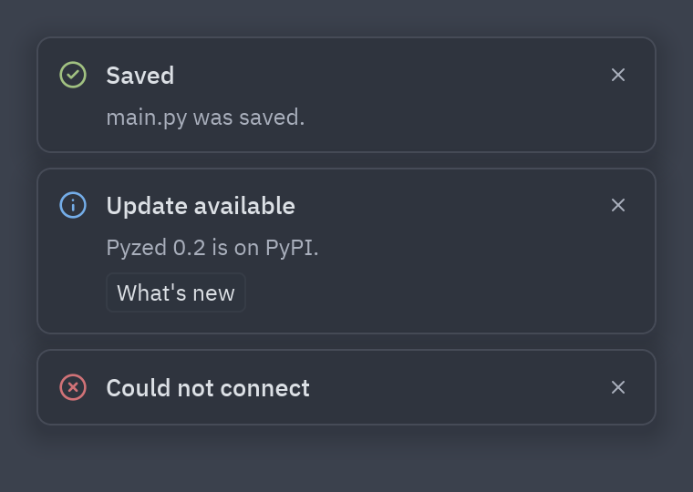

:::tip[Component library]
Every component now has its own page, with a live preview, examples and its full API, in the
[component library](/pyzed/library/). This page is kept as a summary.
:::

## Layers

`ui.layer(base, overlay, on_dismiss=...)` draws `overlay` on top of the UI. Clicking outside
sends `on_dismiss`. If `overlay` is `None`, it returns `base` unchanged, so you can write:

```python
def view(self):
    layout = ui.workspace(...)
    return ui.layer(layout, self.dialog(), on_dismiss=self.close, backdrop="#00000066")

def dialog(self):
    if not self.confirming:
        return None
    return ui.modal(...)
```

`align_x`, `align_y` and `offset` control where the overlay appears (by default, centered at the
top like Zed's palette).

## Modal



```python
ui.modal(
    ui.muted("main.py has unsaved changes. Do you want to save them before closing?"),
    title="Save changes?",
    on_close=self.close,
    footer=[
        ui.button("Don't save", self.discard, variant="ghost"),
        ui.button("Cancel", self.close),
        ui.button("Save", self.save, variant="solid"),
    ],
    width=420,
)
```

## Command palette



```python
class App(pz.App):
    def __init__(self):
        self.palette_open = False
        self.query = ""
        self.selected = 0

    def commands(self):
        return [
            ui.PaletteItem("editor: toggle soft wrap", self.toggle_wrap, keys="alt-z"),
            ui.PaletteItem("theme selector: toggle", self.toggle_theme, keys="ctrl-k ctrl-t"),
            ui.PaletteItem("workspace: toggle left dock", self.toggle_left, keys="ctrl-b"),
        ]

    def on_key(self, combo):
        if combo == "ctrl-shift-p":
            self.palette_open, self.query, self.selected = True, "", 0
            return Command.focus("command-palette")
        if self.palette_open and combo == "escape":
            self.palette_open = False
        elif self.palette_open and combo in ("up", "down"):
            self.selected += 1 if combo == "down" else -1

    def run_selected(self):
        matches = ui.fuzzy_filter(self.query, self.commands(), key=lambda c: c.label)
        if matches:
            self.palette_open = False
            command = matches[self.selected % len(matches)][0]
            return command.on_press()

    def view(self):
        layout = ...
        palette = None
        if self.palette_open:
            palette = ui.command_palette(self.query, lambda q: setattr(self, "query", q), self.commands(),
                                         selected=self.selected, on_submit=self.run_selected)
        return ui.layer(layout, palette, on_dismiss=lambda: setattr(self, "palette_open", False))
```

Enter (`on_submit`) runs the highlighted command; the arrow keys change `selected`.

## Picker and fuzzy search



`command_palette` is built on top of `picker` and `fuzzy_filter`. Use them for your own
finders (files, symbols, branches…):

```python
matches = ui.fuzzy_filter(self.query, self.files)               # [(file, positions), ...]
items = [(ui.PaletteItem(Path(f).name, lambda f=f: self.open(f), icon="file", detail=f), pos)
         for f, pos in matches[:50]]
ui.picker(self.query, self.set_query, items, selected=self.sel, placeholder="Search files…")
```

`fuzzy_match(query, text)` returns `(score, positions)` or `None`, and `highlighted()`
draws a text with the matches highlighted.

## Notifications



```python
ui.toast("Saved", "main.py was saved successfully.", kind="success", on_dismiss=self.dismiss_toast)
ui.toast("Update available", "Pyzed 0.2 is now on PyPI.", kind="info",
         actions=[ui.button("What's new", self.whats_new, size="sm")])
```

`ui.toasts(base, items)` stacks them in the bottom-right corner. To make them disappear on their
own, use a thread and [`pz.post`](/pyzed/guides/commands/#messages-from-other-threads):

```python
def notify(self, title):
    self.toasts.append(title)
    threading.Timer(3, pz.post, args=(("remove_toast", title),)).start()
```

Full reference: [Overlays](/pyzed/reference/ui/#overlays).
