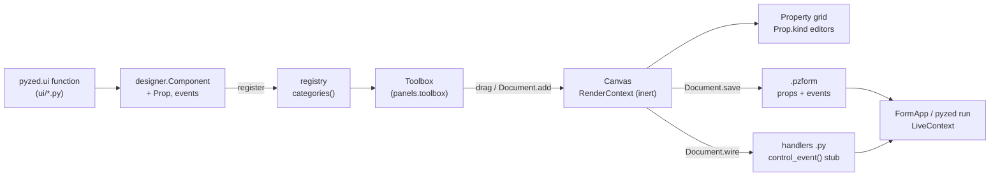

This guide walks through adding a new control to **Pyzed Design**, the visual editor in
`python/pyzed/designer/`, end to end. The running example is a **Rating** control: a row of stars that
raises a `change` event with the number of the clicked star.


## How a component travels

Everything the editor knows about a control comes from one `Component` record in
`python/pyzed/designer/components.py`. The same `render` function draws the control on the canvas (inert)
and in the running app (live), so what you design is exactly what runs.



| Stage | Code | What happens |
| --- | --- | --- |
| Widget | `python/pyzed/ui/` | A plain function returns a `Widget` built from `pyzed._core` (Rust). |
| Toolbox entry | `designer/components.py` | `Component(...)` describes the type, label, icon, category, size, props and events; `register()` adds it. |
| Toolbox | `designer/panels.py` | `toolbox()` lists `categories()` with each entry's `icon` and `label` (translated with `tr`) and its `description` as tooltip. |
| Canvas | `designer/surface.py` | Draws every control with `components.render(control, RenderContext(...))`; callbacks are inert. |
| Property grid | `designer/panels.py` | One editor per `Prop`, chosen by its `kind`, grouped by its `group`. |
| Saving | `designer/model.py` | `Control.to_dict()` writes `type`, geometry, `props` and `events` into the `.pzform` JSON. |
| Handlers | `designer/document.py`, `designer/code.py` | `Document.wire(name, event)` names the handler `<control>_<event>` and appends a stub to the `.py` file. |
| Running | `designer/runtime.py` | `LiveContext.on()` stores the new value in the prop and calls the wired handler with `(form, event)`. |

:::tip[Built in, or just for your app?]
This guide adds a **built-in** component to Pyzed itself. To use a control only in your own app you need
none of the repository changes: call `designer.register(...)` from your code (see the
[worked example](#worked-example-a-rating-control)), write a [`pz.Component`](/pyzed/guides/components/)
class (it joins the toolbox on its own), or draw one in the
[component designer](/pyzed/editor/component-designer/). The user-facing side is described in
[Files, templates and scripting](/pyzed/editor/files-and-scripting/#adding-your-own-components).
:::

## 1. The `pyzed.ui` component

Most designer controls wrap a function from `pyzed.ui`, so the control is also available to people who
write their UI in code. Put it in the module that fits (`inputs.py`, `controls.py`, `display.py`…) and follow
the conventions of the package:

- It is a **plain function** returning a `Widget`; the value comes first, then the callback, then
  keyword-only options.
- The last parameter is `theme: Optional[Theme] = None`, resolved with `t = _theme(theme)`; every color
  comes from the theme (`t.color("accent")`, `t.text_muted`, `t.ghost_hover`…), never a hard-coded hex.
- Callbacks receive the new value; with no callback the control is read only.
- A one-line docstring that says what it draws, then what the callback receives.

```python
# python/pyzed/ui/controls.py
def rating(
    value: float,
    on_change: Any = None,
    *,
    max: int = 5,  # noqa: A002 - mirrors ui.progress
    size: float = 16,
    tint: str = "accent",
    theme: Optional[Theme] = None,
) -> _core.Widget:
    """A row of ``max`` stars with the first ``value`` lit, in the ``tint`` color.

    ``on_change`` is called with the number of the clicked star (1 to ``max``);
    without it the stars are read only.
    """
    t = _theme(theme)
    stars = []
    for i in range(1, int(max) + 1):
        lit = i <= value
        star = _icon("star", size=size, color=t.color(tint) if lit else alpha(t.text_muted, 0.5))
        stars.append(_core.button(star, (lambda i=i: on_change(i)) if on_change else None, padding=2,
                                  bg="transparent", hover_bg=t.ghost_hover, radius=t.radius_sm))
    return _core.row(stars, spacing=0, align="center")
```

`controls.py` already imports `_core`, `_icon`, `alpha`, `Theme` and `_theme`. Then export it from
`python/pyzed/ui/__init__.py`: add `rating` to the `from .controls import (...)` list **and** to `__all__`.
Every name in `__all__` must be documented (see
[Documenting a component](/pyzed/contributing/documenting-components/)).

### When the widget needs Rust

You only touch `src/` when no existing building block can draw the control: a new Iced widget, a native
interaction or something that must be fast. `pyzed._core` exposes a small set of primitives (`text`, `row`,
`column`, `container`, `button`, `text_input`, `slider`, `progress_bar`, `mouse_area`, `stack`, `svg`,
`code_editor`…), and most `ui` components, like Rating, are compositions of them.

A native widget is wired in four places. This is how `progress_bar` does it:

1. **A variant of `Kind`** in `src/widget.rs`, holding plain Rust data (the widget tree is immutable and
   lives in Rust):

   ```rust
   pub enum Kind {
       // ...
       ProgressBar { min: f32, max: f32, value: f32, width: Option<Length>,
                     height: Option<Length>, style: ToggleStyle, radius: f32 },
   }
   ```

2. **A `#[pyfunction]` builder** in `src/widget.rs` (or `src/extra.rs`) that converts Python values with the
   helpers in `src/style.rs` and returns `new(py, Kind::...)`. Callbacks are stored as `PyMsg`
   (`PyMsg::maybe(&on_change)`):

   ```rust
   #[pyfunction]
   #[pyo3(signature = (value, *, min=0.0, max=1.0, width=None, height=None, accent=None, bg=None, radius=2.0))]
   pub fn progress_bar(py: Python<'_>, value: f32, min: f32, max: f32, width: Any<'_>, height: Any<'_>,
                       accent: Any<'_>, bg: Any<'_>, radius: f32) -> PyResult<Py<Widget>> {
       new(py, Kind::ProgressBar { min, max, value,
           width: style::opt_length(&width)?, height: style::opt_length(&height)?,
           style: toggle_style(&accent, &bg, &None, &None, &None)?, radius })
   }
   ```

3. **Registration** in the module's `register()` function (`widget::register`, called from `src/lib.rs`):
   `m.add_function(wrap_pyfunction!(progress_bar, m)?)?;`. It is then `pyzed._core.progress_bar`.
4. **A match arm** in `build()` in `src/render.rs` that turns the `Kind` into an `iced::Element` every frame.
   Interactions become a `Message` (`Message::Py(msg)`, `Message::Slide(msg, value)`, `Message::Toggle`…),
   which `src/app.rs` turns into a call of the Python callback.

Rebuild with `maturin develop --release`, run `cargo fmt` and `cargo clippy -- -D warnings`, and wrap the
new primitive in a `pyzed.ui` function as above. [How it works](/pyzed/guides/how-it-works/) explains the
bridge in more detail.

## 2. The toolbox entry

Built-in controls live in `python/pyzed/designer/components.py`: a render function and an entry in the
tuple that is registered at the end of the module.

### The render function

```python
def _rating(c: Control, ctx: RenderContext) -> Any:
    p = c.props
    return _fill(rating(_num(p["value"]), ctx.on(c, "change", "value") if c.enabled else None,
                        max=int(_num(p["max"], 5)), size=_num(p["size"], 16), tint=p["tint"], theme=ctx.theme), c)
```

(`from ..ui.controls import rating`, or call it as `ui.rating` once it is exported.)

- `c` is the `Control` being drawn. `c.props` already has every property: `components.render()` merges the
  component's defaults under the saved values, so `p["max"]` never raises `KeyError`, even for forms saved
  before the property existed.
- **Values from the property grid or the JSON can be strings or `None`.** Coerce them with the module's
  helpers: `_num(value, default)`, `_lines(value)` for `list` props, `_align(value)`.
- The function is given the control's size: fill it (`_fill(widget, c)` wraps the widget in a
  `width="fill", height="fill"` container, aligned to the start and centered vertically).
- **Use `ctx.on(c, event, prop)` for every callback.** In the designer it returns an inert function. At run
  time (`LiveContext`) it stores the callback's argument in `c.props[prop]` and then calls the handler wired
  to `event`, with that value as `event.value`. Pass `None` when the control is disabled (`c.enabled`).
- `ctx.theme` is the form's theme; `ctx.live` is `False` on the canvas (use it to draw design-time hints, as
  the layout containers do); `ctx.key(c)` is a stable id for widgets with internal state (text inputs,
  editors).
- Do not draw the user's style yourself: `components.render()` applies the control's **Style** section
  (`designer/styling.py`) on top of what you return.

### The `Component` record

```python
Component(
    type="rating", label="Rating", icon="star", category="Common", render=_rating, size=(132, 28),
    props=(Prop("value", "number", 3, min=0, max=10, group="Data"),
           Prop("max", "number", 5, min=1, max=10, group="Data"),
           Prop("size", "number", 16, min=8, max=48),
           Prop("tint", "choice", "accent", choices=TINTS)),
    events=("change",),
    description="A row of stars to rate something; change gives the number of stars.",
),
```

Add it to the `for _component in (...)` tuple, next to the controls of its category; the toolbox shows the
categories, and the components inside them, in registration order.

| Field | Meaning |
| --- | --- |
| `type` | Stable id saved in `.pzform` files and used to name new controls (`rating1`, `rating2`…). **Never rename it** once released: old forms would fail to load (`KeyError: unknown component type`). |
| `label` | Name in the toolbox and at the top of the property grid. |
| `icon` | A [Lucide](https://lucide.dev) icon name, used in the toolbox and the outline (`pyzed icons` lists them). |
| `category` | Toolbox section: `Common`, `Display`, `Containers`, `Layout`, `Navigation`, `Components`, or a new one. |
| `render` | `render(control, ctx) -> Widget`, as above. |
| `size` | Default `(width, height)` when dropped on the form. |
| `props` | The properties shown in the property grid, in order (see below). |
| `events` | The control's own events. The first one is the **default event**, opened by double-clicking the control. |
| `description` | One sentence, shown as the toolbox tooltip and under the label in the property grid. |
| `visual` | `False` for controls that draw nothing at run time (like `timer`): they get no mouse events. |
| `container` | `"free"`, `"flex"` or `"grid"` when other controls can be dropped inside it (see `designer/layout.py`). |
| `child_layout` | Layout options given to new controls of this type, such as `(("grow", 1),)` for the spacer. |

### Properties

`Prop(name, kind, default, label="", choices=(), min=None, max=None, step=1.0, group="Appearance")`:

| `kind` | Editor in the property grid | Value |
| --- | --- | --- |
| `text` | single-line text box | `str` |
| `multiline` | multi-line text box | `str` |
| `number` | number box with steppers (`min`, `max`, `step`) | number, or `None` when the default is `None` |
| `bool` | switch | `bool` |
| `color` | color swatch and picker | theme token or hex string (`""` for none) |
| `choice` | drop-down of `choices` | `str` |
| `list` | list editor, one item per line | `str` with one item per line |
| `rows` | table editor, comma-separated rows, the first one the header | `str` |
| `icon` | Lucide icon picker | icon name (`""` for none) |

- `group` places it in a section of the grid: `Appearance` (default), `Data` (the values a user changes,
  like `text`, `value`, `selected`), `Layout` or `Behavior`.
- The grid shows `label`, or the name with underscores as spaces (`line_numbers` → *Line numbers*).
- Name the prop that changes when the user interacts after what it holds (`value`, `checked`, `selected`,
  `text`) and pass that name as the third argument of `ctx.on`, so `form.rating1.value` is always current.

### Events

- Name events with the existing verbs when they fit: `click`, `double_click`, `change`, `submit`,
  `release`, `tick`. `EVENT_DOCS` in `components.py` holds the docstring of the generated stub for each
  event name; add an entry if you introduce a new one.
- Every visual component also gets `COMMON_EVENTS` (`mouse_enter`, `mouse_leave`, `right_click`)
  automatically (`Component.all_events`); the runtime wraps the control in a `mouse_area` when they are
  wired. Do not list them yourself.

### Translations and hot reload

- The designer's own texts are translated in `python/pyzed/designer/locales/es.json`. Add the Spanish label
  and any new category or property title under `"designer"` (the English text is the key):
  `"Rating": "Valoración"`. Property titles are shared, so `Value`, `Max`, `Size` and `Tint` are already
  there.
- If users change a property by interacting (like Rating's `value`), add it to `_VALUE_PROPS` in
  `python/pyzed/designer/runtime.py` (`"rating": ("value",)`): hot reload then keeps what the user picked
  when the form or its code is saved.

## 3. What the editor saves and generates

Placing a Rating, naming it and double-clicking it gives this in the `.pzform` file (only `type`, the
geometry, `props` and `events` depend on your component):

```json
{
  "name": "rating1",
  "type": "rating",
  "x": 16, "y": 48, "width": 132, "height": 28,
  "props": { "value": 3, "max": 5, "size": 16, "tint": "accent" },
  "events": { "change": "rating1_change" },
  "anchor": ["left", "top"], "visible": true, "enabled": true, "locked": false
}
```

and this stub in the form's handlers module (`Document.wire` → `code.ensure_function`, with the docstring
from `EVENT_DOCS`):

```python
def rating1_change(form, event):
    """Runs when the value of rating1 changes (``event.value``)."""
    pass
```

At run time, handlers read and write the props as attributes: `form.rating1.value`,
`form.rating1.max = 10`, `form.rating1.hide()`. Because `props` are saved as plain JSON, keep their
values JSON-friendly (strings, numbers, booleans, `None`), and when you add a property later give it a
default that keeps old forms looking the same.

## 4. Tests

Tests live in `tests/` and run off-screen. `test_every_component_has_defaults_and_renders` in
`tests/test_designer.py` already renders every registered component with its defaults, so a broken
`render` fails right away. Add tests for what is specific to your control:

```python
import pyzed as pz
from pyzed import designer, ui
from pyzed.designer.document import Document
from pyzed.designer.runtime import FormApp


def test_rating_ui_component():
    assert isinstance(ui.rating(3, lambda stars: None, max=5), pz.Widget)
    assert isinstance(ui.rating(0), pz.Widget)  # read only


def test_rating_in_the_toolbox():
    spec = designer.component("rating")
    assert spec in designer.categories()["Common"]
    assert spec.default_event == "change"
    control = spec.create("stars", 0, 0)
    assert control.props == {"value": 3, "max": 5, "size": 16, "tint": "accent"}
    assert isinstance(designer.render(control, designer.RenderContext(pz.themes.ONE_DARK)), pz.Widget)


def test_rating_runs_its_handler(tmp_path):
    doc = Document(designer.Form(name="review"))
    doc.add("rating", 16, 16)
    handler = doc.wire("rating1", "change")
    doc.set_handler_source(handler, "def rating1_change(form, event):\n    form.rating1.max = 10\n")
    path = doc.save(tmp_path / "review.pzform")
    assert designer.load(path)["rating1"].events == {"change": "rating1_change"}
    rt = designer.open_form(path).runtime
    rt.ctx.on(rt.form["rating1"], "change", "value")(4)  # what a click on the 4th star does
    assert rt.form["rating1"].props["value"] == 4
    assert rt.form["rating1"].props["max"] == 10
    assert rt.error is None


def test_rating_screenshot(tmp_path):
    form = designer.Form(width=200, height=60)
    form.add(designer.component("rating").create("stars", 16, 16))
    FormApp(form).screenshot(tmp_path / "rating.png", scale=1)
    assert (tmp_path / "rating.png").stat().st_size > 0
```

- `rt.ctx.on(control, event, prop)(value)` simulates the user: it is exactly the callback the widget calls.
- `Document` drives the editor without a window: `add`, `set_prop`, `wire`, `save`, `undo`…
- `FormApp(...).screenshot(path, scale=1)` and `designer.Designer(path).screenshot(...)` render the
  running form and the whole editor off-screen.
- The `conftest.py` fixture keeps the editor's preferences out of your real config folder.

Run `pytest tests/test_designer.py -q` while you work and the whole suite before pushing.

## Worked example: a Rating control

This is the complete example, as a single file you can run without touching the repository: it builds
the `ui` function, registers the toolbox entry, creates a form with `Document`, wires the event, runs the
form and takes screenshots. (In a pull request, the pieces go to the files shown in the steps above.)

```python
# rating.py
"""A Rating control for Pyzed Design."""

from typing import Any, Optional

from pyzed import _core
from pyzed.designer import Component, Prop, register
from pyzed.designer.components import TINTS, RenderContext
from pyzed.designer.model import Control
from pyzed.icons import icon as _icon
from pyzed.theme import Theme, alpha
from pyzed.ui.base import _theme


def rating(
    value: float,
    on_change: Any = None,
    *,
    max: int = 5,  # noqa: A002 - mirrors ui.progress
    size: float = 16,
    tint: str = "accent",
    theme: Optional[Theme] = None,
) -> _core.Widget:
    """A row of ``max`` stars with the first ``value`` lit, in the ``tint`` color.

    ``on_change`` is called with the number of the clicked star (1 to ``max``);
    without it the stars are read only.
    """
    t = _theme(theme)
    stars = []
    for i in range(1, int(max) + 1):
        lit = i <= value
        star = _icon("star", size=size, color=t.color(tint) if lit else alpha(t.text_muted, 0.5))
        stars.append(_core.button(star, (lambda i=i: on_change(i)) if on_change else None, padding=2,
                                  bg="transparent", hover_bg=t.ghost_hover, radius=t.radius_sm))
    return _core.row(stars, spacing=0, align="center")


def _rating(c: Control, ctx: RenderContext) -> Any:
    p = c.props
    widget = rating(p["value"], ctx.on(c, "change", "value") if c.enabled else None,
                    max=int(p["max"]), size=p["size"], tint=p["tint"], theme=ctx.theme)
    return _core.container(widget, width="fill", height="fill", align_y="center")


RATING = register(Component(
    "rating", "Rating", "star", "Common", _rating, (132, 28),
    (Prop("value", "number", 3, min=0, max=10, group="Data"),
     Prop("max", "number", 5, min=1, max=10, group="Data"),
     Prop("size", "number", 16, min=8, max=48),
     Prop("tint", "choice", "accent", choices=TINTS)),
    ("change",), "A row of stars to rate something; change gives the number of stars.",
))
```

```python
# demo.py
from pathlib import Path

import rating  # noqa: F401 - registers the component

from pyzed import designer
from pyzed.designer import Document

HERE = Path(__file__).resolve().parent

doc = Document(designer.Form(name="review", title="Review", width=360, height=150))
doc.add("label", 16, 16, 320, 24).props["text"] = "How was your stay?"
doc.add("rating", 16, 48)
doc.add("label", 16, 88, 320, 24)
doc.rename("label2", "status")
handler = doc.wire("rating1", "change")              # "rating1_change", with a stub in review.py
doc.set_handler_source(handler, (
    "def rating1_change(form, event):\n"
    '    form.status.text = f"You gave it {event.value} stars"\n'))
path = doc.save(HERE / "review.pzform")               # writes review.pzform and review.py

app = designer.open_form(path)
rt = app.runtime
rt.ctx.on(rt.form["rating1"], "change", "value")(4)   # a click on the fourth star
assert rt.form["status"].props["text"] == "You gave it 4 stars"
app.screenshot(HERE / "rating-run.png", scale=2)      # the image at the top of this page

editor = designer.Designer(path)
editor.doc.select("rating1")
editor.screenshot(HERE / "rating-designer.png", size=(1280, 760), scale=2)
```

`python demo.py` writes the form, its handlers and the two screenshots. To use the control interactively,
import `rating` before opening the editor or running the form:

```python
import rating  # noqa: F401
from pyzed import designer

designer.design("review.pzform")   # the editor, with Rating in the toolbox
# designer.run("review.pzform")    # or run the form
```

The selected Rating on the canvas, with its **Data** and **Appearance** properties in the grid:


## Checklist

- [ ] `pyzed.ui` function with a docstring, exported in `ui/__init__.py` and `__all__`
- [ ] Rust changes (if any) formatted and clippy-clean, rebuilt with `maturin develop --release`
- [ ] `Component` entry in `designer/components.py`, with a stable `type`, a Lucide icon and a one-sentence
      description
- [ ] Callbacks through `ctx.on(c, event, prop)`; values coerced with `_num`/`_lines`
- [ ] Spanish texts in `designer/locales/es.json`; interactive props in `_VALUE_PROPS`
- [ ] Tests in `tests/`, and `pytest tests` passes
- [ ] Documentation: see [Documenting a component](/pyzed/contributing/documenting-components/)
- [ ] PR titled `✨ Add a Rating component`
