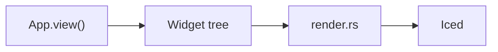
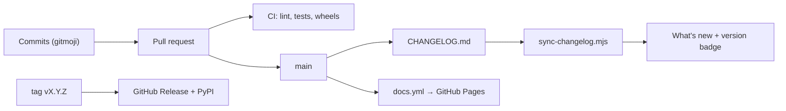

The site is built with [Astro Starlight](https://starlight.astro.build) and lives in `docs/`.
It is published to GitHub Pages on every push to `main` and on every release.

```
docs/
├── astro.config.mjs              # sections (topics), redirects, theme, languages
├── screenshots/                  # large screenshots (examples/screenshots.py)
├── scripts/
│   ├── api_docs_en.py            # English API descriptions
│   ├── api_docs_es.py            # Spanish API descriptions
│   ├── gen_api.py                # generates reference/*.md in both languages
│   ├── library_data.py           # the component library: one entry per component
│   ├── gen_library.py            # generates library/*.mdx in both languages
│   ├── library_shots.py          # generates src/assets/library/*.png
│   ├── component_shots.py        # generates src/assets/components/*.png
│   ├── example_shots.py          # generates example and tutorial screenshots
│   └── sync-changelog.mjs        # CHANGELOG.md → What's new page (both languages) + stable version
└── src/content/docs/             # the pages (Markdown / MDX)
    ├── guides/ ...               # English (default language, site root)
    └── es/                       # Spanish translations, same paths
```

## Preview

```bash
cd docs
npm install
npm run dev        # http://localhost:4321/pyzed/
```

## Languages

The documentation is multilingual. English is the default language and is served at the site
root; each translation lives in a folder named after its locale:

| Language | Files | URL |
| --- | --- | --- |
| English | `src/content/docs/guides/canvas.md` | `/pyzed/guides/canvas/` |
| Spanish | `src/content/docs/es/guides/canvas.md` | `/pyzed/es/guides/canvas/` |

- A translation uses **the same path** as the English page, under `es/`.
- When you add a page, add it in both languages. If a translation is missing, Starlight shows the
  English page with a notice instead of a 404.
- Internal links include the locale: `/pyzed/guides/...` in English pages and `/pyzed/es/guides/...`
  in Spanish ones.
- Relative paths to images and examples have one more `../` in the Spanish files, since they are one
  folder deeper.

## Sections and navigation

The top-level sections (Learn, Library, Designer, Shading, Theming, Distribute, Showcase, Integrations, AI and
Reference) are the `topics` list in `astro.config.mjs`, using the
[starlight-sidebar-topics](https://starlight-sidebar-topics.netlify.app) plugin. Each one is a link in the header
navbar (`src/components/Header.astro`) and has its own sidebar; on phones they appear at the top of the menu. A page
belongs to the section whose sidebar lists it, usually through the folder it lives in:

| Section | Folders |
| --- | --- |
| Learn | `getting-started/`, `tutorials/{basic,intermediate,advanced}/`, `guides/`, `why/`, `examples`, `faq` |
| Library | `library/`, `blocks/` (and the older `components/`) |
| Designer | `editor/`, `download` |
| Shading, Theming, Distribute | `shading/`, `theming/`, `packaging/` |
| Showcase | `showcase/`, `games/` |
| Integrations, AI | `integrations/`, `ai/` |
| Reference | `reference/`, `changelog`, `contributing/` |

- The overview of a section gets a hero when its frontmatter has `section: { eyebrow, icon, lead }`
  (`src/components/PageTitle.astro`).
- Link to pages with `<NavCards>` (`src/components/NavCards.astro`); a card without `href` shows as "coming soon".
- Show screenshots and short recordings with `<Media>` (`src/components/Media.astro`): an image from `src/assets`
  (optionally with a `light` version) or an mp4/webm loop with a `poster`, plus a caption.
- Commands go in `<Tabs syncKey="pkg">` with a `uv` and a `pip` tab, with titled code blocks for Windows and for
  macOS/Linux when they differ.
- **Moving a page:** `git mv` it in both languages, add the old path to `MOVED` in `astro.config.mjs` so the old
  URL redirects, and update the links to it (`git grep` the old path, including `docs/scripts` and `python/`).

## Diagrams

Write diagrams as `mermaid` code blocks; the `astro-mermaid` integration renders them on the page
and follows the light/dark theme:

````md

````

## Regenerating the reference and images

These need Pyzed installed (`uv sync`, or `maturin develop --release`). For a new component, follow
[Documenting a component](/pyzed/contributing/documenting-components/).

```bash
python docs/scripts/gen_api.py              # API reference, both languages
python docs/scripts/gen_api.py --lang en    # English only (or --lang es)
python docs/scripts/gen_api.py --check      # reports public names without documentation
python docs/scripts/component_shots.py      # component illustrations
python docs/scripts/example_shots.py        # example and tutorial screenshots
python examples/screenshots.py              # large screenshots
```

When you add a public function, describe its parameters in `docs/scripts/api_docs_en.py` and
`docs/scripts/api_docs_es.py`, then regenerate the reference. CI runs `gen_api.py --check`.

## What's new and versions



`docs/scripts/sync-changelog.mjs` generates the [What's new](/pyzed/changelog/) page in both
languages from `CHANGELOG.md` (repository root) on every build. Each version is a
`## [X.Y.Z] - YYYY-MM-DD` heading; versions with a suffix (`1.0.0-rc.1`, `0.2.0b1`) are marked as
pre-releases. The most recent one without a suffix is shown as the **latest stable** release in the
header, the home page and the What's new page.
