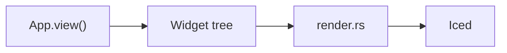
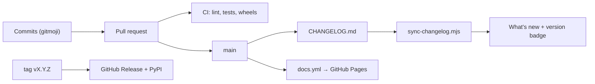

The site is built with [Astro Starlight](https://starlight.astro.build) and lives in `docs/`.
It is published to GitHub Pages on every push to `main` and on every release.

```
docs/
├── astro.config.mjs              # sections (topics), redirects, theme, languages
├── screenshots/                  # large screenshots (examples/screenshots.py)
├── scripts/
│   ├── api_docs_en.py            # English API descriptions
│   ├── api_docs_es.py            # Spanish API descriptions
│   ├── gen_api.py                # generates reference/*.md in both languages
│   ├── library_data.py           # the component library: one entry per component
│   ├── gen_library.py            # generates library/*.mdx in both languages
│   ├── shading_nodes_data.py     # node catalog texts and examples (en/es)
│   ├── gen_shading_nodes.py      # generates shading/nodes/*.mdx in both languages
│   ├── anim_webp.py              # records animated WebP captures (shared library + CLI)
│   ├── library_anim.py           # what each component's animated preview does
│   ├── library_shots.py          # generates public/library/*.webp (animated previews)
│   ├── component_shots.py        # generates src/assets/components/*.png
│   ├── example_shots.py          # generates example and tutorial screenshots
│   └── sync-changelog.mjs        # CHANGELOG.md → What's new page (both languages) + stable version
└── src/content/docs/             # the pages (Markdown / MDX)
    ├── guides/ ...               # English (default language, site root)
    └── es/                       # Spanish translations, same paths
```

## Preview

```bash
cd docs
npm install
npm run dev        # http://localhost:4321/pyzed/
```

## Languages

The documentation is multilingual. English is the default language and is served at the site
root; each translation lives in a folder named after its locale:

| Language | Files | URL |
| --- | --- | --- |
| English | `src/content/docs/guides/canvas.md` | `/pyzed/guides/canvas/` |
| Spanish | `src/content/docs/es/guides/canvas.md` | `/pyzed/es/guides/canvas/` |

- A translation uses **the same path** as the English page, under `es/`.
- When you add a page, add it in both languages. If a translation is missing, Starlight shows the
  English page with a notice instead of a 404.
- Internal links include the locale: `/pyzed/guides/...` in English pages and `/pyzed/es/guides/...`
  in Spanish ones.
- Relative paths to images and examples have one more `../` in the Spanish files, since they are one
  folder deeper.

## Sections and navigation

The top-level sections (Learn, Library, Designer, Shading, Theming, Distribute, Showcase, Integrations, AI and
Reference) are the `topics` list in `astro.config.mjs`, using the
[starlight-sidebar-topics](https://starlight-sidebar-topics.netlify.app) plugin. Each one is a link in the header
navbar (`src/components/Header.astro`) and has its own sidebar; on phones they appear at the top of the menu. A page
belongs to the section whose sidebar lists it, usually through the folder it lives in:

| Section | Folders |
| --- | --- |
| Learn | `getting-started/`, `tutorials/{basic,intermediate,advanced}/`, `guides/`, `why/`, `examples`, `faq` |
| Library | `library/`, `blocks/` (and the older `components/`) |
| Designer | `editor/`, `download` |
| Shading, Theming, Distribute | `shading/`, `theming/`, `packaging/` |
| Showcase | `showcase/`, `games/` |
| Integrations, AI | `integrations/`, `ai/` |
| Reference | `reference/`, `changelog`, `contributing/` |

- The overview of a section gets a hero when its frontmatter has `section: { eyebrow, icon, lead }`
  (`src/components/PageTitle.astro`).
- Link to pages with `<NavCards>` (`src/components/NavCards.astro`); a card without `href` shows as "coming soon".
- Show screenshots and short recordings with `<Media>` (`src/components/Media.astro`): an image from `src/assets`
  (optionally with a `light` version) or an mp4/webm loop with a `poster`, plus a caption.
- Write terminal commands with `` <Commands uv={`...`} pip={`...`} python={`...`} /> ``
  (`src/components/Commands.astro`, in an `.mdx` page). It draws the `uv`, `pip` and `python` tabs (synced across
  the site) and splits each into macOS/Linux and Windows PowerShell blocks when they differ. Write `{py}`,
  `{venv}`, `{activate}`, `{vpy}` and `{env NAME=value}` where the systems differ; the component fills in
  `python3`/`py`, `source .venv/bin/activate`/`.venv\Scripts\Activate.ps1` and so on. Commands that only exist
  on one system go in `<Tabs syncKey="os">` instead.
- Theme swatches come from `src/components/theme-tokens.json` (written by `docs/scripts/gen_theme_tokens.py`), and
  the theming screenshots from `docs/scripts/theming_shots.py`.
- **Moving a page:** `git mv` it in both languages, add the old path to `MOVED` in `astro.config.mjs` so the old
  URL redirects, and update the links to it (`git grep` the old path, including `docs/scripts` and `python/`).

## Diagrams

Write diagrams as `mermaid` code blocks; the `astro-mermaid` integration renders them on the page
and follows the light/dark theme:

````md

````

## Regenerating the reference and images

These need Pyzed installed (`uv sync`, or `maturin develop --release`). For a new component, follow
[Documenting a component](/pyzed/contributing/documenting-components/).

```bash
python docs/scripts/gen_api.py              # API reference, both languages
python docs/scripts/gen_api.py --lang en    # English only (or --lang es)
python docs/scripts/gen_api.py --check      # reports public names without documentation
python docs/scripts/gen_shading_nodes.py    # shader node catalog, both languages
python docs/scripts/gen_shading_nodes.py --check  # fails if the pages are stale or an example breaks
python docs/scripts/library_shots.py        # animated previews of the component library
python docs/scripts/component_shots.py      # component illustrations
python docs/scripts/example_shots.py        # example and tutorial screenshots
python examples/screenshots.py              # large screenshots
```

When you add a public function, describe its parameters in `docs/scripts/api_docs_en.py` and
`docs/scripts/api_docs_es.py`, then regenerate the reference. CI runs `gen_api.py --check`.

## Animated captures

`docs/scripts/anim_webp.py` records a Pyzed view as a looping animated WebP, with a scripted pointer,
keyboard and clock. Every component of the [library](/pyzed/library/) is recorded with it
(`library_shots.py`), and any other page can use it for its own clips: animations, audio
widgets, a form being filled in.

It uses the same off-screen renderer as `pz.screenshot` (no window, display or GPU), through
`pyzed._core.record`: the pointer's position is passed to every frame, so hover and pressed
states and tooltips show up; events (press, release, wheel, keys, typed text) reach the widgets
between frames; and time moves by exactly one frame per frame (animations, spinners, carets and
presences follow it), so a clip comes out the same on every machine, however long a frame takes.

```python
import pyzed as pz
from pyzed import ui
from anim_webp import record_webp, hover, press, type_text, drag, wait, leave


class Login(pz.App):
    def __init__(self):
        self.email = ""

    def view(self):
        return pz.column([
            ui.input(self.email, lambda v: setattr(self, "email", v), placeholder="Email"),
            ui.button("Sign in", lambda: None, variant="solid"),
        ], spacing=8, width=280)


record_webp(
    Login(),
    [press("input"), type_text("ada@example.com"), hover("Sign in"), press(), wait(600), leave()],
    out="docs/public/media/login.webp",
    size=(360, 160),          # canvas, in logical pixels (recorded at 2x)
    theme="One Light",
    crop="content",           # trim to what changes, plus a margin
    poster="docs/public/media/login.still.webp",
)
```

`record_webp` takes an `App` (instance or class) or a function that returns the widget. Steps:

| Step | What it does |
| --- | --- |
| `wait(ms)` | time passes (animations, spinners and carets move) |
| `move(target, ms)`, `hover(target, ms, hold)` | the pointer glides to `target` (and stays) |
| `press(target=None, hold)`, `click` | a left click, held for `hold` ms |
| `drag(start, end, ms)` | press, glide, release (sliders, splitters, color fields) |
| `type_text(text, cps)` | types into the focused field |
| `key(name, mods="")` | one key: `"Enter"`, `"Tab"`, `"Down"`, `"a"` with `"ctrl"`... |
| `scroll(lines, target=None)` | the wheel over `target` |
| `leave(ms)` | the pointer leaves (hover states end) |
| `call(fn)`, `set_state(**attrs)` | change the app's state between frames |
| `theme(name)` | switch the app's theme |

A **target** is a point `(x, y)`, a text shown in the view (`"Sign in"`: its center), `"input"` /
`"input:1"` (the first / second text field), `"center"` (the middle of what is drawn), `"@0.25,0.5"`
(a point relative to what is drawn), `(target, dx, dy)` to aim beside one, or `fn(ctx) -> (x, y)`.
Widgets drawn without text (switches, sliders, dropdown items) are aimed at with points.

Encoding: identical consecutive frames are merged into one longer frame, the clip loops forever,
and frames are lossy (`quality=80`, `method=6`) or lossless, whichever is smaller (WebP's
`allow_mixed`), which keeps text sharp. Aim for **150 KB or less** per clip and never more than
**400 KB**; shorten the clip, crop it or lower `fps` (20 by default) if it grows. Views can read
`clip_time()` (seconds since the clip started) to move things that would otherwise stand still.

The lower-level pieces are there too: `record_frames()` (the frames, as RGBA), `images()`,
`crop_box()`, `encode_webp()`, `fit_webp()` (lowers the quality until the file fits a size; `record.py`
encodes its `anim=True` clips with it), `info(path)` (frames, duration and size of a WebP). From the command
line:

```bash
python docs/scripts/anim_webp.py out.webp --code 'ui.button("Save", None, variant="solid")' \
    --steps 'hover("Save"); press(); wait(500)' --size 320x120 --crop --theme "One Light"
```

**On a page**, serve the files as they are, from `docs/public/`: Astro's image pipeline would turn
an animated WebP into a still picture. `src/components/AnimatedImage.astro` writes the markup: the
`` with its `width`, `height`, `alt`, `loading="lazy"` and `decoding="async"`, and the still frame
for readers who ask for reduced motion:

```html
<picture>
  <source srcset="/pyzed/media/login.still.webp" media="(prefers-reduced-motion: reduce)" />
  
</picture>
```

`<Media clip="...">` uses it for the clips in `public/media/`, and the library's
`src/components/library/Clip.astro` for the ones in `public/library/` (sizes from
`public/library/manifest.json`). What each library preview does is in `docs/scripts/library_anim.py`;
`library_shots.py --probe <slug>` prints the texts and fields a script can aim at.

## What's new and versions



`docs/scripts/sync-changelog.mjs` generates the [What's new](/pyzed/changelog/) page in both
languages from `CHANGELOG.md` (repository root) on every build. Each version is a
`## [X.Y.Z] - YYYY-MM-DD` heading; versions with a suffix (`1.0.0-rc.1`, `0.2.0b1`) are marked as
pre-releases. The most recent one without a suffix is shown as the **latest stable** release in the
header, the home page and the What's new page.
