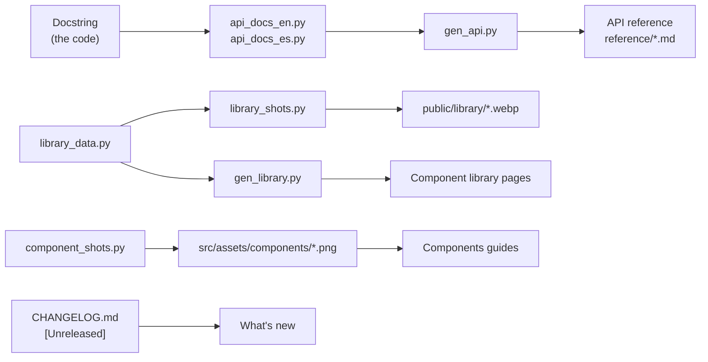

A component is finished when people can find it and learn it without reading its code. Document it in
the same pull request that adds it; reviewers check it. This page continues the Rating example from
[Adding a component to the editor](/pyzed/contributing/adding-components/).



| What | Where | Generated by |
| --- | --- | --- |
| Docstring | the function or class in `python/pyzed/` | written by hand |
| API reference | `docs/src/content/docs/[es/]reference/*.md` | `docs/scripts/gen_api.py` from `api_docs_en.py` / `api_docs_es.py` |
| Component library | the *Component library* section of the site | `docs/scripts/gen_library.py` from `docs/scripts/library_data.py` |
| Library previews (animated) | `docs/public/library/*.webp` | `docs/scripts/library_shots.py` |
| Guide illustrations | `docs/src/assets/components/*.png` | `docs/scripts/component_shots.py` |
| Editor screenshots | `docs/screenshots/*.png` | `examples/screenshots.py` |
| Release notes | `CHANGELOG.md` → [What's new](/pyzed/changelog/) | `docs/scripts/sync-changelog.mjs` on every build |

Install Pyzed in your environment first (`uv sync` or `maturin develop --release`): every script imports
the package, so signatures and images always match the code.

## 1. Docstrings

Docstrings are the source of truth: the editor shows them, completion shows them and the API reference
falls back to them. The repository's style:

- **The first line is a full sentence** that says what it is or does, in the present tense: *"A row of
  ``max`` stars with the first ``value`` lit, in the ``tint`` color."* The first paragraph is what
  `gen_api.py` uses as a summary.
- Then, if needed, a short paragraph about **callbacks and behavior**: what `on_change` receives, what
  happens without it.
- Code names use reST double backticks (```` ``value`` ````) and examples a `::` block; `gen_api.py`
  converts both to Markdown (an inline code span and a fenced `python` block).
- No `Args:`/`Returns:` sections: parameters are described in `api_docs_*.py` (below), so the docstring
  stays short.
- Designer `Prop`s have no docstring: the `description` of the `Component` (one sentence) is the toolbox
  tooltip and the subtitle in the property grid.

```python
def rating(value: float, on_change: Any = None, *, max: int = 5, size: float = 16,
           tint: str = "accent", theme: Optional[Theme] = None) -> _core.Widget:
    """A row of ``max`` stars with the first ``value`` lit, in the ``tint`` color.

    ``on_change`` is called with the number of the clicked star (1 to ``max``);
    without it the stars are read only.
    """
```

## 2. API reference

The pages under [API reference](/pyzed/reference/ui/) are generated. Never edit
`docs/src/content/docs/reference/*.md` by hand: describe the function in `docs/scripts/api_docs_en.py` and
its translation in `docs/scripts/api_docs_es.py`, then regenerate.

Each file has a `PAGES` list; each page has `sections`, a list of `(title, {name: entry})` pairs. Add the
entry to the section where it belongs (for `pyzed.ui` components: `Basics`, `Forms`, `Lists, tree and
menus`, `Navigation`, `Workspace`, `Overlays`, `Code`):

```python
# docs/scripts/api_docs_en.py, page "ui", section "Forms"
"pyzed.ui.rating": {
    "desc": "A row of stars to rate something.",
    "params": {
        "max": "Number of stars.",
        "size": "Size of each star, in pixels.",
        "on_change": "Called with the number of the clicked star (1 to `max`). Without it the stars are read only.",
    },
},
```

```python
# docs/scripts/api_docs_es.py, page "ui", section "Formularios"
"pyzed.ui.rating": {
    "desc": "Una fila de estrellas para valorar algo.",
    "params": {
        "max": "Número de estrellas.",
        "size": "Tamaño de cada estrella, en píxeles.",
        "on_change": "Recibe el número de la estrella pulsada (de 1 a `max`). Sin él, las estrellas son de solo lectura.",
    },
},
```

- **The signature is not written by hand**: `gen_api.py` reads it with `inspect`, from Python and from the
  Rust functions too (PyO3 exposes their signatures).
- Parameters missing from `params` are looked up in `COMMON` at the top of the file (`value`, `tint`,
  `theme`, `width`, `on_press`…), so only describe what is specific.
- An entry can also have `"example"` (a code block) and `"extra"` (Markdown after the table).
- Designer API (`pyzed.designer.*`) entries are listed with `_doc(...)`, which uses the docstring.

```bash
python docs/scripts/gen_api.py              # both languages
python docs/scripts/gen_api.py --lang en    # only English (or --lang es)
python docs/scripts/gen_api.py --check      # lists public names without documentation
```

`--check` looks at everything exported in `__all__` of `pyzed`, `pyzed.ui` and `pyzed.designer`. CI runs
it and reports what is missing as warnings, so a new export without an entry is visible in the PR.

## 3. The component library

The [Component library](/pyzed/library/) has one page per component, in the spirit of shadcn/ui or Chakra
UI: a description, a preview in both themes with a **Preview/Code** tab pair, "When to use", usage,
examples, tips, an API table and related components, plus a gallery of all of them grouped by category.
The pages are generated from one data file, `docs/scripts/library_data.py`, by
`docs/scripts/gen_library.py`; never edit `library/*.mdx` by hand.

Document the function in the API reference first (step 2): the library's API tables reuse `gen_api.py`,
so the signature and the parameter descriptions come from `api_docs_<lang>.py`. Then add an entry with
`add(...)` to `library_data.py` (the order of the file does not matter; pages are sorted by name). Every
text is a `T(en, es)` pair:

```python
add(
    slug="rating",
    name="Rating",
    category="forms",
    api=["pyzed.ui.rating"],
    blurb=T("A row of stars to rate something.", "Una fila de estrellas para valorar algo."),
    desc=T(
        "Stars the user clicks to give a score. `on_change` receives the number of the clicked star; "
        "without it the stars are read only.",
        "Estrellas en las que el usuario hace clic para puntuar. `on_change` recibe el número de la "
        "estrella pulsada; sin él, las estrellas son de solo lectura.",
    ),
    when=T(
        ["To collect a quick score (reviews, feedback).",
         "To show a score next to an item, read only."],
        ["Para recoger una puntuación rápida (reseñas, opiniones).",
         "Para mostrar una puntuación junto a un elemento, en solo lectura."],
    ),
    preview={"code": """pz.column([
    ui.rating(4, on_rate),
    ui.rating(3, on_rate, tint="warning", size=20),
    ui.rating(7, max=10),
], spacing=10)""", "size": (720, 200)},
    usage="""class Review(pz.App):
    def __init__(self):
        self.stars = 0

    def view(self):
        return ui.rating(self.stars, lambda stars: setattr(self, "stars", stars))""",
    related=["slider", "segmented"],
    badge="new",
)
```

| Key | Meaning |
| --- | --- |
| `slug` | URL and file name: `library/<slug>.mdx` and `public/library/<slug>.*.webp`. |
| `name` | Title of the page and of its gallery card. |
| `category` | A key of `CATEGORIES` (`actions`, `display`, `forms`, `feedback`, `data`, `lists`, `navigation`, `overlays`, `dialogs`, `workspace`, `code`, `layout`, `content`). |
| `api` | The public names documented on the page, the main one first. |
| `blurb`, `desc`, `when` | The gallery line, the lead paragraph and the "When to use" bullets. |
| `preview` | `{"code": ..., "size": (w, h), "fill": False, "start": None}`: the snippet shown in the Code tab **and** drawn as the preview. |
| `usage` | Optional fuller snippet, usually an `App` showing where the state lives. |
| `examples` | Optional list of `{"title": T(...), "text": T(...), "code": ..., "size": (w, h)}`, each with its own image (`"shot": False` for code only). |
| `notes` | Optional "Tips" (Markdown). |
| `related`, `badge` | Optional related slugs; `"new"` adds a badge in the sidebar and the gallery. |

Snippets run with `pz`, `ui` and `draw` already imported; any other free name (`on_rate`, `save`…) is a
do-nothing callback, so write them the way a reader would write them in an app; **the last expression is
the widget**. Prose is Markdown inside MDX: write `{`, `}` and `<` only inside backticks.

Render the previews, generate the pages and check them:

```bash
python docs/scripts/library_shots.py rating      # public/library/rating.dark.webp and rating.light.webp
python docs/scripts/gen_library.py               # library/*.mdx in both languages
python docs/scripts/gen_library.py --check       # coverage and consistency, writes nothing
```

Previews are animated WebP recorded off-screen at scale 2 with
[`anim_webp.py`](/pyzed/contributing/docs/#animated-captures), centered on the theme background, in One
Dark and One Light (examples: `<slug>-<n>.<theme>.webp`; each with a still `*.still.webp` for reduced
motion). By default the pointer hovers and presses the middle of the preview, and each variant is
hovered and pressed (or clicked and typed into when it has a text field); a clip in which nothing changes
plays a theme cycle instead. Give the new component a script in `docs/scripts/library_anim.py` when it
does more than that (open a menu, drag a slider, type a query); `library_shots.py --probe rating` prints
what a script can aim at. `--check` fails when a name of `pyzed.ui.__all__` is on no library
page, when an entry points to an unknown name, category, related slug or clip, when a clip is missing or
not animated, or when a generated page is out of date. Commit the clips and `public/library/manifest.json`
with the data file.

## 4. Screenshots for the guides

The topic guides under *Components* (`docs/src/content/docs/components/*.md`) show one image per page,
drawn by `docs/scripts/component_shots.py`. To illustrate the new component there, add a function that
returns the widgets and an entry in `SHOTS` with the image size in logical pixels:

```python
def rating():
    return pz.column([
        ui.rating(3, noop),
        ui.rating(4, noop, tint="warning", size=20),
        ui.rating(2, max=10),
    ], spacing=10)


SHOTS = {
    # ...
    "rating": (rating, (300, 140)),
}
```

```bash
python docs/scripts/component_shots.py rating     # docs/src/assets/components/rating.png
```

and reference it from the page with a relative path:
`` (one more `../` in the Spanish page).

The large screenshots of the editor (`docs/screenshots/`) are made by `examples/screenshots.py`. Its
`designer-components.png` places **every registered component** on one form, so regenerate it when you add
one to the toolbox:

```bash
python examples/screenshots.py
```

Tips for good images:

- Show the component **in context and in its states** (empty, selected, disabled, each variant), not
  just the default.
- Use realistic text ("How was your stay?"), never "foo" or "test".
- Keep the size tight: the scripts render at scale 2, so 300×140 logical pixels is a 600×280 image.
- One Dark is the default theme of the images; the library pages also have One Light.

## 5. Guides and the editor docs

Besides the generated pages, update the hand-written ones the component affects:

- The **Components** guide page of its family (`components/forms.md`, `components/controls.md`…): add it to
  the example and to the *Component / Purpose* table.
- The list of built-in controls in [Visual designer → Components](/pyzed/guides/designer/#components) and the
  [Toolbox and canvas](/pyzed/editor/toolbox-and-canvas/) page of the Pyzed Design manual, when it joins the
  toolbox.
- The [Pyzed Design](/pyzed/editor/) manual, if the control adds editor behavior (a new property editor, a new kind of
  container).

## 6. Translations

The site is English first, with a Spanish translation under `docs/src/content/docs/es/` at the same paths.
For every page you add or change:

- Write the English page, then the Spanish one with the same file name.
- Links include the locale: `/pyzed/guides/designer/` in English, `/pyzed/es/guides/designer/` in Spanish.
- Relative image paths have **one more `../`** in Spanish pages, because they are one folder deeper.
- Anchors come from the heading text, so a link to a section of a Spanish page uses the Spanish heading
  (`/pyzed/es/guides/components/#en-el-diseñador`).
- Generated content has both languages in its data: `api_docs_es.py`, the Spanish fields of
  `library_data.py`, and the editor's own texts in `python/pyzed/designer/locales/es.json`.

If you cannot write the Spanish version, say so in the PR: a missing page falls back to English with a
notice, and a maintainer or another contributor can translate it in a 🌐 PR.

## 7. The changelog

Release notes are generated from the PR titles when a version is released, so a `✨ Add a Rating
component` title is usually enough. For a change that deserves more than one line, write the note by hand
under `## [Unreleased]` in `CHANGELOG.md`, in the section it belongs to:

```markdown
## [Unreleased]

### Features

- **Rating**: a row of stars in `pyzed.ui` (`ui.rating`) and in the designer's toolbox, with a `change` event.
```

Notes written under `[Unreleased]` are kept and merged when the release is cut. The site's
[What's new](/pyzed/changelog/) page is rebuilt from this file on every docs build.

## 8. Build and check the site

```bash
cd docs
npm install
npm run dev        # http://localhost:4321/pyzed/, reloads as you edit
npm run build      # the static site in docs/dist, as published on GitHub Pages
```

Before opening the PR:

- `npm run build` finishes without errors (it fails on broken Markdown, MDX or missing images).
- `python docs/scripts/gen_api.py --check` does not list your new names, and
  `python docs/scripts/gen_library.py --check` passes.
- The new pages show up in the sidebar in both languages, and their links and images work in both.
- The images were regenerated with the scripts, not taken by hand.

See [Editing the documentation](/pyzed/contributing/docs/) for the structure of the site, mermaid
diagrams and the release flow.
