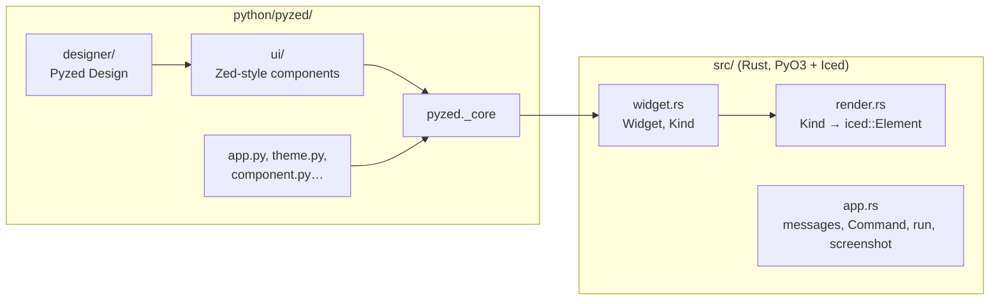

Thanks for helping! This section is the developer's guide to Pyzed: how to build it from source, how the
code is organized, how to [add a component to the visual editor](/pyzed/contributing/adding-components/),
how to [document it](/pyzed/contributing/documenting-components/) and how to
[edit this site](/pyzed/contributing/docs/). The short version also lives in
[`CONTRIBUTING.md`](https://github.com/albakore/pyzed/blob/main/CONTRIBUTING.md) at the root of the
repository.

## Development setup

You need **Python 3.10+**, a stable **Rust** toolchain (`rustup`) and, on Linux, the usual X11/Wayland
development libraries. Pyzed is a Rust extension (PyO3 + Iced) with a Python package on top, built with
[maturin](https://www.maturin.rs).

With [uv](https://docs.astral.sh/uv/):

```bash
git clone https://github.com/albakore/pyzed
cd pyzed
uv sync                       # creates .venv, builds the Rust core (release) and installs pyzed editable
uv run pytest tests
uv run python examples/gallery.py
uv run pyzed design           # the visual editor, Pyzed Design
```

With pip:

```bash
python -m venv .venv
source .venv/bin/activate     # Windows: .venv\Scripts\activate
pip install maturin pytest ty
maturin develop --release     # builds the Rust core and installs pyzed in the venv
pytest tests
```

- Always build with `--release`: debug builds of Iced are too slow to use a real window.
- Changes to Python files under `python/pyzed/` are picked up directly (the package is installed in
  editable mode).
- After changing **Rust** code under `src/`, build again: `maturin develop --release` (with uv, the next
  `uv run` or `uv sync` rebuilds the core on its own).

## Checks

Run the same checks as CI before you push:

```bash
cargo fmt --check             # Rust formatting
cargo clippy -- -D warnings   # Rust lints, warnings are errors
pytest tests                  # or: uv run pytest tests
```

The test suite runs off-screen: windows are rendered with `App.screenshot` into PNG files, so it needs no
GPU or display. Optional extras:

```bash
uv run ty check                            # type checks the Python package
python docs/scripts/gen_api.py --check     # public names without API documentation
```

CI runs the lint job, the tests on Linux, macOS and Windows, a preview of the release notes and the
**PR title** check. Documentation-only changes skip the build.

## The docs site

The documentation is an [Astro Starlight](https://starlight.astro.build) site in `docs/`:

```bash
cd docs
npm install
npm run dev        # http://localhost:4321/pyzed/
npm run build      # the static site in docs/dist (what GitHub Pages publishes)
```

Both scripts first run `scripts/sync-changelog.mjs`, which turns `CHANGELOG.md` into the
[What's new](/pyzed/changelog/) page. See [Editing the documentation](/pyzed/contributing/docs/) for the
layout of the site, translations and the scripts that regenerate the reference and the images.

## Project architecture



| Path | What it holds |
| --- | --- |
| `src/` | Rust core (PyO3 + Iced): the widget tree, the renderer bridge, the runtime and the code editor |
| `python/pyzed/` | Python package: `App`, themes, icons, `pz.Component`, CLI |
| `python/pyzed/ui/` | The ready-made components (`ui.button`, `ui.select`, `ui.table`…), plain functions returning widgets |
| `python/pyzed/designer/` | The visual editor: form model, toolbox registry, document commands, runtime, panels |
| `tests/` | pytest suite (off-screen, no GPU) |
| `examples/` | runnable examples and the tutorials' code |
| `docs/` | this site, with its generator scripts in `docs/scripts/` |
| `scripts/` | release and maintenance scripts |

Read [How it works](/pyzed/guides/how-it-works/) for the bridge between Python and Iced and
[Pyzed Design → How it is built](/pyzed/editor/files-and-scripting/#how-it-is-built) for the classes of
the editor.

## Commits and pull requests

Pyzed follows [FastAPI](https://github.com/fastapi/fastapi)'s style: every commit on `main`, that is,
every **PR title**, starts with a [gitmoji](https://gitmoji.dev) followed by a short sentence in the
imperative, in English, with no trailing period:

```text
✨ Add a Rating component to the designer
🐛 Fix line numbers when the editor wraps lines
📝 Document the Rating component
```

PRs are merged with **Squash and merge**, so the title becomes the commit on `main` and the line in the
release notes. The emoji picks the section of the notes:

| Emoji | Use it for | Release notes section |
| --- | --- | --- |
| 💥 | A breaking change (also explain it in the PR) | Breaking Changes |
| ✨ | A new feature, widget or component | Features |
| 🐛 🚑️ 🔒️ | A bug fix, a critical hotfix, a security fix | Fixes |
| ♻️ ⚡️ 🎨 🔥 | Refactors, performance, structure, removing code | Refactors |
| ⬆️ ⬇️ 📌 | Upgrading, downgrading or pinning a dependency | Upgrades |
| 📝 ✏️ | Documentation, typos | Docs |
| 🌐 | Translations of the docs | Translations |
| ✅ 👷 💚 🔧 🔨 | Tests, CI, configuration, development scripts | Internal |

The **PR title** workflow (`.github/workflows/pr-title.yml`) rejects titles that do not start with a gitmoji
(or a shortcode such as `:sparkles:`) and a space.

The workflow for a change:

1. Fork the repository and create a branch from `main` (`feature/rating`, `fix/editor-scroll`,
   `docs/tutorial-typo`). For anything bigger than a small fix, open an issue first.
2. Keep each PR focused on one change. Add or update tests for behavior changes and docs for user-facing
   ones.
3. Run `cargo fmt --check`, `cargo clippy -- -D warnings` and `pytest tests`.
4. Open the PR with a gitmoji title and fill in the template: what changes, how it was tested (screenshots
   for UI changes) and the checklist. Link the issue it closes (`Closes #123`).
5. Push follow-up commits to the same branch; there is no need to squash them yourself.

Commits must be authored by you: do not add `Co-authored-by` trailers or generated-by footers.

## Where to go next

- [Adding a component to the editor](/pyzed/contributing/adding-components/): from a `pyzed.ui` function to
  a toolbox entry with properties, events and tests, with a worked example.
- [Documenting a component](/pyzed/contributing/documenting-components/): docstrings, API reference,
  component library, screenshots, translations and the changelog.
- [Editing the documentation](/pyzed/contributing/docs/): how this site is organized and built.
