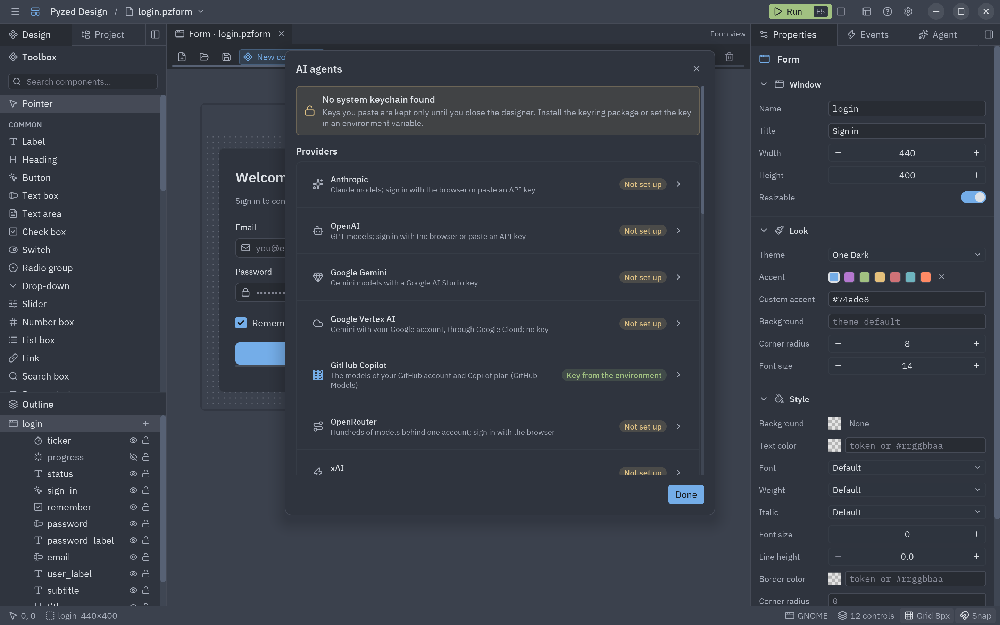
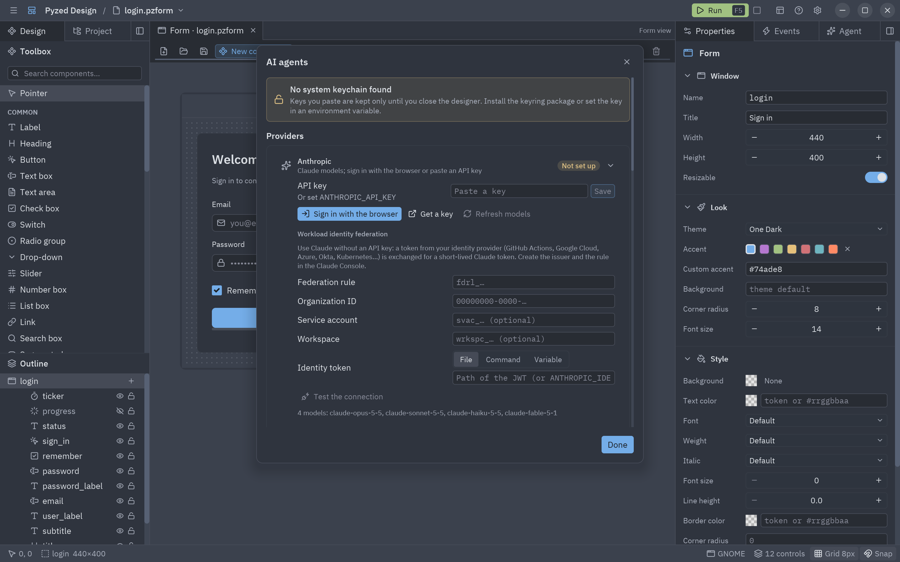

The **Agent** panel (right dock, next to Properties and Events) is an AI agent. Describe
what you want and it reads the open form, adds and arranges controls, wires events, writes the handlers, creates
new forms and components, and checks its own code. Every change it makes is an ordinary undo step, and you can
reject the whole run at once.


## Getting started

1. Open the panel: the **Agent** tab in the right dock, **View → Agent panel**, or <kbd>Ctrl</kbd>+<kbd>Alt</kbd>+<kbd>A</kbd>.
2. The first time, the panel asks you to **connect a model** and lists the main providers. Click one to
   [sign in with the browser](#signing-in), or **All providers…** for the rest.
3. Type what you want and press <kbd>Enter</kbd>, or click one of the suggestions.

Claude needs the optional dependencies (`anthropic` and `keyring`); the compiled Pyzed Design already has them:

```bash
pip install "pyzed-ui[agents]"     # or: uv add "pyzed-ui[agents]"
```


### Signing in

Signing in happens inside Pyzed Design; no other program is needed.

- **Anthropic (Claude), OpenAI, Gemini, xAI, Mistral, DeepSeek, Groq**: these providers don't let other apps
  sign in with OAuth (Anthropic's subscription sign-in is only for its own apps), so Pyzed signs in through a
  page of its own. Your browser opens a **Connect … to Pyzed Design** page served by Pyzed on this computer
  (`127.0.0.1`, a one-time address); it links to the provider's API keys page. Create a key there and paste it
  on Pyzed's page, or just click the key's **Copy** button: Pyzed notices the copied key too. Pyzed checks the key
  with the provider, saves it in the system keychain, loads the provider's models and comes back to the front,
  so you can close the tab and keep working. While it waits, a **Signing in** card offers **Paste key** (read the
  clipboard now), **Open the key page** and **Cancel**. The clipboard is read only while that card is showing (at
  most five minutes), and only a text that looks like that provider's key is used. The local page only accepts a
  key sent from itself: other sites and other host names can't reach it. To use your Claude Pro or Max plan
  instead of a key, see [Your Claude subscription](#your-claude-subscription).
- **OpenRouter**: real OAuth with PKCE. You approve Pyzed on OpenRouter's page and the key it issues comes back to
  Pyzed directly; nothing to copy.
- **GitHub Copilot**: **Sign in with GitHub** uses GitHub's device flow. Pyzed opens
  `github.com/login/device` and shows a short code; type it there, approve Pyzed, and the token comes back on its
  own (the card has a button to copy the code, and **Cancel**). It reaches the models of your GitHub account and Copilot
  plan through GitHub Models. Signing in needs a GitHub App client ID in the provider's settings; without one,
  **Sign in with a token** takes a fine-grained personal access token with the **Models** permission.
- **Google Vertex AI**: **Sign in with Google** opens Google's consent page (OAuth with PKCE) and the token comes
  back to Pyzed; it is refreshed on its own. If you already ran `gcloud auth application-default login`, those
  credentials are used and nothing else is needed. Pick the **Google Cloud project** (with Vertex AI enabled)
  in the provider's settings, or click **List my projects**.
- **Anthropic without a key**: [workload identity federation](#claude-without-an-api-key) exchanges a token from
  your identity provider for a short-lived Claude token.
- **Ollama, LM Studio**: nothing to sign in to. Clicking them asks the local server for its models.

You can always paste a key by hand in the [settings](#settings) or set the provider's environment variable.


## The panel

| Part | What it does |
| --- | --- |
| **Header** | The thread's title, **New thread** (<kbd>+</kbd>), **History**, **Expand the panel** (it fills the window; click again to put it back in its dock) and the agent's **settings**. |
| **Thread** | Your messages, the agent's answers (Markdown), its reasoning (**Thought**, folded) and one line per tool it used: a spinner while it runs, a check when it worked, a red cross when it failed. Click a line to see the tool's input and result. |
| **Agent changes** | After a run that changed something: **Reject** puts every form and code file it touched back as they were before the run; **Keep** hides the bar. Undo (<kbd>Ctrl</kbd>+<kbd>Z</kbd>) still steps back one change at a time. |
| **Message box** | Grows with the text. <kbd>Enter</kbd> sends and <kbd>Shift</kbd>+<kbd>Enter</kbd> starts a new line. Type <kbd>@</kbd> to [add context](#adding-context-with-) and <kbd>/</kbd> for [commands](#commands-with-); in their list <kbd>↑</kbd> <kbd>↓</kbd> move, <kbd>Enter</kbd> picks and <kbd>Esc</kbd> closes. While the agent works the send button becomes **Stop**. |
| **+** | **Files, the form, its code, controls** (an @ mention), **Attach images…**, **Paste image** and **Screenshot of the form**. See [Images](#images). |
| **Permission mode** | What the agent may do without asking (see below). |
| **Model** | Every provider with its models, and the [external agents](#external-agents). A provider that is not set up shows **Connect…**, which signs in right there. |
| **Effort** | How much the model thinks before answering: **Low**, **Medium**, **High**, **Extra high**, **Max**. Claude models only. |
| **Fast** | Fast mode: faster answers at a higher price, on Claude Opus 5.5 and Opus 5 through the Claude API. |

| Permission mode | What the agent may do |
| --- | --- |
| **Ask before writing** | Edits the open form and its code freely (every change can be undone); asks before creating documents or writing files. The default. |
| **Bypass permissions** | Never asks. |
| **Read only** | Reads only: answers questions and suggests code without changing anything. |
| **Chat only** | No tools: a plain conversation with the model. |


Each message carries a short note of where you are (the open document, the selected controls, the handler in the
code editor), so "align these" or "validate this field" refer to what you are looking at.

### Adding context with @

Type <kbd>@</kbd> (or click **+**) and pick what to attach: the **selection**, the open **form**, its **code**,
one of its **controls**, a **file** of the project (an image file goes as an image), or a **screenshot** of the
open form. Keep typing to filter the list; <kbd>Enter</kbd> picks the
highlighted row. What you pick shows as a chip above the message and its content goes with the message, so the
agent doesn't have to look for it. Files that may hold secrets (`.env`, keys…) are never offered.


### Commands with /

Type <kbd>/</kbd> at the start of the message:

| Command | Does |
| --- | --- |
| `/new` | Starts a new thread. |
| `/app` | Starts a request to [build a whole application](#building-an-application). |
| `/history` | Shows the past threads. |
| `/settings` | Opens the AI agents settings. |
| `/form`, `/component` | Starts a request to generate a form or a component. |
| `/explain` | Explains the open form and its handlers. |
| `/fix` | Checks the form's code with `validate_code` and fixes what it finds. |
| `/tidy` | Aligns the controls and evens out the margins. |
| `/look` | Takes a screenshot of the form, looks at it and improves its layout and design. |

### What the agent can do

| Tool | Does |
| --- | --- |
| `get_document` | Reads the open form or component: settings, every control with its rect, props, events and style, the selection and the code. |
| `add_control`, `update_control`, `remove_controls` | Place, change, move into a container, rename and delete controls. Types and props are checked against the toolbox. |
| `set_form`, `select_controls` | Change the form's title, size, theme or style; select controls so you see them. |
| `wire_event`, `set_handler`, `set_code` | Connect events and write one handler or the whole module (it must parse). |
| `new_document`, `save_document` | Create a new form or component next to the open one and open it in a tab; save. |
| `list_components`, `describe_component`, `search_icons`, `list_themes`, `read_docs`… | The same knowledge as the [MCP server](/pyzed/guides/mcp/): components, icons, themes and this documentation. |
| `validate_code`, `validate_form` | Check code and forms before handing them back. |
| `list_files`, `read_file`, `search_text`, `write_file` | Work with files of the project, never outside its folder. |
| `screenshot_form` | Renders the open form to a picture and looks at it, to check the layout as you see it. |
| `run_app` | Runs the app (the project's main form, or another form) in the project's own environment without showing a window, and returns what it printed (errors and tracebacks included) and a picture of its window. |
| `update_plan` | Shows the agent's plan as a checklist above the message box and keeps it current. |
| `get_project`, `create_project`, `add_dependency`, `check_project`, `open_document` | Read the open project (forms, components, dependencies, entry point), create a new one and open it, add a package with uv, run the project's checks and open any of its files in a tab. |
| `list_examples`, `read_example`, `new_form` | Pyzed's examples to learn from, and a starting form written for a description. |
| `mcp_<server>_<tool>` | The tools of the [MCP servers](#mcp-servers) you added. |

Tools that **create or write files** ask first in the **Ask before writing** mode: a card shows **Allow**,
**Always allow** (for the rest of the session) and **Deny**. **Bypass permissions** skips it. Changes to the open
document never ask, since they can be undone.

## Images

The agent can look at pictures: a mock-up to rebuild, a screenshot of a bug, the form as it looks now. Add them
with **+**:

- **Attach images…** opens the system's file dialog (PNG, JPEG, GIF or WebP, up to 5 MB each).
- **Paste image** takes the picture you copied (a screenshot, an image from the browser).
- **Screenshot of the form** renders the open form and attaches it.

They show as thumbnails above the message and in the thread. Tools can answer with images too: `screenshot_form`
and the tools of MCP servers that return pictures. The model must take images (Claude, GPT-4.1 and later, Gemini,
most vision models of Ollama…).

## Building an application

`/app`, the **Create a notes app…** suggestion or a plain request ("Create an app to track my expenses") start a
whole application, not only a form. The agent knows the editor (projects, forms, components, styles, data
binding, the [MCP server](/pyzed/guides/mcp/) and these docs) and, in each message, what is open: the project
and its files, the form, the selection and the other tabs. It then:

1. Makes a plan with `update_plan`: a **Plan** card above the message box shows each step, ticks it off as it
   goes and folds away when everything is done (click its header to fold it yourself).
2. Creates a [project](/pyzed/editor/projects/) with `create_project` (or uses the open one) and adds the
   packages it needs with `add_dependency`.
3. Writes the forms and components, places their controls, wires the events and writes the code, reading
   Pyzed's examples and docs when it needs them, and saves them.
4. Looks at each form with `screenshot_form`, and runs `check_project` and `validate_code` until they pass.
5. Runs the app with `run_app`, reads its errors and the picture of its window, fixes what is wrong and runs it
   again until it starts cleanly. Then it tells you what it built and how to run it (<kbd>F5</kbd>).

It works on its own from start to end, for up to 150 model answers per message. For no interruptions, pick
**Bypass permissions** in the mode menu; with **Ask before writing** it asks before writing files and before
running the app.

## Generating forms and components

**View → Generate a form with AI…** and **Generate a component with AI…** (also in the command palette) open the
panel with the start of the request written for you: finish the sentence and press <kbd>Enter</kbd>. For example:

> Create a new form for a customer: name, email, a country drop-down and Save / Cancel buttons; Save validates
> the email and shows a toast.

The agent creates `customer.pzform` and `customer.py`, opens them, places and aligns the controls, wires the
buttons and writes the handlers. With a component it creates the `.pzcomp` and its class, which then shows up
in the toolbox like any [component](/pyzed/editor/component-designer/).

## Inline assist

In the code editor, <kbd>Ctrl</kbd>+<kbd>Alt</kbd>+<kbd>I</kbd> (or the ✦ button in its header) opens a bar over
the code. Describe the change and press <kbd>Enter</kbd>: the model rewrites the handler (or the whole file, in
whole-file mode) and the editor shows the result. **Undo** puts the previous code back, **Keep** closes the bar.
Nothing is applied to the form until you click **Apply**, as with your own edits.


## Settings

**Settings → AI agents → AI agents settings…**, the gear in the panel header, or **AI agents settings…** in the
command palette.



### Providers

| Provider | How to connect | Notes |
| --- | --- | --- |
| **Anthropic** | **Sign in with the browser**, API key, `ANTHROPIC_API_KEY` or [identity federation](#claude-without-an-api-key) | Claude models stream their reasoning summaries, use adaptive thinking and take effort and fast mode. An existing Anthropic CLI profile (`ant auth login`) is also used, but the CLI is not needed. |
| **OpenAI** | **Sign in with the browser**, API key or `OPENAI_API_KEY` | |
| **Google Gemini** | **Sign in with the browser**, AI Studio key or `GEMINI_API_KEY` | Through Gemini's OpenAI-compatible endpoint. |
| **OpenRouter** | **Sign in with the browser** (OAuth), API key or `OPENROUTER_API_KEY` | OAuth with PKCE: the key OpenRouter issues for Pyzed goes to the keychain. |
| **xAI**, **Mistral**, **DeepSeek**, **Groq** | **Sign in with the browser**, API key or `XAI_API_KEY`, `MISTRAL_API_KEY`, `DEEPSEEK_API_KEY`, `GROQ_API_KEY` | Their models are listed after signing in. |
| **GitHub Copilot** | **Sign in with GitHub** (device flow), a fine-grained token with the **Models** permission or `GITHUB_TOKEN` | The models of GitHub Models (`openai/gpt-4.1`, …) with your account's limits. Signing in needs a **GitHub App client ID** (or `PYZED_GITHUB_CLIENT_ID`). |
| **Google Vertex AI** | **Sign in with Google**, or the Google Cloud credentials of this computer (`gcloud auth application-default login`) | Gemini through Vertex AI's OpenAI-compatible endpoint, with no key. Needs a **Google Cloud project** and a **Location** (`global` by default); signing in with Google needs an **OAuth client** (Desktop app) whose secret goes to the keychain. |
| **Ollama**, **LM Studio** | Nothing: they run on your computer | Change the **Server URL** if they run elsewhere. |
| **OpenAI-compatible** | Server URL, and a key if the server needs one | vLLM, llama.cpp, a company gateway… |

Click a provider to open it: **Sign in with the browser** (see [Signing in](#signing-in)), paste a key and
**Save**, **Get a key** (opens the provider's key page), **Remove key**, and **Refresh models**, which asks the
provider for its list of models so they show up in the model picker.



**Test the connection** checks the provider with what is set up and shows where the credentials come from.

### Claude without an API key

Open **Anthropic** and fill in **Workload identity federation**. A token from your identity provider (GitHub
Actions, Google Cloud, Azure, Okta, Kubernetes…) is exchanged for a short-lived Claude token, so no API key is
stored anywhere. First create the issuer and the federation rule in the Claude Console, then fill in:

| Field | What goes there |
| --- | --- |
| **Federation rule** | The rule's ID, `fdrl_…`. |
| **Organization ID** | Your organization's UUID. |
| **Service account** | `svac_…`, when the rule doesn't name one. Optional. |
| **Workspace** | `wrkspc_…` or `default`. Optional. |
| **Identity token** | Where the token comes from: a **File** (the path of the JWT, or `ANTHROPIC_IDENTITY_TOKEN_FILE`), a **Command** that prints a fresh one (for example `gcloud auth print-identity-token`) or a **Variable** (`ANTHROPIC_IDENTITY_TOKEN`). |

A saved API key wins over federation; remove it to use federation. The `ANTHROPIC_FEDERATION_RULE_ID`,
`ANTHROPIC_ORGANIZATION_ID` and `ANTHROPIC_IDENTITY_TOKEN_FILE` variables work too.

### MCP servers

**MCP servers** adds the tools of any [Model Context Protocol](https://modelcontextprotocol.io) server to the
agent's. **Add an MCP server** asks for:

- a **Name**;
- the **Command**, as you would type it in a terminal (`npx -y @modelcontextprotocol/server-github`,
  `uvx mcp-server-fetch`…), **or the URL** of a remote server (Streamable HTTP);
- **Secrets**: `NAME=value` pairs separated by `;`, passed as environment variables (or as headers for a URL).
  They go to the system keychain, never to `agents.json`.

**Test** starts the server and lists its tools; the switch turns it off without removing it. Their tools show
up as `mcp_<server>_<tool>`. Tools the server doesn't mark as read-only ask first in **Ask before writing**, like
file writes; in **Read only** they are left out.

### External agents

**External agents** run Claude Code, Gemini CLI, Codex or any agent that speaks the
[Agent Client Protocol](https://agentclientprotocol.com) inside the panel. **Add an external agent…**
offers the known ones (Claude Code through `@zed-industries/claude-code-acp`, `gemini --experimental-acp`, Codex
through `@zed-industries/codex-acp`) or **Other…** for any command. Once added, pick it in the model picker under
**External agents**.

The agent runs as its own program in the project folder and signs in its own way (its own account or key; put
keys in **Secrets**). Pyzed answers its requests: it reads and writes files only inside the project and never
the ones that may hold secrets, and asks before acting according to the permission mode (**Read only** allows
only reads, **Chat only** refuses every tool).

With **Let external agents control the editor** on (the default), the agent gets the built-in agent's tools over
MCP: it reads and changes the open form and its code, creates forms and components, runs the app with `run_app`,
keeps a plan and knows Pyzed's components and docs. Its changes show up live in the editor, and **Keep** and
**Reject** work as with the built-in agent. Pyzed serves these tools on `127.0.0.1` at a one-time address with a
token only that agent receives (agents that only start local servers get a small bridge program). Its own file
and shell tools stay its own. The plan the agent follows shows in the **Plan** card.

### Your Claude subscription

**Use my Claude subscription** (first in an empty panel, and in the model picker under **External agents**) uses
your Claude Pro or Max plan through Claude Code, Anthropic's own agent, since Anthropic only lets its own apps
sign in with a subscription:

1. It needs [Node.js](https://nodejs.org/en/download) 18 or later; without it, Pyzed opens the download page.
2. It adds Claude Code as an external agent, picks it and lets it control the editor.
3. If Claude Code is not signed in yet, it opens in a terminal: choose to sign in with your Claude account and
   finish in the browser. Pyzed notices the sign-in, comes back to the front and is ready.

Claude Code keeps its own sign-in; Pyzed never sees it. Usage counts toward your plan. When an answer fails
because Claude Code is signed out, **Sign in to Claude** opens the terminal again.

### Where keys are stored

Keys and tokens go to the **operating system's keychain**: Keychain on macOS, Credential Manager on Windows,
Secret Service (GNOME Keyring, KWallet) on Linux, under the service `pyzed`. They are never written to Pyzed's
settings files, to threads, or to the project. If no keychain is available, a key you paste is kept in memory until
the designer closes, and the settings say so; use an environment variable instead in that case.

Environment variables, apps opened from the Finder or the Start menu, MCP secrets and good practices are covered in
[API keys and credentials](/pyzed/ai/api-keys/).

The rest stays on your computer too: the settings in `agents.json` and the threads in `agents/threads/`, both in
[Pyzed's settings folder](/pyzed/editor/settings/#where-they-are-saved). Nothing is sent anywhere except the
requests to the provider you picked.

### Agent options

| Setting | What it does |
| --- | --- |
| **Default model** | The model new threads start with. |
| **Effort** | How much the model thinks before answering (`low` … `max`). Claude only; `high` by default. |
| **Fast mode** | Faster answers at a higher price (Claude Opus 5.5 and Opus 5). Also in the message box. |
| **Ask before writing files** | Creating forms and components and saving files wait for your OK. On by default; the same as the **Ask before writing** / **Bypass permissions** modes. |
| **Show thinking** | Shows the model's reasoning summaries in the thread. |
| **Rules** | Instructions added to every thread: "Answer in Spanish", "Name buttons with a `_button` suffix"… |

## Getting good results

- **Start from the screen, not the widgets.** *"A customer form: name, email, a country drop-down and Save / Cancel;
  Save validates the email and shows a toast"* gives the agent the goal and the rules at once.
- **Select, then ask.** Select a group of controls and say *"put these in a row with 8 px spacing"*.
- **Use @ for precision.** `@email_input` plus *"only accept company addresses"* leaves no doubt about which control.
- **Show it a picture.** Attach a mock-up or a screenshot of the bug, or ask for `/look` to have it check the form.
- **Let it check itself.** Finish requests with *"then run /fix"*, or ask it to validate before it answers.
- **Keep rules in the settings.** *Rules* are added to every thread: *"Answer in Spanish"*, *"Use the Gruvbox Dark
  theme"*.
- **Review, then keep.** After a run, **Agent changes** offers **Keep** or **Reject** for the whole run.

More prompts that work well are in the [prompting guide](/pyzed/ai/prompting/).

## History

**History** in the header lists your threads, newest first. Click one to continue it (the agent remembers the
whole conversation), or delete it. The last 200 threads are kept.

## Using agents in your own app

The agent is not tied to the designer: `pyzed.agents` gives any app the same providers, keychain storage and
agent loop. See [AI agents in your app](/pyzed/guides/agents/).
