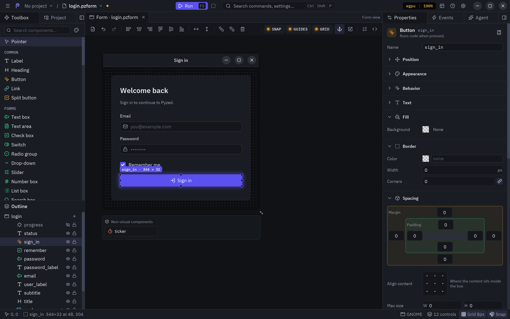

Every visual control has two sections at the end of the **Properties** panel, after its style: **Effects** and
**Animation**. What you set there is saved in the `.pzform` and plays when the form runs. It is the same
system as [`widget.animate()` and the style effects](/pyzed/animation/) of the library.



## Effects

| Field | What it does |
| --- | --- |
| **Opacity** | How visible the control and everything inside it is (1 is opaque). |
| **Shadow** | A drop shadow: pick a color, then **Offset** (X and Y) and **Blur**. |
| **Blur** | Blurs the control and everything inside it, in pixels. |
| **Backdrop blur** | Blurs what is behind the box, in pixels. |
| **Glow** | A soft halo around the box. Pick a color (or a theme token such as `accent`); **Glow size** sets how far it spreads. |
| **Bloom** | Light that spills from the bright parts of the control. **Intensity** goes from 0 to 1. |
| **Glass** | A translucent panel that blurs what is behind it, with a light edge. **Tint** colors it and **Strength** sets how much of the tint shows. |

Rotation is in the **Position** section. Sub-fields only show while the effect is on. Clear the color (or turn **Glass** off) to remove it.
Effects are style properties (`opacity`, `shadow`, `blur`, `backdrop_blur`, `glow`, `bloom`, `glass`), so they also show in code as
`control.style` and work with **Reset style**. Glass looks best over a colorful background, such as a
panel with a gradient.

## Animation

An animation is two choices: **when** it plays and **what** plays (a preset such as *Fade in up*, *Pulse* or
*Shake*). A control without animations shows a few ready-made ones to add with one click (**Fade in when it
appears**, **Lift on hover**, **Pulse on click**, **Shake when the value is invalid**...), only those that suit the
control, and **Add animation** for any other.

Each row is one animation: an icon for what plays it, a summary (**Fade in up · 280 ms**, with
**+delay** and **×repeat** when set) and the trigger under it. The **▶** button previews it and the trash
can removes it. Click a row to open its editor:

| Field | Meaning |
| --- | --- |
| **When** | What plays it (see the table below). Under the field, a line says how the chosen one starts. |
| **Control**, **Event** | Only for **On another control's event**: which control (or the form) and which of its events. |
| **Animation** | The preset. The ones that suit the trigger come first (entrances for *appears*, interactions for hover and press, attention seekers for clicks and events); the tooltip describes the selected one. |
| **Duration**, **Delay** | Milliseconds. Empty keeps the preset's own timing. |
| **Easing** | How the speed changes along the way (ease, linear, ease out cubic, spring...). |
| **Repeat** | 1, 2, 3, 5 or infinite. |

| When | Plays |
| --- | --- |
| **When it appears** | Once, when the form opens or the control is shown. |
| **While hovered**, **While pressed**, **While focused** | Forward while the condition holds, and back when it ends. |
| **On click**, **On double click**, **On right click** | Once on each click. |
| **When the pointer enters**, **When the pointer leaves** | Once each time the mouse comes in or goes out. |
| **When its value changes** | Once on each new value (typing, a new choice, a toggled switch...). |
| **When Enter is pressed** | Once when the user submits a text box. |
| **When its value is invalid** | Once each time a [validation rule](/pyzed/editor/data-binding/) fails: a classic *shake* on a wrong password. |
| **On another control's event** | Once on each event of another control or the form: a label that pulses when **Save** is clicked, a card that fades in when the form loads. |
| **When played from code** | Only when a handler calls `play_animation()` (see below). |

The triggers that play on an event work even if the control has no handler for it, and they play before the
handler runs. **Add animation** adds a row (a *Fade in up* when it appears) and opens it. Picking another
preset resets the row's timing to the new preset's. Every change can be undone.

### Playing it from your code

Choose **When played from code** and the animation waits for your handlers: it doesn't play when the
form opens. The open row shows the line that plays it, with a copy button. Paste it in any handler
(a button's click, a timer's tick, a failed validation):

```python
def sign_in_click(form, event):
    if not form.password.validate():
        form.password.play_animation()      # plays the password box's "When played from code" animations
```

`play_animation()` also replays the control's **When it appears** animations. Give it a preset name,
a `pz.Animation` or property values to play something the control has no row for, and use
`stop_animation()` to stop what it started (a loop, for example):

| Call | What plays |
| --- | --- |
| `form.title.play_animation()` | Its own rows set to **When played from code** (and replays **When it appears**). |
| `form.title.play_animation("tada")` | That preset, once. |
| `form.badge.play_animation("pulse", repeat=3, duration=400)` | A preset with other timing (any [`animate()` option](/pyzed/animation/animate/#timing-options)). |
| `form.card.play_animation(scale=1.05, duration=200)` | To these values and back. |
| `form.spinner.stop_animation()` | Stops what `play_animation` started. |

[Start here: apply and play](/pyzed/animation/start/) compares this with `pz.Trigger`, the way a
code-only app does the same.

### Previewing

The canvas stays still while you edit, so controls don't move under the mouse. **Preview** (at the
bottom of the section, or **▶** on a row) plays the control's animations once on the canvas, as if it had
just appeared; **Stop** ends the preview. Run the form (**F5**) to see every animation with its real
trigger.

## In code

Animations are saved as plain data on the control:

```json
"animations": [
  {"preset": "fade_in_up"},
  {"preset": "lift", "on": "hover", "duration": 180}
]
```

The `"on"` values are `mount` (the default), `hover`, `press`, `focus`, `click`, `double_click`, `right_click`,
`enter`, `leave`, `change`, `submit`, `invalid`, `event` and `manual` (**When played from code**). An `event`
entry also names its source and event: `{"preset": "tada", "on": "event", "source": "save", "event": "click"}`
(an empty `source` is the form). `Document.set_animations(name, animations)` changes them
from a script and `Control.animations` reads them. To play one from a handler, call
`form.<control>.play_animation(...)` (see above); to make your own presets, use the library's
`pz.Animation` and `define_animation` (see the [preset list](/pyzed/animation/presets/)).

## Timeline animations

For animations that move several controls together (an intro, a transition between states), open the
**Animation** panel from **View → Animation** (`Ctrl+Shift+M`). It edits **clips**: timelines saved in the
`.pzform` that play the same way as [`pz.AnimationPlayer`](/pyzed/animation/timeline/) does in code.


An empty panel lists the three steps (add a track, add keys, play it) and has a **New animation** button.

| Action | Result |
| --- | --- |
| **Add track for …** | Adds a track for a property of the selected control (opacity, position, scale, colors, size…) or any of its properties, such as a label's text. |
| **Click** anywhere on the ruler or the lanes, or **drag** | Moves the playhead; the canvas shows the form at that time. It snaps to keys nearby. |
| **Double-click** a lane | Adds a key at that time with the value the track has there. |
| **Drag** a key | Moves it in time. You can grab it from a few pixels away (the pointer becomes a hand) and it snaps to the keys of the other tracks, the start and the end. A label shows its time and value while you drag or hover it. |
| **Click** a key | Selects it: edit its time, value and easing below the tracks. |
| **Right-click** a key | Deletes it. |
| **Calls** lane | Type a handler name and press Enter (or double-click the lane) to call that method of the form's code file at the playhead. Drag a call to move it; right-click it to remove it. |
| **Length**, **loop**, **autoplay** | Set how long the clip lasts, whether it repeats, and whether it plays when the form opens. |

With the pointer over the panel, the keyboard edits the timeline:

| Key | Does |
| --- | --- |
| `Delete` / `Backspace` | Deletes the selected key. |
| `Space` | Plays or pauses the preview. |
| `←` / `→` | Moves the selected key (or the playhead) by 0.01 s; with `Shift`, by 0.1 s. |
| `Home` / `End` | Jumps to the start or the end. |


Controls inside an animated container follow its opacity, position and blur. Every change can be undone.

### How a clip starts

A clip plays in one of two ways, and the bar under the tracks says which one applies to the clip you
are editing:

- **⚡ Play when the form opens** (in the toolbar) makes it the form's autoplay clip: "Plays when the
  form opens."
- Otherwise it waits for a handler. The bar shows the line to call, with a copy button:

```python
def replay_click(form, event):
    form.animations.play("intro", restart=True)  # from the start, even if it is playing
    # also: form.animations.pause(), .resume(), .seek(0.5), .play_backwards("intro"), .queue("outro")
```

`form.animations` is the form's [`pz.AnimationPlayer`](/pyzed/animation/player/): it can also pause,
seek, queue clips and say when one ends. The [Animation section](/pyzed/animation/) explains clips,
tracks, keys, easing and the player in depth.
