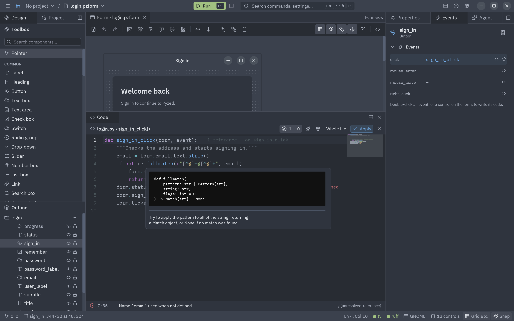
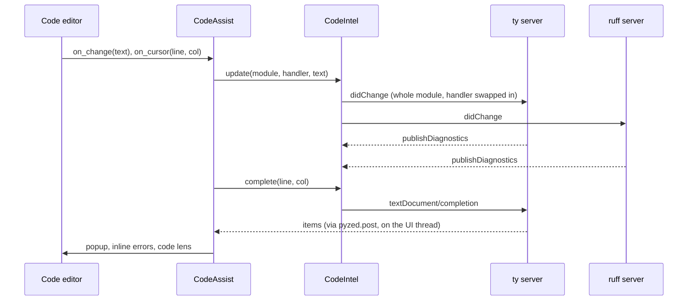

The **Code** panel (bottom dock) is a Python editor backed by two language servers from
Astral: **ty** (types, completion, references) and **ruff** (linting and formatting). It shows up when you open a
handler or a project file and goes away when you close it.


## What it edits

The editor shows either **one handler** or the **whole code file**:

| Mode | How to get there | Title |
| --- | --- | --- |
| One handler | Double-click a control or an event, <kbd>Enter</kbd> on a selected control, **View code**, a method in the [Component panel](/pyzed/editor/component-designer/#the-component-panel). | `login.py › sign_in_click()` |
| Whole file | <kbd>F7</kbd>, **Edit code file** (toolbar, ☰ menu, palette), or **Whole file** in the header. | `login.py` |
| A project file | A click on a text file in the [Project tab](/pyzed/editor/projects/#files), or <kbd>Ctrl</kbd>+<kbd>P</kbd>. | `src/shop/cart.py` |

**Whole file** and **This handler** in the header switch between the two. In handler mode you only see the
function, but the language servers always see the whole module with that handler swapped in, so the imports and
helpers at the top of the file are known to completion and diagnostics.

## The header

| Item | Does |
| --- | --- |
| Title | The code file and, in handler mode, the function. |
| **Problems** (`2 · 1`) | Errors and warnings of the code; click to show or hide the problems list. A check mark means there are none. |
| **Gear** | Opens the [editor settings](#editor-settings). |
| **Whole file / This handler** | Switches the mode. |
| **Apply** | Checks the syntax, writes the code to the document and, with *Format with ruff on Apply* on, formats it. |
| **×** | Closes the editor (the code is applied first). |

Your code is applied to the document on its own whenever you switch handlers, switch mode, change tab, save or run;
**Apply** is for checking it (and formatting it) right away. If the code does not parse, a red line under the
editor says where (`Line 3: invalid syntax`), and saving, running and switching wait until you fix it.

## Writing code

- **Syntax highlighting** for Python, with the theme of the editor (or its own, see settings).
- **Indentation**: <kbd>Tab</kbd> inserts spaces (the *Tab size*), or a tab with *Indent with tabs*;
  <kbd>Enter</kbd> keeps the indentation of the line (its spaces and tabs) and adds a level after a `:`;
  <kbd>Backspace</kbd> in the indentation removes a whole level (one space with *Backspace removes a whole level*
  off). See [Tabs or spaces](#tabs-or-spaces).
- **Brackets and quotes**: typing `(`, `[`, `{`, `"` or `'` inserts its pair, wraps the selection if there is one,
  and typing the closing character steps over it instead of doubling it.
- **Gutter**: line numbers (they follow wrapped lines) and the current line highlighted.
- **Folding**: chevrons in the gutter fold and unfold blocks (functions, classes, `if`s...);
  <kbd>Ctrl</kbd>+<kbd>Shift</kbd>+<kbd>[</kbd> folds the innermost block around the cursor and
  <kbd>Ctrl</kbd>+<kbd>Shift</kbd>+<kbd>]</kbd> unfolds it.
- **Minimap**: the code zoomed out on the right; click or drag it to scroll.
- **Input methods**: Chinese, Japanese and Korean input methods (IME) work: the text being composed is
  drawn at the cursor and the committed text goes in at every cursor.
- **Whitespace**: optionally draws spaces as `·` and tabs as `→`.
- **Zoom**: <kbd>Ctrl</kbd>+<kbd>=</kbd>, <kbd>Ctrl</kbd>+<kbd>-</kbd> or <kbd>Ctrl</kbd>+wheel change the font size;
  <kbd>Ctrl</kbd>+<kbd>0</kbd> resets it. The size is saved.
- **Scrolling**: the mouse wheel scrolls the code (<kbd>Shift</kbd>+wheel sideways) and the scrollbars sit right of
  the minimap. The view also follows the cursor.
- **Sticky scroll**: while you scroll, the lines that open the blocks you are in (`class`, `def`, `for`, `if`,
  `with`...) stay pinned at the top of the editor, the innermost one last, so you always know where you are. Click
  one to jump to it. Up to five lines are pinned; turn it off with *Sticky scroll* in the settings.
- **Long lines** scroll sideways by default; <kbd>Alt</kbd>+<kbd>Z</kbd> (or *Wrap long lines* in the settings) wraps
  them at the editor's width instead.


### Keys in the editor

| Keys | Action |
| --- | --- |
| Arrows, <kbd>Home</kbd>, <kbd>End</kbd> | Move the cursor. |
| <kbd>Ctrl</kbd>+<kbd>←</kbd> / <kbd>→</kbd> | Move by word. |
| <kbd>Ctrl</kbd>+<kbd>Home</kbd> / <kbd>End</kbd> | Start or end of the code. |
| <kbd>Page Up</kbd> / <kbd>Page Down</kbd> | One page up or down. |
| <kbd>Shift</kbd> + any of the above | Extend the selection. |
| <kbd>Ctrl</kbd>+<kbd>A</kbd> | Select everything. |
| <kbd>Ctrl</kbd>+<kbd>C</kbd> / <kbd>X</kbd> / <kbd>V</kbd> | Copy, cut, paste. |
| <kbd>Tab</kbd> | Indent (insert spaces). |
| <kbd>Ctrl</kbd>+<kbd>Space</kbd> | Open the completion list. |
| <kbd>F12</kbd>, <kbd>Ctrl</kbd>+click | Go to the definition. |
| <kbd>Alt</kbd>+<kbd>←</kbd> / <kbd>→</kbd> | Go back / forward after a jump. |
| <kbd>Shift</kbd>+<kbd>F12</kbd> | Find every reference. |
| <kbd>F2</kbd> | Rename the symbol. |
| <kbd>Ctrl</kbd>+<kbd>.</kbd> | Quick fixes and refactorings. |
| <kbd>Ctrl</kbd>+<kbd>Shift</kbd>+<kbd>[</kbd> / <kbd>]</kbd> | Fold / unfold at the cursor. |
| <kbd>Ctrl</kbd>+<kbd>=</kbd> / <kbd>-</kbd> / <kbd>0</kbd> | Font bigger, smaller, default. |
| <kbd>Ctrl</kbd>+<kbd>Z</kbd> / <kbd>Ctrl</kbd>+<kbd>Shift</kbd>+<kbd>Z</kbd> | Undo, redo (typing is grouped into one step). |
| <kbd>Ctrl</kbd>+<kbd>F</kbd> / <kbd>H</kbd> / <kbd>G</kbd> | Find, replace, go to line (see below). |
| <kbd>Esc</kbd> | Back to one cursor, close the completion list, or leave the editor. |

On macOS, <kbd>Cmd</kbd> works where these say <kbd>Ctrl</kbd>. The editor's global commands (<kbd>F5</kbd>,
<kbd>Ctrl</kbd>+<kbd>S</kbd>, <kbd>Ctrl</kbd>+<kbd>Shift</kbd>+<kbd>P</kbd>...) work while you type; the canvas
shortcuts (<kbd>Delete</kbd>, arrows, <kbd>Ctrl</kbd>+<kbd>D</kbd>) do not, so typing never moves a control.

## Tabs or spaces

Python refuses a block that mixes tabs and spaces, so the editor keeps to one of them:

- **Indent with tabs** (Editor settings → Editing) makes <kbd>Tab</kbd>, <kbd>Enter</kbd> and indent
  (<kbd>Ctrl</kbd>+<kbd>]</kbd>) write tab characters. Tabs are drawn *Tab size* columns wide, and
  <kbd>Enter</kbd> copies the spaces and tabs of the line above as they are, in either mode.
- **Convert indentation to tabs** and **Convert indentation to spaces**, in the command palette
  (<kbd>Ctrl</kbd>+<kbd>Shift</kbd>+<kbd>P</kbd>), rewrite the indentation of the file the code editor shows. The
  text inside multi-line strings is left as it is.
- **Convert indentation on save** does it every time a Python file (or the form's code) is saved, so pasted code
  never breaks the file.
- The code the designer writes for you (a new handler or method) follows the file: in a file indented with tabs it
  is written with tabs.

Holding <kbd>Backspace</kbd> or <kbd>Delete</kbd> deletes at the pace set under **Deleting**: the first press
always deletes; the next ones wait *Delay before repeating* and then come at most *Deletions per second* times a
second. They can be slower than your system's key repeat, not faster.

## Find, replace and multiple cursors


- <kbd>Ctrl</kbd>+<kbd>F</kbd> opens the find bar with the word under the cursor; matches are highlighted in the
  code and the bar counts them. <kbd>Enter</kbd> or <kbd>F3</kbd> go to the next one, <kbd>Shift</kbd>+<kbd>F3</kbd>
  to the previous one, and <kbd>Alt</kbd>+<kbd>Enter</kbd> puts a cursor on every match. The buttons match case,
  whole words or a regular expression.
- <kbd>Ctrl</kbd>+<kbd>H</kbd> also shows the replace field: **Replace** changes the current match, **Replace all**
  every match in one undo step. With a regular expression, `\1` in the replacement inserts a group.
- <kbd>Ctrl</kbd>+<kbd>G</kbd> goes to a line (`42`) or a line and column (`42:8`).
- The editor has multiple cursors and the usual editing keys of modern code editors: <kbd>Alt</kbd>+click,
  <kbd>Ctrl</kbd>+<kbd>Alt</kbd>+<kbd>↑</kbd>/<kbd>↓</kbd>, <kbd>Ctrl</kbd>+<kbd>D</kbd>,
  <kbd>Alt</kbd>+<kbd>Shift</kbd>+<kbd>↑</kbd>/<kbd>↓</kbd> to duplicate lines on every cursor,
  <kbd>Ctrl</kbd>+<kbd>Shift</kbd>+<kbd>L</kbd>, <kbd>Alt</kbd>+<kbd>↑</kbd>/<kbd>↓</kbd> to move lines,
  <kbd>Ctrl</kbd>+<kbd>/</kbd> to comment, <kbd>Ctrl</kbd>+<kbd>Z</kbd> / <kbd>Ctrl</kbd>+<kbd>Shift</kbd>+<kbd>Z</kbd>
  and more. See the full list in [the code editor component](/pyzed/components/code/#multiple-cursors-and-zeds-keys)
  or press <kbd>F1</kbd> in the designer.

## Completion


- The list opens while you type a name or after a `.` (not in comments or strings), and
  <kbd>Ctrl</kbd>+<kbd>Space</kbd> opens it anywhere. Turn off *Autocomplete while typing* to open it only with the
  keys.
- <kbd>↑</kbd>/<kbd>↓</kbd> move (wrapping around), <kbd>Page Up</kbd>/<kbd>Page Down</kbd> jump nine rows,
  <kbd>Enter</kbd> or <kbd>Tab</kbd> insert, <kbd>Esc</kbd> closes; a click inserts too. The footer shows the
  position (`3/42`).
- The mouse wheel scrolls the list without moving the highlighted entry, and a scrollbar on its right shows where
  you are. Long names and signatures are cut with `…` to fit; the pane beside the list shows them whole.
- Typing keeps filtering the list: names that start with what you typed come first, then names that contain the
  letters in order (`gtx` finds `get_text`).
- Each entry has an icon for its kind and, beside the list, a pane with its **signature** and **documentation**
  (the docstring, as Markdown).

  | Icon color | Kind |
  | --- | --- |
  | Purple | Functions and methods |
  | Yellow | Classes, enums, type parameters |
  | Blue | Variables, attributes and properties |
  | Cyan | Constants |
  | Red | Modules |
  | Accent | Controls of the form |

- **Private** names (`_cache`) are dimmed, carry a small lock and are listed after the public ones; dunders
  (`__init__`) come last.
- **Auto-import**: picking a name that is not imported yet also adds its `import` at the top of the file, even in
  handler mode.
- The list opens below the word, or above it when there is more room there.

### The form's own names

A handler's `form` and `event` have no type the servers could read, so the editor completes them itself:

| You type | You get |
| --- | --- |
| `form.` | Every control of the form, plus `title`, `name`, `size`, `window` and `close()`. |
| `form.email.` | The properties of that control, with their types, plus `name`, `type`, `visible`, `enabled`, `show()`, `hide()` and `focus()`. |
| `event.` | `sender`, `name` and `value`. |


## Hover, navigation and refactoring



These work like in VS Code or Zed, with ty answering where it can and the editor filling in what only the designer
knows (the controls of the form).

- **Hover**: rest the mouse on a name for half a second and a card shows its type or signature and its docstring
  (as Markdown), plus the problems at that spot. `form.email` and `form.email.text` describe the control and its
  property. The card stays while the mouse is over it, so you can scroll it and select its text. Turn it off with
  *Information on hover* in the settings.
- **Go to definition**: <kbd>F12</kbd> or <kbd>Ctrl</kbd>+click on a name opens where it is defined: further down
  the same code, another handler of the form (the editor switches to it), a file of your project or a library in
  the `.venv` (opened read-only in a tab). <kbd>Ctrl</kbd>+<kbd>F12</kbd> goes to the definition of its **type**.
  On `form.email`, it selects the control on the canvas. Without ty it still finds the `def` and `class` of the
  file.
- **Back and forward**: <kbd>Alt</kbd>+<kbd>←</kbd> returns to where you were before the jump, and
  <kbd>Alt</kbd>+<kbd>→</kbd> goes forward again.
- **Find references**: <kbd>Shift</kbd>+<kbd>F12</kbd> lists every use of the name under the editor, with the file,
  line and text; click one to go there.
- **Rename**: <kbd>F2</kbd> opens a field on the name; type the new one and press <kbd>Enter</kbd>. Every use
  changes, in this file and in the other files of the project that use it (they open as unsaved tabs for you to
  check and save). Renaming a handler keeps its events wired to it (`on sign_in.click`), and one
  <kbd>Ctrl</kbd>+<kbd>Z</kbd> takes the rename back.
- **Quick fixes** (<kbd>Ctrl</kbd>+<kbd>.</kbd>, or **Quick fix…** in the hover card): the fixes ruff and ty offer
  for the line, such as removing an unused import, plus:
  - **Import** a name that is not defined, from the module that has it.
  - **Install a missing package**: on `import httpx` with httpx not installed, *Install httpx in the project
    (uv add)* adds it to `pyproject.toml` and the `.venv`, and the error goes away once it is installed. Known
    names are translated to their package (`cv2` → `opencv-python`, `PIL` → `pillow`, `yaml` → `pyyaml`).
- **Organize imports** (<kbd>Alt</kbd>+<kbd>Shift</kbd>+<kbd>O</kbd>) sorts and groups the imports with ruff, and
  **Fix all auto-fixable problems** (command palette) applies every safe ruff fix.

## Contextual help

<kbd>Shift</kbd>+<kbd>F1</kbd> opens the [built-in reference](/pyzed/editor/reference/) on the name under the
cursor: `form.email` or `form.email.text` opens the page of the control's kind, `form` and `event` open the form
scripting pages, and library names (`pz.text`, `ui.button`, `Theme`) open their API page. With no match it searches
the reference for the name.

## Diagnostics and code lens


- **Inline diagnostics** (error lens): the most severe problem of each line is written at its end, in red for
  errors, yellow for warnings and blue for information.
- **Problems list**: under the editor, every problem with its line and column, message and source (`ruff (F401)`,
  `ty`). Click one to jump to it. The header button shows the counts and hides or shows the list.
- **Code lens** at the end of each `def` and `class` line: how many **references** it has (from ty, or counted by
  name when ty is off), how many classes **implement** a class, and which events **call** a handler
  (`on sign_in.click`).

## Language servers

The servers start in the folder of the nearest project marker above the code file (`pyproject.toml`, `uv.lock`,
`setup.py`, `.git`) and use its `.venv` (where `uv sync` installs your dependencies), or `$VIRTUAL_ENV`. The code's
own folder and `src/` are added as import roots, so a UI kept in its own folder still resolves both:

```
myapp/
├── pyproject.toml      ← uv add httpx
├── .venv/              ← uv sync
├── src/myapp/
└── ui/
    ├── login.pzform
    ├── login.py        ← import httpx / from helpers import greet / from myapp import api
    └── helpers.py
```

When the project has no `.venv` yet (a form you just opened, or a project before its first `uv sync`), ty uses the
Python the designer runs on, so `import pyzed` and the standard library resolve instead of being reported as
missing. As soon as the `.venv` appears, or `pyproject.toml` or `uv.lock` change (adding a dependency in the
[Project tab](/pyzed/editor/projects/)), the servers restart with it, so new packages resolve without reopening the
project.

The editor looks for `ty` and `ruff` in the project's `.venv` first, then next to the editor, then on `PATH`.
Install them with `uv add --dev ty ruff` in the project, or with `pip install "pyzed-ui[designer]"` next to the
editor. Ruff reads its rules from `[tool.ruff]` in `pyproject.toml`.

While the code editor is open, the status bar shows a dot per server: green when **ready**, yellow while
**starting**, red when **missing** or failed. Hover it for details; click it to open the editor settings.



## Editor settings

The **gear** in the code panel header, the server dots in the status bar, or **Settings → Code editor → Editor
settings…** open them. They are saved per user, in the same `designer.json` as the
[editor's settings](/pyzed/editor/settings/). An index on the left lists the sections and
the right side shows the one you pick.


| Section | Setting | What it does |
| --- | --- | --- |
| Appearance | **Theme** | *Same as the designer*, or any theme for the editor alone. |
| | **Font** | *Default* (IBM Plex Mono) or any installed font; also in Settings → Fonts and size. |
| | **Font size** | 8 to 32 (also <kbd>Ctrl</kbd>+<kbd>=</kbd>/<kbd>-</kbd>/<kbd>0</kbd> and <kbd>Ctrl</kbd>+wheel). |
| | **Line height** | Compact, Standard or Comfortable. |
| | **Line numbers**, **Highlight current line** | The gutter and the current-line band. |
| | **Show whitespace** | Spaces as `·`, tabs as `→`. |
| Cursor | **Shape** | Bar, Block, Underline or Hollow. |
| | **Blink** | Whether the cursor blinks. |
| | **Width** | 1 to 4 pixels, for the bar cursor. |
| Editing | **Tab size** | 1 to 8 columns per level, and the width tabs are drawn with. |
| | **Indent with tabs** | <kbd>Tab</kbd>, <kbd>Enter</kbd> and <kbd>Ctrl</kbd>+<kbd>]</kbd> indent with tab characters instead of spaces. |
| | **Convert indentation on save** | Saving a Python file rewrites its indentation with tabs or spaces, as set above. |
| | **Backspace removes a whole level** | Off: <kbd>Backspace</kbd> in the indentation removes one space at a time. |
| | **Autocomplete while typing** | Off: the list only opens with <kbd>Ctrl</kbd>+<kbd>Space</kbd>. |
| | **Auto-close brackets and quotes** | Pairs, wrapping the selection and stepping over the closer. |
| | **Code folding** | The chevrons and the fold keys. |
| | **Match brackets** | Outlines the bracket that pairs with the one at the cursor (<kbd>Ctrl</kbd>+<kbd>M</kbd> jumps to it). |
| | **Highlight selection matches** | Highlights the other places with the selected text. |
| | **Format with ruff on Apply** | Runs `ruff format` on the code when you press Apply. |
| Deleting | **Delay before repeating** | Milliseconds <kbd>Backspace</kbd> and <kbd>Delete</kbd> wait, held down, before they repeat (500 by default; 0 keeps the system's). |
| | **Deletions per second** | How fast they delete while held down (20 by default; 0 keeps the system's pace). |
| Scrolling and wrapping | **Wrap long lines** | Off by default: long lines scroll sideways. <kbd>Alt</kbd>+<kbd>Z</kbd> toggles it. |
| | **Scrollbars** | Shows or hides the scrollbars. |
| | **Minimap** | The zoomed-out code on the right. |
| | **Sticky scroll** | Keeps the lines of the enclosing blocks pinned at the top while you scroll. |
| Code lens and diagnostics | **Code lens** | References, implementations and wired events at the end of definitions. |
| | **Inline diagnostics** | Problems at the end of the line. |
| | **Information on hover** | The card with the type, documentation and problems of the name under the mouse. |
| Language servers | **ty**, **ruff** | Turn each server on or off. Each row shows its state and version. Below: the project root and the Python in use. |
| | **Restart servers** | Restarts both; use it after `uv sync` or after installing them. |


### Key bindings

**Key bindings** in the index opens the [keymap editor](/pyzed/editor/keymap/), where you can change the keys of every
action of the editor, the code panel and the rest of the designer. The changes are saved in `keymap.json`, in Zed's
format.

In your own apps, `ui.editor(keymap=...)` takes keys → action (the same format as Zed's keymaps, `None` to take a
default key away), and `pyzed.ui.editor.keymap_for` turns per-action changes into it.
