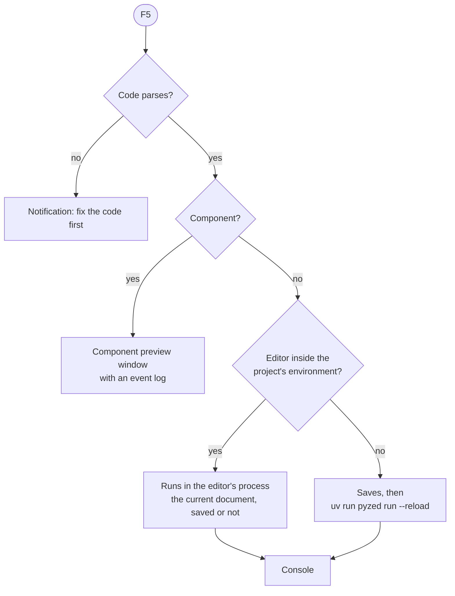

## Run and Stop

**Run** (<kbd>F5</kbd>, the green button in the title bar, the ☰ menu or the console) opens the document in a new
window with all its logic; **Stop** (<kbd>Shift</kbd>+<kbd>F5</kbd>, the square next to Run) closes it.


What Run does depends on the document and on where the editor runs:



- **In the editor's process** (you started the editor with `uv run pyzed design`, or there is no project): the form
  runs as it is in the editor, **including unsaved changes**, with its code file compiled fresh. Running again
  closes the previous window first.
- **With `uv run`** (the standalone Pyzed Design, or an editor installed with `uv tool`, which does not have the
  project's dependencies): the form is saved and started in its own process with
  `uv run pyzed run --reload`, so every package of `.venv` is available.
- **A component** opens in a [preview window](/pyzed/editor/component-designer/#running-and-using-it) that lists
  the custom events it raises.

With **Save before running** on (Settings → Running), Run always saves first.

:::tip
If the code file fails when it is loaded (an import error, a typo at the top level), Run stops and the console
shows the traceback, with a notification naming the error.
:::

## The console

The **Console** panel (bottom dock, <kbd>Ctrl</kbd>+<kbd>Shift</kbd>+<kbd>Y</kbd> or **View → Console**) shows what
the running form does, without leaving the editor:


| Line | Comes from |
| --- | --- |
| ▶ `login started` / ■ `login stopped` | A run starting and ending (with `(uv run)` when it runs in its own process). |
| Event (accent, lightning icon) | Each event the form handles, with its value and the handler it calls: `sign_in.click → sign_in_click()`. `tick`, `mouse_enter` and `mouse_leave` are left out so they do not flood it. |
| Output | Whatever the handlers `print`. |
| Error output (yellow) | What they write to `stderr`. |
| Error (red) | The full traceback of a handler that raised, starting at the handler. |

The toolbar of the console:

- **Filter** box: shows only the lines containing the text.
- **Level toggles**, one per kind of line present, with its count: click one to hide or show those lines.
- **Copy** puts the whole log on the clipboard; **Clear** empties it.
- A **Running** badge while a form runs, **Stop** and **Run**.

The list keeps scrolling to the newest line while you are at the bottom; scroll up to read older lines in peace.
Output still reaches the terminal the editor was started from.

When Run opens the console is decided by **Settings → Running → Open the console on Run**, and whether events are
logged by **Log events in the console**. The console stays in its dock until you hide it, once it has something to
show or you opened it from the View menu.

## Errors in the running window

A handler that raises does not close the window: an **Event handler error** callout appears at its bottom with the
last line of the error, and the traceback goes to the console. Fix the code, save, and try again (see below).

## Live updates on save

While a form runs, **Save** (<kbd>Ctrl</kbd>+<kbd>S</kbd>) updates the open window without restarting it: the
layout, the properties and the code are replaced, while what the user typed or picked in each control (texts,
check boxes, selections, slider values) stays. If the new version fails to load, the window keeps running the old
one and shows the error.

A form started with `uv run` (or with `pyzed run app.pzform --reload` from a terminal) watches its files instead,
so saving from any editor updates it too. From code, use `designer.run(path, reload=True)` or set
`PYZED_RELOAD=1`.

```bash
pyzed run login.pzform            # run a form without the editor
pyzed run login.pzform --reload   # ...and update it on every save
pyzed run ui/rating.pzcomp        # preview a designed component
```
