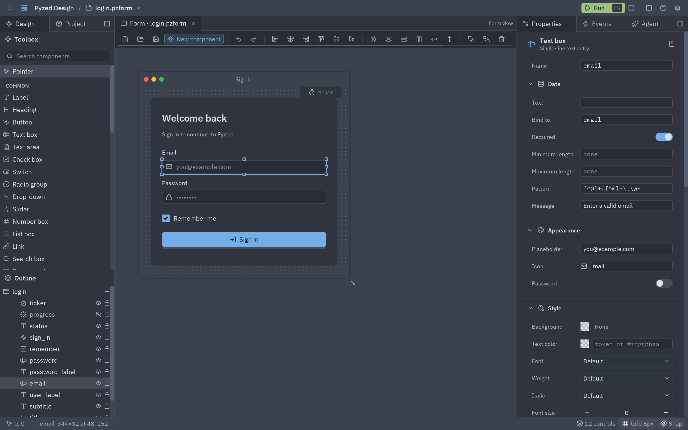
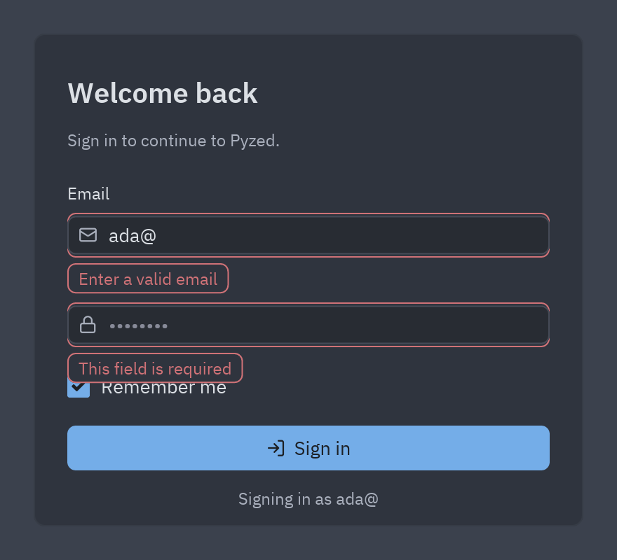
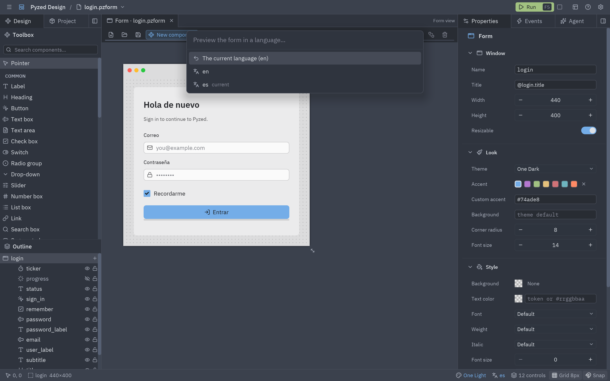

A form can show and edit **data** without a line of glue code: bind each control to a field of `form.data`, give
the input controls **rules**, and call `form.validate()` before you use the data.

## Binding a control

Select a control and fill **Bind to** in the **Data** section of [Properties](/pyzed/editor/properties/). The field
is a name (`email`) or a path into nested data (`customer.address.city`, `items.0.title`).



- **Input controls** bind in both directions: they show the field and write back what the user types or picks.
  Text boxes, text areas and search boxes bind `text`; check boxes and switches `checked`; radio groups, drop-downs,
  segmented controls, tab bars and list boxes `selected`; sliders and number boxes `value`.
- **Display controls** only show it: labels, headings, badges, links, chips, markdown and callouts bind `text`,
  stats and progress bars `value`, images `source`, charts `values` and tables `data`.
- A display control's **Bind to** can also be a **Python expression** over the data's fields, re-evaluated on every
  render:

  ```python
  f"Signing in as {email}" if email else ""
  f"{len(items)} items, {sum(i.price for i in items):.2f} €"
  ```

  Nested dicts read with dots (`customer.city`); `data` is the whole object and `form` the running form. A path to
  a field that is still missing leaves the control's designed value; an expression that raises leaves it too and
  shows the error in the window.

## The form's data

`form.data` is whatever the form that opened this one passed, or a dict the form makes itself:

```python
def edit_click(form):
    return form.open("customer", data=selected_customer)  # a dict, a dataclass, any object
```

| Opened with | `form.data` is |
| --- | --- |
| `data=` a dict or an object | That same object: the user's edits change it in place. |
| Nothing, with bound controls | A new dict, filled with the controls' designed values (`{"email": "", "remember": False}`). |

Assigning `form.data = {...}` replaces it and refreshes every bound control, which is the way to load a record:

```python
def form_load(form):
    form.data = database.load_customer(42)
```

## Validation rules

The **Data** section also holds the rules of a two-way control. The rules depend on the kind of control:

| Rule | Controls | Fails when |
| --- | --- | --- |
| **Required** | Every input control | The value is empty (an unchecked box, for check boxes and switches). |
| **Minimum length**, **Maximum length** | Text boxes, text areas, search | The text is shorter or longer. |
| **Pattern** | Text boxes, text areas, search | The whole text does not match the regular expression. |
| **Minimum**, **Maximum** | Sliders, number boxes | The number is smaller or larger. |
| **Message** | Every input control | Replaces the built-in message of any rule (`@key` translates it). |

An empty value only fails **Required**, so an optional email field with a pattern accepts a blank. The built-in
messages ("This field is required", "At least 8 characters") follow the app's language.

The running form checks a control's rules **as the user types**, and shows the message in a bubble under the
control, which gets a red border:



## Validating in code

```python
def sign_in_click(form):
    if not form.validate():          # checks every visible, enabled control and shows the errors
        return
    auth.sign_in(form.data["email"], form.data["password"])
```

| Code | Does |
| --- | --- |
| `form.validate()` | Checks every bound control's rules (hidden and disabled ones are skipped) and returns `True` when all pass. |
| `form.valid` | `True` while no control shows an error. |
| `form.errors` | `{"email": "Enter a valid email", ...}`: the controls that show an error. |
| `form.email.validate()` | Checks one control; `True` when it passes. |
| `form.email.error` | The control's message, or `None`. Assign a text to show your own error (`form.email.error = "Already registered"`), `None` to clear it. |

A server-side check therefore looks like any other:

```python
async def sign_in_click(form):
    if form.validate() and not await api.email_free(form.data["email"]):
        form.email.error = "That email is already registered"
```

## Translatable texts

Any text property that starts with `@` is a **translation key**: a label whose text is `@login.title` shows
`pz.t("login.title")` in the app's language. `@@` writes a literal `@`. List items (a drop-down's options, a tab
bar's tabs) translate one by one, and so do the form's title and a rule's message.

The catalogs live in a `locales/` folder next to the form, or in any folder above it up to the project root
(`pyproject.toml` or `.git`), one file per language:

```json title="locales/es.json"
{"login": {"title": "Iniciar sesión", "email": "Correo", "sign_in": "Entrar"}}
```

The designer and the running form load them on their own. See [Translations](/pyzed/guides/i18n/) for plurals,
fallbacks and switching the language at run time.

## Preview in another theme or language

**View → Preview theme…** and **View → Preview language…** pick a theme and a language for the canvas, without
touching the form: the form keeps its own theme and the app its language, and the first entry of each picker goes
back to them.



While a preview is on, the status bar shows it (click it to pick another), and **Run** (<kbd>F5</kbd>) starts the
form with the same theme and language, so you can try the whole flow in Spanish or in a light theme. The running
form reads them from the `PYZED_PREVIEW_THEME` and `PYZED_PREVIEW_LANGUAGE` environment variables, which also work
from a terminal:

```bash
PYZED_PREVIEW_LANGUAGE=es PYZED_PREVIEW_THEME="One Light" uv run python main.py
```

## Copying controls between forms

Copy (<kbd>Ctrl</kbd>+<kbd>C</kbd>) puts the selected controls on the **system clipboard**, with their bindings
and rules, so you can paste them into another form, in another tab or another Pyzed Design window. See
[Toolbox and canvas](/pyzed/editor/toolbox-and-canvas/#clipboard-and-history).
