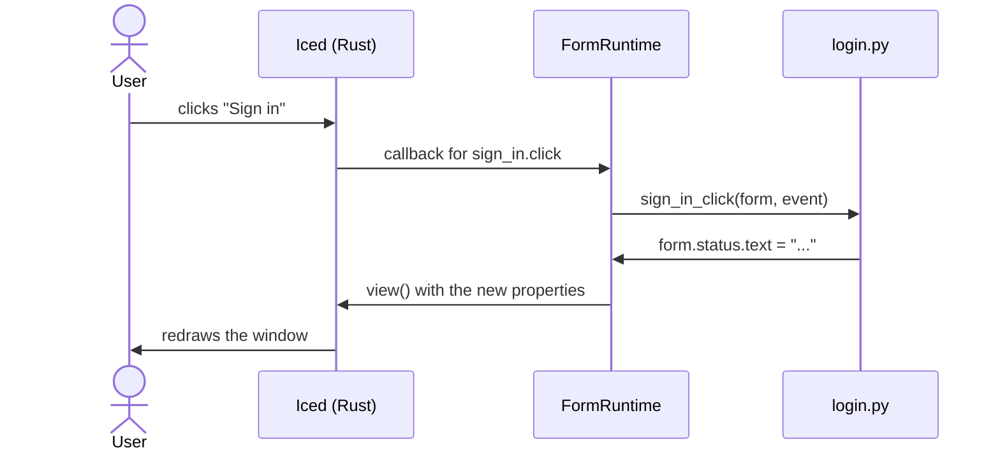

Controls raise **events** (a click, a change of text, a timer tick) and each event can be **wired** to a Python
function, its **handler**, in the form's code file (`login.py` next to `login.pzform`).

## The Events panel

The **Events** panel (right dock, next to Properties) lists the events of the selected control, or of the form
when nothing is selected, with the handler wired to each one (`—` when there is none).


| Action | Result |
| --- | --- |
| **Double-click** an event, or press its **`<>`** button | Wires it if needed (creating the handler stub) and opens the handler in the code editor. |
| **Unlink** button (wired events only) | Disconnects the event **and deletes its handler's code**. |
| Hover an event | A tooltip says when it runs and what `event.value` holds. |
| The **book** button in the header | Opens the control's page in the [reference](/pyzed/editor/reference/), with every event and its handler name (<kbd>Shift</kbd>+<kbd>F1</kbd>). |

The event being edited is highlighted. With several controls selected, the panel asks you to pick one: events
belong to a single control.

### Faster ways in

- **Double-click a control** on the canvas: opens the handler of its **main event** (the first one: `click` for a
  button, `change` for a text box, `tick` for a timer).
- <kbd>Enter</kbd> with a control selected does the same.
- **View code** in the control's context menu.
- <kbd>F7</kbd> (**Edit code file**) opens the whole file.

Handlers are named `<control>_<event>` (`sign_in_click`), or `form_<event>` for the form, and the stub carries a
docstring saying when it runs. Renaming a control renames the handlers that follow this convention.

## Every event

Every visible control has three common events on top of its own:

| Event | Runs when | `event.value` |
| --- | --- | --- |
| `mouse_enter` | The pointer enters the control. | `None` |
| `mouse_leave` | The pointer leaves the control. | `None` |
| `right_click` | The control is right-clicked. | `None` |

| Component | Own events |
| --- | --- |
| Label | `click`, `double_click` |
| Button, Link, Chip | `click` |
| Text box, Search box | `change` (the new text), `submit` (<kbd>Enter</kbd> pressed) |
| Text area | `change` (the new text) |
| Check box, Switch | `change` (`True` or `False`) |
| Radio group, Drop-down, Segmented, Tab bar | `change` (the selected option) |
| Slider, Number box | `change` (the new number) |
| List box | `change` (the selected item) |
| Table | `change` (the selected row's index) |
| Timer (invisible at run time) | `tick`, every `interval` milliseconds while `running` |
| Heading, Progress bar, Badge, Image, Icon, Markdown, Spinner, Callout, Avatar, Key binding, Stat, Chart, containers, Spacer, Divider | Only the common ones |

The form itself:

| Event | Runs when | `event.value` |
| --- | --- | --- |
| `load` | Once, when the window opens. | `None` |
| `close` | The window is closing. Return `False` to keep it open. | `None` |
| `key` | On every key press. | The combo, such as `"ctrl-s"` |
| `resize` | The window is resized. | `(width, height)` |

[Designed components](/pyzed/editor/component-designer/) add their own **custom events** to this list when you
place them on a form.

## Writing handlers

A handler receives the running `form` and an `event`. Controls are attributes of the form and their properties
are attributes of the control; changing them updates the window.

```python
def sign_in_click(form, event):
    if "@" not in form.email.text:
        form.status.text = "Enter a valid email address."
        return form.email.focus()          # handlers may return commands
    form.sign_in.enabled = False
    form.progress.show()
    form.ticker.running = True             # a Timer control starts ticking
```

| Name | What it is |
| --- | --- |
| `event.sender` | The control (or form) that raised the event. |
| `event.name` | The event (`"click"`, `"change"`...). |
| `event.value` | Its value: new text, checked state, key combo... |
| `form.<control>` | A control; read and write its properties (`form.email.text`). |
| `form.<control>.visible`, `.enabled`, `.x`, `.y`, `.width`, `.height`, `.anchor` | Its layout and behavior fields. |
| `form.<control>.show()`, `.hide()` | Shows or hides it. |
| `form.<control>.focus()` | A command that focuses it (text boxes and text areas). |
| `form.title`, `form.name`, `form.size` | The window's title (assigning it renames the window), the form's name and the current size. |
| `form.close()` | A command that closes the window. |
| `form.open("details", data=...)` | A command that opens another form in a new window; it gets `data` as `form.data`. |
| `form.window` | The Pyzed window running this form. |

Handlers can return anything a Pyzed callback can: a `Command`, a list of commands, a coroutine (for async work)
or a generator. Helpers at the top of the file, imports and other modules of the project all work as usual.



### When a handler fails

If a handler raises, the running window does not close: an **Event handler error** callout appears at the bottom
of it with the last line of the error (dismiss it with its ×), and the full traceback goes to the
[console](/pyzed/editor/console-and-running/). If an event is wired to a function that is not in the code file,
the callout says so.

:::tip
Type `form.` in a handler and the completion list offers the controls of the form; `form.email.` lists that text
box's properties, and `event.` the event's fields. See [Code editor](/pyzed/editor/code-editor/#completion).
:::

## Opening other windows

```python
def details_button_click(form, event):
    return form.open("details", data=form.order_id.text)

# details.py
def form_load(form, event):
    form.title = f"Order {form.data}"
```

The name is looked up next to the current form, then in the project's `ui/` folder. Create the second form with
**New form** (<kbd>Ctrl</kbd>+<kbd>N</kbd>); the *dialog* template comes with **OK** and **Cancel** already wired to
`form.close()`.
