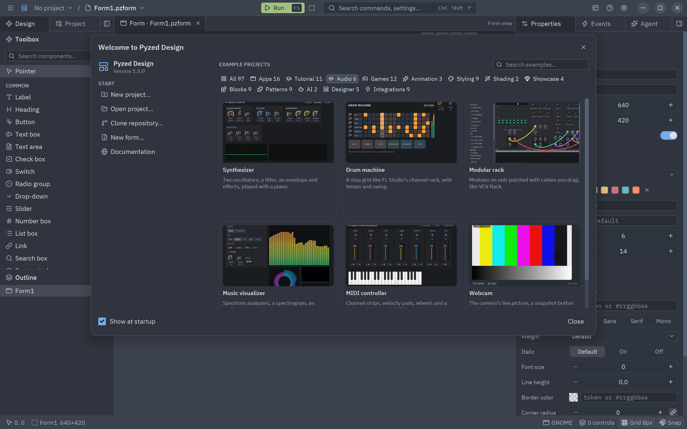

When Pyzed Design starts without a file, the **welcome window** opens. On the left you can start a new project,
open one, create a form or read the documentation, and reopen a recent project. On the right is the **gallery of
example projects**: each example has a thumbnail, a title and a description.


Open it again at any time from **Help → Welcome**, or **Help → Example projects…** to see every example. Uncheck
**Show at startup** (or turn off **Welcome window** in [Settings](/pyzed/editor/settings/)) to start straight on
an empty form.

## The gallery

The buttons above the gallery filter the examples by category (each shows how many it has), and the search box
filters them by title and description. **All** shows every category under its own heading:

| Category | Examples |
| --- | --- |
| **Apps** | Counter, To-do list, Todos, Pomodoro, Markdown viewer, Game of Life, Analog clock, Stopwatch, QR code, Color picker, Image viewer, Several windows, Custom window frame, Store admin, Component gallery, Mini editor, Zed-like editor. |
| **Tutorial** | The five steps of the tutorial (Hello, State, Layout, Async work, Notes app), Layout basics, Lists and tables, Navigation, Talking to the user, Theme switcher, Contacts with SQLite. |
| **Audio** | Synthesizer, Drum machine, Modular rack, Music visualizer, MIDI controller, Webcam. |
| **Drag and drop** | Drag and drop board, Form builder, Page builder, Design canvas, Node editor, Sortable lists ([guide](/pyzed/dnd/)). |
| **Games** | Snake, Breakout, Neon Invaders, Rock Storm, Pixel Run, 2048, Coin Chase, Jump Lab, Walker, Orb Rush, Target Rush, Dodge. |
| **Animation** | Animations, Effects, Timeline. |
| **Styling** | Styles, Web-style layout, Theming playground, and the themes Brand, Glassy dark, Pastel, Retro terminal, High contrast and Two themes. |
| **Shading** | Shader gallery, Aurora shader. |
| **Showcase** | Glass dashboard, Game HUD, Game main menu, Inventory. |
| **Blocks** | Dashboard, Kanban board, Music player, Chat, Settings, Data table, IDE layout, Sign-in screen, Onboarding wizard. |
| **Patterns** | Services (timer, worker, process, clipboard, settings), Custom components, Docks and grids, Resizable panes, Context menu, Dialogs and languages, Background work, Download progress, Live data. |
| **AI** | Pyzed agent (an agent that calls tools, with a demo model that needs no key), AI chat. |
| **Designer** | Forms made in Pyzed Design: Login form, Task runner (the non-visual components), Project explorer (tree, breadcrumbs, tabs, sortable table and other toolbox controls), Mini IDE (a Dock with panels on every side), Component cards, Bound sign-up form, Form over a shader. |
| **Integrations** | SQLModel heroes, SQLModel inventory, Pydantic sign-up, PyPI with httpx, Downloads with httpx, SQLAlchemy contacts, SQLAlchemy quick start, Async SQLite journal, FastAPI heroes. |
| **IoT** | MQTT dashboard, Serial monitor, Modbus energy meter, Network scanner: each one runs with simulated devices when there is no hardware (see [IoT and devices](/pyzed/guides/iot/)). |




## Creating a project from an example

Click an example to name the new project and choose where it goes (by default `~/Pyzed Projects/<name>`; **Browse…**
picks another folder). **Create project** then:

1. copies the example into the folder as a normal [uv project](/pyzed/editor/projects/), with `pyzed-ui` and the
   packages the example needs in `pyproject.toml`;
2. opens it in the Project panel, with its script (or, for the Designer example, its main form) in front;
3. installs its packages with `uv sync` in the background.


The copy is yours: change it freely, the original example is not touched.

## Running it

Projects made from a code example have a `script` in `[tool.pyzed]`:

```toml
[tool.pyzed]
ui = "ui"
script = "snake.py"
```

When no form is open, **Run** (<kbd>F5</kbd>) starts that script with `uv run`, and its output goes to the
[console](/pyzed/editor/console-and-running/). **Run → Run project script** does the same at any time. Open
project files with unsaved changes are saved first.

## Where the examples come from

The standalone **Pyzed Design** app carries every example and its thumbnail inside it (about 5 MB), so the gallery
works without a connection. A designer installed with pip does not include them: the gallery offers **Download
examples**, which fetches them once from the release of the installed version. Creating the project's environment
with `uv sync` needs a connection the first time, to download Python and the packages.
