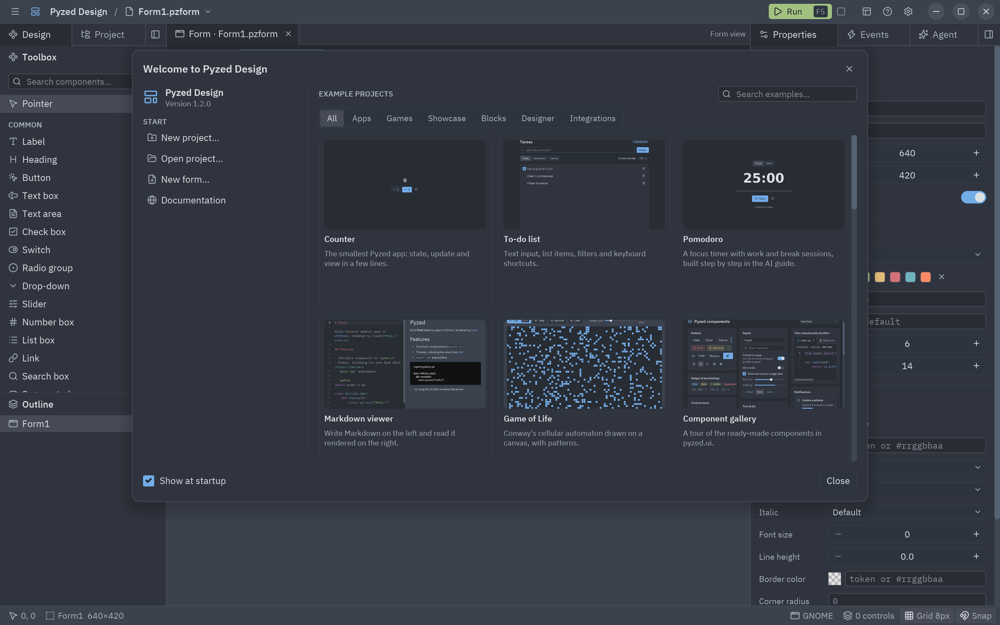
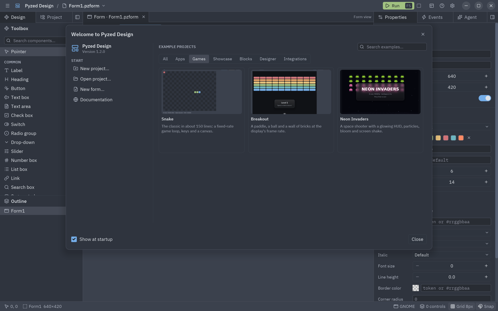
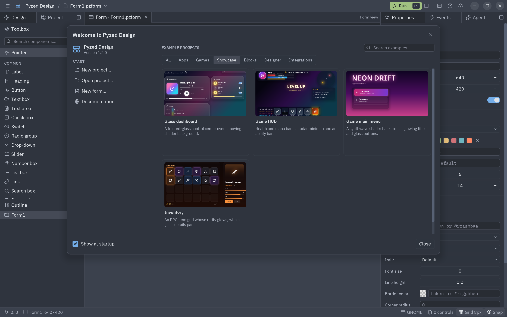
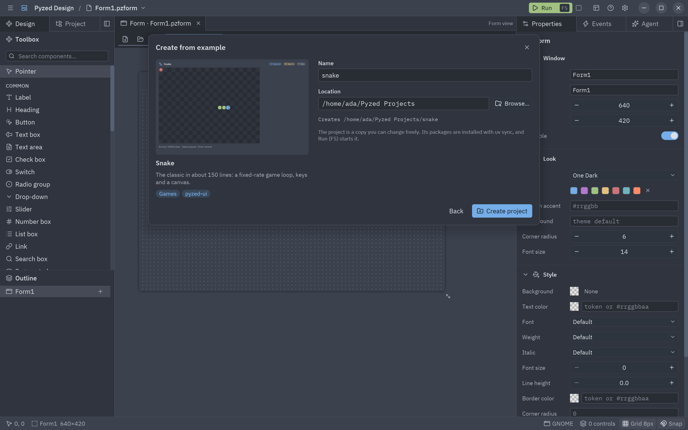

When Pyzed Design starts without a file, the **welcome window** opens. On the left you can start a new project,
open one, create a form or read the documentation, and reopen a recent project. On the right is the **gallery of
example projects**: each example has a thumbnail, a title and a description.



Open it again at any time from **Help → Welcome**, or **Help → Example projects…** to see every example. Uncheck
**Show at startup** (or turn off **Welcome window** in [Settings](/pyzed/editor/settings/)) to start straight on
an empty form.

## The gallery

The tabs filter the examples by category, and the search box filters them by title and description:

| Category | Examples |
| --- | --- |
| **Apps** | Counter, To-do list, Pomodoro, Markdown viewer, Game of Life, Component gallery, Zed-like editor. |
| **Games** | Snake, Breakout, Neon Invaders. |
| **Showcase** | Glass dashboard, Game HUD, Game main menu, Inventory. |
| **Blocks** | Dashboard, Kanban board, Music player, Chat, Settings. |
| **Designer** | Login form: a form made in Pyzed Design, with its event code and components. |
| **Integrations** | SQLModel heroes, Pydantic sign-up, PyPI with httpx, SQLAlchemy contacts. |





## Creating a project from an example

Click an example to name the new project and choose where it goes (by default `~/Pyzed Projects/<name>`; **Browse…**
picks another folder). **Create project** then:

1. copies the example into the folder as a normal [uv project](/pyzed/editor/projects/), with `pyzed-ui` and the
   packages the example needs in `pyproject.toml`;
2. opens it in the Project panel, with its script (or, for the Designer example, its main form) in front;
3. installs its packages with `uv sync` in the background.



The copy is yours: change it freely, the original example is not touched.

## Running it

Projects made from a code example have a `script` in `[tool.pyzed]`:

```toml
[tool.pyzed]
ui = "ui"
script = "snake.py"
```

When no form is open, **Run** (<kbd>F5</kbd>) starts that script with `uv run`, and its output goes to the
[console](/pyzed/editor/console-and-running/). **Run → Run project script** does the same at any time. Open
project files with unsaved changes are saved first.

## Where the examples come from

The standalone **Pyzed Design** app carries every example and its thumbnail inside it (about 1.5 MB), so the gallery
works without a connection. A designer installed with pip does not include them: the gallery offers **Download
examples**, which fetches them once from the release of the installed version. Creating the project's environment
with `uv sync` needs a connection the first time, to download Python and the packages.
