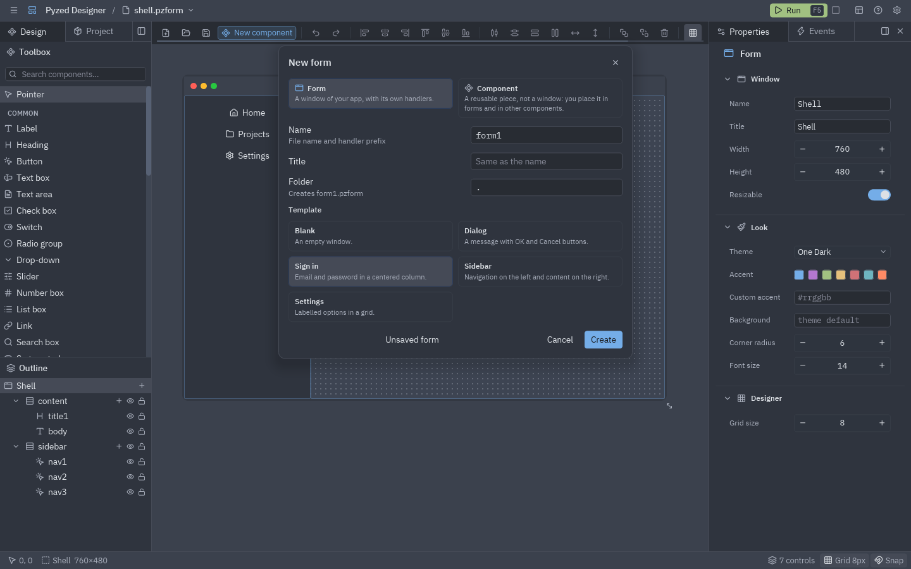
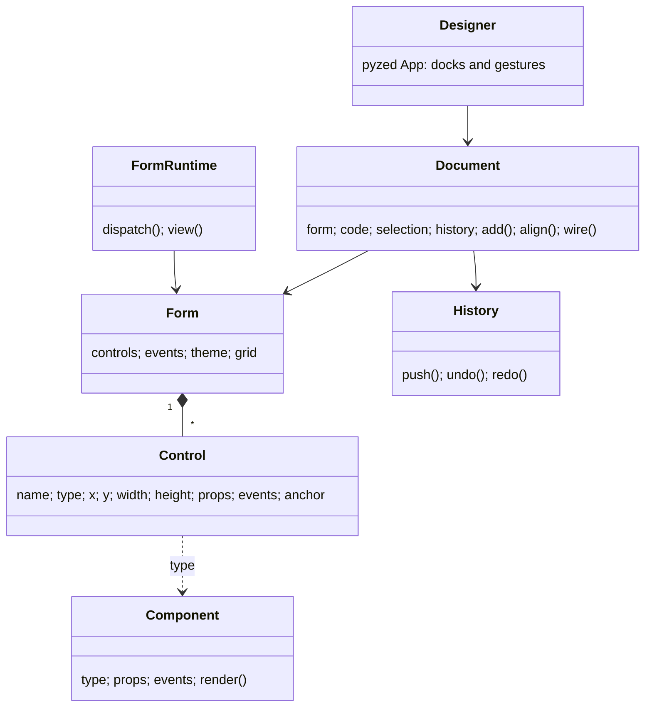

## Document tabs

Every open file is a tab above the toolbar: `Form · login.pzform` or `Component · rating.pzcomp` (with an accent
icon). A dot marks unsaved changes, and the end of the tab bar says which view you are in: **Form view** or
**Component view**.

- Click a tab to switch. Each document keeps its own selection and undo history; the code editor is applied and
  closed when you leave a tab (if the code does not parse, the switch waits until you fix it).
- The **×** on a tab closes it. With unsaved changes, a dialog offers **Save**, **Don't save** and **Cancel**.
- Opening a file that is already open switches to its tab, keeping its unsaved changes. An untouched empty
  untitled form is replaced instead of piling up tabs.
- Double-clicking a placed [designed component](/pyzed/editor/component-designer/) opens its file in a tab.

The window title shows the active document, after a `●` when it has unsaved changes.

## New form

**New form** (<kbd>Ctrl</kbd>+<kbd>N</kbd>, the first toolbar button or the ☰ menu) opens the New dialog. At the
top, **Form** or **Component** picks what to create (**New component**, <kbd>Ctrl</kbd>+<kbd>Shift</kbd>+<kbd>N</kbd>,
opens it on Component).



| Field | Meaning |
| --- | --- |
| **Name** | The file name and the prefix of the form's handlers. A free default (`form1`, `form2`...) is proposed. |
| **Title** | The window title (the name when empty). |
| **Folder** | Where the files go: the current document's folder, or the project's `ui/` folder. The dialog shows the path it will create, and warns if it exists. |
| **Template** | The starting point (below). |

| Template | Gives you |
| --- | --- |
| **Blank** | An empty window. |
| **Dialog** | A heading, a message and a row of **Cancel** and **OK** buttons anchored to the bottom, both already wired to close the window. |
| **Sign in** | Email, password, "remember me", a sign-in button and a status label in a centered column. |
| **Sidebar** | Navigation buttons in a column on the left and a content column on the right. |
| **Settings** | Labelled options (text box, drop-down, switch, slider) in a two-column grid, with a Save button. |

**Create** writes the `.pzform` and its `.py` and opens them. **Unsaved form** opens the template without writing
anything: it is saved (asking for a path) the first time you save. New forms take the grid size from
[Settings](/pyzed/editor/settings/).

## Open, save and save as

- **Open…** (<kbd>Ctrl</kbd>+<kbd>O</kbd>, or click the file name in the title bar) lists the `.pzform` and
  `.pzcomp` files under the working folder (skipping `.git`, `.venv`, `node_modules`, `build`...). Type to filter
  the list, or type a path and press <kbd>Enter</kbd>.
- **Recent** files are listed at the end of the ☰ menu (the last five).
- **Save** (<kbd>Ctrl</kbd>+<kbd>S</kbd>) writes the document and its code file. An untitled document asks for a
  path first. Saving also refreshes the form running from <kbd>F5</kbd>.
- **Save as…** (<kbd>Ctrl</kbd>+<kbd>Shift</kbd>+<kbd>S</kbd>) asks for a new path, relative to the working folder;
  the suffix is added when you leave it out.

## The files

A form is two files side by side, both meant to be committed:

```
login.pzform   ← layout: JSON, diffs nicely
login.py       ← event handlers: plain Python
```

The `.pzform` file stores the form settings and, for each control, its type, position, size, properties, anchors
and which handler each event calls:

```json
{
  "format": "pyzed.form/1",
  "form": { "name": "login", "title": "Sign in", "width": 440, "height": 400, "theme": "One Dark", "events": { "load": "form_load" } },
  "controls": [
    { "name": "sign_in", "type": "button", "x": 48, "y": 304, "width": 344, "height": 32,
      "props": { "text": "Sign in", "variant": "solid", "icon": "log-in" },
      "events": { "click": "sign_in_click" }, "anchor": ["left", "top"] }
  ]
}
```

The editor edits the `.py` file with `ast`: it finds, adds, renames and replaces handler functions without
touching the rest of the file, so your imports, helpers and comments stay as you wrote them. You can edit the code
file in any other editor too; the form only needs the handler functions to exist.

A designed component is also two files, `rating.pzcomp` (layout) and `rating.py` (the class); see
[Component designer](/pyzed/editor/component-designer/).

## Adding your own components

Register a component and it shows up in the toolbox, with its properties in the grid and its events in the
Events panel:

```python
from pyzed import ui
from pyzed.designer import Component, Prop, register

register(Component(
    type="rating", label="Rating", icon="star", category="Custom", size=(120, 24),
    props=(Prop("value", "number", 3, min=0, max=5),),
    events=("change",),
    render=lambda control, ctx: ui.label("★" * int(control.props["value"])),
))
```

`render` is used both in the editor (inert) and at run time; use `ctx.on(control, "change", "value")` for
callbacks so the same code works in both. Every `pz.Component` subclass of your project appears in the toolbox
too (see [Components](/pyzed/guides/components/)), and so do the components you draw in the
[component designer](/pyzed/editor/component-designer/).

## Your own templates

```python
from pyzed.designer import new

def toolbar(form):
    ...  # add controls to the empty form

new.register_template(new.Template("toolbar", "Toolbar", "panel-top", "A row of buttons on top.", toolbar))
```

Registered templates appear in the New form dialog after the built-in ones.

## Scripting forms

Everything the editor does is available from Python, which is handy for generating forms or for tests:

```python
from pyzed import designer
from pyzed.designer import Document

doc = Document(designer.Form(name="hello", title="Hello", width=320, height=140))
doc.add("input", 16, 16, 200, 28)
doc.add("button", 224, 16)
doc.select_all()
doc.align("middle")
handler = doc.wire("button1", "click")
doc.set_handler_source(handler, "def button1_click(form, event):\n    form.button1.text = form.input1.text\n")
doc.save("hello.pzform")

designer.run("hello.pzform")
```

`designer.new_form(path, template="dialog")` creates a form and its handlers module from a template (in a project,
`project.find().new_form("settings")` puts it in `ui/`). `designer.open_window(form_or_path, data=...)` returns
the command that opens a form from any app, and also accepts a `designer.Form` built in code (with
`handlers={"name": function}`). The full API is in the [designer reference](/pyzed/reference/designer/).

## How it is built



- `model.py`: the form and its controls, saved as JSON.
- `components.py`: the component library and the `render` shared by the editor and the runtime.
- `geometry.py`: snapping, alignment, distribution, resizing, anchors and smart guides (pure functions).
- `layout.py`: where every control goes, flex and grid containers included.
- `history.py`: undo/redo as snapshots; repeated edits of one field merge into one step.
- `code.py`: finds, adds, renames and replaces handler functions with `ast`.
- `document.py`: every editing command, with no UI, so it is fully testable.
- `commands.py`: every command in one table, read by the menus, the palette, the keyboard and the shortcut list.
- `docks.py`, `panels.py`, `surface.py`, `dialogs.py`, `console.py`, `project_panel.py`: the views.
- `app.py`: the `Designer` app wiring clicks and keys to the document.
- `scene.py`, `scene_code.py`, `scene_runtime.py`, `scene_panel.py`: the component designer.
- `runtime.py`: `FormApp` and `FormWindow`, which draw a form and call its handlers.
- `lsp.py`, `intellisense.py`, `code_panel.py`, `settings.py`: the code editor and its language servers.
- `preferences.py`, `locale.py`: the editor's settings and its translations.
