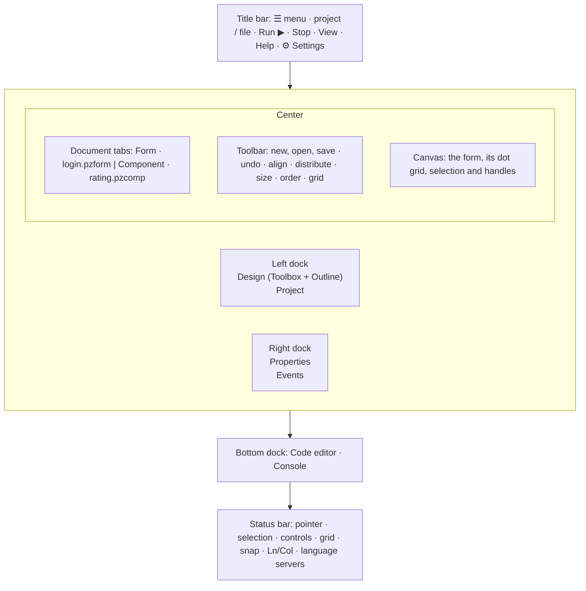
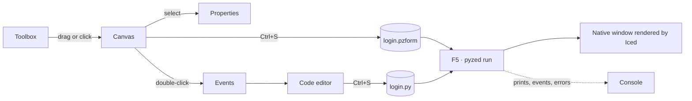

**Pyzed Design** is the visual editor of Pyzed, in the spirit of Visual Basic, the WinForms designer of Visual
Studio and Qt Designer, and built with Pyzed itself. You draw a window with the mouse, set its properties in a
grid, double-click a control to write the Python code of its event, and press <kbd>F5</kbd> to run it with all its
logic. The same editor builds reusable **components** with typed properties, methods and custom events.

This manual walks through every area of the editor: what it shows, what you can do there, and the tricks that
make you faster.


## Opening it

| How | What it opens |
| --- | --- |
| `pyzed design` | Inside a project: its main form (`[tool.pyzed] main`). Elsewhere: an empty, untitled form. |
| `pyzed design login.pzform` | That form, or a new one with that name that is created on the first save. |
| `pyzed design ui/rating.pzcomp` | A [designed component](/pyzed/editor/component-designer/) (created on the first save if missing). |
| `python -m pyzed.designer [file]` | The same, without the `pyzed` command on `PATH`. |
| **Pyzed Design** app | The standalone build: the editor with its own Python and `uv`, nothing else to install (see [Projects](/pyzed/editor/projects/#the-standalone-app)). |

```bash
pip install "pyzed-ui[designer]"   # Pyzed plus the ty and ruff language servers
pyzed design login.pzform
```

## A tour of the window




| Area | What it is for | Manual page |
| --- | --- | --- |
| **Title bar** | The ☰ menu (File and Run), the project and file names (click the file to open another), **Run** and **Stop**, the **View** and **Help** menus and the **Settings** gear. | [Menus and commands](/pyzed/editor/menus-and-commands/) |
| **Toolbox** | Every component you can place, by category, with a search box. | [Toolbox and canvas](/pyzed/editor/toolbox-and-canvas/) |
| **Outline** | The controls of the document as a tree: select, reorder, nest, hide and lock them. | [Toolbox and canvas](/pyzed/editor/toolbox-and-canvas/#the-outline) |
| **Project** | The uv project: its forms, dependencies, ruff, ty and git. | [Projects](/pyzed/editor/projects/) |
| **Document tabs** | One tab per open form or component. | [Files and documents](/pyzed/editor/files-and-scripting/) |
| **Toolbar** | File actions, undo, alignment, distribution, sizing, z-order and the grid tools. | [Toolbox and canvas](/pyzed/editor/toolbox-and-canvas/#align-distribute-and-size) |
| **Canvas** | The form exactly as it will run, with a dot grid, selection, handles and smart guides. | [Toolbox and canvas](/pyzed/editor/toolbox-and-canvas/) |
| **Properties** | The selected control's (or the form's) properties, style, position and behavior. | [Properties](/pyzed/editor/properties/) |
| **Events** | The events of the selected control and the handler wired to each one. | [Events and handlers](/pyzed/editor/events/) |
| **Agent** | An AI agent that builds forms and components, writes their code and edits the open form. | [AI agents](/pyzed/editor/ai-agents/) |
| **Code** | A Python editor with completion, diagnostics, code lens, folding and a minimap. | [Code editor](/pyzed/editor/code-editor/) |
| **Console** | What the running form prints, the events it handles and its errors. | [Running and the console](/pyzed/editor/console-and-running/) |
| **Status bar** | Pointer position, the selection's size and place, the control count, grid and snap toggles, and while coding the cursor and the language servers. | [Settings](/pyzed/editor/settings/) |

Every panel lives in a **dock** (left, right, bottom or top) and can be moved to another one, resized or hidden.
See [Panels and docks](/pyzed/editor/menus-and-commands/#panels-and-docks).

## The workflow in one picture



1. **Place** components from the toolbox: drag them onto the form, or click one and then click (or drag a
   rectangle) on the form.
2. **Arrange** them with the mouse, the keyboard, the smart guides, the alignment tools or a
   [layout container](/pyzed/editor/layouts/).
3. **Configure** them in [Properties](/pyzed/editor/properties/): text, data, style, anchors.
4. **Write the logic**: double-click a control to open the handler of its main event in the
   [code editor](/pyzed/editor/code-editor/).
5. **Run** with <kbd>F5</kbd>. The [console](/pyzed/editor/console-and-running/) shows prints, events and errors;
   saving updates the running window.
6. **Reuse**: turn repeated pieces into [components](/pyzed/editor/component-designer/), and ship the app with
   `pyzed build`.

## In this manual

- [Projects](/pyzed/editor/projects/): uv projects, dependencies, ruff, ty and git from the Project panel.
- [Toolbox and canvas](/pyzed/editor/toolbox-and-canvas/): placing, selecting, moving, resizing, snapping, guides,
  alignment and the outline.
- [Properties](/pyzed/editor/properties/): every section of the property grid, the list and table editors.
- [Layouts and containers](/pyzed/editor/layouts/): panels, flex rows and columns, grids and anchors.
- [Styles and themes](/pyzed/editor/styles-and-themes/): the Style section, the color picker, gradients and themes.
- [Events and handlers](/pyzed/editor/events/): every event and how to write its code.
- [Code editor](/pyzed/editor/code-editor/): completion, diagnostics, code lens, folding and its settings.
- [Running and the console](/pyzed/editor/console-and-running/): F5, the console, `uv run` and hot reload.
- [Component designer](/pyzed/editor/component-designer/): reusable components with props, state, methods and
  events.
- [Files, templates and scripting](/pyzed/editor/files-and-scripting/): tabs, `.pzform` files, templates and the
  Python API.
- [Menus and commands](/pyzed/editor/menus-and-commands/): every menu entry, the command palette and the docks.
- [Keyboard shortcuts](/pyzed/editor/keyboard-shortcuts/): the complete list.
- [Settings](/pyzed/editor/settings/): the editor's and the code editor's preferences.
- [Tips and tricks](/pyzed/editor/tips-and-tricks/).
