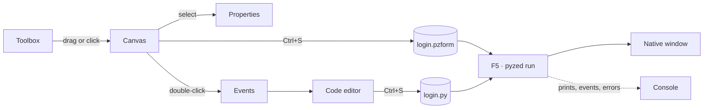

import { Aside, Tabs, TabItem } from '@astrojs/starlight/components';
import NavCards from '../../../components/NavCards.astro';
import Media from '../../../components/Media.astro';
import designer from '../../../../screenshots/designer.png';
import designerLight from '../../../../screenshots/designer-light.png';

**Pyzed Design** is the visual editor of Pyzed, built with Pyzed itself. You draw a window with the mouse, set its
properties in a grid, double-click a control to write the Python code of its event, and press <kbd>F5</kbd> to run it
with all its logic. The same editor builds reusable **components**, GPU **shaders** made of nodes, and edits the
Python of your whole project.

It stands on the shoulders of tools many people already know: the form designer of **Visual Basic** and **Qt
Designer** (draw, set properties, wire events), the scenes and visual shaders of **Godot** and the details panel and
material editor of **Unreal Engine**, and a clean, keyboard-friendly interface inspired by the **Zed** code editor.
The goal is a frontend framework for desktop apps that you can use without writing code, and extend with code when
you want.

<Media src={designer} light={designerLight} alt="Pyzed Design with the login example open" caption="A sign-in form open in the Form view." size="wide" eager />

## Open it

Download the [standalone app](/pyzed/download/) (it brings its own Python and uv), or start it from a Python
environment:

<Tabs syncKey="pkg">
	<TabItem label="uv">
		```bash
		uv add "pyzed-ui[designer]"      # in your project: Pyzed plus the ty and ruff language servers
		uv run pyzed design
		```
	</TabItem>
	<TabItem label="pip">
		```bash
		pip install "pyzed-ui[designer]"
		pyzed design
		```
	</TabItem>
	<TabItem label="python">
		```bash title="macOS / Linux"
		python3 -m pip install "pyzed-ui[designer]"
		python3 -m pyzed design
		```
		```powershell title="Windows (PowerShell)"
		py -m pip install "pyzed-ui[designer]"
		py -m pyzed design
		```
	</TabItem>
</Tabs>

| Command | What it opens |
| --- | --- |
| `pyzed design` | Inside a project: its main form (`[tool.pyzed] main`). Elsewhere: the welcome window, or an empty form. |
| `pyzed design login.pzform` | That form, or a new one with that name that is created on the first save. |
| `pyzed design ui/rating.pzcomp` | A [component](/pyzed/editor/component-designer/) (created on the first save if missing). |
| `pyzed design fx/fire.pzshad` | A [shader made of nodes](/pyzed/editor/shader-view/) (created on the first save if missing). |
| `python -m pyzed.designer [file]` | The same, without the `pyzed` command on `PATH`. |

## The workflow in one picture



1. **Place** controls from the toolbox: drag them onto the form, or click one and then click (or drag a rectangle)
   on the form.
2. **Arrange** them with the mouse, the keyboard, the smart guides, the alignment tools or a
   [layout container](/pyzed/editor/layouts/).
3. **Configure** them in [Properties](/pyzed/editor/properties/): text, data, style, anchors.
4. **Write the logic**: double-click a control to open the handler of its main event in the
   [code editor](/pyzed/editor/code-editor/).
5. **Run** with <kbd>F5</kbd>. The [console](/pyzed/editor/console-and-running/) shows prints, events and errors;
   saving updates the running window.
6. **Reuse and ship**: turn repeated pieces into [components](/pyzed/editor/component-designer/), and package the app
   with `pyzed build` (see [Distribute](/pyzed/packaging/)).

## Start here

<NavCards
	items={[
		{ title: 'The interface', text: 'Title bar, menus, docks, panels, tabs, status bar: what every area is called and does.', href: '/pyzed/editor/interface/', icon: 'laptop', tag: 'Tour' },
		{ title: 'Welcome and examples', text: 'The welcome window and two dozen example projects to start from.', href: '/pyzed/editor/examples/', icon: 'open-book' },
		{ title: 'Projects', text: 'uv projects, the file tree, dependencies, ruff, ty and git.', href: '/pyzed/editor/projects/', icon: 'seti:folder' },
	]}
/>

## The views

<NavCards
	items={[
		{ title: 'Views and documents', text: 'Forms, components, shaders and code: which view each one opens in.', href: '/pyzed/editor/views/', icon: 'document' },
		{ title: 'The Form view', text: 'Draw a window, wire its first event and run it, step by step.', href: '/pyzed/editor/form-view/', icon: 'pencil', tag: 'Basic' },
		{ title: 'The Component view', text: 'Reusable pieces with properties, state, methods and events.', href: '/pyzed/editor/component-designer/', icon: 'puzzle' },
		{ title: 'The Shader view', text: 'GPU effects made by wiring nodes, with live previews.', href: '/pyzed/editor/shader-view/', icon: 'star' },
		{ title: 'Code editor', text: 'Completion, diagnostics, code lens, multiple cursors and key bindings.', href: '/pyzed/editor/code-editor/', icon: 'seti:python' },
	]}
/>

## Designing forms

<NavCards
	min="13rem"
	items={[
		{ title: 'Toolbox and canvas', text: 'Place, select, move, snap, align, the outline.', href: '/pyzed/editor/toolbox-and-canvas/', icon: 'pencil' },
		{ title: 'Properties', text: 'Every section of the property grid.', href: '/pyzed/editor/properties/', icon: 'setting' },
		{ title: 'Layouts', text: 'Panels, rows, columns, grids and anchors.', href: '/pyzed/editor/layouts/', icon: 'list-format' },
		{ title: 'Styles and themes', text: 'Colors, fonts, gradients and the form style.', href: '/pyzed/editor/styles-and-themes/', icon: 'moon' },
		{ title: 'Animations and effects', text: 'Glow, blur, glass and motion on hover or click.', href: '/pyzed/editor/animations-and-effects/', icon: 'star' },
		{ title: 'Events', text: 'Every event and how to write its handler.', href: '/pyzed/editor/events/', icon: 'rocket' },
		{ title: 'Data binding', text: 'Bind fields to data, validate, translate.', href: '/pyzed/editor/data-binding/', icon: 'random' },
	]}
/>

## Run, files, AI and reference

<NavCards
	min="13rem"
	items={[
		{ title: 'Running and the console', text: 'F5, output, errors and hot reload.', href: '/pyzed/editor/console-and-running/', icon: 'right-arrow' },
		{ title: 'Files and scripting', text: 'Tabs, templates, the .pzform format, the Python API.', href: '/pyzed/editor/files-and-scripting/', icon: 'document' },
		{ title: 'AI agents', text: 'An agent that builds forms and writes their code.', href: '/pyzed/editor/ai-agents/', icon: 'comment-alt' },
		{ title: 'Menus and commands', text: 'Every menu entry and the command palette.', href: '/pyzed/editor/menus-and-commands/', icon: 'list-format' },
		{ title: 'Keyboard shortcuts', text: 'The complete list.', href: '/pyzed/editor/keyboard-shortcuts/', icon: 'pencil' },
		{ title: 'Settings', text: 'Themes, canvas, running, panels, telemetry.', href: '/pyzed/editor/settings/', icon: 'setting' },
	]}
/>

<Aside type="note" title="Status of this manual">
Every panel and view has its page, written against the current version. New captures and short recordings of each
area are being added; until a page has them, it uses the captures of the previous release, which may differ in small
details such as the title bar.
</Aside>
