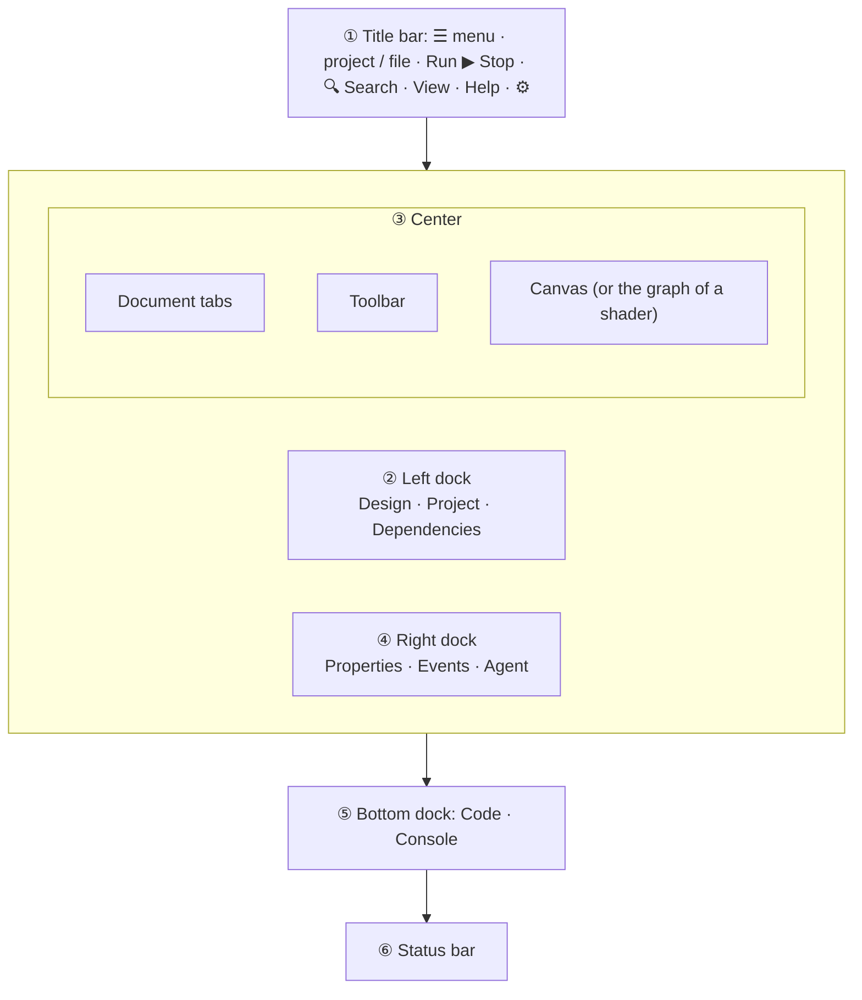

import { Aside, Tabs, TabItem } from '@astrojs/starlight/components';
import NavCards from '../../../components/NavCards.astro';
import Media from '../../../components/Media.astro';
import designer from '../../../assets/editor/form-view.png';
import designerLight from '../../../assets/editor/form-view-light.png';
import fileMenu from '../../../assets/editor/menu-file.png';
import windowFrames from '../../../assets/editor/window-frames.png';
import systemFrame from '../../../assets/editor/system-frame.png';
import tabWindow from '../../../assets/editor/tab-window.png';
import statusBar from '../../../assets/editor/status-bar.png';
import welcome from '../../../assets/editor/welcome.png';
import welcomeLight from '../../../assets/editor/welcome-light.png';
import dockMenu from '../../../../screenshots/editor-dock-menu.png';

Pyzed Design is one window split in a few areas, and every area has a single job. Once you know their names, the
rest of this manual reads easily. The layout borrows from editors many people already know: the panels and the title
bar are inspired by the [Zed](https://zed.dev) code editor, the form canvas and the property grid by Visual Basic and
Qt Designer, and the node and scene ideas by Godot and Unreal Engine.

<Media src={designer} light={designerLight} alt="Pyzed Design with a sign-in form open: toolbox and outline on the left, the form in the middle, properties on the right" caption="A form open in Pyzed Design. Every area is described below." size="wide" eager />

## ① The title bar

The strip at the very top. From left to right (Run, Stop and the search field sit in the middle):

| Item | What it does |
| --- | --- |
| **☰** | The main menu: New, Open, Go to file, Save, Settings, recent files, and the Run commands. |
| **Environment** | Shown under WSL: the Linux distribution the project runs in (*Ubuntu*...), like Zed's remote indicator. |
| **Project name ⌄** | The active project (or *No project*). Click it for the **project picker**: the projects open in this window and the recent ones; see [Several projects in one window](/pyzed/editor/projects/#several-projects-in-one-window). |
| **Branch** / **worktree** | The project's git branch (click it to switch branch) and, in a linked worktree, its name. |
| **/ file name ⌄** | The document in front. Click it to open another form, component or shader. |
| **●** | Shown when the document has unsaved changes. |
| **Component** / **Shader** badge | Says which [view](/pyzed/editor/views/) you are in when it is not a form. |
| **▶ Run** (<kbd>F5</kbd>) | Runs the form, previews the component, or opens the shader in its own window. |
| **■ Stop** (<kbd>Shift</kbd>+<kbd>F5</kbd>) | Closes what Run opened. Disabled when nothing is running. |
| **🔍 Search** (<kbd>Ctrl</kbd>+<kbd>Shift</kbd>+<kbd>P</kbd>) | Opens the [command palette](/pyzed/editor/menus-and-commands/#command-palette): commands, panels, editor settings, key bindings and recent files. |
| **View** (panels icon) | Docks, panels, grid and guides, previews of other themes, languages and window frames. |
| **Help** (? icon) | Shortcuts, the built-in reference, the welcome window, updates and About. |
| **⚙** (<kbd>Ctrl</kbd>+<kbd>,</kbd>) | [Settings](/pyzed/editor/settings/). |

<Media src={fileMenu} alt="The ☰ menu open with File and Run commands and recent files" caption="The ☰ menu: file commands, recent files and Run." />

Every menu entry is listed with its keys in [Menus and commands](/pyzed/editor/menus-and-commands/). Anything you
can click in a menu is also in the **command palette** (the search field, or <kbd>Ctrl</kbd>+<kbd>Shift</kbd>+<kbd>P</kbd>): type a few
letters of its name and press <kbd>Enter</kbd>.

### The window frame

By default Pyzed Design draws its **own window frame**: the title bar above also holds the minimize, maximize and
close buttons, in the style of your system, and the borders of the window resize it. Drag the title bar to move the
window; double-click it to maximize. This gives a compact, uniform window on every platform.

<Media src={windowFrames} alt="The same title bar five times, with the window buttons of macOS, Windows 11, GNOME, Ubuntu and KDE Plasma" caption="One title bar, five systems. From top to bottom: macOS, Windows 11, GNOME, Ubuntu and KDE Plasma." />

<Aside type="tip" title="Prefer your system's frame?">
Turn off **Settings → Appearance → Custom window frame** to use the frame of your operating system (it applies the
next time Pyzed Design opens). Your own apps can use the same frames: see `ui.window_frame` and `Window.frame` in
the [API reference](/pyzed/reference/ui/).
</Aside>

<Media src={systemFrame} alt="Pyzed Design with Custom window frame turned off: the bar with the menus and Run has no window buttons" caption="With <strong>Custom window frame</strong> off, the bar keeps the menus and Run, and your system draws the frame and its buttons around it." />

## ② ④ ⑤ Docks and panels

Panels live in **docks** around the center: left, right, bottom and a top dock that is empty until you move a
panel there. Each dock shows one tab at a time. Every place takes any tab: a panel can sit next to the form tabs in
the center (the code editor beside your forms, for example), a form can go into a side dock, and any tab can float in
a **window of its own**, alone or stacked with others.

| Panel | Dock | What it is for | Manual |
| --- | --- | --- | --- |
| **Design** | Left | The **Toolbox** (everything you can place) above the **Outline** (the tree of what is placed). In a shader it becomes the **Shading** sidebar and the shader's variables. | [Toolbox and canvas](/pyzed/editor/toolbox-and-canvas/) |
| **Project** | Left | The files of the project as a tree, with search, git status and a right-click menu. | [Projects](/pyzed/editor/projects/#files) |
| **Dependencies** | Left | Packages, ruff and ty of the project (only with a project open). | [Projects](/pyzed/editor/projects/#the-dependencies-panel) |
| **Properties** | Right | Everything about the selection: text, size, colors, data, behavior. | [Properties](/pyzed/editor/properties/) |
| **Events** | Right | The events of the selection and the Python handler wired to each. | [Events](/pyzed/editor/events/) |
| **Agent** | Right | An AI agent that builds forms and components and writes their code. | [AI agents](/pyzed/editor/ai-agents/) |
| **Code** | Bottom | The Python editor, while a handler or a file is open. | [Code editor](/pyzed/editor/code-editor/) |
| **Console** | Bottom | What a running form prints, the events it handles, and its errors. | [Running and the console](/pyzed/editor/console-and-running/) |

What you can do with them:

- **Switch** with the tabs at the top of a dock.
- **Drag** any tab, a panel's or a form's: along its row to reorder it, onto another row to stack it there, over a
  dock or the center to move it there, or out of the window to open it in a **window of its own**. While you drag, a
  copy of the tab follows the pointer, the place it would go to lights up, and over a row a bar marks where it would
  land. Drop more tabs on a window to stack them there, and drag them back over the main window to put them back.
- **Move** a panel from the menu instead: the dock button at the end of the tab bar opens **Move *panel* to** left,
  right, bottom, top or **Center**, or **New window**. A panel's tab outside the docks has a **×** that sends it back
  to its dock. In a window of its own, the same button offers **Dock everything here back**, and closing the window
  does the same: forms go back to the main window and panels to their docks.
- **Resize** a dock by dragging its edge that faces the canvas.
- **Hide** a dock with its **×**, or toggle it: <kbd>Ctrl</kbd>+<kbd>B</kbd> (left), <kbd>Ctrl</kbd>+<kbd>Alt</kbd>+<kbd>B</kbd>
  (right), <kbd>Ctrl</kbd>+<kbd>J</kbd> (bottom).
- **Save the layout** with **View → Save layout as…** and switch between layouts from **View → Layouts**. Pyzed
  comes with **Default**, **Coding** (code next to the properties), **Focus** (only the canvas and the right dock),
  **Events and code** and **Code with the forms** (the code editor as a tab beside the forms, the events on the left);
  **Delete this layout** removes one of yours.
- **Reset** everything with **View → Reset panel layout**. Where each panel is, the tab order, the size of each dock
  and the panel windows (with their size and position) are saved with your settings and reopen next time.

<Media clip="designer-tabs-anywhere" alt="The Events panel dragged next to the form tabs, a form dragged into the left dock, and both dragged back, with the target lit up and a copy of the tab under the pointer" caption="Any tab goes anywhere: the place it would land in lights up while you drag." />

<Media src={dockMenu} alt="The dock menu with Move Properties to the left, bottom or top dock" caption="Move any panel to another dock from the dock button." size="narrow" />

<Aside type="tip" title="A layout for writing code">
On a laptop, pick **View → Layouts → Coding**, or hide the left dock (<kbd>Ctrl</kbd>+<kbd>B</kbd>) and add
controls with <kbd>Ctrl</kbd>+<kbd>Shift</kbd>+<kbd>A</kbd>. With two screens, drag **Code** and **Console** to the
second one and save the result as a layout of your own.
</Aside>

## ③ The center: tabs, toolbar and canvas

### Document tabs and windows

Every open file is a tab: `Form · login.pzform`, `Component · rating.pzcomp`, a shader, a Python file, the reference
or the release notes. The end of the tab row says which view is in front (**Form view**, **Component view**...).

- **Click** a tab to switch; each document keeps its own selection and undo history.
- **Drag** a tab along the row to reorder it, or over a dock to work on that form beside the one in the center.
- **Drag a tab out** of the window to give it a window of its own, with its own tabs, toolbar and canvas. Drag it
  onto another Pyzed Design window to stack it there. **View → Move tab to new window** and **Move tab to main
  window** do the same with the keyboard (handy on Wayland, where apps can't know where their windows are).
- Panels can share this row too: drop the **Code** or **Console** tab here and it sits among the forms.
- The panels follow the form you used last, wherever it is. Closing a document window brings its tabs back to the
  main window.

<Media src={tabWindow} alt="A shader dragged out of the main window into a second Pyzed Design window" caption="A shader in its own window, next to the main window with the form." size="wide" />

### Toolbar

Under the tabs of a form or component: **New form**, **Open**, **Save**, **New component**; **Undo** and **Redo**;
the **align**, **distribute**, **same size** and **center** tools; **Bring to front**, **Send to back** and
**Delete**; and at the end **Grid**, **Snap**, **Smart guides**, **Resize contents with their anchors**, **Fit
selection to grid** and **Edit code file** (<kbd>F7</kbd>). Tools that don't apply to the selection are grayed out,
and every tooltip shows its shortcut. A shader has its own toolbar; see [the Shader view](/pyzed/shading/shader-designer/).

### Canvas

The form exactly as it will look when it runs, inside a window frame, over a dot grid. Click to select, drag to
move, pull the handles to resize. Everything about it is in [Toolbox and canvas](/pyzed/editor/toolbox-and-canvas/).

<Aside type="note" title="See your form on other systems">
**View → Preview window frame…** draws the form inside the frame of macOS, Windows 11, GNOME, Ubuntu or KDE Plasma,
so you can check how it will look there without leaving your computer. It changes nothing in the form.
</Aside>

## ⑥ The status bar

The bar at the bottom tells you where you are and toggles a few things with a click:

| Item | Meaning |
| --- | --- |
| `120, 48` | Where the pointer is on the form, in pixels. |
| `sign_in 344×32 at 48, 304` | The selected control, its size and position (or the form's, or how many are selected). |
| **Placing Button…** | Shown while you place a control from the toolbox. |
| Theme / language | Shown while you preview another theme or language; click to change it. |
| **macOS**, **Windows 11**... | The window frame the canvas shows; click to pick another. |
| **12 controls** | How many controls the document has. |
| **Grid 8px** · **Snap** | Click to toggle the grid and snapping. |
| `Ln 12, Col 8` · **ty** · **ruff** | While coding: the cursor and the state of the language servers. |
| **Update to X.Y.Z** | A new version is ready; see [Updates](/pyzed/download/#updates). |

Hide it with **View → Status bar**.

<Media src={statusBar} alt="The status bar: pointer position, the selected control sign_in with its size and position, the GNOME frame, 12 controls, Grid 8px and Snap" caption="The status bar with the <code>sign_in</code> button selected." plain />

## The welcome window

When Pyzed Design starts without a file, the **welcome window** greets you: start or open a project, reopen a
recent one, or make a project from one of the examples (apps, games, showcase demos, blocks and integrations). Open
it again from **Help → Welcome**. Everything about it is in [Welcome and examples](/pyzed/editor/examples/).

<Media src={welcome} light={welcomeLight} alt="The welcome window: New project, Open project and recent projects on the left, the gallery of examples on the right" caption="The welcome window, with the gallery of example projects." />

## Notifications

Short messages appear in a corner for a few seconds: saved, copied, a wire that can't connect, a command that
failed... Click the **×** to dismiss one; at most four show at once.

## Opening pages and signing in

Links in the editor (Help → Documentation, the reference, sign-in pages of the AI agents) open in your default
browser. When Pyzed Design runs inside **WSL** on Windows, they open in the Windows browser, with no console window
flashing, unless you set the `BROWSER` variable to choose another.

## Next

<NavCards
	items={[
		{ title: 'Views', text: 'Form, Component, Shader and code: what each kind of document looks like.', href: '/pyzed/editor/views/', icon: 'document' },
		{ title: 'The Form view', text: 'Draw a window step by step and wire its first event.', href: '/pyzed/editor/form-view/', icon: 'pencil' },
		{ title: 'Menus and commands', text: 'Every menu entry, the command palette and the toolbar.', href: '/pyzed/editor/menus-and-commands/', icon: 'list-format' },
	]}
/>
