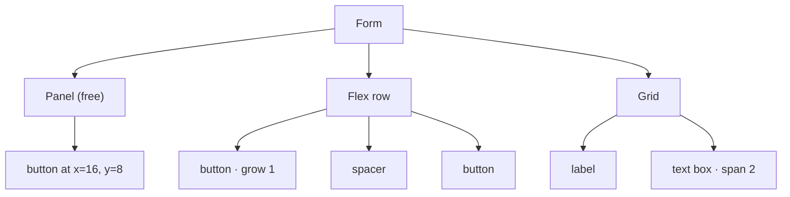

Controls can live directly on the form, at fixed positions, or inside **containers** that place them for you.
The same layout code runs in the editor and in the running app, so what you see while designing is what you get.

## The three kinds of container

| Kind | Components | How children are placed |
| --- | --- | --- |
| **Free** | Panel, Group box, Card | Where you drop them, in coordinates relative to the container. Their anchors follow the container's edges. |
| **Flex** | Flex row, Flex column | One after another, like CSS flexbox. |
| **Grid** | Grid | In cells, left to right and top to bottom. |

## Putting controls in a container

- **Drop** a control on a container (it lights up with an accent frame while you drag): from the toolbox, from the
  canvas or from the outline.
- **Draw** a new control inside it: pick a component and click or drag inside the container.
- **Add inside…**: the **+** on the container's outline row, or its context menu, opens the Add control list.
- **Group**: select some controls and use **Edit → Group in a row / column / grid** (palette) or the context menu,
  which also offers **Group in a panel**. The new container wraps the selection exactly.
- **Take out**: drag the control onto the bare form, use **Move out of *container*** in its context menu, or the
  arrow next to **Inside** in its Position section.

Moving or resizing a container moves its children with it, and copy, cut, paste, duplicate and delete take them
along. A container cannot be dropped inside itself or its own children.

## Flex row and flex column

| Property | Meaning |
| --- | --- |
| **Direction** | `row` (left to right) or `column` (top to bottom). A flex row and a flex column are the same container with a different default. |
| **Gap** | Space between children, in pixels. |
| **Padding** | Space between the container's edge and its children. |
| **Justify** | Where children go along the main axis when there is room left: `start`, `center`, `end`, `space-between`, `space-around`, `space-evenly`. |
| **Align** | Across the main axis: `stretch` (fill), `start`, `center`, `end`. |
| **Background** | A color behind the children. |

Each child gets a **Grow** field in its Position section: the share of the free space it takes (0 keeps its own
size). Two children with grow 1 split the free space in halves; 2 and 1 in thirds. When the children do not fit,
they all shrink in proportion to their size, like CSS `flex-shrink`.

A **Spacer** is an empty control with grow 1: put one between two buttons and the second one is pushed to the end
of the row.

## Grid

| Property | Meaning |
| --- | --- |
| **Columns** | Number of columns of equal width. |
| **Gap** | Space between cells, both ways. |
| **Padding** | Space inside the container's edge. |
| **Row height** | Height of every row; **0** shares the container's height between the rows. |
| **Align** | How a child sits in its cell: `stretch` fills it, otherwise `start`, `center` or `end` at its own size. |
| **Background** | A color behind the cells. |

Each child gets a **Column span**: how many columns it takes (1 to 24). A child that does not fit in the rest of
a row starts a new one.

## Order of children

In a flex or grid container, order matters, position does not: children have no X and Y. To reorder them, drag a
child within the container on the canvas (it drops at the place under the pointer) or drag its row in the outline,
which lists them in layout order.

## Anchors: responsive free layouts

On the form and in free containers, **anchors** decide what happens when the running window (or the container) is
resized, like in WinForms. Anchored to left and right, a control stretches; anchored only to the right, it follows
that edge; anchored to neither, it stays centered. The same applies vertically with top and bottom.

A common recipe for a resizable window:

1. A **flex column** anchored on all four sides fills the window.
2. Rows inside it with **grow** on the part that should take the extra space (a text area, a list).
3. A **flex row** at the bottom with a **spacer** and the buttons, so they stay on the right.

:::tip
Templates in **New form** use these recipes: the *dialog* puts its buttons in a row anchored left, right and
bottom; the *sidebar* uses a column anchored left, top and bottom next to another anchored on all sides; the
*settings* template is a two-column grid. Start from one and look at its properties.
:::
