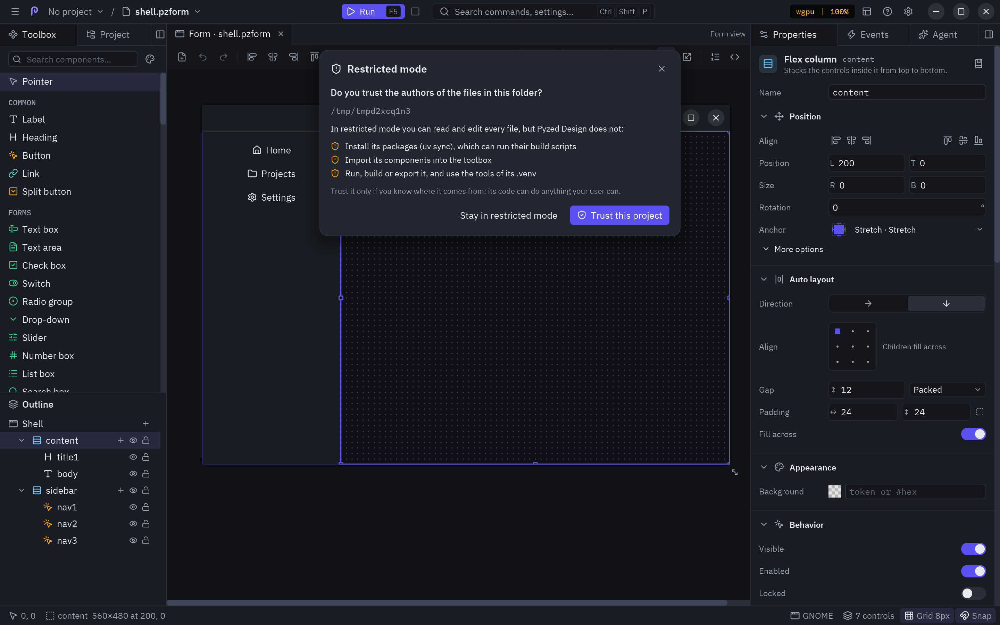
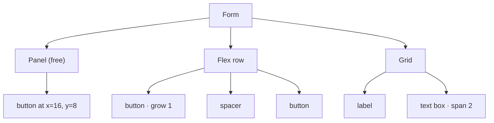

Controls can live directly on the form, at fixed positions, or inside **containers** that place them for you.
The same layout code runs in the editor and in the running app, so what you see while designing is what you get.



## The three kinds of container

| Kind | Components | How children are placed |
| --- | --- | --- |
| **Free** | Panel, Group box, Card | Where you drop them, in coordinates relative to the container. Their anchors follow the container's edges. |
| **Flex** | Flex row, Flex column | One after another, like CSS flexbox. |
| **Grid** | Grid | In cells, left to right and top to bottom. |
| **Dock** | Dock | Dock panels only, on their side under a row of tabs (see [Dock](#dock)). |



## Putting controls in a container

- **Drop** a control on a container (it lights up with an accent frame while you drag): from the toolbox, from the
  canvas or from the outline.
- **Draw** a new control inside it: pick a component and click or drag inside the container.
- **Add inside…**: the **+** on the container's outline row, or its context menu, opens the Add control list.
- **Group**: select some controls and press <kbd>Ctrl</kbd>+<kbd>G</kbd> to put them in an invisible panel that
  wraps them exactly, without moving them. <kbd>Shift</kbd>+<kbd>A</kbd> (**Add auto layout**) wraps them in a
  flex row or column instead, guessed from how they are placed. **Edit → Group in a row / column / grid** (palette)
  and the context menu offer every kind, including **Group in a panel**.
- **Ungroup**: <kbd>Ctrl</kbd>+<kbd>Shift</kbd>+<kbd>G</kbd> on a container takes its children out and removes it.
  They keep the place and size they had on the canvas, even the ones a flex row stretched.
- **Take out**: drag the control onto the bare form, use **Move out of *container*** in its context menu, or the
  arrow next to **Inside** in its Position section.

Moving or resizing a container moves its children with it, and copy, cut, paste, duplicate and delete take them
along. A container cannot be dropped inside itself or its own children.

## Flex row and flex column

| Property | Meaning |
| --- | --- |
| **Direction** | `row` (left to right) or `column` (top to bottom). A flex row and a flex column are the same container with a different default. |
| **Gap** | Space between children, in pixels. |
| **Padding** | Space between the container's edge and its children: one number for every side, two (vertical and horizontal) or four (top, right, bottom, left). |
| **Justify** | Where children go along the main axis when there is room left: `start`, `center`, `end`, `space-between`, `space-around`, `space-evenly`. |
| **Align** | Across the main axis: `stretch` (fill), `start`, `center`, `end`. |
| **Background** | A color behind the children. |

The **Auto layout** section of the Properties panel edits all of these the way Figma does: a direction, a 3×3
**Align** box (click where the children sit), the gap (or a way to spread them), the padding and **Fill across**.
See [Properties](/pyzed/editor/properties/#auto-layout).

Each child says in its Position section whether its **Width** and **Height** are **Fixed** (its own size) or
**Fill** (the room the container leaves); a child that fills across overrides the container's **Align** for itself
(`align_self` in the `.pzform`). Each child also gets a **Grow** field: the share of the free space it takes (0 keeps its own
size). Two children with grow 1 split the free space in halves; 2 and 1 in thirds. When the children do not fit,
they all shrink in proportion to their size, like CSS `flex-shrink`.

A **Spacer** is an empty control with grow 1: put one between two buttons and the second one is pushed to the end
of the row.

## Grid

| Property | Meaning |
| --- | --- |
| **Columns** | Number of columns of equal width. |
| **Gap** | Space between cells, both ways. |
| **Padding** | Space inside the container's edge. |
| **Row height** | Height of every row; **0** shares the container's height between the rows. |
| **Align** | How a child sits in its cell: `stretch` fills it, otherwise `start`, `center` or `end` at its own size. |
| **Background** | A color behind the cells. |

Each child gets a **Column span**: how many columns it takes (1 to 24). A child that does not fit in the rest of
a row starts a new one.

## Dock

A **Dock** (Layout category) is the layout of Zed and of Pyzed Design itself: a center area with panels on its
left, right, top and bottom. A new Dock comes with three **Dock panels**: Explorer on the left, Terminal at the
bottom and Editor in the center. Drop controls on a panel as on any free container (anchors work inside it).

| Where | Property | Meaning |
| --- | --- | --- |
| Dock panel | **Title**, **Icon** | What its tab shows. |
| Dock panel | **Side** | `left`, `right`, `top`, `bottom` or `center` (no tab, between the others). |
| Dock | **Left width**, **Right width**, **Top height**, **Bottom height** | The size of each side, tabs included. |
| Dock | **Saved layout** | Where the user left the panels (filled in at run time; save it with a Settings component). |

Panels on the same side share its place as tabs; the top-most one (last in the outline order) is the tab shown,
so use **Bring to front** or the outline to edit the others. When the form runs, the tabs switch panels,
dragging a tab onto another side moves it there, right-clicking a tab offers the same moves, and dragging a
side's inner edge resizes it. Each change raises the dock's `layout` event with the new layout.

```python
def dock1_layout(form, event):
    """Runs when a panel of dock1 is moved, resized or switched."""
    form.status.text = f"Left side: {event.value['sizes'].get('left', 220):.0f} px"
```

## Order of children

In a flex or grid container, order matters, position does not: children have no X and Y. To reorder them, drag a
child within the container on the canvas (it drops at the place under the pointer) or drag its row in the outline,
which lists them in layout order.

## Anchors: responsive free layouts

On the form and in free containers, **anchors** decide what happens when the running window (or the container) is
resized, like in WinForms. Anchored to left and right, a control stretches; anchored only to the right, it follows
that edge; anchored to neither, it stays centered. The same applies vertically with top and bottom.

Pick them in the **Position** section of [Properties](/pyzed/editor/properties/#position) from a grid of 16
presets, as in Unity, Unreal or Godot, and give a stretched control a **minimum** and **maximum size** so it
stops growing at a readable width (its **pivot** says which side it keeps then). The running form applies all
of them; in code without the designer, [`pz.anchor_layout`](/pyzed/guides/layout/#anchored-layouts) does the same.

Anchors work while you design too: resizing the form (or a component) with its corner grip or its **Width** and
**Height**, or resizing a free container, moves and stretches what is inside exactly as the running window would,
size limits and pivot included. Turn it off with the anchor button of the toolbar (**Resize contents with their
anchors**) to change the size without touching the controls.

A common recipe for a resizable window:

1. A **flex column** anchored on all four sides fills the window.
2. Rows inside it with **grow** on the part that should take the extra space (a text area, a list).
3. A **flex row** at the bottom with a **spacer** and the buttons, so they stay on the right.

:::tip
Templates in **New form** use these recipes: the *dialog* puts its buttons in a row anchored left, right and
bottom; the *sidebar* uses a column anchored left, top and bottom next to another anchored on all sides; the
*settings* template is a two-column grid. Start from one and look at its properties.
:::
