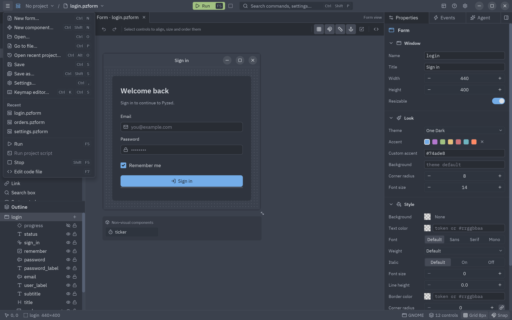
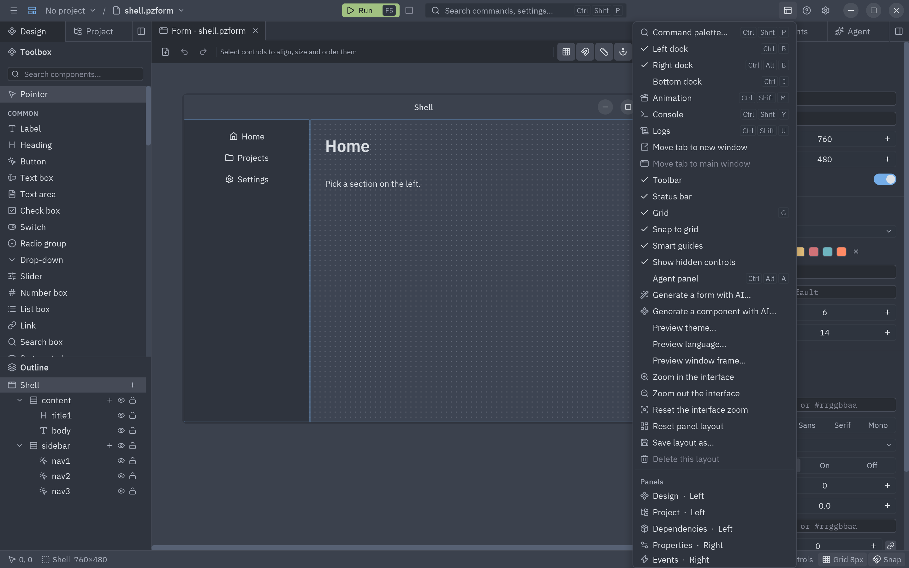
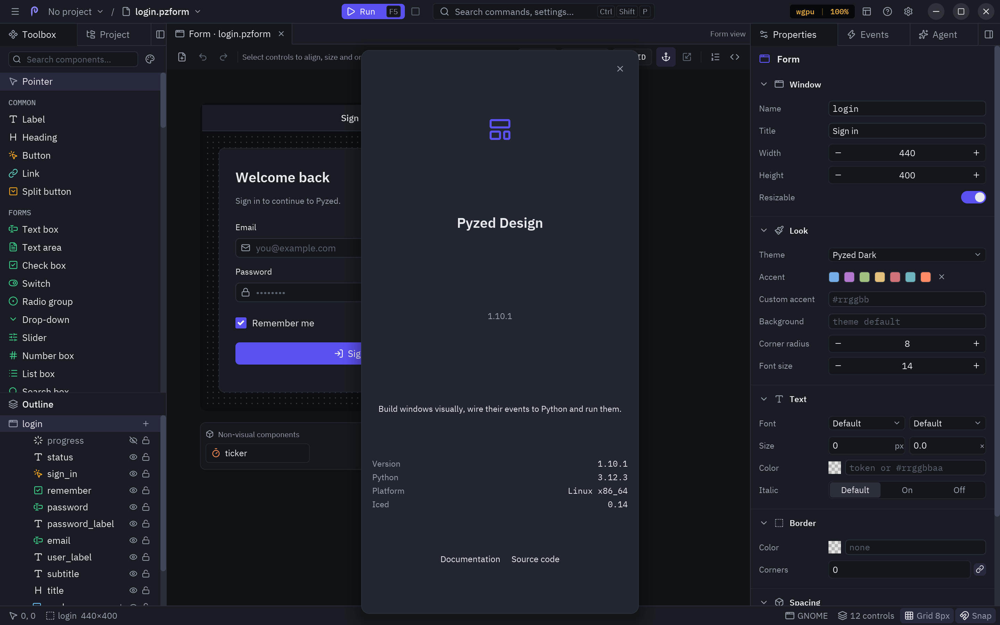
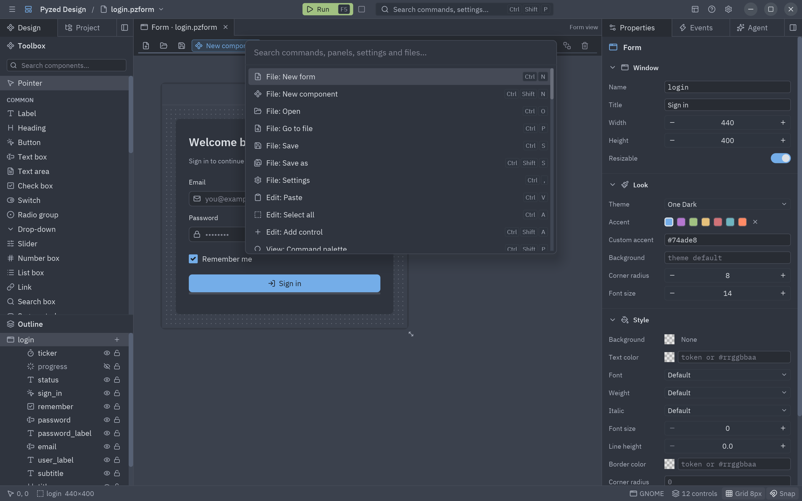
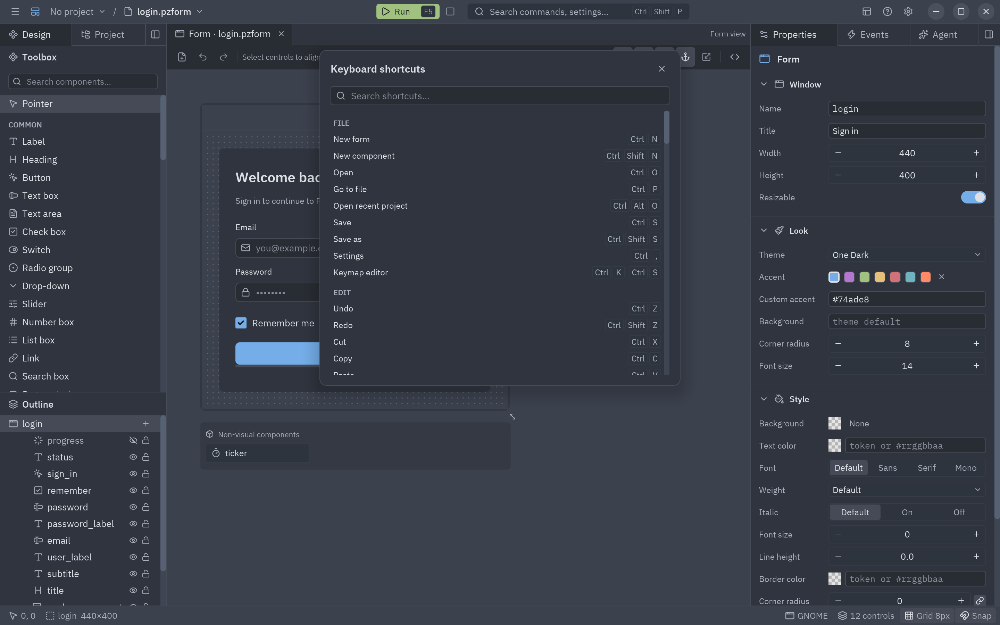
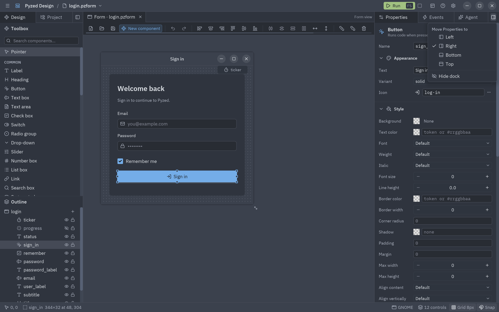
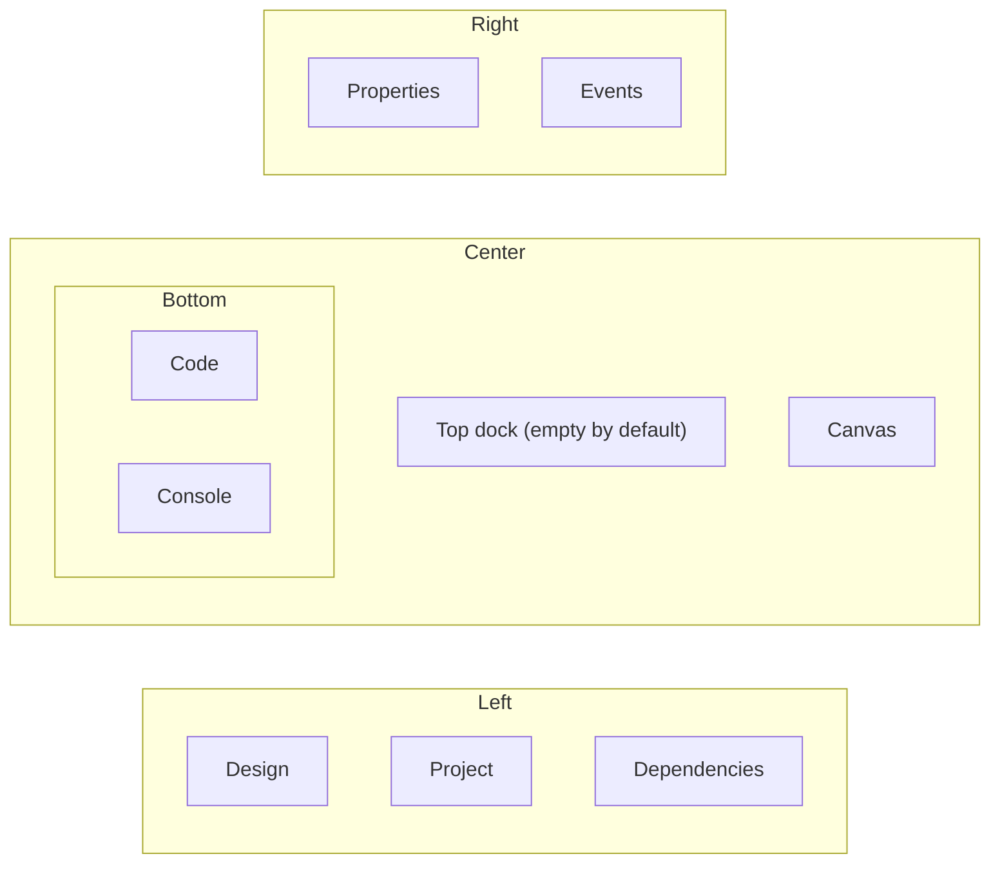

Every command of the editor lives in one table, so the menus, the command palette, the keyboard and the shortcut
list always agree. This page lists them all.

## The title bar

From left to right: the **☰** menu, the project's name (click it to show the Project panel), the file name (click
it to open another file), a dot when there are unsaved changes and a **Component** badge in component mode. At the
right: **Run** (<kbd>F5</kbd>), **Stop**, the **View** menu, the **Help** menu and the **Settings** gear.

## ☰ File menu

| Entry | Keys | Does |
| --- | --- | --- |
| New form… | <kbd>Ctrl</kbd>+<kbd>N</kbd> | The New dialog, on Form. |
| New component… | <kbd>Ctrl</kbd>+<kbd>Shift</kbd>+<kbd>N</kbd> | The New dialog, on Component. |
| Open… | <kbd>Ctrl</kbd>+<kbd>O</kbd> | Lists the forms and components under the working folder. |
| Save | <kbd>Ctrl</kbd>+<kbd>S</kbd> | Saves the document and its code. |
| Save as… | <kbd>Ctrl</kbd>+<kbd>Shift</kbd>+<kbd>S</kbd> | Saves under a new path. |
| Settings… | <kbd>Ctrl</kbd>+<kbd>,</kbd> | The [settings](/pyzed/editor/settings/). |
| *Recent* | | The last five files opened. |
| Run | <kbd>F5</kbd> | [Runs](/pyzed/editor/console-and-running/) the form or previews the component. |
| Stop | <kbd>Shift</kbd>+<kbd>F5</kbd> | Closes the running form. |
| Edit code file | <kbd>F7</kbd> | Opens the whole code file in the code editor. |

## Edit commands

The Edit commands have no menu of their own: they are on the toolbar, in the control's context menu, on the
keyboard and in the command palette.

| Command | Keys |
| --- | --- |
| Undo / Redo | <kbd>Ctrl</kbd>+<kbd>Z</kbd> / <kbd>Ctrl</kbd>+<kbd>Shift</kbd>+<kbd>Z</kbd> |
| Cut / Copy / Paste | <kbd>Ctrl</kbd>+<kbd>X</kbd> / <kbd>Ctrl</kbd>+<kbd>C</kbd> / <kbd>Ctrl</kbd>+<kbd>V</kbd> |
| Duplicate | <kbd>Ctrl</kbd>+<kbd>D</kbd> |
| Delete | <kbd>Delete</kbd> |
| Select all | <kbd>Ctrl</kbd>+<kbd>A</kbd> |
| Add control… | <kbd>Ctrl</kbd>+<kbd>Shift</kbd>+<kbd>A</kbd> |
| Group in a row / in a column / in a grid | |

## View menu

| Entry | Keys | Does |
| --- | --- | --- |
| Command palette… | <kbd>Ctrl</kbd>+<kbd>Shift</kbd>+<kbd>P</kbd> | Runs any command by name. |
| Left dock / Right dock / Bottom dock | <kbd>Ctrl</kbd>+<kbd>B</kbd> / <kbd>Ctrl</kbd>+<kbd>Alt</kbd>+<kbd>B</kbd> / <kbd>Ctrl</kbd>+<kbd>J</kbd> | Shows or hides each dock (checked when shown). |
| Console | <kbd>Ctrl</kbd>+<kbd>Shift</kbd>+<kbd>Y</kbd> | Shows the console and keeps it open. |
| Toolbar, Status bar | | Shows or hides them. |
| Grid | <kbd>G</kbd> | Shows or hides the dot grid. |
| Snap to grid | | Toggles snapping. |
| Smart guides | | Toggles the alignment guides. |
| Show hidden controls | | Draws hidden controls dimmed on the canvas, or leaves them out. |
| Preview window frame… | | Shows the form on the canvas in the window frame of another platform: macOS, Windows 11, GNOME, Ubuntu or KDE Plasma (checked while it is not this system's). |
| Preview theme…, Preview language… | | Shows the canvas (and the next run) in another theme or language without changing the form (checked while on). See [Preview in another theme or language](/pyzed/editor/data-binding/#preview-in-another-theme-or-language). |
| Reset panel layout | | Puts every panel back in its default dock and size. |
| *Panels* | | One entry per panel, with the dock it is in (`Properties · Right`): click to bring it to the front. |

The toggles are remembered between sessions.

## Help menu

| Entry | Keys | Does |
| --- | --- | --- |
| Keyboard shortcuts | <kbd>F1</kbd> | A searchable list of every shortcut. |
| Reference | <kbd>Shift</kbd>+<kbd>F1</kbd> | The [built-in reference](/pyzed/editor/reference/), on the page of the selected control or of the name under the cursor. |
| Documentation | | Opens this documentation in the browser. |
| Report a problem | | Opens the issue tracker. |
| What's new | | A tab with the release notes of this version (or of the update waiting to install). |
| Check for updates | | Looks for a newer release on GitHub now; see [Updates](/pyzed/download/#updates). |
| Check for updates automatically | | Toggles the daily check (on by default). |
| About Pyzed Design | | The versions of Pyzed, Python and Iced, the platform, and links. |

## The toolbar

Under the document tabs, left to right: **New form**, **Open**, **Save**, **New component**; **Undo**, **Redo**;
**Align left, centers, right, top, middles, bottom**; **Distribute horizontally, vertically**, **Same width,
height**, **Center in form horizontally, vertically**; **Bring to front**, **Send to back**, **Delete**. At the
end: **Show grid**, **Snap to grid**, **Smart guides**, **Resize contents with their anchors**, **Fit selection to grid** and **Edit code file**.
Every button has a tooltip with its shortcut, buttons that do not apply to the selection are disabled, and the
toolbar scrolls sideways when the window is narrow. Hide it with **View → Toolbar**. See
[Toolbox and canvas](/pyzed/editor/toolbox-and-canvas/#align-distribute-and-size).

## Command palette

<kbd>Ctrl</kbd>+<kbd>Shift</kbd>+<kbd>P</kbd> opens a search box over every command that can run right now, as
`Group: Command` with its shortcut. Type a few letters (the search is fuzzy: `vgr` finds *View: Grid*),
<kbd>↑</kbd>/<kbd>↓</kbd> to move, <kbd>Enter</kbd> to run, <kbd>Esc</kbd> to close. It also reaches commands that
have no menu, such as the Edit ones.

## Add control

<kbd>Ctrl</kbd>+<kbd>Shift</kbd>+<kbd>A</kbd> is the palette for components: a fuzzy-searchable list of every
component with its category. <kbd>Enter</kbd> adds the highlighted one, centered on the form, and selects it. From
a container (its **+** in the outline, or **Add inside…**), it adds inside that container instead.

## Keyboard shortcuts dialog

<kbd>F1</kbd> lists every shortcut by group (File, Edit, View, Run, Help, Canvas, Code) with a search box. See the
[complete table](/pyzed/editor/keyboard-shortcuts/).

## Panels and docks

Six panels live in four docks around the canvas:

| Panel | Default dock | Shows |
| --- | --- | --- |
| **Design** | Left | The toolbox and the outline. |
| **Project** | Left | The project's files. |
| **Dependencies** | Left | Dependencies, ruff and ty (only with a project open). |
| **Properties** | Right | The property grid. |
| **Events** | Right | The events of the selection. |
| **Code** | Bottom | The code editor (only while a handler or the file is open). |
| **Console** | Bottom | The console (once it has something to show). |

Each dock shows one panel at a time, with a tab per panel. At the end of the tab bar:

- the **dock button** opens a menu to **Move *panel* to** the left, right, bottom or top dock, or **Hide dock**;
- the **×** hides the dock (bring it back with its shortcut or the View menu).

Drag the edge of a dock that faces the canvas to resize it (each dock has a minimum size). Where every panel is,
which docks are hidden and their sizes are saved with your settings; **View → Reset panel layout** (or
**Settings → Panels → Reset**) restores the default.

:::tip
On a wide screen, move **Events** to the left dock (or the top one) to see Properties and Events at the same time;
on a small one, hide the left dock with <kbd>Ctrl</kbd>+<kbd>B</kbd> while you write code, and use
<kbd>Ctrl</kbd>+<kbd>Shift</kbd>+<kbd>A</kbd> to add controls without the toolbox.
:::

## Notifications

Short messages appear in a corner for a few seconds: saved, copied, opened, a command that failed... Click the ×
to dismiss one; at most four are shown at once.
