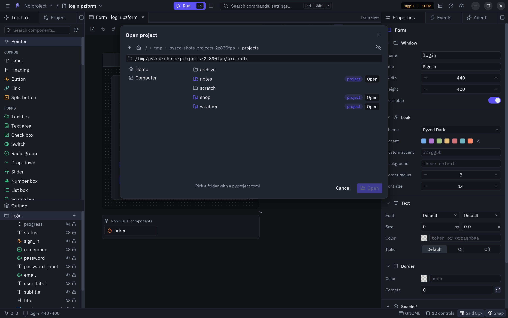
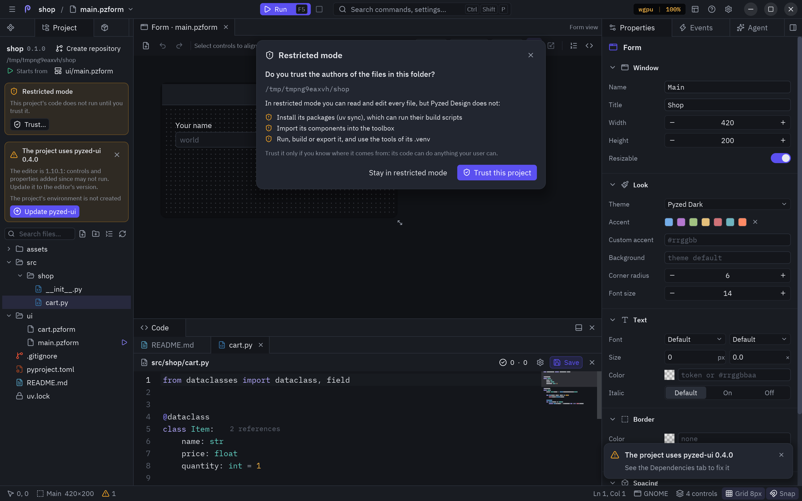
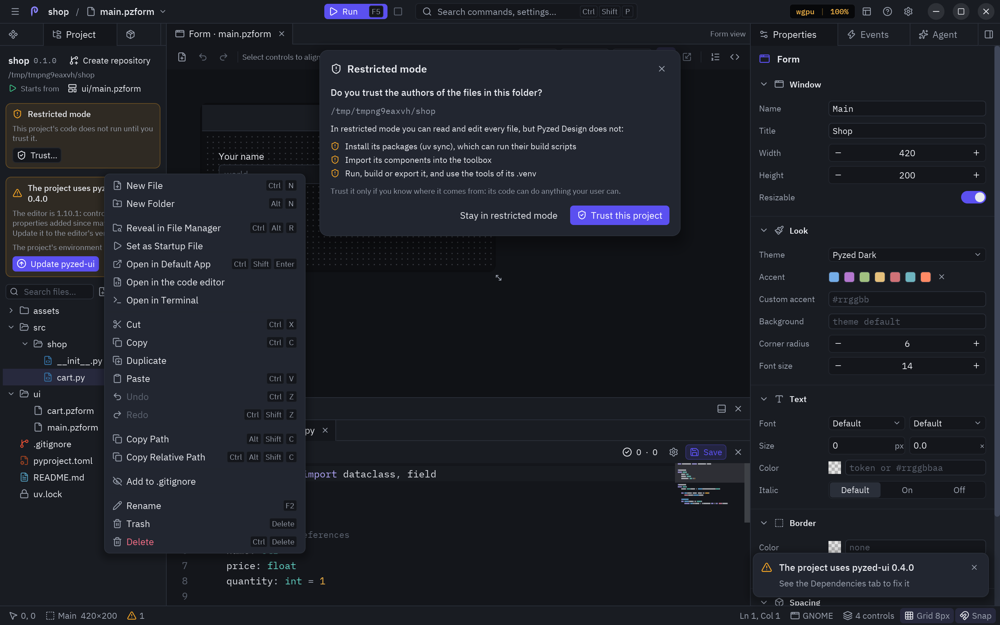
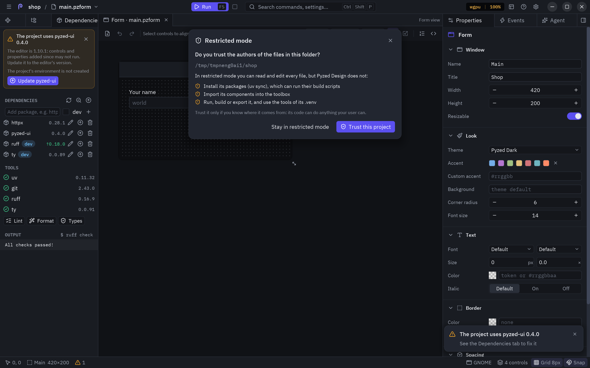

A Pyzed app is a normal [uv](https://docs.astral.sh/uv/) project: the interface lives in `ui/`, the backend in
`src/` and uv manages the dependencies. The **Project** panel (left dock, next to **Design**) shows the project's
files, like the project panel of Zed or the explorer of VS Code, and the **Dependencies** panel next to it manages
packages, tools and checks, all without leaving the editor. The background, the layout of a project and the matching `pyzed` commands are in
[Projects with uv](/pyzed/guides/projects/).


## How the editor finds your project

When the editor starts, it looks for a Pyzed project (a `pyproject.toml` with a `[tool.pyzed]` table) at the file
you opened or above it, or above the current folder. If it finds one it:

- **opens it** in the Project panel, makes its folder the working folder and remembers it among the recent
  projects;
- **activates** it, so forms and handlers can import `ui/` helpers, the `src/` package and every dependency of
  its `.venv`;
- **discovers its components**: every `.pzcomp` of the project joins the toolbox;
- **checks its tools** in the background (uv, git, ruff and ty, with their versions).

The title bar then shows the project's name before the file name: click it to bring the Project panel to the
front.

## No project open

With no project, the panel offers **New project** and **Open…**, and lists your recent projects (click one to
open it).


### New project

| Field | What it does |
| --- | --- |
| **Name** | The project's name and folder name. |
| **Location** | The folder it is created in; the dialog shows the full path it will create. **Browse…** opens the folder browser: walk to a folder and press **Choose this folder**. |
| **Backend in src/** | `uv init --package`: a `src/<name>/` package importable from the UI and from tests. Off gives a flat layout (`uv init --app`). |
| **Git repository** | Runs `git init` and writes a `.gitignore`. |

**Create** runs uv in the background and then opens the new project and its main form. The target folder must be
empty, or already be a project.

### Open project

**Open…** shows a folder browser instead of a text field:



- The bar at the top goes to the **parent folder** (up arrow) or **home**, and every part of the path is
  clickable. The eye shows or hides hidden folders.
- The path field below it takes a folder typed or pasted; <kbd>Enter</kbd> goes there.
- On the left, the usual **places** (home, desktop, documents, downloads, the disks) and your **recent**
  projects (click one to open it).
- On the right, the folders of the current one; click a folder to go into it. Folders that are uv projects (they
  have a `pyproject.toml`) carry a **project** badge and their own **Open** button.

**Open** at the bottom opens the folder you are in when it is a project. If the project has a main form, it
opens in a tab.

## The project panel

### Header

The project's name, version and folder. On the right, the current **git branch**, or **Create repository** when
the folder is not a repository yet (it runs `git init` and writes a `.gitignore`, like Zed), and a folder button
that opens another project.

While a command runs, a bar with a spinner says what is going on (`Adding httpx`, `Syncing the environment`...).
Commands run on a worker thread, so you can keep designing while uv downloads packages.

### Files

Under the header, the project's files and folders as a tree, like Zed's project panel. Folders open and close with
a click (the `ui/` and `src/` folders start open); files are colored by their git status (modified, new, deleted,
conflict) and folders take the color of what changed inside them. Virtual environments, caches and build output
(`.venv`, `__pycache__`, `build`, `dist`...) are left out; hidden files such as `.gitignore` stay.

Clicking a file opens it where it belongs:

| File | Opens |
| --- | --- |
| `.pzform`, `.pzcomp` | In a designer tab. |
| The `.py` of a form or component | Its form, with the whole code file in the [code panel](/pyzed/editor/code-editor/). |
| Any other text file (`.py`, `.toml`, `.md`, `.json`...) | In a tab of the code panel, to edit it right there. |
| Images and other binary files | In the system's app for that file type. |



Each open file gets a tab in the code panel, after the form's code when it is open. The editor has syntax
highlighting for the file's language, search and replace (<kbd>Ctrl</kbd>+<kbd>F</kbd>), go to line
(<kbd>Ctrl</kbd>+<kbd>G</kbd>) and every editing shortcut; completion and diagnostics stay with the form's code.
A dot on a tab means unsaved changes: **Save** or <kbd>Ctrl</kbd>+<kbd>S</kbd> (while the file has the keyboard)
writes it, and closing it asks first. Renaming or deleting a file in the tree updates its tab.

The toolbar above the tree has a **search field** for files and folders (it matches letters in order, like Zed's
file finder, and file names count more than folders: `crt` finds `ui/cart.pzform`), **New file**, **New
folder** (in the selected folder), **Collapse all** and **Refresh**. The tree reloads by itself when you save and
after uv commands.

**Right-click** a file or folder (or the empty space below the tree, for the project folder) for its menu, the
same as Zed's project panel:



| Item | Keys | What it does |
| --- | --- | --- |
| **New File** / **New Folder** | <kbd>Ctrl</kbd>+<kbd>N</kbd> / <kbd>Alt</kbd>+<kbd>N</kbd> | Creates one in that folder (a new file opens right away). |
| **Reveal in File Manager** | <kbd>Ctrl</kbd>+<kbd>Alt</kbd>+<kbd>R</kbd> | Shows it in Files, Finder or Explorer. |
| **Open in Default App** | <kbd>Ctrl</kbd>+<kbd>Shift</kbd>+<kbd>Enter</kbd> | Opens the file with the system's app for its type. |
| **Open in the code editor** | | Opens any text file as text (a form's `.py` on its own too). |
| **Open in Terminal** | | Opens the system's terminal in that folder (`$TERMINAL` first on Linux). |
| **Cut** / **Copy** / **Paste** | <kbd>Ctrl</kbd>+<kbd>X</kbd> / <kbd>C</kbd> / <kbd>V</kbd> | Moves or copies it into the folder you paste on; a taken name gets ` copy`. |
| **Duplicate** | <kbd>Ctrl</kbd>+<kbd>D</kbd> | Copies it next to itself and asks for the copy's name. |
| **Undo** / **Redo** | <kbd>Ctrl</kbd>+<kbd>Z</kbd> / <kbd>Ctrl</kbd>+<kbd>Shift</kbd>+<kbd>Z</kbd> | Reverts or repeats the last new file or folder, rename, move or copy made here. |
| **Copy Path** / **Copy Relative Path** | <kbd>Alt</kbd>+<kbd>Shift</kbd>+<kbd>C</kbd> / <kbd>Ctrl</kbd>+<kbd>Alt</kbd>+<kbd>Shift</kbd>+<kbd>C</kbd> | Copies the full path or the path from the project folder. |
| **Add to .gitignore** / **Add to .git/info/exclude** | | Ignores it in git, for everyone or only in your copy. |
| **Open File Permalink** / **Copy File Permalink** | | The link to it at the current commit on GitHub, GitLab or another remote (only with a remote). |
| **Rename** | <kbd>F2</kbd> | Renames it. |
| **Trash** | <kbd>Delete</kbd> | Moves it to the system's trash, where you can restore it. |
| **Delete** | <kbd>Ctrl</kbd>+<kbd>Delete</kbd> | Deletes it for good after asking (a folder with everything in it). |

The keys work once you click in the tree, and also <kbd>↑</kbd> <kbd>↓</kbd> to move the selection,
<kbd>←</kbd> <kbd>→</kbd> to close and open folders and <kbd>Enter</kbd> to open the selected file. A file open in
the code panel follows its renames and moves, and closes when it is deleted (unless it has unsaved changes).

### Go to file

<kbd>Ctrl</kbd>+<kbd>P</kbd> (or **File → Go to file…**) opens a search over every file and folder of the
project. Type part of a name and press <kbd>Enter</kbd> for the best match, or click a result; a folder is revealed
in the Project panel.

## The Dependencies panel

With a project open, the left dock gets a **Dependencies** panel next to **Project** (when the three titles do not
fit, the panels not shown keep only their icon).



### Dependencies

| Control | Runs |
| --- | --- |
| **Add package** field + **+** (or <kbd>Enter</kbd>) | `uv add <packages>`. Type several separated by spaces, or a constraint such as `httpx>=0.28`. Tick **dev** for the dev group. |
| **Pencil** on a row | Opens **Change**: type a new requirement (`httpx==0.27.2`, `httpx>=0.28,<1`) and apply it. |
| **Up arrow** on a row | Upgrades that package within its constraint. |
| **Trash** on a row | `uv remove` from the group it is in. |
| **Refresh** in the section header | `uv sync`: makes `.venv` match `uv.lock`. |
| **Search** in the section header | **Check for updates**: looks up newer versions; rows with one show `↑version` in green (hover it for the change). |
| **Up arrow** in the section header | Upgrades every package. |

Dependencies of other groups show their group as a badge.

### Tools

uv, git, ruff and ty with the version found, or a red **missing** badge. Under them:

- **Lint** runs `ruff check` on the project.
- **Format** runs `ruff format`.
- **Types** runs `ty check`.

The **Output** section at the bottom shows the command that ran (`$ ruff check`) and the last lines of its output,
in red when it failed. A failed command also shows a notification with its last line.

:::tip
Ruff reads its rules from `[tool.ruff]` in `pyproject.toml`, so **Lint** and the code editor's inline warnings
follow the same configuration.
:::

## Running forms of a project

When the editor runs inside the project's own environment (you started it with `uv run pyzed design`), **Run**
(<kbd>F5</kbd>) runs the form in the editor's process. When it does not (the standalone app, or `pyzed design`
installed with `uv tool`), **Run** saves the form and starts it with `uv run pyzed run --reload` in the project,
so it has every dependency of `.venv` and updates on every save. Its output is piped into the
[console](/pyzed/editor/console-and-running/) either way.

## Building the app

The Project panel does not package apps; use the command line in the project folder:

```bash
uv run pyzed build            # a folder with the executable for this platform
uv run pyzed build --onefile  # a single file
uv run pyzed build --workflow # a GitHub Actions workflow for Linux, Windows and macOS
```

See [Build and distribute](/pyzed/packaging/build/).

## The standalone app

**Pyzed Design** is also published as a standalone app for Linux, Windows and macOS: the editor compiled with its
own Python and the `uv` binary, so nothing else needs to be installed. Projects created from it are normal uv
projects with their own `.venv`, and their forms always run through `uv run`.

:::tip
If completion does not know a package you just added, press **Restart servers** in the
[editor settings](/pyzed/editor/code-editor/#editor-settings) after the sync finishes: the language servers read
the project's `.venv` when they start.
:::
