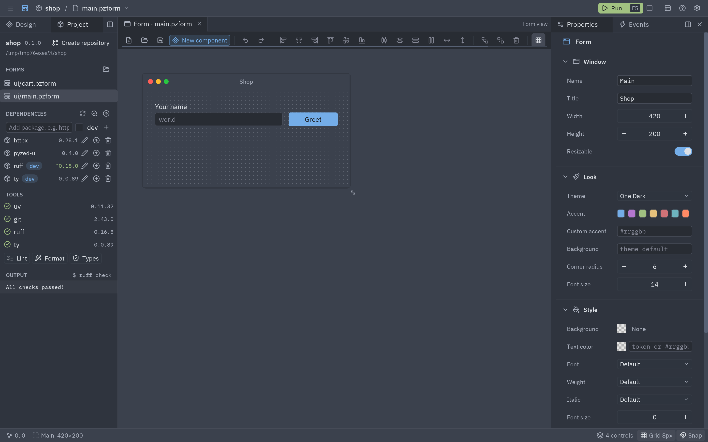
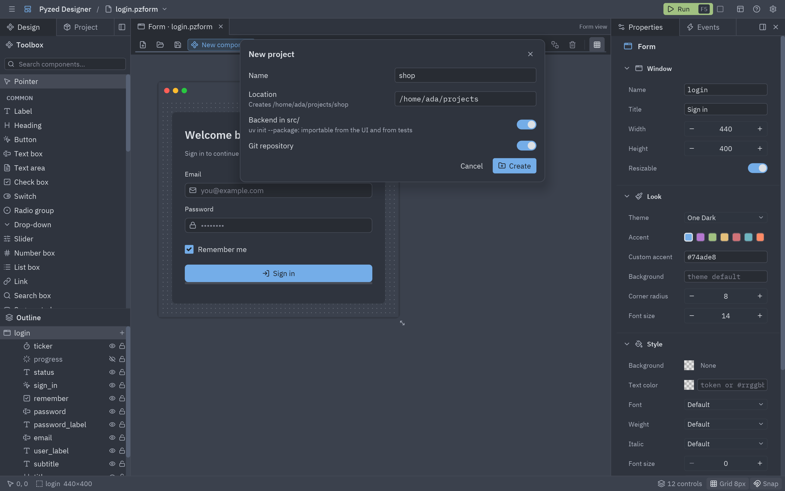

A Pyzed app is a normal [uv](https://docs.astral.sh/uv/) project: the interface lives in `ui/`, the backend in
`src/` and uv manages the dependencies. The **Project** panel (left dock, next to **Design**) does all of it
without leaving the editor. The background, the layout of a project and the matching `pyzed` commands are in
[Projects with uv](/pyzed/guides/projects/).



## How the editor finds your project

When the editor starts, it looks for a Pyzed project (a `pyproject.toml` with a `[tool.pyzed]` table) at the file
you opened or above it, or above the current folder. If it finds one it:

- **opens it** in the Project panel, makes its folder the working folder and remembers it among the recent
  projects;
- **activates** it, so forms and handlers can import `ui/` helpers, the `src/` package and every dependency of
  its `.venv`;
- **discovers its components**: every `.pzcomp` of the project joins the toolbox;
- **checks its tools** in the background (uv, git, ruff and ty, with their versions).

The title bar then shows the project's name before the file name: click it to bring the Project panel to the
front.

## No project open

With no project, the panel offers **New project** and **Open…**, and lists your recent projects (click one to
open it).



### New project

| Field | What it does |
| --- | --- |
| **Name** | The project's name and folder name. |
| **Location** | The folder it is created in; the dialog shows the full path it will create. |
| **Backend in src/** | `uv init --package`: a `src/<name>/` package importable from the UI and from tests. Off gives a flat layout (`uv init --app`). |
| **Git repository** | Runs `git init` and writes a `.gitignore`. |

**Create** runs uv in the background and then opens the new project and its main form. The target folder must be
empty, or already be a project.

### Open project

Type (or paste) a folder that holds a `pyproject.toml` and press <kbd>Enter</kbd> or **Open**, or pick one of the
recent projects listed below the field. If the project has a main form, it opens in a tab.

## The project panel

### Header

The project's name, version and folder. On the right, the current **git branch**, or **Create repository** when
the folder is not a repository yet (it runs `git init` and writes a `.gitignore`, like Zed).

While a command runs, a bar with a spinner says what is going on (`Adding httpx`, `Syncing the environment`...).
Commands run on a worker thread, so you can keep designing while uv downloads packages.

### Forms

Every `.pzform` in the project's UI folder. Click one to open it in a tab; the open one is highlighted. The
folder icon at the end of the section opens another project.

### Dependencies

| Control | Runs |
| --- | --- |
| **Add package** field + **+** (or <kbd>Enter</kbd>) | `uv add <packages>`. Type several separated by spaces, or a constraint such as `httpx>=0.28`. Tick **dev** for the dev group. |
| **Pencil** on a row | Opens **Change**: type a new requirement (`httpx==0.27.2`, `httpx>=0.28,<1`) and apply it. |
| **Up arrow** on a row | Upgrades that package within its constraint. |
| **Trash** on a row | `uv remove` from the group it is in. |
| **Refresh** in the section header | `uv sync`: makes `.venv` match `uv.lock`. |
| **Search** in the section header | **Check for updates**: looks up newer versions; rows with one show `↑version` in green (hover it for the change). |
| **Up arrow** in the section header | Upgrades every package. |

Dependencies of other groups show their group as a badge.

### Tools

uv, git, ruff and ty with the version found, or a red **missing** badge. Under them:

- **Lint** runs `ruff check` on the project.
- **Format** runs `ruff format`.
- **Types** runs `ty check`.

The **Output** section at the bottom shows the command that ran (`$ ruff check`) and the last lines of its output,
in red when it failed. A failed command also shows a notification with its last line.

:::tip
Ruff reads its rules from `[tool.ruff]` in `pyproject.toml`, so **Lint** and the code editor's inline warnings
follow the same configuration.
:::

## Running forms of a project

When the editor runs inside the project's own environment (you started it with `uv run pyzed design`), **Run**
(<kbd>F5</kbd>) runs the form in the editor's process. When it does not (the standalone app, or `pyzed design`
installed with `uv tool`), **Run** saves the form and starts it with `uv run pyzed run --reload` in the project,
so it has every dependency of `.venv` and updates on every save. Its output is piped into the
[console](/pyzed/editor/console-and-running/) either way.

## Building the app

The Project panel does not package apps; use the command line in the project folder:

```bash
uv run pyzed build            # a folder with the executable for this platform
uv run pyzed build --onefile  # a single file
uv run pyzed build --workflow # a GitHub Actions workflow for Linux, Windows and macOS
```

See [Build and distribute](/pyzed/guides/packaging/).

## The standalone app

**Pyzed Design** is also published as a standalone app for Linux, Windows and macOS: the editor compiled with its
own Python and the `uv` binary, so nothing else needs to be installed. Projects created from it are normal uv
projects with their own `.venv`, and their forms always run through `uv run`.

:::tip
If completion does not know a package you just added, press **Restart servers** in the
[editor settings](/pyzed/editor/code-editor/#editor-settings) after the sync finishes: the language servers read
the project's `.venv` when they start.
:::
