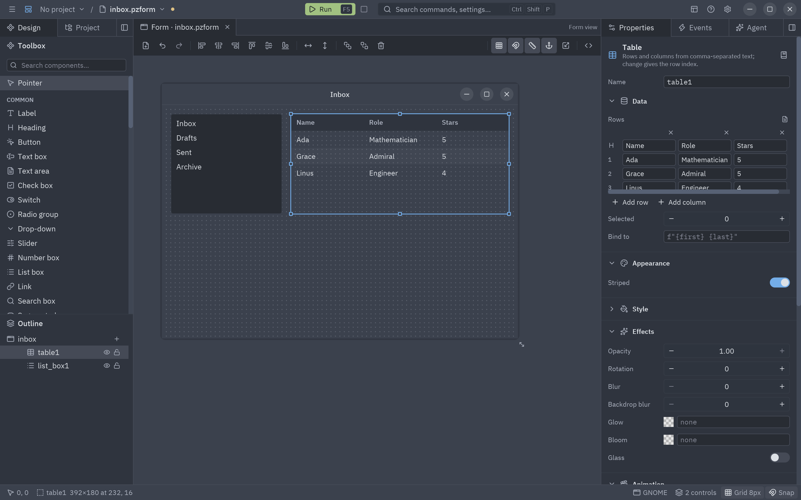
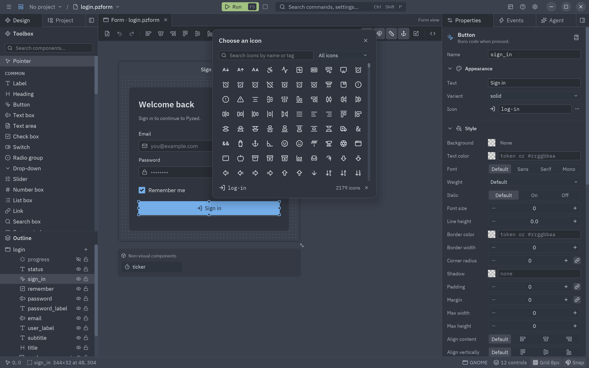
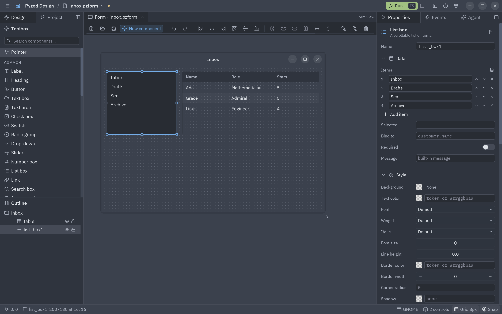
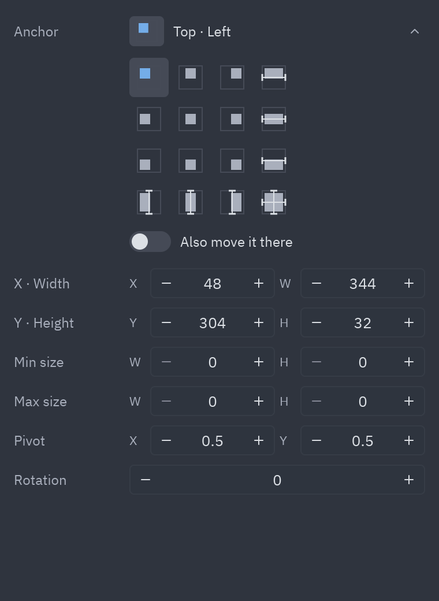

The **Properties** panel (right dock) edits whatever is selected. Its content changes with the selection:

| Selection | The panel shows |
| --- | --- |
| Nothing | The **form** itself: window, look, global style and designer settings. In a component, the [Component panel](/pyzed/editor/component-designer/#the-component-panel). |
| One control | Its name, its own properties by group, **Style**, **Position** and **Behavior**. |
| Several controls | Alignment, distribution and same-size tools. |

Every section is collapsible: click its header to fold it. The folded sections are remembered while the editor is
open, so you can keep only the ones you use. Every change is one undo step, and typing in a field merges into a
single step.

## A control

### Header and name

The top of the panel shows the component's icon, its kind and a one-line description. Under it, **Name** is the
control's identifier: the attribute you use in code (`form.email`) and the prefix of its handlers. Type a new name
and press <kbd>Enter</kbd> to rename it; handlers that follow the naming convention (`email_change`) are renamed
in the code file too. Names are made valid and unique for you.

The **book** button at the right of the header (<kbd>Shift</kbd>+<kbd>F1</kbd>) opens the control's page in the
[built-in reference](/pyzed/editor/reference/): every property with its type and default, its events and its
methods. Hover a property's label for a one-line description.

### The component's own sections

Each component groups its properties in **Appearance**, **Data**, **Layout** or **Behavior** sections. The kind of
a property decides its editor:

| Kind | Editor | Example |
| --- | --- | --- |
| Text | A text field. | A button's `text`, a text box's `placeholder`. |
| Multiline | A small code editor with wrapping. | A text area's `text`, a markdown's `text`. |
| Number | A number box with `−`/`+` and limits. | A slider's `min`, `max`, `step`. |
| Switch | An on/off switch. | `checked`, `secure`, `wrap`. |
| Choice | Up to four short choices side by side as a segmented control; longer lists as a drop-down. | A button's `variant`, a label's `size`. |
| Color | A swatch and a field for a theme token (`accent`, `text_muted`) or `#hex`. | A label's `color`. |
| Icon | A preview, a field for a [Lucide](https://lucide.dev) icon name and a **…** button: click the preview or **…** to pick from the icon dialog (see below). | A button's `icon`. |
| List | One field per item (see below). | A drop-down's `options`, a list box's `items`, a tab bar's `tabs`. |
| Rows | A small spreadsheet (see below). | A table's `data`. |

Hover a property's name to read what it does, when it has a tip. The [component library](/pyzed/library/) documents
every property of every component.

Controls that hold a value also show **Bind to** and their validation rules (**Required**, **Minimum length**,
**Pattern**...) in the **Data** section: see [Data binding and validation](/pyzed/editor/data-binding/).

### The icon dialog

Clicking an icon property's preview or its **…** button opens **Choose an icon**: a search box, a category
drop-down and a grid of every bundled icon. The search matches names and Lucide's tags ("person" finds `user`,
"trash" finds `trash-2`), Enter picks the first match, and a click on an icon sets the property and closes the dialog.
The icon in use is highlighted and shown at the bottom, next to the number of matches; **×** clears the property.

The same dialog picks the **Icon** of a [designed component](/pyzed/editor/component-designer/) and the default of
its icon properties. In your own apps it is [`ui.IconPicker`](/pyzed/library/icon-picker/).

### The list editor

Lists get one numbered field per item, with buttons to **move it up**, **move it down** and **remove** it, and
**Add item** at the end. The page icon at the right of the property's title switches to **Edit as text**: one item
per line in a small editor, handy for pasting a long list. The list icon switches back (**Edit item by item**).

### The rows editor

A table's data is a small spreadsheet. The first row (marked **H**) is the header; the others are numbered.
**Add row** and **Add column** grow it, the **×** at the end of a row removes the row and the **×** above a column
removes the column (a table keeps at least one). It scrolls sideways when the table is wider than the panel.
As with lists, the page icon switches to plain text: one row per line, cells separated by commas.

### Style

Every control has a **Style** section, the same set of properties as [`pz.Style`](/pyzed/theming/styles/):
background (color, gradient or mask), text color, font, weight, italic, font size, line height, border, corner
radius, shadow, padding, margin, maximum size, content alignment and clipping. Empty fields keep the component's
own look and **Reset style** clears them all. See [Styles and themes](/pyzed/editor/styles-and-themes/).

Each field has an editor made for its value: **Font**, **Italic**, **Clip** and the two alignments are segmented
controls (the alignments show icons; hover them for their name), and **Padding**, **Margin** and **Corner radius**
are one number for every side. Press the **link** button at its end to give each side (or corner) its own number;
press it again to use one value everywhere.

Below it, **Effects** (opacity, glow, bloom, glass) and **Animation** (what plays when the control appears, on
hover, press, focus or click) are covered in [Animations and effects](/pyzed/editor/animations-and-effects/).

### Position

For a control placed freely (on the form, or in a panel, group box or card):

| Field | Meaning |
| --- | --- |
| **Inside** | Only inside a container: the container's name (click it to select the container) and a button to **move out** of it. |
| **Anchor** | The anchor preset, drawn as a box in a frame, and its name (`Top · Left`). Click it to open the 4×4 grid of presets (see below). |
| **X · Width**, **Y · Height** | Position relative to the form or the container, and size in pixels. |
| **Left · Right**, **Top · Bottom** | Instead of X and Width (or Y and Height) when the control stretches on that axis: its distances to the sides of the container. Changing one keeps the opposite side where it is. |
| **Min size**, **Max size** | Limits for the width and height when the control stretches (`0`: no limit), so a stretched panel stops at a readable width. |
| **Pivot** | The point the control turns and scales around, and that stays put when a size limit stops it from stretching: `0 0` is the top-left corner, `0.5 0.5` (the default) the center, `1 1` the bottom-right corner. |
| **Rotation** | Degrees clockwise, around the pivot (the same value as the style's `rotate`). |

For a child of a **flex row or column**: **Grow** (its share of the free space, 0 keeps its size), **Width** and
**Height**. For a child of a **grid**: **Column span** (how many columns it takes), **Width** and **Height**.
These children are placed by their container, so they have no X and Y: drag them to reorder them. See
[Layouts and containers](/pyzed/editor/layouts/).

The presets are the anchors of Unity, Unreal and Godot. The columns say how the control follows the width
(**Left**, **Center**, **Right** or **Stretch**) and the rows how it follows the height (**Top**, **Middle**,
**Bottom** or **Stretch**); the last cell, **Stretch · Stretch**, fills the container. Picking a preset only
changes how the control follows a resize; turn on **Also move it there** to also put it against the edges it is
anchored to (centered, or filling the container on stretched axes). Under the hood a preset is a set of edges, as
in WinForms:

| Anchors | When the window grows |
| --- | --- |
| Left + Top (default) | The control stays where it is. |
| Left + Right | It stretches horizontally. |
| Right only | It moves with the right edge. |
| Neither left nor right | It stays centered horizontally. |
| Top + Bottom, Bottom only, neither | The same, vertically. |

### Behavior

| Field | Meaning |
| --- | --- |
| **Visible** | Hidden controls are not shown when the form runs (`form.status.show()` brings them back). |
| **Enabled** | Disabled controls are drawn grayed and ignore the user. |
| **Locked** | Design-time only: the control cannot be moved or resized on the canvas. |

## Several controls

With two or more controls selected the panel shows **Align** (left edges, centers, right edges, top edges,
middles, bottom edges) and **Spacing and size** (distribute horizontally or vertically, same width, same height).
They work as the [toolbar buttons](/pyzed/editor/toolbox-and-canvas/#align-distribute-and-size).

## The form

Click an empty spot of the canvas, or the first row of the outline, to edit the form itself.

| Section | Field | Meaning |
| --- | --- | --- |
| **Window** | **Name** | The form's name: the file name and the prefix of the form's handlers. |
| | **Title** | The window title. |
| | **Width**, **Height** | The window's size (also the grip under the canvas). |
| | **Resizable** | Whether the user can resize the running window. |
| **Look** | **Theme** | Any registered theme: One Dark, One Light, Ayu, Gruvbox... or your own. |
| | **Accent** | Seven preset accent colors and **×** for the theme's own. |
| | **Custom accent** | Any `#rrggbb` accent. |
| | **Background** | A color for the window background (`theme default` when empty). |
| | **Corner radius** | The radius of every control (0 to 24). |
| | **Font size** | The base text size of the window. |
| **Style** | | The window's **global style**: font, text color, weight, size and line height for every text that does not set its own; background, border color, radius and padding of the window. |
| **Designer** | **Grid size** | The grid step of this form. |

The form's look is independent of the editor's own theme: a form can be light while you design in a dark editor.
