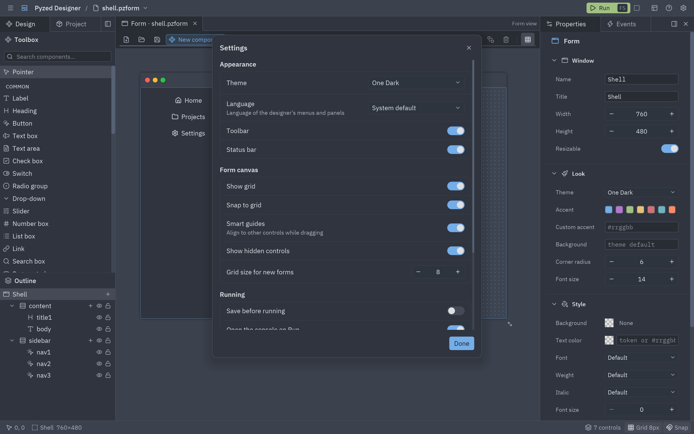

**Settings** (<kbd>Ctrl</kbd>+<kbd>,</kbd>, the gear at the right of the title bar, or the ☰ menu) holds the
editor's own preferences. Changes apply at once and are saved right away; **Done** closes the dialog.



## Appearance

| Setting | What it does |
| --- | --- |
| **Theme** | The editor's theme (One Dark, One Light, Ayu, Gruvbox...). Forms keep their own theme. |
| **Language** | *System default*, English or Español: the language of the menus and panels. |
| **Toolbar** | Shows or hides the toolbar. |
| **Status bar** | Shows or hides the status bar. |

## Form canvas

| Setting | What it does |
| --- | --- |
| **Show grid** | The dot grid on the canvas (also <kbd>G</kbd>). |
| **Snap to grid** | Rounds positions and sizes to the grid. |
| **Smart guides** | Aligns to other controls while dragging. |
| **Show hidden controls** | Draws controls whose Visible is off, dimmed. Off leaves them out of the canvas (they stay in the outline). |
| **Grid size for new forms** | The grid step (2 to 64) given to forms and components you create. Each form then keeps its own in Properties. |

## Running

| Setting | What it does |
| --- | --- |
| **Save before running** | <kbd>F5</kbd> saves the document first. |
| **Open the console on Run** | Brings the console to the front when a form starts. |
| **Log events in the console** | Writes every event the running form handles, with its value and handler. |

## Panels

| Setting | What it does |
| --- | --- |
| **Layout → Reset** | Puts every panel back in its default dock and size. |
| **Code editor → Editor settings…** | The [code editor's settings](/pyzed/editor/code-editor/#editor-settings): font, tabs, cursor, completion, language servers. |

## Where they are saved

Everything the editor remembers goes to one file, `designer.json`, in Pyzed's settings folder:

| Platform | Folder |
| --- | --- |
| Windows | `%APPDATA%\pyzed` |
| macOS | `~/Library/Application Support/pyzed` |
| Linux | `$XDG_CONFIG_HOME/pyzed` or `~/.config/pyzed` |

Set `PYZED_CONFIG_DIR` to use another folder (handy for a portable setup or for tests). The file has two
sections: `"designer"` (theme, language, canvas defaults, toolbar and status bar, run options, recent files, and
where each panel is docked, which docks are hidden and their sizes) and `"editor"` (the code editor). Invalid
values are ignored and the defaults used, so a hand-edited file can not break the editor.

```json
{
  "designer": { "theme": "One Light", "language": "es", "grid": 8, "snap": true, "console_on_run": true,
                "docks": { "events": "left" }, "sizes": { "right": 360 }, "recent": ["/home/ada/shop/ui/main.pzform"] },
  "editor": { "font_size": 15, "tab_size": 4, "minimap": false, "cursor_shape": "block", "format_on_apply": true }
}
```

## Translating the editor

The editor's interface is translated with [`pz.t`](/pyzed/guides/i18n/). English and Spanish are built in; add a
catalog under the `designer` key to translate it to another language. The **Language** setting offers the built-in
ones; for another language, let the editor follow the system or set `"language"` in the `designer` section of
`designer.json`.

Missing strings fall back to English, so a partial translation already works.
