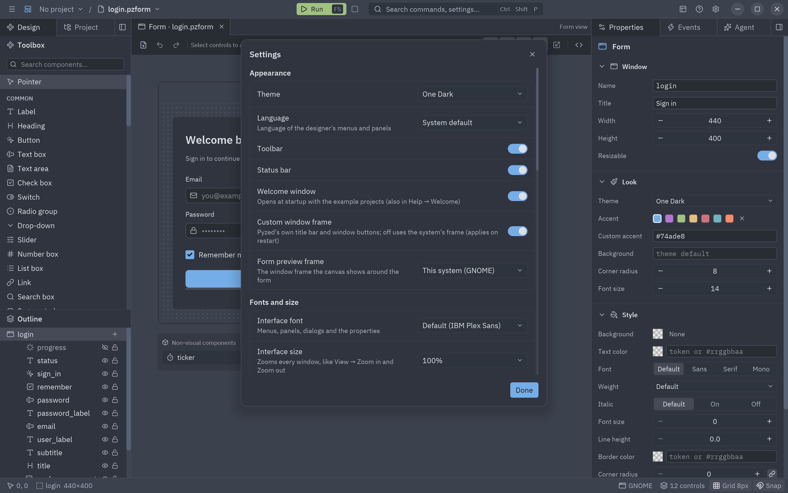
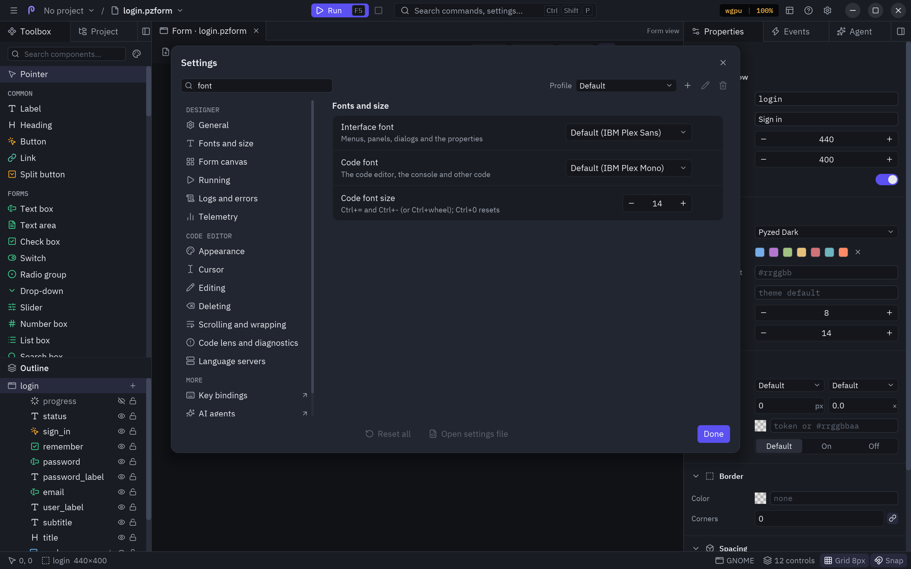
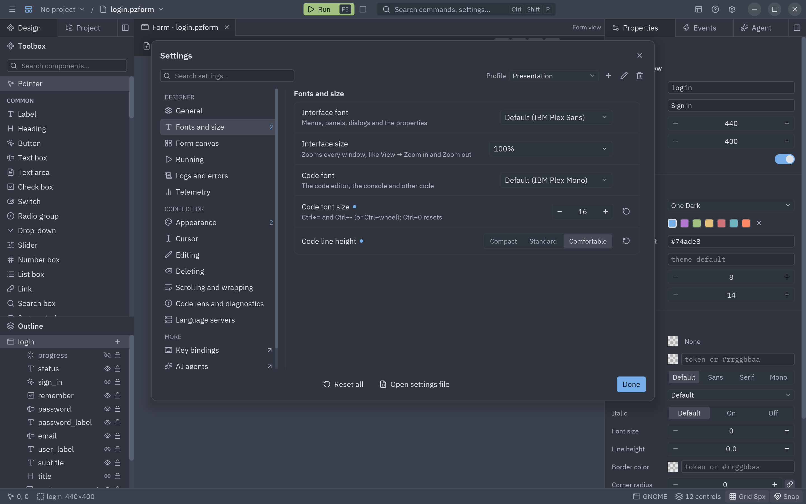
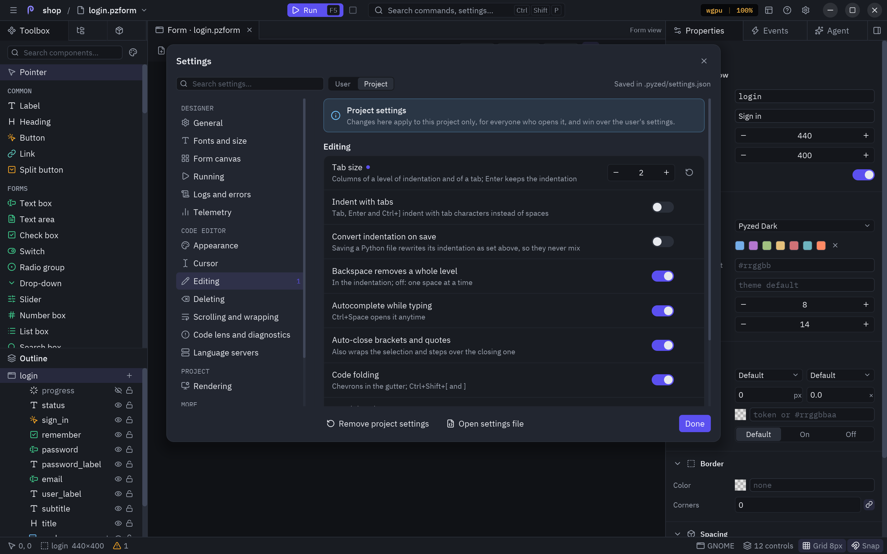
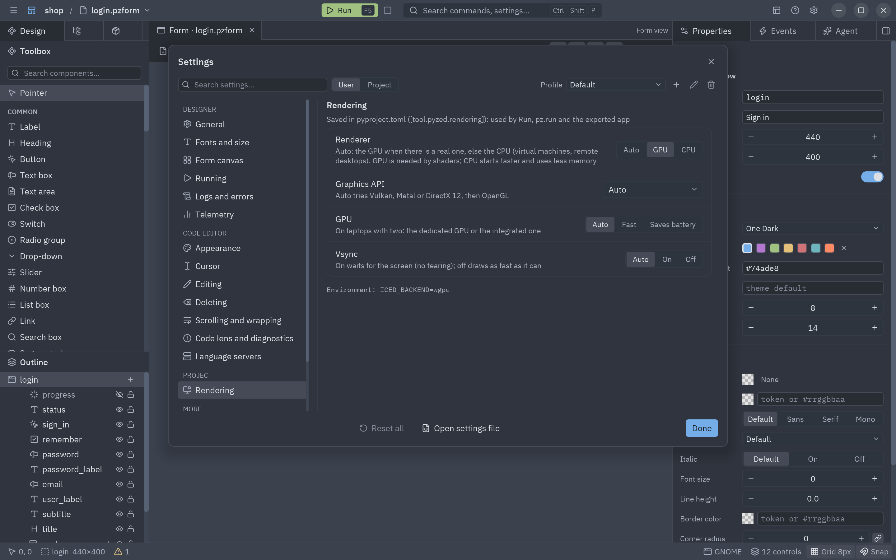

**Settings** (<kbd>Ctrl</kbd>+<kbd>,</kbd>, the gear at the right of the title bar, or the ☰ menu) holds every
preference of the designer and of its code editor in one dialog. Changes apply at once and are saved right away;
**Done** closes the dialog.



- **The index** on the left groups the pages: *Designer* (General, Fonts and size, Form canvas, Running, Logs and
  errors, Telemetry), *Code editor* (Appearance, Cursor, Editing, Deleting, Scrolling and wrapping, Code lens and
  diagnostics, Language servers) and, with a project open, *Project* (Rendering). A number next to a page counts
  its changed settings.
- **Search settings…** (focused when the dialog opens) finds a setting by its name or its help, in English or in
  your language, across every page.
- **A dot** after a setting's name means it is not at its default; the **↺** button at its right puts it back.
- **Reset all** puts every setting of the profile back to its default. It asks for a second press, so one click
  can not lose your settings.
- **Open settings file** opens the JSON file the page writes to.



## Profiles

A profile is a whole set of preferences you can switch between, like VS Code's profiles: one for everyday work,
one with big fonts for presentations, one for a small laptop screen... The **Profile** list at the top right
switches; switching applies the profile at once (theme, fonts, sizes, editor options).

| Button | What it does |
| --- | --- |
| **+** | A new profile, a copy of the one in use, with the name you type. |
| **✎** | Renames the profile in use. |
| **🗑** | Deletes the profile in use and goes back to *Default*. *Default* can not be renamed or deleted. |

Profiles only hold preferences: the panel layout, the recent files and the [keymap](/pyzed/editor/keymap/) stay
the same whatever the profile.



## Project settings

With a project open, **User | Project** at the top says where your changes go:

- **User**: your own settings, in the active profile. They apply to every project.
- **Project**: this project's own settings, saved in `.pyzed/settings.json` inside the project, like Zed's
  `.zed/settings.json`. They win over the user's while the project is open, and travel with it (commit the file
  so everyone who opens the project gets them).

In the Project scope, the dot marks the settings the project sets, and **↺** removes them so the user's value
applies again; **Remove project settings** removes all of them. In the User scope, a setting the project sets
shows *This project sets its own*. A few settings belong to the user only (the welcome window, the window frame,
updates, the log file).



```json
{
  "editor": { "tab_size": 2, "hard_tabs": false, "format_on_apply": true },
  "designer": { "grid": 4, "snap": true }
}
```

## Rendering

**Project → Rendering** chooses how the project's app draws its windows. It is saved in the project's
`pyproject.toml`, so it applies when the designer runs the project, when you run it with `pz.run` or
`pyzed run`, and in the [exported app](/pyzed/editor/exporting/).

| Setting | Options | What it does |
| --- | --- | --- |
| **Renderer** | Auto, GPU, CPU | *Auto* (the default) uses the GPU when there is a real one and the CPU renderer elsewhere (virtual machines, remote desktops). *GPU* always uses it: [shaders](/pyzed/shading/shaders/) need it. *CPU* (tiny-skia) starts faster and uses less memory, and works everywhere. |
| **Graphics API** | Auto, Vulkan, Metal, DirectX 12, OpenGL | The GPU's API. *Auto* tries Vulkan, Metal or DirectX 12, then OpenGL. |
| **GPU** | Auto, Fast, Saves battery | On laptops with two GPUs: the dedicated one or the integrated one. |
| **GPU name** | Any, or part of a name | Picks the GPU by name (`nvidia`, `intel`, `radeon`) when the machine has several; Enter saves it. |
| **Vsync** | Auto, On, Off | *On* waits for the screen (no tearing); *Off* draws as fast as it can (to measure performance). |
| **Present mode** | Auto, Fifo, Relaxed, Mailbox, Immediate | Wins over Vsync. *Mailbox* keeps only the newest frame (low latency without tearing), *Immediate* shows each frame at once (lowest latency, may tear), *Fifo* waits for the screen (least power). A mode the system lacks falls back to vsync on or off. |
| **Antialiasing** | Auto, Off, 2x, 4x, 8x, 16x | Smooths the edges of canvas drawings, charts and curves. *Auto* is 4x; *Off* saves GPU work on weak devices. |
| **Frame latency** | Auto, 1, 2, 3 | Frames the GPU may prepare ahead of the screen. 1 (the default) answers input soonest; 2 or 3 smooth heavy scenes on slow GPUs. |
| **GPU memory** | Auto, Low, Performance | *Low* (the default) allocates in small blocks freed soon; *Performance* keeps large blocks for fewer allocations. |
| **Max frame rate** | Screen, 30, 60, 90, 120, 144 | The most frames per second animations draw. Clicks, keys and new content are always drawn at once. |
| **Background frame rate** | Same, Pause, 5, 15, 30 | The same for windows without the focus; *Pause* stops their animations until they get it back. |



```toml
[tool.pyzed.rendering]
renderer = "gpu"         # "auto", "gpu" or "cpu"
gpu_api = "vulkan"       # "auto", "vulkan", "metal", "dx12" or "gl"
gpu = "intel"            # part of the GPU's name, when there are several
power = "low"            # "auto", "high" or "low"
vsync = "off"            # "auto", "on" or "off"
present = "mailbox"      # "auto", "fifo", "fifo_relaxed", "mailbox" or "immediate"
antialiasing = "8x"      # "auto", "off", "2x", "4x", "8x" or "16x"
frame_latency = "2"      # "auto", "1", "2" or "3"
memory = "performance"   # "auto", "low" or "performance"
max_fps = 30             # 0 follows the screen
background_fps = 0       # 0 pauses animations of windows without the focus
```

In code, `App.rendering` does the same for one app, and wins over `pyproject.toml`:

```python
class Game(pz.App):
    rendering = pz.Rendering(renderer="gpu", vsync="off")
```

The settings become the environment variables Iced and wgpu read (`ICED_BACKEND`, `WGPU_BACKEND`,
`WGPU_ADAPTER_NAME`, `WGPU_POWER_PREF`, `ICED_PRESENT_MODE`, `ICED_MSAA`, `ICED_FRAME_LATENCY`, `ICED_MEMORY`,
`ICED_MAX_FPS`, `ICED_BACKGROUND_FPS`); one you set yourself still wins, so a deployed app can be tuned
without changing its code. While a project sets its own renderer,
Run always starts the form in its own process, since the designer's window already has one.

## Appearance

| Setting | What it does |
| --- | --- |
| **Theme** | The editor's theme (One Dark, One Light, Ayu, Gruvbox...). Forms keep their own theme. |
| **Language** | *System default*, English or Español: the language of the menus and panels. |
| **Toolbar** | Shows or hides the toolbar. |
| **Status bar** | Shows or hides the status bar. |
| **Welcome window** | Opens the [welcome window](/pyzed/editor/examples/) at startup (on by default). |
| **Custom window frame** | On by default: Pyzed Design draws its own title bar and window buttons, in the style of your system. Turn it off to use the system's frame (applies the next time it opens). |
| **Form preview frame** | The window frame the canvas shows around the form: this system's, macOS, Windows 11, GNOME, Ubuntu or KDE Plasma. |

## Fonts and size

| Setting | What it does |
| --- | --- |
| **Interface font** | The font of the menus, panels, dialogs and properties. *Default* is IBM Plex Sans; the list has the bundled fonts, the system's and any loaded with `pz.load_font`. |
| **Interface size** | Makes the whole editor bigger or smaller, from 75% to 150%, panel windows included. **View → Zoom in the interface**, **Zoom out the interface** and **Reset the interface zoom** do the same in 5% steps; give them keys in the [keymap editor](/pyzed/editor/keymap/). |
| **Code font** | The font of the code editor and other code. *Default* is IBM Plex Mono. |
| **Code font size** | 8 to 32 points, the same setting as in the [code editor's settings](/pyzed/editor/code-editor/#editor-settings). |
| **Code line height** | Compact, Standard or Comfortable. |

Every change shows at once, without restarting, and is saved for the next time.

:::tip
A monospaced font keeps code columns aligned: pick one for **Code font** (its name usually says *Mono* or
*Code*). For the interface, any font with regular, medium and semibold weights looks best.
:::

## Form canvas

| Setting | What it does |
| --- | --- |
| **Show grid** | The dot grid on the canvas (also <kbd>G</kbd>). |
| **Snap to grid** | Rounds positions and sizes to the grid. |
| **Smart guides** | Aligns to other controls while dragging. |
| **Outline eye** | **Hidden when running** (the default): the eye turns Visible off; the control is also left out of the canvas and shown while selected. **Hidden in the editor only**: the eye hides it on the canvas only and the running form still shows it. |
| **Show all hidden controls** | Draws every control whose Visible is off, dimmed. Off (the default), a hidden control appears only while it or something inside it is selected. |
| **Grid size for new forms** | The grid step (2 to 64) given to forms and components you create. Each form then keeps its own in Properties. |

## Running

| Setting | What it does |
| --- | --- |
| **Save before running** | <kbd>F5</kbd> saves the document first. |
| **Open the console on Run** | Brings the console to the front when a form starts. |
| **Log events in the console** | Writes every event the running form handles, with its value and handler. |
| **Restricted mode** | Asks before installing the packages of a project you did not create, importing its components or running it ([restricted mode](/pyzed/editor/projects/#restricted-mode)). On by default; only your own settings can turn it off. |

## Package managers

**Package manager of the projects** is the one that creates them and installs their packages. Pyzed's projects are uv projects (`pyproject.toml` and `uv.lock`), so it is uv for now; the page is built from a registry of package managers, so new ones show up here with their own settings.

Each package manager has its own group. The top of the group lists every executable Pyzed finds, with its version and path, and marks the one **In use**:

- **Included with Pyzed**: the one that comes with Pyzed Design. It changes only when the editor updates.
- **This computer's**: one installed on its own (for uv, on the `PATH` or in `~/.local/bin`). **Install** sets it up (uv's official installer) and **Update** updates it (`uv self update`), apart from the editor.
- **Custom path**: any other executable.

| Setting | What it does |
| --- | --- |
| **Executable to use** | *Automatic* uses this computer's when it is installed, else the included one. The others pick one; if it is missing, Pyzed falls back to *Automatic* so projects keep working. |
| **Path of the custom executable** | Shown with *Custom path*. <kbd>Enter</kbd> saves it. |

uv's own defaults:

| Setting | What it does |
| --- | --- |
| **Python of new projects** | The Python version new projects ask for, such as `3.13` (`uv init --python`). Empty: the newest uv finds or installs. |
| **Package index** | Another index instead of PyPI, such as a company mirror (`UV_DEFAULT_INDEX`). |
| **More package indexes** | Indexes to look in too, separated by spaces (`UV_INDEX`). |
| **Allow pre-releases** | Pre-release versions of every package (`UV_PRERELEASE=allow`). |
| **Offline** | Only the packages already downloaded, without the network (`UV_OFFLINE`). |
| **How packages are installed** | Copy, hard links, symbolic links or clones (`UV_LINK_MODE`). Copy is the safest across drives. |

They go to every command the editor runs: creating a project, the Dependencies tab, Run and the export. They are your own settings, never a project's: what a project needs goes in its `pyproject.toml` (`[tool.uv]`). The Dependencies tab tells which uv is in use next to its version.

## Logs and errors

| Setting | What it does |
| --- | --- |
| **Show a dialog on errors** | Opens the [error dialog](/pyzed/editor/console-and-running/#when-the-editor-itself-fails) when something fails. Off, errors only go to the Logs panel. |
| **Write a log file** | Also writes the [logs](/pyzed/editor/console-and-running/#the-logs-panel) to `logs/pyzed-design.log` in the Pyzed config folder (applies on restart). |

## More

The end of the index has links to the rest:

| Item | What it does |
| --- | --- |
| **Key bindings** | The [keymap editor](/pyzed/editor/keymap/): change the keys of any action. |
| **AI agents** | The [agent's settings](/pyzed/editor/ai-agents/#settings): model providers, keys and browser sign-in, default model, effort and permissions. |
| **Reset panel layout** | Puts every panel back in its default dock and size. |

## Telemetry

The designer can keep usage and performance numbers to help improve it, but only if you turn it on: it is
**off by default**. In **Settings → Telemetry**, *Collect usage and performance data* records:

- how many times each command and editor action is used (`command.save`, `editor.select_next`…);
- how long the designer takes to start, to draw a frame and to run each command (count, total, maximum and a
  histogram);
- the number of sessions and their length.

It never records your code, texts, form or file names, or paths. The data is kept in `telemetry.json` in the
Pyzed config folder; **View** opens it and **Delete** empties it (and changes the random installation id).

Nothing leaves your computer unless you also set an **Endpoint**: then the designer posts the data there as JSON
when it closes, and starts counting again. A send that fails is retried the next time. `PYZED_TELEMETRY=0` turns
telemetry off whatever the settings say.

```json
{"schema": 1, "installation": "4f0c…", "app": "pyzed-designer", "version": "0.4.0", "os": "linux",
 "arch": "x86_64", "python": "3.13", "since": "…", "until": "…", "sessions": 3,
 "counters": {"command.save": 12, "editor.select_next": 7},
 "timings": {"render": {"count": 840, "total_ms": 2210.4, "max_ms": 41.2, "buckets": [690, 120, 25, 5, 0, 0, 0, 0]}}}
```

The `buckets` count durations up to 4, 8, 16, 33, 50, 100 and 250 ms, and longer.

## Where they are saved

Everything the editor remembers goes to one file, `designer.json`, in Pyzed's settings folder:

| Platform | Folder |
| --- | --- |
| Windows | `%APPDATA%\pyzed` |
| macOS | `~/Library/Application Support/pyzed` |
| Linux | `$XDG_CONFIG_HOME/pyzed` or `~/.config/pyzed` |

Set `PYZED_CONFIG_DIR` to use another folder (handy for a portable setup or for tests). The file has two
sections: `"designer"` (theme, language, canvas defaults, toolbar and status bar, run options, recent files, and
where each panel is docked, which docks are hidden and their sizes) and `"editor"` (the code editor). They hold
the active profile; `"profile"` names it and `"profiles"` keeps the others (only what differs from the defaults).
A project's own settings are in its `.pyzed/settings.json`. The
[AI agent](/pyzed/editor/ai-agents/) keeps its settings in `agents.json` and its threads in `agents/threads/` in
the same folder; API keys are never written there, they go to the system keychain. Invalid
values are ignored and the defaults used, so a hand-edited file can not break the editor.

```json
{
  "designer": { "theme": "One Light", "language": "es", "ui_font": "Inter", "ui_scale": 1.1, "grid": 8, "snap": true, "console_on_run": true,
                "docks": { "events": "left" }, "sizes": { "right": 360 }, "recent": ["/home/ada/shop/ui/main.pzform"] },
  "editor": { "font_family": "JetBrains Mono", "font_size": 15, "tab_size": 4, "minimap": false, "cursor_shape": "block", "format_on_apply": true }
}
```

## Translating the editor

The editor's interface is translated with [`pz.t`](/pyzed/guides/i18n/). English and Spanish are built in; add a
catalog under the `designer` key to translate it to another language. The **Language** setting offers the built-in
ones; for another language, let the editor follow the system or set `"language"` in the `designer` section of
`designer.json`.

Missing strings fall back to English, so a partial translation already works.
