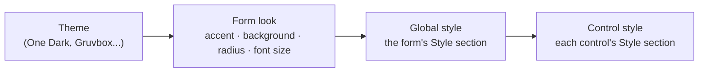

A form's look comes from three layers, from broad to specific:

Each layer only overrides what it sets; empty fields fall through to the layer above.

## Themes

Pick the form's theme in **Properties → Look → Theme** (select an empty spot of the canvas first). Every
registered theme is listed: the built-in One, Ayu and Gruvbox families and any theme your project registers.
Next to it:

- **Accent**: seven preset colors, or **×** for the theme's own accent. **Custom accent** takes any `#rrggbb`.
- **Background**: a window background color (empty keeps the theme's).
- **Corner radius**: the radius every control uses (0 for square corners).
- **Font size**: the base size of every text.

The form's theme is independent from the **editor's** theme (Settings → Appearance → Theme) and from the **code
editor's** theme (Editor settings → Theme): you can design a light form in a dark editor.

## The Style section

Every control has a **Style** section in Properties, like CSS for that one control (see [Styles](/pyzed/guides/styles/)):

| Field | Takes |
| --- | --- |
| **Background** | A color, a linear gradient or a masked fill: click the swatch or the summary to open the picker; **×** removes it. |
| **Text color** | A theme token (`accent`, `text_muted`, `success`...) or `#rrggbb` / `#rrggbbaa`. |
| **Font** | Default, sans, serif or mono. |
| **Weight** | Default, thin, light, normal, medium, semibold, bold, black. |
| **Italic** | Default, on or off. |
| **Font size** | Pixels; 0 keeps the component's own size. |
| **Line height** | A multiple of the font size; 0 keeps it. |
| **Border color**, **Border width** | The control's border. |
| **Corner radius** | One number, or four: top-left, top-right, bottom-right, bottom-left (two numbers repeat). |
| **Shadow** | A color, then **Offset** (x and y, −64 to 64) and **Blur** (0 to 96) appear. |
| **Padding** | Space inside: one number, two (vertical horizontal) or four (top right bottom left). |
| **Margin** | Space outside, same format. |
| **Max width**, **Max height** | 0 means no limit. |
| **Align content**, **Align vertically** | Where the content sits in the control's box: start, center or end. |
| **Clip** | Cut what overflows the box. |

Empty fields keep the component's own look. **Reset style** (at the end of the section, once something is set)
clears every override of that control. Half-typed values (`#3b`) are skipped while drawing instead of failing, so
you can type freely.

## The color picker

Click a color's swatch to open the picker, floating next to the panel; click outside it to close it.

- **Saturation/value square**, **hue bar** and **alpha bar**, the current color with a hex field (type `#rrggbb` or
  `#rrggbbaa`) and its opacity in percent.
- **Swatches** of the form's theme: accent, success, warning, error, info, text, muted text and background.
- For a **background**, **Solid / Gradient** switches to a linear gradient: click the stops bar to add a stop with
  the color the gradient has there, drag a stop to move it, select it to recolor it, set the **Angle** (in 15°
  steps with the buttons) and remove the selected stop (a gradient keeps at least two).
- For a background, **Mask** fades the fill from opaque to transparent: its own stops bar with an **Opacity** per
  stop (up to 8 stops) and an angle.

:::tip
The picker works in concrete colors: picking turns a theme token into its hex value. To keep a color that follows
the theme (so the form looks right in a light and a dark theme), type the token (`accent`, `text_muted`,
`surface`...) in the field next to the swatch instead.
:::

## The form's global style

With nothing selected, the form's **Style** section is the window's global style:

- **Text color, font, weight, italic, font size, line height** apply to every text that does not set its own.
- **Background, border color, corner radius and padding** become the window's.

It runs the same way (`Window.style`), and so do components made in the editor. A serif global font, for
example, changes every label, button and input of the form at once.

## Colors as properties

Some components also have color properties of their own (a label's **Color**, a panel's **Background**, an icon's
**Color**). They take the same values: a theme token or a hex color, with a swatch that previews it in the form's
theme.
