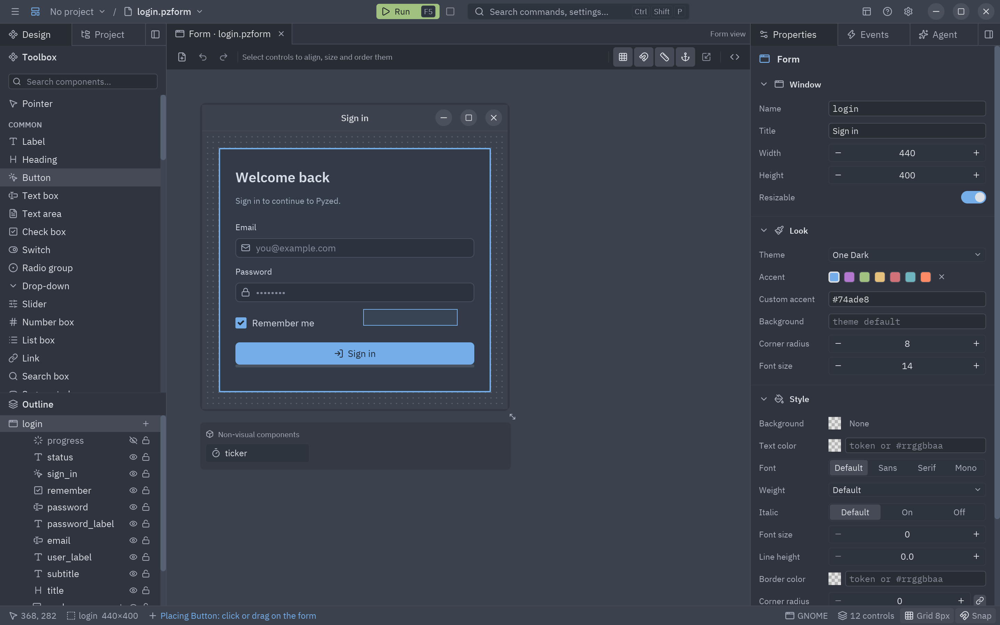
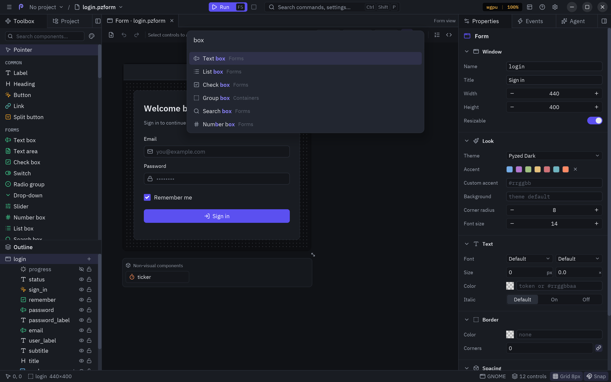
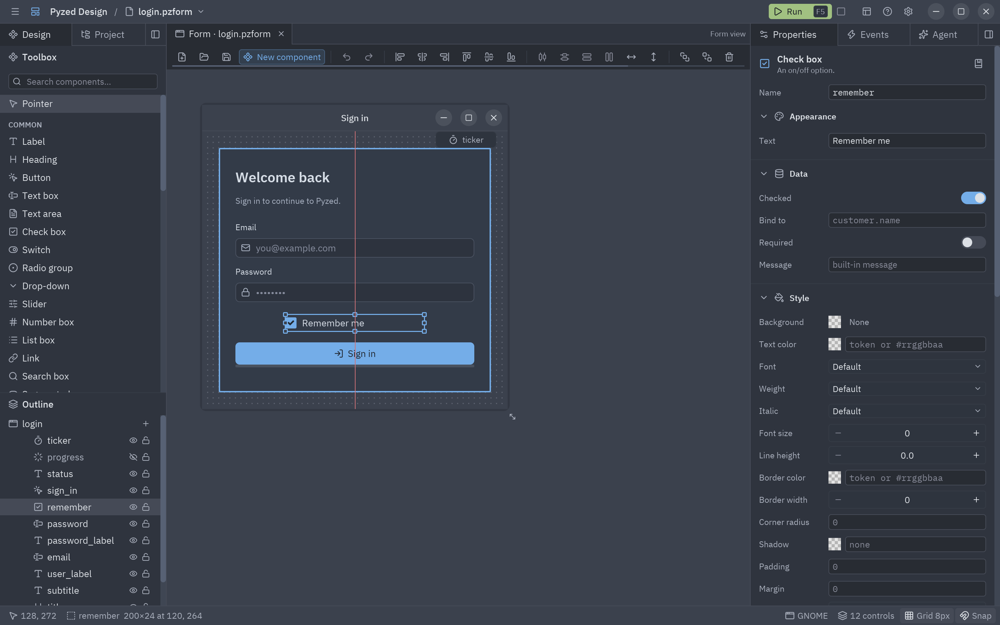
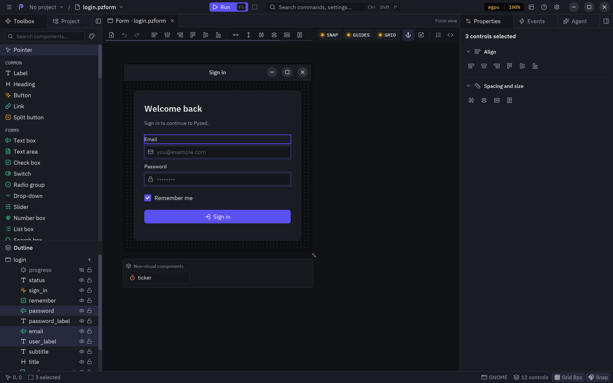
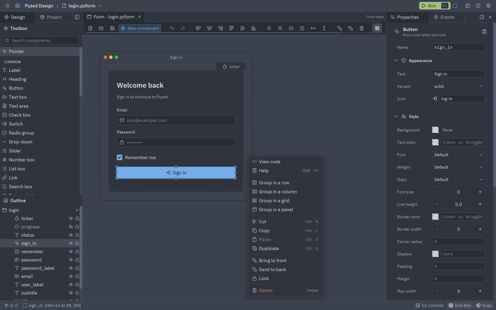
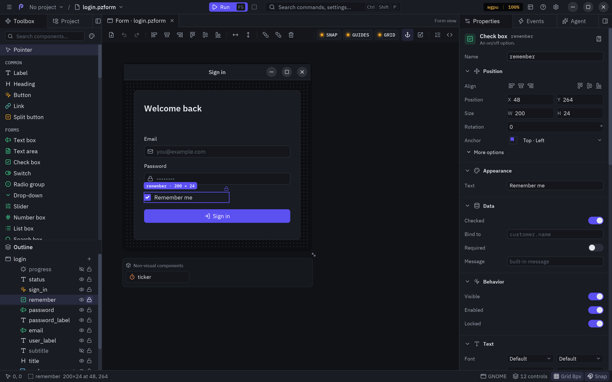

import Media from '../../../components/Media.astro';

The **Design** panel (left dock) holds the **Toolbox** on top and the **Outline** below; drag the bar between them
to give one more room. The **canvas** in the center shows the document exactly as it will run, but inert: buttons
do not click and text boxes do not type, so the mouse is free to edit.

## The toolbox

Every component you can place, by category: **Common**, **Display**, **Containers**, **Layout**, **Navigation**,
**Components** (the [non-visual ones](/pyzed/editor/non-visual-components/): timers, file watchers,
processes... which go to the tray under the form) and one category per group of [designed components](/pyzed/editor/component-designer/)
of your project. Hover a row for the component's description.

| Category | Components |
| --- | --- |
| **Common** | Label, Button, Split button, Text box, Text area, Check box, Switch, Radio group, Drop-down, Slider, Number box, List box, Link, Search box, Segmented, Toggle group, Table, Color picker, Icon picker |
| **Display** | Progress bar, Badge, Image, SVG image, Image viewer, Shader, Icon, Markdown, Spinner, Chip, Callout, Avatar, Facepile, Counter badge, Status dot, Key binding, Stat, Chart, Diff stat, Empty state, QR code, Terminal output |
| **Navigation** | Tab bar, Tree view, Breadcrumbs |
| **Containers** and **Layout** | Panel, Group box, Card, Divider, Flex row, Flex column, Grid, Dock, Dock panel, Spacer |
| **Media** and **Audio** | Webcam, and the [audio controls](/pyzed/audio/): knobs, faders, pads, piano, meters, waveforms, spectrum... |

The [Project explorer](/pyzed/editor/examples/) example puts most of them on one form, with a handler for each of
their events.

- **Search components…** filters the list by name (in English or in the editor's language) or by type.
- **Pointer** (first row) is the normal selection tool. It is highlighted when no component is picked.

### Placing a control

There are four ways, pick the one that fits:

| Gesture | Result |
| --- | --- |
| **Drag** a toolbox row onto the form | The control lands where you drop it, at its default size, inside the container under the pointer (it lights up while you drag). |
| **Click** a row, then **click** on the form | Same, at the point you clicked. |
| **Click** a row, then **drag a rectangle** on the form | The control takes the rectangle's size (at least 6×6 px); its corners snap to the grid. |
| <kbd>Ctrl</kbd>+<kbd>Shift</kbd>+<kbd>A</kbd> (**Add control…**) | A searchable list; <kbd>Enter</kbd> adds the highlighted component centered on the form. |

While a component is picked, the pointer is a crosshair and the status bar says
`Placing Button: click or drag on the form`. <kbd>Esc</kbd> (or clicking **Pointer**, or the same row again) drops
the tool. New controls get a free name from their type (`button1`, `button2`...) and are selected, with the
Properties panel in front.

:::tip
The **+** on a container's row in the outline, and **Add inside…** in its context menu, open the same list but add
the new control *inside* that container.
:::

## Selecting

| Gesture | Selects |
| --- | --- |
| Click a control | That control (the others are deselected). |
| Click an already selected control | Keeps the selection and makes that control the **primary** one: the reference for alignment and same size, drawn with a thicker outline. |
| Drag on an empty spot | A rubber band: every control it touches. A container and the controls inside it count once (the container). |
| <kbd>Ctrl</kbd>+<kbd>A</kbd> | Every control. |
| Click an empty spot | Nothing: the Properties panel then shows the form itself. |
| A row in the outline | That control, even if it is hidden behind others. |

With several controls selected, the Properties panel shows the alignment and spacing tools instead of
properties, and the Events panel asks you to pick one control.

## Moving and resizing

- **Drag** a selected control to move the whole selection. Positions snap to the grid (when snapping is on) and
  the group stays inside the form.
- **Drop** it on a container to put it inside, or on the bare form to take it out of its container. The target
  lights up with an accent frame while you drag.
- The **eight handles** of a single selected control resize it from that edge or corner; the opposite edge stays
  put. Controls are never smaller than the minimum size and stay inside their container.
- The **grip** under the form's bottom-right corner resizes the form (at least 120×80, snapped to the grid).
- <kbd>Esc</kbd> during any drag cancels it and puts everything back.
- **Arrow keys** nudge the selection by 1 px; <kbd>Shift</kbd>+arrows move it by one grid step (1 px when snapping
  is off). Consecutive nudges are a single undo step.

Locked controls do not move or resize (they show a small lock above their corner), and alignment tools skip them.

### Containers and their grip

A container's children cover most of it, so a press there picks a child. To pick or drag the container itself, use
the **grip tab** with its name above its top-left corner: it shows while the pointer is over the container and
while the container, or a control inside it, is selected. Right-click the grip for the container's context menu.
See [Layouts and containers](/pyzed/editor/layouts/).

## Snapping, grid and smart guides

| Tool | Where | What it does |
| --- | --- | --- |
| **Show grid** | Toolbar, status bar, **View → Grid**, <kbd>G</kbd> | Shows or hides the dots of the grid. |
| **Snap to grid** | Toolbar (magnet), status bar, **View** | Rounds positions and sizes to the grid step while you drag, place and resize. |
| **Smart guides** | Toolbar (ruler), **View** | Snaps a moving control to the edges and centers of the other controls and of the form, and draws a red guide line while they line up. |
| **Resize contents with their anchors** | Toolbar (anchor) | Resizing the form, a component or a free container moves and stretches what is inside by its anchors, as the running window does. On by default. |
| **Fit selection to grid** | Toolbar | Moves and resizes the selected controls (all of them when nothing is selected) onto the grid. |
| **Grid size** | Properties of the form (**Designer** section) | The grid step of this form (2 to 64 px, 8 by default). New forms take the default from [Settings](/pyzed/editor/settings/). |

Smart guides snap within 4 px of a target, on both axes at once, so a control can line up with one control's left
edge and another's middle in the same drag.

## Align, distribute and size

The toolbar acts on the selection:

| Button | Effect |
| --- | --- |
| **Align left / centers / right** | Lines up the left edges, the horizontal centers or the right edges. |
| **Align top / middles / bottom** | Lines up the top edges, the vertical centers or the bottom edges. |
| **Distribute horizontally / vertically** | Spaces three or more controls evenly between the first and the last. |
| **Same width / height** | Gives every selected control the primary control's width or height. |
| **Center in form horizontally / vertically** | Centers the selection in the form. |
| **Bring to front / Send to back** | Changes the z-order (what is drawn on top). |
| **Delete** | Deletes the selection (<kbd>Delete</kbd> or <kbd>Backspace</kbd>). |

With several controls selected, alignment uses the bounds of the selection; with a single control it aligns to
the form. The Properties panel shows the same tools while several controls are selected.

## Clipboard and history

- <kbd>Ctrl</kbd>+<kbd>C</kbd>, <kbd>Ctrl</kbd>+<kbd>X</kbd>, <kbd>Ctrl</kbd>+<kbd>V</kbd>: copy, cut and paste.
  Pasted controls are shifted a little so you can see them; a container is copied with everything inside it.
  Pasted controls are **not** wired: their events start empty, so they do not share handlers with the originals.
- Copies go to the **system clipboard**, so you can paste controls into **another form**: another tab, another
  Pyzed Design window, or the same form after restarting. In another form a pasted control keeps its name when
  it is free there (fresh names otherwise), along with its properties, style,
  [binding and rules](/pyzed/editor/data-binding/). Pasting text that is not Pyzed controls pastes the last copy
  made in this window.
- <kbd>Ctrl</kbd>+<kbd>D</kbd> duplicates the selection without touching the clipboard.
- <kbd>Ctrl</kbd>+<kbd>Z</kbd> undoes, <kbd>Ctrl</kbd>+<kbd>Shift</kbd>+<kbd>Z</kbd> (or <kbd>Ctrl</kbd>+<kbd>Y</kbd>)
  redoes. Each document keeps its own history; repeated edits of one field (typing a title, nudging) merge into
  one step.

## The context menu

Right-click a control on the canvas, its row in the outline or a container's grip:

| Entry | Does |
| --- | --- |
| **View code** | Opens the handler of the control's main event (or opens a designed component in its own tab). |
| **Help** | Opens the control's page in the [reference](/pyzed/editor/reference/) (<kbd>Shift</kbd>+<kbd>F1</kbd>). |
| **Add inside…** | Containers only: the Add control list, adding inside this container. |
| **Group in a row / column / grid / panel** | Wraps the selection in a new flex row, flex column, grid or panel. |
| **Move out of *container*** | Takes the control out of its container, into the container's parent. |
| **Cut, Copy, Paste, Duplicate** | As the shortcuts. |
| **Bring to front, Send to back** | Z-order. |
| **Lock / Unlock** | Locks the control in place. |
| **Delete** | Deletes the selection. |

The menu opens at the pointer and stays inside the window. <kbd>Esc</kbd> or a click elsewhere closes it.

## The outline

The **Outline** lists every control of the document as a tree. The first row is the form (or the component)
itself: click it to select it, **+** adds a control to it.

- **Order**: top-most first, like layers in a drawing app. Children of a flex row, a flex column or a grid are
  listed in their layout order instead.
- **Chevron**: folds or unfolds a container's children. On a placed designed component, it lists the component's
  public properties and methods; click one to insert `form.ada.rate()` (or `self.stars.pick()` in a component) at
  the code editor's cursor, or to copy it when no code is open.
- **Eye**: hides the control. Hidden controls are invisible when the form runs and their names are grayed in
  the outline. See [Dialogs, drawers and other hidden controls](#dialogs-drawers-and-other-hidden-controls).
- **Lock**: locks the control so it cannot be moved or resized by accident.
- **+** (containers): adds a control inside.
- **Drag a row** to reorder it: a line shows where it goes (before or after a row), and a frame when it would go
  *inside* a container. Drop it on the canvas to move it into the container under the pointer, or onto the form.
- **Right-click** a row for the context menu.

:::tip
The outline is the easiest way to pick a control buried under others, or a
[non-visual component](/pyzed/editor/non-visual-components/) such as a timer, and to move controls between containers precisely.
:::

<Media clip="designer-timer-outline" alt="A Timer dragged from the toolbox onto the login form lands in the tray under the form, not on it; then the email text box and the form's ticker timer are selected from the Outline, where non-visual components are listed under Non-visual" caption="Drop a Timer on the form and it goes to the tray. In the Outline, non-visual components come after the controls, under Non-visual." />

## Dialogs, drawers and other hidden controls

A dialog, a drawer or a page that only appears when a button is pressed is a container with **Visible** off,
shown from code with `form.status_dialog.show()` (and `.hide()` to close it). The canvas leaves hidden controls
out, so a form with many of them does not turn into a pile of overlapping panels:

1. **Select it in the outline** (or anything inside it). It comes up in front of the form, which is dimmed
   behind it, as it will look when the form runs. A chip at the top names it.
2. **Edit it as usual**: move, resize, drop new controls into it from the toolbox, change its properties.
3. **Go back** with <kbd>Esc</kbd>, the chip's **×**, or a click on the dimmed form.

To see every hidden control at once, dimmed in its place, turn on **View → Show all hidden controls**.

## The status bar

From left to right: the pointer's position on the form, what is selected (`sign_in 344×32 at 48, 304`, or
`3 selected`, or the form and its size) and, while a component is picked, the placing hint. On the right: the
window frame shown around the form (**GNOME**, **macOS**...: click to preview another platform's), the
number of controls, **Grid 8px** (click to show or hide the grid) and **Snap** (click to toggle snapping). While
the code editor is open it also shows the cursor's line and column and the state of the language servers. Hide it
with **View → Status bar**.
