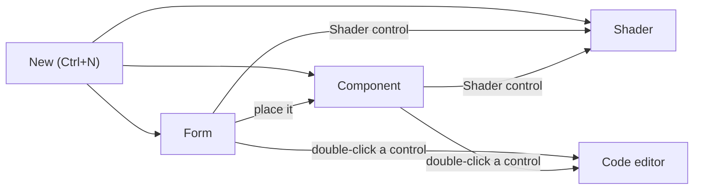

import { Aside, Tabs, TabItem } from '@astrojs/starlight/components';
import NavCards from '../../../components/NavCards.astro';
import Media from '../../../components/Media.astro';
import formShot from '../../../assets/editor/form-view.png';
import formLight from '../../../assets/editor/form-view-light.png';
import componentShot from '../../../assets/editor/component-view.png';
import componentLight from '../../../assets/editor/component-view-light.png';
import shaderShot from '../../../assets/shading/shader-view.png';
import shaderLight from '../../../assets/shading/shader-view-light.png';
import codeShot from '../../../../screenshots/designer-code.png';

Pyzed Design edits four kinds of document. Each opens in its own **view**: the same window, but the left dock, the
toolbar, the center and the Properties panel change to fit what you are making. The tab row tells you which view is
in front, and the title bar shows a **Component** or **Shader** badge when it is not a form.

| Document | File | Opens in | Think of it as |
| --- | --- | --- | --- |
| **Form** | `login.pzform` + `login.py` | Form view | A window of your app, like a Visual Basic form or a Qt Designer `.ui`. |
| **Component** | `rating.pzcomp` + `rating.py` | Component view | A reusable piece placed in forms, like a Godot scene or an Unreal widget blueprint. |
| **Shader** | `fire.pzshad` | Shader view | A GPU effect made of nodes, like Godot's visual shaders or Unreal's material editor. |
| **Code and text** | `*.py`, `*.toml`, `*.md`... | Code editor | The Python behind everything, with completion and diagnostics. |

All files are plain text (JSON or Python), so they diff well in git and you can open them in any other editor.



## Form view

**For:** the windows of your app: a login, a settings page, a dashboard, a dialog.

<Media src={formShot} light={formLight} alt="The Form view with a sign-in form" caption="Form view: the toolbox on the left, the form on the canvas, its properties on the right." />

- **Left dock:** the **Toolbox** with every control, and the **Outline** of the form.
- **Center:** the form drawn in a window frame, with a dot grid, handles and smart guides.
- **Right dock:** **Properties** and **Events** of the selection (or of the form when nothing is selected).
- **Run** (<kbd>F5</kbd>) opens the form as a real window with its Python handlers.

Read [The Form view](/pyzed/editor/form-view/) for a guided first form.

## Component view

**For:** pieces you use many times: a star rating, a profile card, a product tile. A component has no window; it lives
inside forms and other components.

<Media src={componentShot} light={componentLight} alt="The Component view with a ProfileCard that contains a Rating component" caption="Component view: an accent frame with the class name instead of window buttons." />

- The same toolbox and canvas as a form, but the canvas shows an **accent frame with the class name** instead of a
  window, and the title bar a **Component** badge.
- With nothing selected, **Properties** shows the **Component panel**: the class name, how it shows in the toolbox,
  its typed **properties** and its **methods**. Its **custom events** are in the **Events** tab, below the
  built-in ones.
- **Run** previews the component alone in a window.
- Double-click a component placed on a form to open it in its own tab.

Everything is in [The Component view](/pyzed/editor/component-designer/).

## Shader view

**For:** animated backgrounds, glows, transitions and game visuals drawn by the graphics card.

<Media src={shaderShot} light={shaderLight} alt="The Shader view: a graph of nodes with previews and the Output preview" caption="Shader view: nodes with live previews, wired from inputs to the Output." />

- **Left dock:** the **Shading** sidebar (every node, by category) and the **Outline** of variables, named values and
  nodes.
- **Center:** three tabs: **Graph** (the nodes), **Preview** (the result large, with a control per variable) and
  **WGSL** (the generated code, read only).
- **Properties:** the settings and inputs of the selected node, of a variable, or of the shader itself.
- **Run** opens the shader in a window that follows your edits.

Start with [The Shader view](/pyzed/editor/shader-view/) in this manual, or go straight to the
[Shading section](/pyzed/shading/).

## Code editor

**For:** the Python of every form and component (their event handlers and methods) and any text file of the project.

<Media src={codeShot} alt="The code editor in the bottom dock with a handler open" caption="The Code panel: completion, diagnostics and code lens from ty and ruff." />

- Opens in the **bottom dock** when you double-click a control or an event, press <kbd>F7</kbd> for the whole file, or
  click a file in the Project panel. Each file is a tab of the Code panel.
- Completion, diagnostics, code lens, folding, a minimap, multiple cursors, find and replace, and key bindings you can
  change.

See [Code editor](/pyzed/editor/code-editor/).

## Switching between views

- Every open document is a tab; click one to switch. Each keeps its own selection and undo history.
- Opening a file that is already open switches to its tab.
- Drag a tab out of the window to work on two documents side by side (see [The interface](/pyzed/editor/interface/#document-tabs-and-windows)).

<Aside type="caution" title="Code with a syntax error">
When you leave a form or component, its handler code is applied. If the code doesn't parse, the switch waits until you
fix it, and a notification says why: nothing you wrote is lost.
</Aside>

## From the command line

Pass a file to open it in the right view (it is created on the first save if it doesn't exist):

<Tabs syncKey="pkg">
	<TabItem label="uv">
		```bash
		uv run pyzed design ui/login.pzform
		uv run pyzed design ui/rating.pzcomp
		uv run pyzed design shaders/fire.pzshad
		```
	</TabItem>
	<TabItem label="pip">
		```bash
		pyzed design ui/login.pzform
		pyzed design ui/rating.pzcomp
		pyzed design shaders/fire.pzshad
		```
	</TabItem>
	<TabItem label="python">
		```bash title="macOS / Linux"
		python3 -m pyzed design ui/login.pzform
		```
		```powershell title="Windows (PowerShell)"
		py -m pyzed design ui\login.pzform
		```
	</TabItem>
</Tabs>

<NavCards
	items={[
		{ title: 'The Form view', text: 'Your first window, step by step.', href: '/pyzed/editor/form-view/', icon: 'pencil' },
		{ title: 'The Component view', text: 'Props, state, methods, events and inheritance.', href: '/pyzed/editor/component-designer/', icon: 'puzzle' },
		{ title: 'The Shader view', text: 'Nodes, previews and variables.', href: '/pyzed/editor/shader-view/', icon: 'star' },
		{ title: 'Code editor', text: 'Completion, diagnostics and keys.', href: '/pyzed/editor/code-editor/', icon: 'seti:python' },
	]}
/>
