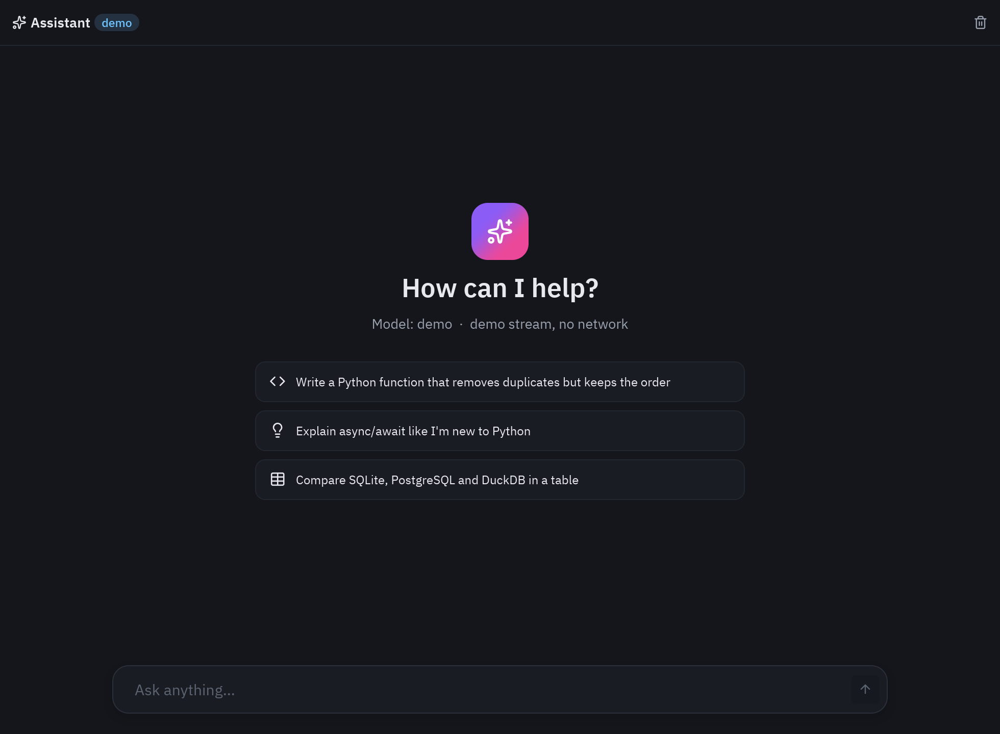
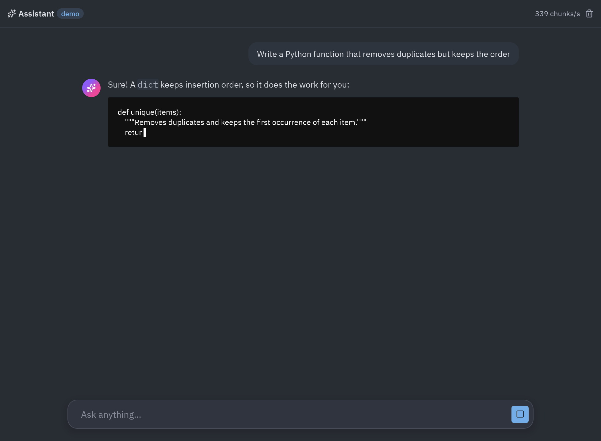
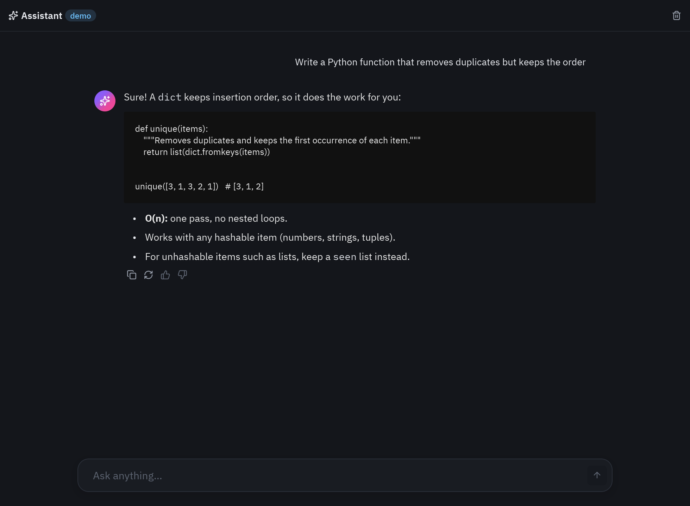

import Commands from '../../../../components/Commands.astro';

Pyzed encaja muy bien con las apps de IA: las respuestas llegan token a token mientras la ventana sigue respondiendo,
el Markdown y el código se muestran sin hacer nada y los componentes (campos, tarjetas, spinners, badges) ya tienen
el aspecto de una herramienta de IA moderna. Esta página construye un **chat con streaming** completo que habla con
cualquier servidor compatible con OpenAI (OpenAI, Ollama, LM Studio, vLLM, llama.cpp, OpenRouter, Groq...) usando
[httpx](https://www.python-httpx.org), y que funciona sin red en modo demo.

| Conversación vacía | Respuesta en curso |
| --- | --- |
|  |  |



## Ejecutarlo

<Commands
	uv={`
		uv run python examples/ai_chat.py                  # demo: una respuesta fija, sin red ni clave
		{env CHAT_BASE_URL=http://localhost:11434/v1} {env CHAT_MODEL=llama3.2} uv run --with httpx python examples/ai_chat.py     # Ollama
		{env CHAT_BASE_URL=https://api.openai.com/v1} {env CHAT_API_KEY=sk-...} {env CHAT_MODEL=<model>} uv run --with httpx python examples/ai_chat.py
	`}
	pip={`
		python examples/ai_chat.py                         # demo: una respuesta fija, sin red ni clave
		pip install httpx                                  # para un modelo real
		{env CHAT_BASE_URL=http://localhost:11434/v1} {env CHAT_MODEL=llama3.2} python examples/ai_chat.py     # Ollama
		{env CHAT_BASE_URL=https://api.openai.com/v1} {env CHAT_API_KEY=sk-...} {env CHAT_MODEL=<model>} python examples/ai_chat.py
	`}
	python={`
		{py} examples/ai_chat.py                          # demo: una respuesta fija, sin red ni clave
		{py} -m pip install httpx                          # para un modelo real
		{env CHAT_BASE_URL=http://localhost:11434/v1} {env CHAT_MODEL=llama3.2} {py} examples/ai_chat.py     # Ollama
		{env CHAT_BASE_URL=https://api.openai.com/v1} {env CHAT_API_KEY=sk-...} {env CHAT_MODEL=<model>} {py} examples/ai_chat.py
	`}
/>

El código es [`examples/ai_chat.py`](https://github.com/albakore/pyzed/blob/main/examples/ai_chat.py), unas 220
líneas con la interfaz. Estas son las partes importantes.

## Cómo funciona el streaming

```mermaid
sequenceDiagram
    participant UI as Hilo de la UI
    participant App as AIChat
    participant Loop as bucle asyncio
    participant API as Servidor del modelo
    UI->>App: Enter → send()
    App-->>Loop: return reply() (async generator)
    Loop->>API: POST /chat/completions (stream=true)
    loop cada token
        API-->>Loop: data: {"choices":[{"delta":{"content":"…"}}]}
        Loop-->>App: yield ("delta", turn, text) → update()
        App->>UI: view() con la respuesta más larga
    end
    Loop-->>App: yield ("done", turn, None)
```

Un callback que **devuelve un generador async** hace que Pyzed lo ejecute en su bucle asyncio, y cada valor que
produce llega a `update` en el hilo de la interfaz (mira [Async y suscripciones](/pyzed/es/guides/async/)). Sin
hilos, colas ni bloqueos en tu código.

### 1. Leer el stream del servidor

Los servidores compatibles con OpenAI envían
[server-sent events](https://developer.mozilla.org/es/docs/Web/API/Server-sent_events): líneas que empiezan por
`data:` con un trozo JSON, y terminan con `data: [DONE]`.

```python
async def openai_stream(messages, *, model=MODEL, base_url=BASE_URL, api_key=API_KEY):
    """Yields the answer's text pieces from an OpenAI-compatible ``/chat/completions`` endpoint."""
    import httpx  # only needed when talking to a real server

    headers = {"Authorization": f"Bearer {api_key}"} if api_key else {}
    body = {"model": model, "messages": messages, "stream": True}
    async with httpx.AsyncClient(timeout=httpx.Timeout(60, connect=10)) as client:
        async with client.stream("POST", f"{base_url.rstrip('/')}/chat/completions", json=body,
                                 headers=headers) as response:
            if response.status_code >= 400:
                detail = (await response.aread()).decode(errors="replace")[:300]
                raise RuntimeError(f"HTTP {response.status_code}: {detail}")
            async for line in response.aiter_lines():  # server-sent events: "data: {...}"
                if not line.startswith("data:"):
                    continue
                data = line[5:].strip()
                if data == "[DONE]":
                    break
                delta = json.loads(data)["choices"][0].get("delta", {}).get("content")
                if delta:
                    yield delta
```

El modo demo la cambia por una función con la misma forma, así el resto de la app no nota la diferencia:

```python
async def demo_stream(messages, *, delay=0.015):
    """A stand-in for the model: streams a canned answer a few characters at a time."""
    text = DEMO_ANSWER
    for i in range(0, len(text), 4):
        await asyncio.sleep(delay)
        yield text[i:i + 4]
```

### 2. Enviar y convertir el stream en mensajes

```python
def send(self, text=None):
    text = (text if text is not None else self.draft).strip()
    if not text or self.busy:
        return None
    self.messages += [{"role": "user", "content": text}, {"role": "assistant", "content": ""}]
    self.draft, self.error, self.busy = "", "", True
    self.turn += 1
    history = [{"role": "system", "content": SYSTEM}] + self.messages[:-1]
    return [self.reply(self.turn, history), pz.Command.scroll_to_end("thread")]

async def reply(self, turn, history):
    """Runs on Pyzed's asyncio loop; each yield goes to update() on the UI thread."""
    try:
        async for piece in self.stream(history):
            if turn != self.turn:   # stopped or superseded
                return
            yield ("delta", turn, piece)
    except Exception as error:      # network errors, bad keys... shown in the thread
        yield ("error", turn, str(error) or type(error).__name__)
    yield ("done", turn, None)
```

- `send` devuelve **una lista**: el generador y un comando que baja el hilo hasta el final. Pyzed ejecuta los dos.
- Cada respuesta lleva un número de **turno**. **Detener** solo incrementa `self.turn`: el generador en marcha ve
  un turno más nuevo y termina, y `update` ignora los trozos de un turno anterior que ya venían en camino.
- Los errores se convierten en un mensaje en vez de una excepción: una clave mal puesta o un servidor caído muestran
  un aviso rojo en el hilo y la app sigue funcionando.

### 3. Actualizar el estado

```python
def update(self, message):
    kind, turn, value = message
    if turn != self.turn:
        return None
    if kind == "delta":
        self.messages[-1]["content"] += value
        return pz.Command.scroll_to_end("thread")
    if kind == "error":
        self.error = value
    elif kind == "done":
        self.busy = False
    return None
```

### 4. La vista

La respuesta del asistente es un `ui.markdown`, con un cursor (`▍`) al final mientras llega y un `ui.spinner` antes
del primer token. El hilo es un `pz.scrollable(..., anchor_bottom=True)` para que el texto nuevo quede a la vista, y
el compositor cambia el botón de enviar por **Detener** mientras `busy`:

```python
action = (ui.icon_button("square", self.stop, variant="solid", tooltip="Stop") if self.busy else
          ui.icon_button("arrow-up", self.send, variant="solid" if self.draft.strip() else "filled",
                         tooltip="Send", disabled=not self.draft.strip()))
```

Bajo las respuestas terminadas aparecen los botones de copiar, regenerar y valorar; `pz.Command.copy(text)` deja la
respuesta en el portapapeles.

## Probarlo sin red

El stream es un argumento del constructor, así que los tests manejan la app entera con un modelo falso, igual que
los tests de Pyzed en `tests/test_blocks.py`:

```python
import asyncio
from ai_chat import AIChat, DEMO_ANSWER, demo_stream


def test_streams_the_answer():
    app = AIChat(stream=lambda messages: demo_stream(messages, delay=0))
    effects = app.send("hello")
    reply = next(e for e in effects if hasattr(e, "__aiter__"))

    async def run():
        async for message in reply:
            app.update(message)

    asyncio.run(run())
    assert app.messages[-1]["content"] == DEMO_ANSWER and not app.busy
    app.screenshot("chat.png")          # off-screen, no window
```

El test del repositorio también levanta un pequeño servidor HTTP local que habla server-sent events y comprueba que
`openai_stream` envía la petición correcta y une los trozos.

## Con `pyzed.agents`: proveedores y herramientas

Para varios proveedores, claves en el llavero del sistema y **herramientas** (funciones que el modelo puede llamar),
usa [`pyzed.agents`](/pyzed/es/guides/agents/), el motor del agente de Pyzed Design. `Agent.run` bloquea, así que
ejecútalo en un hilo con `pz.Command.perform` y pasa sus eventos a `update` con `pz.post`, que es seguro desde
cualquier hilo:

```python
import pyzed as pz
from pyzed import agents, ui


@agents.tool
def stock(product: str) -> int:
    """How many units of a product are in stock."""
    return {"chair": 4, "desk": 0}.get(product, 0)


class Shop(pz.App):
    def __init__(self):
        self.agent = agents.Agent("ollama:qwen3:8b", tools=[stock], system="You help the shop's staff.")
        self.answer, self.prompt, self.busy = "", "", False

    def ask(self):
        self.answer, self.busy = "", True
        return pz.Command.perform(lambda: self.agent.run(self.prompt, on_event=pz.post), self.finished)

    def finished(self, text):
        self.busy = False

    def update(self, event):
        if isinstance(event, agents.Event) and event.kind == "text":
            self.answer += event.text

    def view(self):
        return pz.column([
            ui.markdown(self.answer or "Ask about the stock."),
            ui.spinner() if self.busy else None,
            ui.input(self.prompt, lambda v: setattr(self, "prompt", v), on_submit=self.ask),
        ], spacing=8, padding=16)
```

## Ideas para seguir

- **Varias conversaciones**: guarda una lista de hilos y muéstralos en una barra lateral con `ui.list_item`, como el
  [bloque de chat](/pyzed/es/blocks/chat/).
- **Adjuntos**: lee un archivo que elija el usuario y añade su texto al mensaje.
- **Herramientas que tocan la interfaz**: una herramienta con `ui=True` se ejecuta en el hilo de la interfaz a
  través del `executor` del agente.
- **Una app local**: Ollama o LM Studio en la misma máquina, sin clave y sin que los datos salgan del ordenador.
- **Estilo**: dale un brillo al avatar del asistente (`.style(glow=("#8b5cf6", 18))`) o un panel de vidrio al
  compositor; mira [Animación y efectos](/pyzed/es/animation/effects/).
