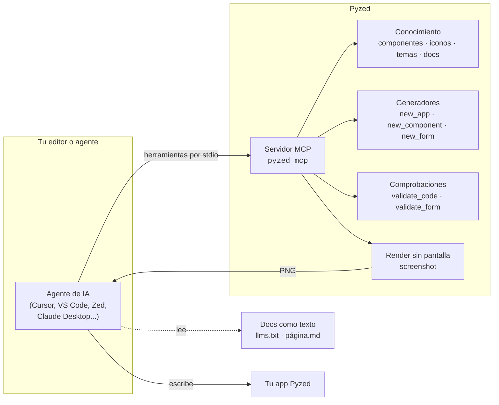

Pyzed está hecho para escribirse **con** agentes de IA y para poner IA **dentro** de tus apps. Un agente conectado
a Pyzed no adivina la API de memoria: consulta la firma exacta de cada componente, sigue las reglas de Pyzed,
comprueba el código que escribe y renderiza una captura de la ventana para ver el resultado, todo sin abrir ninguna
ventana.

## Tres formas de trabajar con IA

| | Qué es | Empieza aquí |
| --- | --- | --- |
| **Agentes que escriben Pyzed** | Conecta cualquier agente que hable [MCP](https://modelcontextprotocol.io) y tendrá los componentes, la documentación, los generadores, las comprobaciones y las capturas de Pyzed. Los agentes sin MCP pueden leer la documentación como texto. | [Servidor MCP](/pyzed/es/ai/mcp/), [llms.txt y reglas para editores](/pyzed/es/ai/llms-txt/) |
| **El agente de Pyzed Design** | El diseñador visual tiene un panel de agente que coloca controles, conecta eventos, escribe handlers y crea formularios, componentes y apps completas; ve imágenes, usa servidores MCP y ejecuta agentes externos, y todo se puede deshacer. | [Agente en Pyzed Design](/pyzed/es/ai/agent-composer/), [Claves de API](/pyzed/es/ai/api-keys/) |
| **IA dentro de tu app** | `pyzed.agents` habla con muchos proveedores de modelos con herramientas y streaming, y el modelo async de Pyzed muestra las respuestas a medida que llegan sin congelar la interfaz. | [Crear apps con IA](/pyzed/es/ai/ai-apps/) |

## Por qué los agentes escriben buen código Pyzed

- **Una sola forma de hacer interfaces.** El estado está en la app, `view()` devuelve widgets y los eventos llaman a
  métodos. No hay un árbol de widgets que mutar, ni gestores de geometría que elegir, ni reglas de hilos del
  `mainloop` que recordar: hay menos maneras de que el código generado falle.
- **Todo se consulta, nada se adivina.** `describe_component("ui.table")` devuelve la firma real y la documentación de
  los parámetros de la versión instalada, y `validate_code` rechaza parámetros que no existen (`heigth=8`), efectos
  secundarios en `view()` y lambdas en bucles antes de ejecutar nada.
- **El agente puede ver.** La herramienta `screenshot` renderiza la app sin pantalla (sin display ni GPU) y devuelve
  un PNG, así el agente revisa el diseño y lo corrige, como lo haría una persona.
- **Documentación hecha también para máquinas.** Cada página de este sitio existe en Markdown (`/pyzed/es/<página>.md`),
  el sitio entero como [`llms.txt`](/pyzed/es/llms.txt) y [`llms-full.txt`](/pyzed/es/llms-full.txt), y el paquete
  incluye stubs tipados (`.pyi`) que leen editores y agentes.
- **Bloques para empezar.** Los [Bloques](/pyzed/es/blocks/) son pantallas completas y probadas que un agente puede
  leer con `read_example("blocks/dashboard")` y adaptar, en vez de partir de un archivo vacío.

## Qué puede hacer un agente con Pyzed

| Pide | Qué pasa |
| --- | --- |
| *"Haz un temporizador Pomodoro con barra de progreso"* | Lee las buenas prácticas, consulta `ui.progress`, escribe la app, la valida y mira una captura. Mira el [ejemplo completo](/pyzed/es/ai/prompting/#un-ejemplo-completo). |
| *"Haz un componente de valoración reutilizable"* | Genera un `pz.Component` con props, estado y eventos que también aparece en la caja de herramientas de Pyzed Design. |
| *"Crea un formulario de clientes con validación"* | Genera un `.pzform` y su módulo de handlers, y comprueba ambos con `validate_form`. |
| *"Parte del bloque kanban y carga las tarjetas desde SQLite"* | Lee el bloque, mantiene la interfaz y cambia los datos de ejemplo por una consulta. |
| *"¿Por qué no se desplaza mi lista?"* | Lee la guía de layout y la documentación del componente, y corrige el código. |
| *"Añade un chat con un modelo local"* | Usa `pyzed.agents` o una llamada HTTP compatible con OpenAI, con streaming hacia la interfaz. |

## Inicio rápido

1. Instala Pyzed con el extra MCP: `pip install "pyzed-ui[mcp]"` (o deja que el agente lo ejecute con `uvx`).
2. Añade el servidor a tu agente, por ejemplo en `.cursor/mcp.json` o `.vscode/mcp.json`, como se explica en
   [Servidor MCP](/pyzed/es/ai/mcp/#conecta-tu-agente).
3. Copia la [plantilla de `AGENTS.md`](/pyzed/es/ai/llms-txt/#agentsmd-para-un-proyecto-pyzed) en tu proyecto y pide
   lo que necesites. La [guía de prompts](/pyzed/es/ai/prompting/) tiene peticiones que funcionan bien.
