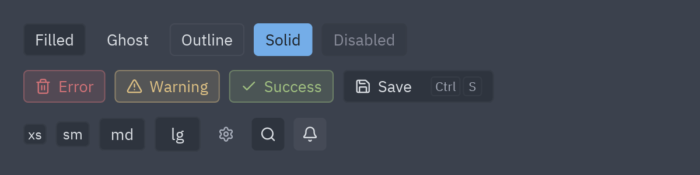
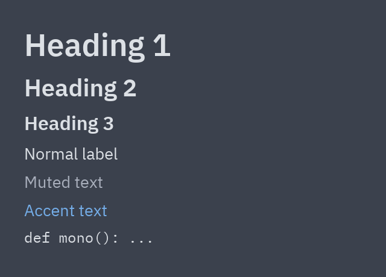
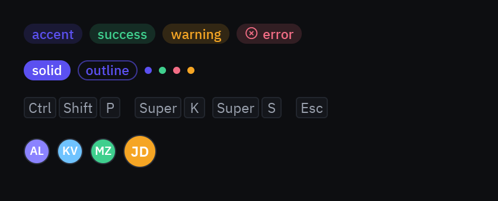
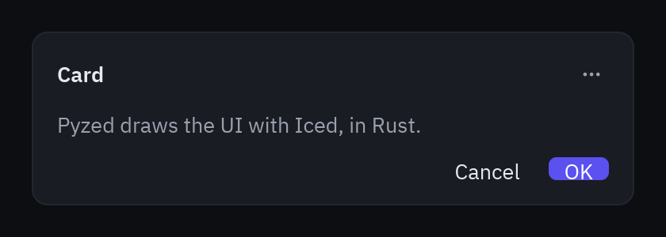

:::tip[Biblioteca de componentes]
Cada componente tiene ahora su propia página, con vista previa, ejemplos y su API completa, en la
[biblioteca de componentes](/pyzed/es/library/). Esta página se mantiene como resumen.
:::

## Botones



```python
pz.row([
    ui.button("Filled", self.accion),
    ui.button("Ghost", self.accion, variant="ghost"),
    ui.button("Outline", self.accion, variant="outline"),
    ui.button("Solid", self.accion, variant="solid"),
    ui.button("Disabled", self.accion, disabled=True),
], spacing=8)

ui.button("Error", self.borrar, variant="error", icon="trash-2")
ui.button("Guardar", self.guardar, icon="save", keys="ctrl-s")
ui.button("lg", self.accion, size="lg")

ui.icon_button("settings", self.ajustes, tooltip="Ajustes")
ui.icon_button("bell", self.avisos, selected=True)
```

- `variant`: `"filled"` (por defecto), `"ghost"`, `"subtle"`, `"outline"`, `"solid"`, `"tinted"`
  o directamente un color semántico (`"accent"`, `"error"`, `"warning"`, `"success"`, `"info"`).
- `size`: `"xs"`, `"sm"`, `"md"`, `"lg"`.
- `icon` + `icon_position="start" | "end"`, `full_width=True`, `selected=True`.
- Si `on_press` es `None`, el botón se dibuja deshabilitado.
- Cualquier parámetro de estilo de [`pz.button`](/pyzed/es/reference/widgets/#button) (`bg`,
  `hover_bg`, `radius`…) sobrescribe el del tema.

## Texto



```python
ui.heading("Heading 1")
ui.heading("Heading 2", level=2)
ui.label("Label normal")
ui.muted("Texto atenuado")
ui.label("Texto de acento", color="accent")
ui.label("def mono(): ...", mono=True, size="sm")
```

`size` acepta `"xs"`, `"sm"`, `"md"`, `"lg"`, `"xl"`, `"2xl"` o un número.

## Badges, indicadores, atajos y avatares



```python
ui.badge("success", tint="success")
ui.badge("error", tint="error", icon="circle-x")
ui.badge("solid", variant="solid")          # "soft" (por defecto), "solid", "outline"

ui.indicator("success")                      # punto de color

ui.kbd("ctrl-shift-p")                       # ⌃⇧P en macOS, Ctrl Shift P en el resto
ui.kbd("cmd-k cmd-s")                        # acordes

ui.avatar("KV", index=1)                     # index elige un color de colaborador del tema
```

El estilo de los atajos se controla con `pyzed.ui.base.KEY_STYLE`: `"auto"` (por defecto),
`"symbols"` o `"words"`.

## Tooltip

```python
ui.tooltip(ui.icon_button("save", self.guardar), "Guardar", keys="ctrl-s", position="bottom")
```

`ui.icon_button(..., tooltip="Texto")` es un atajo para lo mismo.

## Tarjeta y divisor



```python
ui.card(
    pz.column([
        ui.muted("Pyzed dibuja la interfaz con Iced en Rust."),
        pz.row([pz.hspace(), ui.button("Cancelar", self.cerrar, variant="ghost"),
                ui.button("Aceptar", self.aceptar, variant="solid")], spacing=8),
    ], spacing=12),
    title="Tarjeta",
    actions=[ui.icon_button("ellipsis", self.menu, size="sm")],
    width=380,
)

ui.divider()                # horizontal
ui.divider(vertical=True)
```

Referencia completa: [Componentes (pyzed.ui)](/pyzed/es/reference/ui/#básicos).
