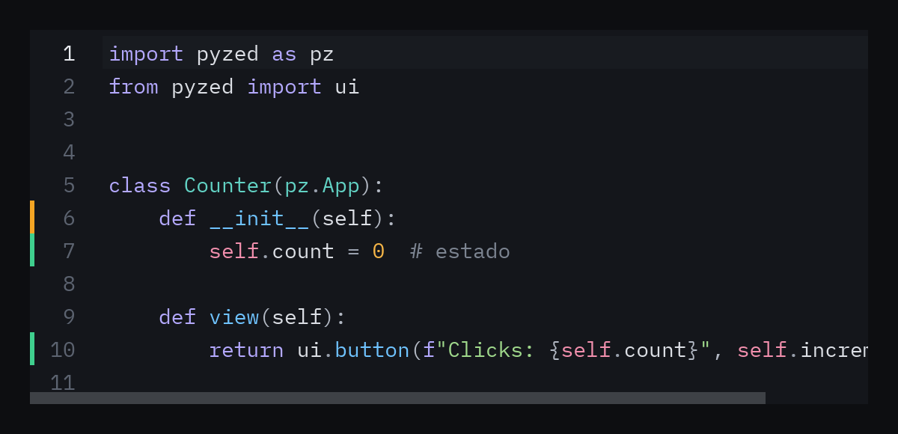
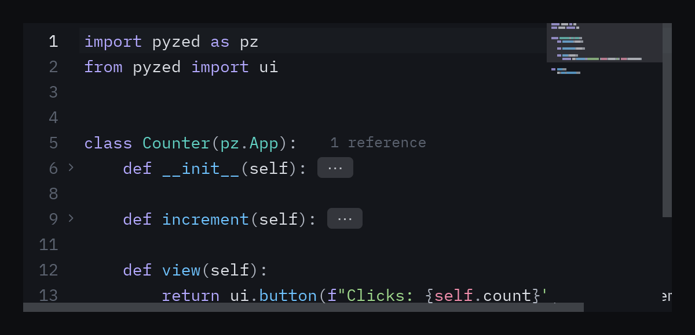
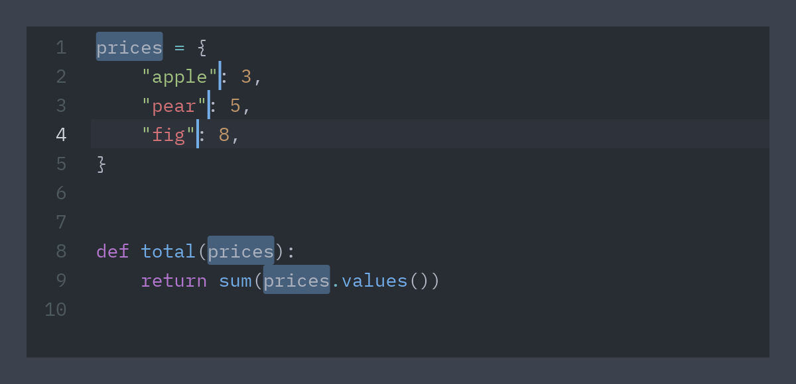
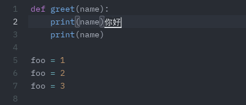
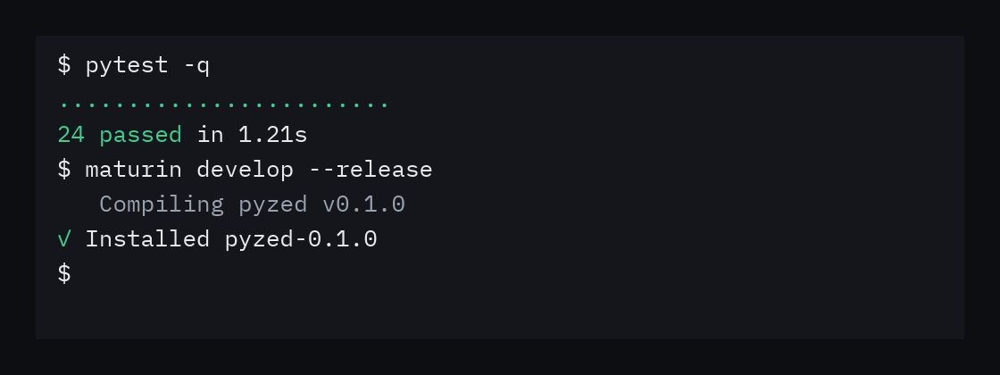

:::tip[Biblioteca de componentes]
Cada componente tiene ahora su propia página, con vista previa, ejemplos y su API completa, en la
[biblioteca de componentes](/pyzed/es/library/). Esta página se mantiene como resumen.
:::

## Editor



```python
ui.editor(
    "counter.py",                      # id del buffer
    codigo,                            # texto inicial
    path="counter.py",                 # deduce el lenguaje
    markers={6: "modified", 7: "created", 10: "created"},
    on_change=self.cambiado,           # recibe el texto completo
    on_cursor=self.cursor,             # recibe (línea, columna), desde 1
)
```

- **No controlado.** El texto, el cursor, la selección y el historial de deshacer viven en Rust,
  asociados al `id`. `text` solo se usa la primera vez que aparece ese `id`. Para reemplazar el
  contenido devuelve `Command.set_editor_text(id, texto)`.
- **Un buffer por archivo.** Usa la ruta como `id`: al cambiar de pestaña cada archivo conserva su
  cursor y su historial.
- **Resaltado.** Más de 100 lenguajes (gramáticas de syntect / two-face) con los colores de
  sintaxis del tema. El lenguaje se deduce de `path` o se pasa con `language="rs"`.
- **Marcadores de git.** `markers` asigna a cada línea `"created"`, `"modified"` o `"deleted"`.
- **Cursor.** `Command.set_editor_cursor(id, línea, columna)` mueve el cursor, incluso antes del
  primer dibujado.

```python
def guardar(self):
    Path(self.activa).write_text(self.textos[self.activa])
    self.sucios.discard(self.activa)

def cambiado(self, texto):
    self.textos[self.activa] = texto
    self.sucios.add(self.activa)
```

- **Líneas largas.** Con `wrap=False` (por defecto) el editor se desplaza en horizontal y los
  números de línea quedan fijos a la izquierda. Con `wrap=True` las líneas se ajustan y el número
  aparece en la primera fila de cada línea.
- **Línea activa.** La línea del cursor se resalta y el scroll sigue al cursor (también con
  <kbd>RePág</kbd>/<kbd>AvPág</kbd>).

### Editar como en un editor de código moderno



```python
ui.editor(
    "app.py", codigo, path="app.py",
    minimap=True,                  # o un ancho en píxeles
    cursor_shape="block",          # "bar" (por defecto), "block", "underline", "hollow"
    on_zoom=self.zoom,             # 1, -1 o 0 con Ctrl+= / Ctrl+- / Ctrl+0 y Ctrl+rueda
    font_size=self.tamano,
)

def zoom(self, paso):
    self.tamano = 14 if paso == 0 else self.tamano + paso
```

- **Cierre automático** (`auto_close=True`, por defecto). Al escribir `(`, `[`, `{`, `"`, `'` o
  `` ` `` también se inserta el de cierre y el cursor queda en medio. Con una selección, el par la
  envuelve. Escribir un cierre que ya está a continuación lo salta, <kbd>Retroceso</kbd> dentro de
  un par vacío borra los dos y <kbd>Enter</kbd> entre llaves abre una línea con sangría. Las
  comillas no se cierran dentro de palabras (`don't`), pero sí tras un prefijo de cadena (`f"`, `rb'`).
- **Plegado** (`folding=True`, por defecto). Los bloques se pliegan según la sangría: pasa el ratón
  por el margen para ver las flechas y haz clic en una para plegar su bloque. Una línea plegada
  termina en `⋯` (haz clic para desplegarla). <kbd>Ctrl</kbd>+<kbd>Shift</kbd>+<kbd>[</kbd> pliega
  el bloque más interno alrededor del cursor y <kbd>Ctrl</kbd>+<kbd>Shift</kbd>+<kbd>]</kbd> lo
  despliega. `Command.fold_line(id, línea)` y `Command.fold_all(id)` lo hacen desde código. Los
  números de línea, `markers`, `annotations`, `on_change`, `on_cursor` y `set_editor_cursor` siguen
  usando las líneas reales; editar una línea plegada o mover el cursor dentro de un pliegue lo despliega.
- **Minimapa.** `minimap=True` dibuja el código en miniatura a la derecha con el área visible
  resaltada; haz clic para saltar, arrastra para desplazarte o usa la rueda encima.
- **Zoom de fuente.** El editor pasa <kbd>Ctrl</kbd>+<kbd>=</kbd>, <kbd>Ctrl</kbd>+<kbd>-</kbd>,
  <kbd>Ctrl</kbd>+<kbd>0</kbd> y <kbd>Ctrl</kbd>+rueda a `on_zoom`; cambia `font_size` en respuesta.
- **Cursor.** `cursor_shape`, `cursor_blink`, `cursor_width` (de la barra) y `cursor_color` (por
  defecto, el color de jugador del tema), como la opción `cursor_shape` de Zed.

### Varios cursores y los atajos de Zed



El editor usa los atajos por defecto de Zed y VS Code (Linux y Windows; en macOS, <kbd>Cmd</kbd> en lugar de <kbd>Ctrl</kbd>):

| Teclas | Acción |
| --- | --- |
| <kbd>Alt</kbd>+clic | Añade un cursor (o quita el que hay bajo el clic) |
| <kbd>Ctrl</kbd>+<kbd>Alt</kbd>+<kbd>↑</kbd> / <kbd>↓</kbd> | Añade un cursor arriba / abajo |
| <kbd>Ctrl</kbd>+<kbd>D</kbd> | Selecciona la palabra bajo el cursor y luego añade la siguiente coincidencia como cursor |
| <kbd>Ctrl</kbd>+<kbd>Shift</kbd>+<kbd>L</kbd> | Selecciona todas las coincidencias |
| <kbd>Alt</kbd>+<kbd>Shift</kbd>+<kbd>I</kbd> | Un cursor en cada línea de la selección |
| <kbd>Ctrl</kbd>+<kbd>U</kbd> | Deshace el último cambio de cursores |
| <kbd>Esc</kbd> | Vuelve a un cursor y luego quita la selección |
| <kbd>Ctrl</kbd>+<kbd>Z</kbd>, <kbd>Ctrl</kbd>+<kbd>Y</kbd> o <kbd>Ctrl</kbd>+<kbd>Shift</kbd>+<kbd>Z</kbd> | Deshacer y rehacer (lo escrito seguido es un solo paso) |
| <kbd>Alt</kbd>+<kbd>↑</kbd> / <kbd>↓</kbd> | Sube / baja las líneas |
| <kbd>Alt</kbd>+<kbd>Shift</kbd>+<kbd>↑</kbd> / <kbd>↓</kbd> o <kbd>Ctrl</kbd>+<kbd>Alt</kbd>+<kbd>Shift</kbd>+<kbd>↑</kbd> / <kbd>↓</kbd> | Duplica las líneas de cada cursor arriba / abajo |
| <kbd>Ctrl</kbd>+<kbd>Shift</kbd>+<kbd>D</kbd> | Duplica la selección de cada cursor justo después (la línea si no hay) |
| <kbd>Ctrl</kbd>+<kbd>Shift</kbd>+<kbd>K</kbd> | Borra las líneas |
| <kbd>Ctrl</kbd>+<kbd>L</kbd> | Selecciona la línea (otra vez: también la siguiente) |
| <kbd>Ctrl</kbd>+<kbd>Shift</kbd>+<kbd>J</kbd> | Une líneas |
| <kbd>Ctrl</kbd>+<kbd>Enter</kbd> / <kbd>Ctrl</kbd>+<kbd>Shift</kbd>+<kbd>Enter</kbd> | Nueva línea debajo / encima, con sangría |
| <kbd>Ctrl</kbd>+<kbd>]</kbd> / <kbd>Ctrl</kbd>+<kbd>[</kbd>, <kbd>Shift</kbd>+<kbd>Tab</kbd> | Sangra / quita sangría (<kbd>Tab</kbd> sangra una selección de varias líneas) |
| <kbd>Ctrl</kbd>+<kbd>/</kbd> | Comenta o descomenta las líneas (`#`, `//` o `--`, según `language`) |
| <kbd>Ctrl</kbd>+<kbd>M</kbd> | Salta al corchete pareja (o al que lo encierra) |
| <kbd>Ctrl</kbd>+<kbd>Retroceso</kbd> / <kbd>Ctrl</kbd>+<kbd>Supr</kbd> | Borra la palabra anterior / siguiente |
| <kbd>Inicio</kbd> | Primer carácter que no es espacio y luego el principio de la línea |
| <kbd>Ctrl</kbd>+<kbd>↑</kbd> / <kbd>↓</kbd> | Desplaza una línea sin mover el cursor |
| <kbd>Ctrl</kbd>+<kbd>C</kbd> / <kbd>Ctrl</kbd>+<kbd>X</kbd> | Sin selección, copia / corta la línea entera; con varios cursores, el texto de todos |
| <kbd>Ctrl</kbd>+<kbd>K</kbd> <kbd>Ctrl</kbd>+<kbd>0</kbd> / <kbd>Ctrl</kbd>+<kbd>J</kbd> / <kbd>Ctrl</kbd>+<kbd>L</kbd> | Pliega todo / despliega todo / pliega o despliega en el cursor |

Escribir, borrar y moverse se aplica a todos los cursores. Al pegar un texto con una línea por
cursor, cada cursor recibe su línea, como en Zed. El corchete junto al cursor y su pareja se
remarcan (`match_brackets`), y al seleccionar un texto se resaltan sus demás apariciones
(`selection_highlight`).

Cada acción tiene un nombre (el de Zed, en snake case). `on_action(nombre)` se llama después de cada
una, `Command.editor_action(id, nombre)` ejecuta una desde código (un menú, una paleta de comandos) y
`Command.editor_actions()` las lista:

```python
ui.editor("main.py", code, path="main.py", on_action=self.ran,
          highlights=self.found)       # [(línea, columna, línea_final, columna_final)], desde 1

def comment(self):
    return pz.Command.editor_action("main.py", "toggle_comments")

def select_matches(self):
    # Un cursor por rango; el primero es el cursor principal.
    return pz.Command.select_editor_ranges("main.py", self.found)

def replace_all(self):
    # Un solo paso de deshacer; on_change recibe el texto nuevo.
    return pz.Command.replace_editor_ranges("main.py", [(r, "total") for r in self.found])
```

Entre los nombres están `undo`, `redo`, `add_selection_above`, `add_selection_below`, `select_next`,
`select_previous`, `select_all_matches`, `split_selection_into_lines`, `undo_selection`, `cancel`,
`move_line_up`, `move_line_down`, `duplicate_line_up`, `duplicate_line_down`, `delete_line`,
`newline_above`, `newline_below`, `indent`, `outdent`, `select_line`, `join_lines`, `toggle_comments`,
`move_to_enclosing_bracket`, `convert_to_upper_case`, `convert_to_lower_case` y
`sort_lines_case_sensitive`.

### Métodos de entrada

El chino, el japonés, el coreano y otros idiomas que se escriben con un método de entrada (IME) funcionan
en el editor. Mientras compones, el texto del IME se dibuja en un recuadro en el cursor y el cursor se oculta; el texto confirmado se inserta en cada cursor y varias confirmaciones
seguidas se deshacen en un solo paso, como al escribir. El IME sigue al cursor cuando lo mueves.



## Terminal



```python
salida = "$ pytest -q\n\x1b[32m24 passed\x1b[0m in 1.21s\n$ "
ui.terminal(salida, id="term")
```

Es una vista de **solo lectura** que entiende los colores ANSI y se mantiene desplazada al final.
Pásale la salida de un proceso que ejecutes tú (por ejemplo con `subprocess` en un hilo y
`pz.post`). También acepta una lista de líneas de segmentos `(texto, color)`, donde el color es
un nombre ANSI (`"green"`, `"red"`, `"dim"`…) o un token del tema.

`ui.ansi(texto)` hace la conversión a segmentos por si quieres dibujarlos a tu manera.

Referencia completa: [Código](/pyzed/es/reference/ui/#código).
