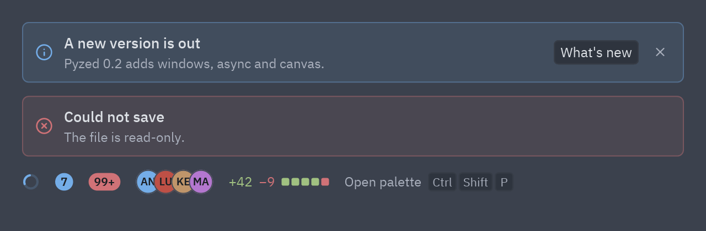
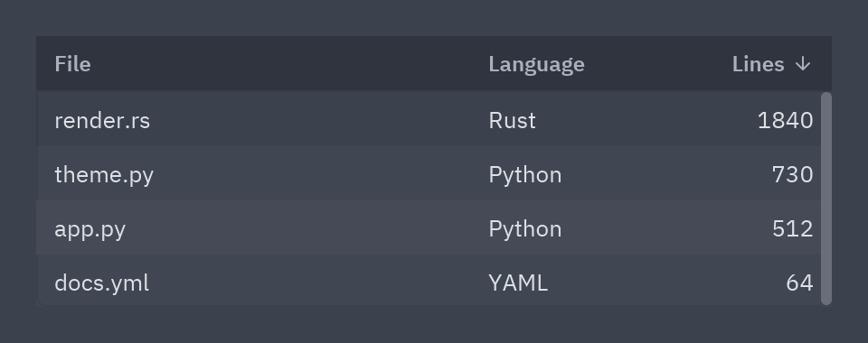
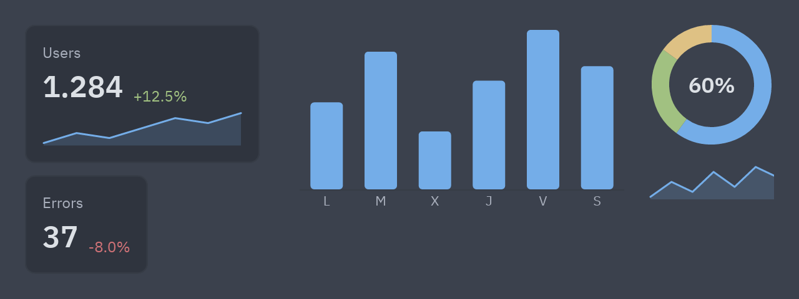
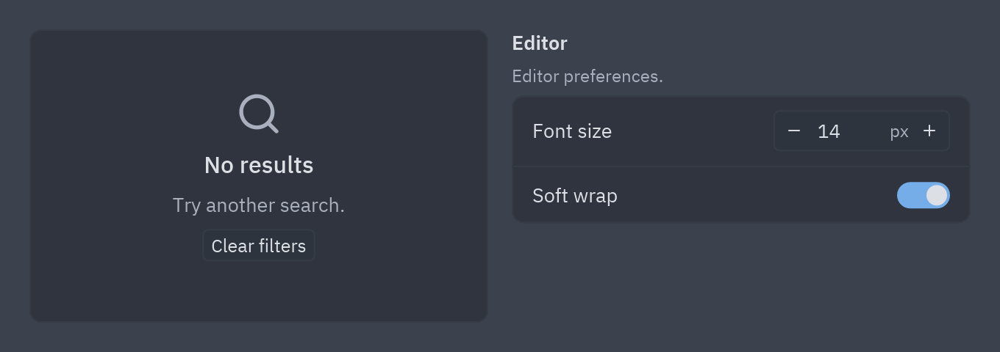

## Avisos e indicadores



```python
ui.callout("Hay una versión nueva", "Pyzed 0.2 añade ventanas, async y canvas.", tint="info",
           actions=[ui.button("Ver novedades", self.novedades, size="sm")], on_dismiss=self.cerrar)
ui.callout("No se pudo guardar", "El archivo es de solo lectura.", tint="error")

pz.row([
    ui.spinner(),                                  # gira solo mientras está en pantalla
    ui.count_badge(7),
    ui.count_badge(120, tint="error"),            # muestra "99+"
    ui.facepile(["Ana", "Luis", "Kev", "Marta"]), # avatares solapados
    ui.diff_stat(42, 9),                          # +42 −9 y bloques como en Zed
    ui.keybinding_hint("Abrir paleta", "ctrl-shift-p"),
], spacing=14, align="center")
```

`tint` acepta `"info"`, `"success"`, `"warning"`, `"error"` o cualquier token o color del tema.

:::note
`ui.spinner()` se anima con el reloj de la app: necesita redibujarse. Mientras se muestre,
devuelve una suscripción como `pz.every(1 / 30, lambda: None)` (ver [Async](/pyzed/es/guides/async/)).
:::

## Tablas



```python
ui.table(
    [ui.Column("Archivo", "name"),
     ui.Column("Lenguaje", "lang", width=120),
     ui.Column("Líneas", "lines", width=80, align="end")],
    self.filas,                     # dicts u objetos
    sort_by=self.orden, descending=self.desc, on_sort=self.ordenar,
    on_row_press=self.seleccionar, selected=self.seleccion, striped=True,
)

def ordenar(self, titulo):
    self.desc = not self.desc if self.orden == titulo else False
    self.orden = titulo
```

`ui.Column(title, key, width="fill", align="start", render=None, sortable=True)`: `key` es una
clave del dict, un atributo o una función `fila -> valor`; `render(valor)` devuelve un widget
para la celda. La tabla ordena por la columna cuyo **título** es `sort_by`; tú solo guardas el
título y la dirección.

## Estadísticas y gráficos



```python
ui.stat("Usuarios", "1.284", delta=12.5, trend=[3, 5, 4, 6, 8, 7, 9])
ui.stat("Errores", "37", delta=-8.0)
ui.bar_chart([12, 19, 8, 15, 22, 17], labels=["L", "M", "X", "J", "V", "S"], width=260, height=150)
ui.donut([60, 25, 15], label="60%")
ui.sparkline([1, 4, 2, 6, 3, 7, 5, 8])
```

Se dibujan con [`pz.canvas`](/pyzed/es/guides/canvas/) y usan los colores del tema
(`tint`, `colors`).

## Estados vacíos y ajustes



```python
ui.empty_state("Sin resultados", "Prueba con otra búsqueda.", icon="search",
               actions=[ui.button("Limpiar filtros", self.limpiar, size="sm")])

ui.settings_group("Editor", [
    ui.field("Tamaño de fuente", ui.number_field(self.fuente, self.set_fuente, suffix="px")),
    ui.field("Ajuste de línea", ui.switch(self.wrap, self.set_wrap)),
], description="Preferencias del editor.")
```

Referencia completa: [Datos y feedback](/pyzed/es/reference/ui/#datos-y-feedback).
