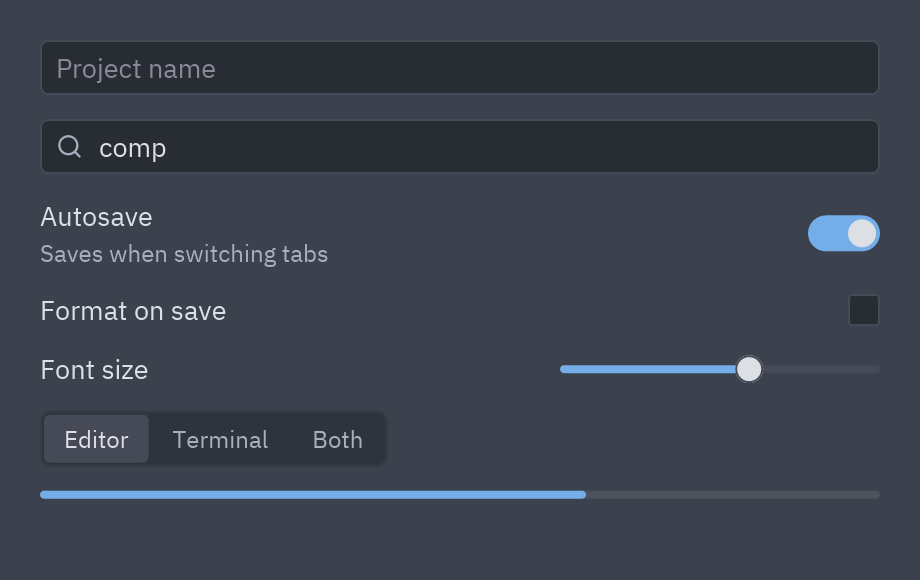

```python
class Ajustes(pz.App):
    def __init__(self):
        self.nombre = ""
        self.query = ""
        self.autosave = True
        self.formatear = False
        self.fuente = 0.6
        self.modo = "Editor"

    def view(self):
        return pz.column([
            ui.input(self.nombre, lambda t: setattr(self, "nombre", t), placeholder="Nombre del proyecto"),
            ui.search_input(self.query, lambda t: setattr(self, "query", t)),
            ui.field("Autoguardado", ui.switch(self.autosave, lambda v: setattr(self, "autosave", v)),
                     description="Guarda al cambiar de pestaña"),
            ui.field("Formato al guardar", ui.checkbox(self.formatear, lambda v: setattr(self, "formatear", v))),
            ui.field("Tamaño de fuente",
                     pz.container(ui.slider(self.fuente, lambda v: setattr(self, "fuente", v)), width=160)),
            ui.segmented(["Editor", "Terminal", "Ambos"], self.modo, lambda m: setattr(self, "modo", m)),
            ui.progress(0.65),
        ], spacing=12, padding=20, width=420)
```

## Campos de texto

Los campos son **controlados**: muestran `value` y te avisan de cada cambio con `on_input`.
Guarda el texto en tu estado y vuelve a pasarlo en `view()`.

```python
ui.input(self.email, self.set_email, placeholder="tu@correo.com", icon="mail",
         on_submit=self.enviar, id="email")
ui.input(self.clave, self.set_clave, secure=True)          # contraseña
ui.input(self.query, self.set_query, borderless=True, size="lg")
```

Para enfocar un campo desde el código, dale un `id` y devuelve `Command.focus("email")`.

## Interruptores y casillas

`on_toggle` recibe el nuevo `bool`:

```python
ui.switch(self.wifi, lambda on: setattr(self, "wifi", on), label="Wi-Fi")
ui.checkbox(self.acepto, lambda v: setattr(self, "acepto", v), label="Acepto los términos")
```

## Deslizador y progreso

```python
ui.slider(self.volumen, self.set_volumen, min=0, max=100, step=1)
ui.progress(self.descargado, max=self.total, tint="success", height=6)
```

## Grupo segmentado

El `ToggleButtonGroup` de Zed. `on_select` recibe la opción elegida:

```python
ui.segmented(["Día", "Semana", "Mes"], self.vista, lambda v: setattr(self, "vista", v))
```

## Filas de ajustes

`ui.field(título, control, description=...)` alinea un título a la izquierda y el control a la
derecha, como el panel de ajustes de Zed.

Referencia completa: [Formularios](/pyzed/es/reference/ui/#formularios).
