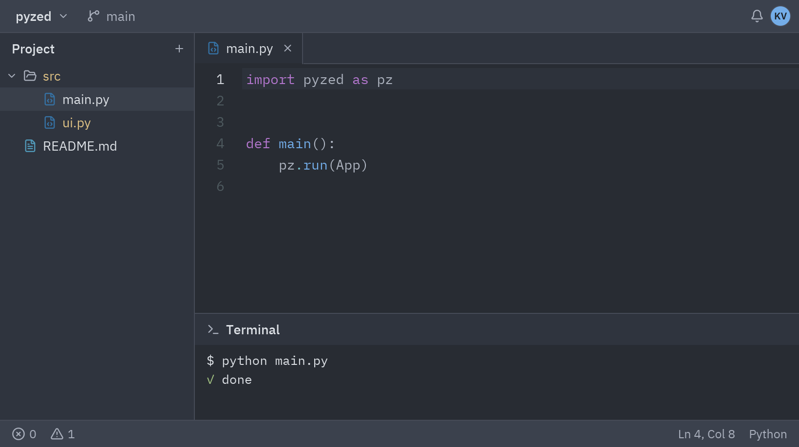

:::tip[Biblioteca de componentes]
Cada componente tiene ahora su propia página, con vista previa, ejemplos y su API completa, en la
[biblioteca de componentes](/pyzed/es/library/). Esta página se mantiene como resumen.
:::

`ui.workspace` monta la estructura de una ventana de Zed: barra de título arriba, docks a la
izquierda, derecha y abajo, el área central y la barra de estado.



```python
def view(self):
    return ui.workspace(
        pz.column([
            ui.tab_bar([ui.Tab.for_file("src/main.py")], "src/main.py", on_close=self.cerrar),
            ui.editor("src/main.py", self.codigo, path="main.py"),
        ]),
        title_bar=ui.title_bar(
            [ui.title_button("pyzed", chevron=True),
             ui.title_button("main", icon="git-branch", muted=True)],
            [ui.icon_button("bell", self.avisos, size="sm"), ui.avatar("KV")],
        ),
        left=pz.column([
            ui.panel_header("Proyecto", [ui.icon_button("plus", self.nuevo, size="xs")]),
            ui.tree(self.nodes, expanded=self.expanded, selected="src/main.py"),
        ]) if self.show_left else None,
        bottom=pz.column([
            ui.panel_header("Terminal", icon="terminal"),
            ui.terminal("$ python main.py\n\x1b[32m✓\x1b[0m listo"),
        ]) if self.show_bottom else None,
        status_bar=ui.status_bar(
            [ui.status_item("0", icon="circle-x"), ui.status_item("1", icon="triangle-alert")],
            [ui.status_item("Ln 4, Col 8"), ui.status_item("Python")],
        ),
        left_width=200,
        bottom_height=110,
    )
```

## Docks

- Pasa `None` en `left`, `right` o `bottom` para ocultar un dock. Así se implementan atajos como
  <kbd>Ctrl</kbd>+<kbd>B</kbd> (`self.show_left = not self.show_left`).
- `left_width`, `right_width` y `bottom_height` fijan su tamaño.
- Dentro de un dock, `ui.panel_header(título, acciones, icon=...)` hace de cabecera.
- `ui.panel(contenido, header=..., side=...)` sirve si montas tu propio layout.

## Barra de título

```python
ui.title_bar(
    start=[ui.title_button("mi-proyecto", self.proyectos, chevron=True)],
    end=[ui.icon_button("settings", self.ajustes, size="sm")],
    center=ui.muted("main.py"),
)
```

## Barra de estado

```python
ui.status_bar(
    [ui.status_item(icon="panel-left", on_press=self.toggle_left, selected=self.show_left,
                    tooltip="Panel de proyecto", keys="ctrl-b")],
    [ui.status_item(f"Ln {line}, Col {col}"), ui.status_item(pz.icons.language_for(self.activa))],
)
```

Referencia completa: [Workspace](/pyzed/es/reference/ui/#workspace).
