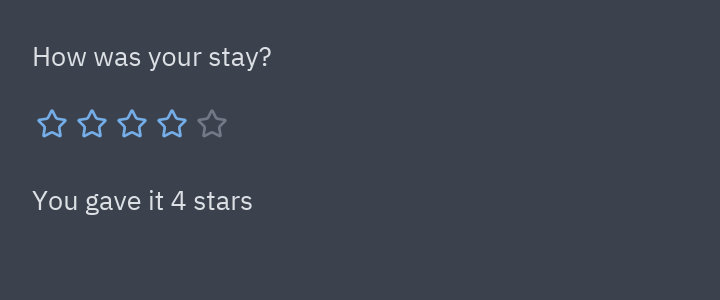
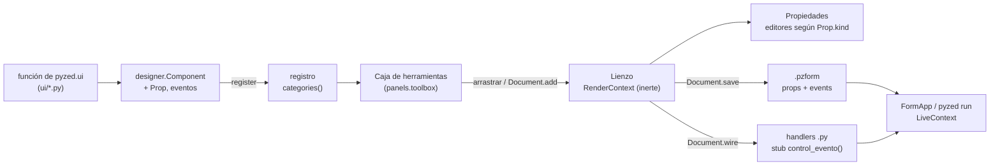
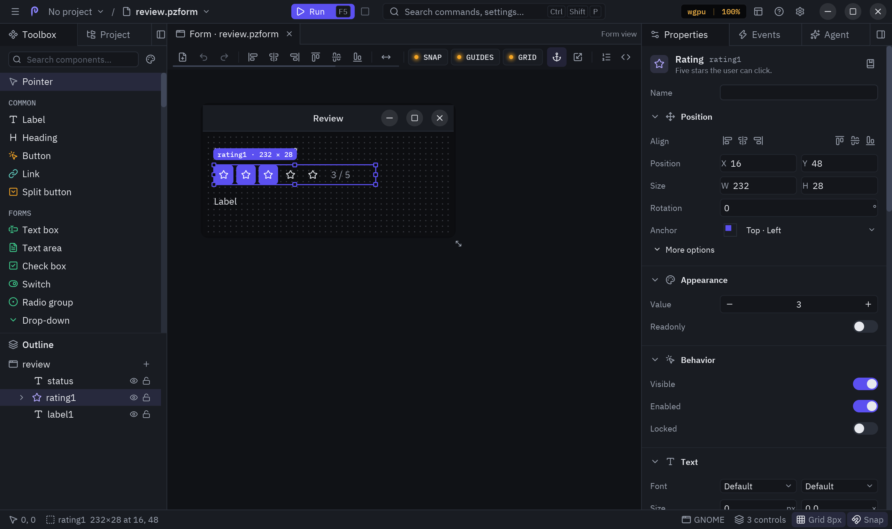

Esta guía explica cómo añadir un control nuevo a **Pyzed Design**, el editor visual de
`python/pyzed/designer/`, de principio a fin. El ejemplo es un control **Rating** (valoración): una fila de
estrellas que lanza un evento `change` con el número de la estrella pulsada.



## El recorrido de un componente

Todo lo que el editor sabe de un control sale de un registro `Component` en
`python/pyzed/designer/components.py`. La misma función `render` dibuja el control en el lienzo (inerte) y en
la aplicación en ejecución (activo), así que lo que diseñas es exactamente lo que se ejecuta.



| Etapa | Código | Qué pasa |
| --- | --- | --- |
| Widget | `python/pyzed/ui/` | Una función normal devuelve un `Widget` construido con `pyzed._core` (Rust). |
| Entrada de la caja | `designer/components.py` | `Component(...)` describe el tipo, la etiqueta, el icono, la categoría, el tamaño, las propiedades y los eventos; `register()` lo añade. |
| Caja de herramientas | `designer/panels.py` | `toolbox()` lista `categories()` con el `icon` y el `label` de cada entrada (traducido con `tr`) y su `description` como tooltip. |
| Lienzo | `designer/surface.py` | Dibuja cada control con `components.render(control, RenderContext(...))`; los callbacks son inertes. |
| Propiedades | `designer/panels.py` | Un editor por cada `Prop`, elegido por su `kind` y agrupado por su `group`. |
| Guardado | `designer/model.py` | `Control.to_dict()` escribe `type`, la geometría, `props` y `events` en el JSON del `.pzform`. |
| Handlers | `designer/document.py`, `designer/code.py` | `Document.wire(nombre, evento)` llama al handler `<control>_<evento>` y añade un stub al archivo `.py`. |
| Ejecución | `designer/runtime.py` | `LiveContext.on()` guarda el valor nuevo en la propiedad y llama al handler conectado con `(form, event)`. |

:::tip[¿Integrado o solo para tu aplicación?]
Esta guía añade un componente **integrado** en Pyzed. Para usar un control solo en tu aplicación no hace
falta ningún cambio en el repositorio: llama a `designer.register(...)` desde tu código (mira el
[ejemplo completo](#ejemplo-completo-un-control-rating)), escribe una clase
[`pz.Component`](/pyzed/es/guides/components/) (se une a la caja de herramientas sola) o dibuja uno en el
[diseñador de componentes](/pyzed/es/editor/component-designer/).
:::

## 1. El componente de `pyzed.ui`

La mayoría de los controles del diseñador envuelven una función de `pyzed.ui`, así que el control también
está disponible para quien escribe su interfaz en código. Ponla en el módulo que corresponda (`inputs.py`,
`controls.py`, `display.py`…) y sigue las convenciones del paquete:

- Es una **función normal** que devuelve un `Widget`; primero el valor, después el callback y luego las
  opciones solo por nombre.
- El último parámetro es `theme: Optional[Theme] = None`, que se resuelve con `t = _theme(theme)`; todos los
  colores salen del tema (`t.color("accent")`, `t.text_muted`, `t.ghost_hover`…), nunca un hexadecimal fijo.
- Los callbacks reciben el valor nuevo; sin callback, el control es de solo lectura.
- Un docstring de una línea que diga qué dibuja y, después, qué recibe el callback.

```python
# python/pyzed/ui/controls.py
def rating(
    value: float,
    on_change: Any = None,
    *,
    max: int = 5,  # noqa: A002 - mirrors ui.progress
    size: float = 16,
    tint: str = "accent",
    theme: Optional[Theme] = None,
) -> _core.Widget:
    """A row of ``max`` stars with the first ``value`` lit, in the ``tint`` color.

    ``on_change`` is called with the number of the clicked star (1 to ``max``);
    without it the stars are read only.
    """
    t = _theme(theme)
    stars = []
    for i in range(1, int(max) + 1):
        lit = i <= value
        star = _icon("star", size=size, color=t.color(tint) if lit else alpha(t.text_muted, 0.5))
        stars.append(_core.button(star, (lambda i=i: on_change(i)) if on_change else None, padding=2,
                                  bg="transparent", hover_bg=t.ghost_hover, radius=t.radius_sm))
    return _core.row(stars, spacing=0, align="center")
```

`controls.py` ya importa `_core`, `_icon`, `alpha`, `Theme` y `_theme`. Después, expórtala en
`python/pyzed/ui/__init__.py`: añade `rating` a la lista `from .controls import (...)` **y** a `__all__`.
Todo nombre de `__all__` debe estar documentado (mira
[Documentar un componente](/pyzed/es/contributing/documenting-components/)).

### Cuando el widget necesita Rust

Solo tocas `src/` cuando ninguna pieza existente puede dibujar el control: un widget nuevo de Iced, una
interacción nativa o algo que tiene que ser rápido. `pyzed._core` expone un conjunto pequeño de primitivas
(`text`, `row`, `column`, `container`, `button`, `text_input`, `slider`, `progress_bar`, `mouse_area`, `stack`,
`svg`, `code_editor`…), y la mayoría de los componentes de `ui`, como Rating, son combinaciones de ellas.

Un widget nativo se conecta en cuatro sitios. Así lo hace `progress_bar`:

1. **Una variante de `Kind`** en `src/widget.rs`, con datos de Rust normales (el árbol de widgets es
   inmutable y vive en Rust):

   ```rust
   pub enum Kind {
       // ...
       ProgressBar { min: f32, max: f32, value: f32, width: Option<Length>,
                     height: Option<Length>, style: ToggleStyle, radius: f32 },
   }
   ```

2. **Una función `#[pyfunction]`** en `src/widget.rs` (o `src/extra.rs`) que convierte los valores de Python
   con las ayudas de `src/style.rs` y devuelve `new(py, Kind::...)`. Los callbacks se guardan como `PyMsg`
   (`PyMsg::maybe(&on_change)`):

   ```rust
   #[pyfunction]
   #[pyo3(signature = (value, *, min=0.0, max=1.0, width=None, height=None, accent=None, bg=None, radius=2.0))]
   pub fn progress_bar(py: Python<'_>, value: f32, min: f32, max: f32, width: Any<'_>, height: Any<'_>,
                       accent: Any<'_>, bg: Any<'_>, radius: f32) -> PyResult<Py<Widget>> {
       new(py, Kind::ProgressBar { min, max, value,
           width: style::opt_length(&width)?, height: style::opt_length(&height)?,
           style: toggle_style(&accent, &bg, &None, &None, &None)?, radius })
   }
   ```

3. **El registro** en la función `register()` del módulo (`widget::register`, que llama `src/lib.rs`):
   `m.add_function(wrap_pyfunction!(progress_bar, m)?)?;`. A partir de ahí es `pyzed._core.progress_bar`.
4. **Una rama del `match`** en `build()` de `src/render.rs` que convierte el `Kind` en un `iced::Element` en
   cada frame. Las interacciones se convierten en un `Message` (`Message::Py(msg)`,
   `Message::Slide(msg, value)`, `Message::Toggle`…), que `src/app.rs` traduce en una llamada al callback de
   Python.

Recompila con `maturin develop --release`, ejecuta `cargo fmt` y `cargo clippy -- -D warnings`, y envuelve la
primitiva nueva en una función de `pyzed.ui` como antes. [Cómo funciona](/pyzed/es/guides/how-it-works/)
explica el puente con más detalle.

## 2. La entrada de la caja de herramientas

Los controles integrados viven en `python/pyzed/designer/components.py`: una función de dibujo y una entrada
en la tupla que se registra al final del módulo.

### La función de dibujo

```python
def _rating(c: Control, ctx: RenderContext) -> Any:
    p = c.props
    return _fill(rating(_num(p["value"]), ctx.on(c, "change", "value") if c.enabled else None,
                        max=int(_num(p["max"], 5)), size=_num(p["size"], 16), tint=p["tint"], theme=ctx.theme), c)
```

(`from ..ui.controls import rating`, o llámala como `ui.rating` cuando esté exportada).

- `c` es el `Control` que se dibuja. `c.props` ya tiene todas las propiedades: `components.render()` mezcla
  los valores por defecto del componente debajo de los guardados, así que `p["max"]` nunca lanza `KeyError`,
  ni siquiera en formularios guardados antes de que existiera la propiedad.
- **Los valores del panel de propiedades o del JSON pueden ser textos o `None`.** Conviértelos con las ayudas
  del módulo: `_num(valor, por_defecto)`, `_lines(valor)` para las propiedades `list`, `_align(valor)`.
- La función recibe el tamaño del control: rellénalo (`_fill(widget, c)` envuelve el widget en un contenedor
  `width="fill", height="fill"`, alineado al inicio y centrado en vertical).
- **Usa `ctx.on(c, evento, prop)` para cada callback.** En el diseñador devuelve una función inerte. En
  ejecución (`LiveContext`) guarda el argumento del callback en `c.props[prop]` y después llama al handler
  conectado a `evento`, con ese valor como `event.value`. Pasa `None` cuando el control está deshabilitado
  (`c.enabled`).
- `ctx.theme` es el tema del formulario; `ctx.live` es `False` en el lienzo (úsalo para dibujar ayudas de
  diseño, como hacen los contenedores de layout); `ctx.key(c)` es un id estable para widgets con estado
  interno (campos de texto, editores).
- No dibujes tú el estilo del usuario: `components.render()` aplica la sección **Estilo** del control
  (`designer/styling.py`) sobre lo que devuelves.

### El registro `Component`

```python
Component(
    type="rating", label="Rating", icon="star", category="Common", render=_rating, size=(132, 28),
    props=(Prop("value", "number", 3, min=0, max=10, group="Data"),
           Prop("max", "number", 5, min=1, max=10, group="Data"),
           Prop("size", "number", 16, min=8, max=48),
           Prop("tint", "choice", "accent", choices=TINTS)),
    events=("change",),
    description="A row of stars to rate something; change gives the number of stars.",
),
```

Añádelo a la tupla `for _component in (...)`, junto a los controles de su categoría; la caja de herramientas
muestra las categorías, y los componentes dentro de ellas, en el orden de registro.

| Campo | Significado |
| --- | --- |
| `type` | Id estable que se guarda en los `.pzform` y con el que se nombran los controles nuevos (`rating1`, `rating2`…). **No lo cambies nunca** después de publicarlo: los formularios antiguos dejarían de cargar (`KeyError: unknown component type`). |
| `label` | Nombre en la caja de herramientas y arriba del panel de propiedades. |
| `icon` | Un icono de [Lucide](https://lucide.dev), para la caja de herramientas y la estructura (`pyzed icons` los lista). |
| `category` | Sección de la caja: `Common`, `Display`, `Containers`, `Layout`, `Navigation`, `Components` o una nueva. |
| `render` | `render(control, ctx) -> Widget`, como arriba. |
| `size` | `(ancho, alto)` por defecto al soltarlo en el formulario. |
| `props` | Las propiedades del panel de propiedades, en orden (ver abajo). |
| `events` | Los eventos propios del control. El primero es el **evento por defecto**, que se abre con doble clic en el control. |
| `description` | Una frase; es el tooltip de la caja de herramientas y el subtítulo del panel de propiedades. |
| `visual` | `False` para controles que no dibujan nada en ejecución (como `timer`): no reciben eventos del ratón. |
| `container` | `"free"`, `"flex"` o `"grid"` cuando se pueden soltar otros controles dentro (mira `designer/layout.py`). |
| `child_layout` | Opciones de layout para los controles nuevos de este tipo, como `(("grow", 1),)` en el espaciador. |

### Propiedades

`Prop(name, kind, default, label="", choices=(), min=None, max=None, step=1.0, group="Appearance")`:

| `kind` | Editor en el panel de propiedades | Valor |
| --- | --- | --- |
| `text` | cuadro de texto de una línea | `str` |
| `multiline` | cuadro de texto de varias líneas | `str` |
| `number` | cuadro numérico con botones (`min`, `max`, `step`) | número, o `None` si el valor por defecto es `None` |
| `bool` | interruptor | `bool` |
| `color` | muestra de color y selector | token del tema o hexadecimal (`""` para ninguno) |
| `choice` | desplegable con `choices` | `str` |
| `list` | editor de lista, un elemento por línea | `str` con un elemento por línea |
| `rows` | editor de tabla, filas separadas por comas, la primera es el encabezado | `str` |
| `icon` | selector de iconos de Lucide | nombre del icono (`""` para ninguno) |

- `group` la coloca en una sección del panel: `Appearance` (por defecto), `Data` (los valores que cambia el
  usuario, como `text`, `value`, `selected`), `Layout` o `Behavior`.
- El panel muestra `label`, o el nombre con los guiones bajos como espacios (`line_numbers` → *Line numbers*).
- Llama a la propiedad que cambia con la interacción del usuario según lo que guarda (`value`, `checked`,
  `selected`, `text`) y pasa ese nombre como tercer argumento de `ctx.on`, así `form.rating1.value` siempre
  está al día.

### Eventos

- Usa los verbos existentes cuando encajen: `click`, `double_click`, `change`, `submit`, `release`, `tick`.
  `EVENT_DOCS` en `components.py` guarda el docstring del stub generado para cada evento; añade una entrada
  si introduces uno nuevo.
- Todo componente visual recibe también los `COMMON_EVENTS` (`mouse_enter`, `mouse_leave`, `right_click`)
  automáticamente (`Component.all_events`); el runtime envuelve el control en un `mouse_area` cuando están
  conectados. No los listes tú.

### Traducciones y recarga en caliente

- Los textos del propio diseñador se traducen en `python/pyzed/designer/locale.py`. Añade la etiqueta en
  español y cualquier categoría o título de propiedad nuevo a `_ES` (la clave es el texto en inglés):
  `"Rating": "Valoración"`. Los títulos de propiedad se comparten, así que `Value`, `Max`, `Size` y `Tint` ya
  están.
- Si el usuario cambia una propiedad al interactuar (como el `value` de Rating), añádela a `_VALUE_PROPS` en
  `python/pyzed/designer/runtime.py` (`"rating": ("value",)`): así la recarga en caliente conserva lo que
  eligió el usuario al guardar el formulario o su código.

## 3. Qué guarda y genera el editor

Colocar un Rating, ponerle nombre y hacer doble clic en él deja esto en el `.pzform` (solo `type`, la
geometría, `props` y `events` dependen de tu componente):

```json
{
  "name": "rating1",
  "type": "rating",
  "x": 16, "y": 48, "width": 132, "height": 28,
  "props": { "value": 3, "max": 5, "size": 16, "tint": "accent" },
  "events": { "change": "rating1_change" },
  "anchor": ["left", "top"], "visible": true, "enabled": true, "locked": false
}
```

y este stub en el módulo de handlers del formulario (`Document.wire` → `code.ensure_function`, con el
docstring de `EVENT_DOCS`):

```python
def rating1_change(form, event):
    """Runs when the value of rating1 changes (``event.value``)."""
    pass
```

En ejecución, los handlers leen y escriben las propiedades como atributos: `form.rating1.value`,
`form.rating1.max = 10`, `form.rating1.hide()`. Como las `props` se guardan como JSON, usa valores
compatibles con JSON (textos, números, booleanos, `None`), y cuando añadas una propiedad más adelante dale un
valor por defecto que no cambie el aspecto de los formularios antiguos.

## 4. Tests

Los tests viven en `tests/` y se ejecutan sin pantalla. `test_every_component_has_defaults_and_renders`, en
`tests/test_designer.py`, ya dibuja cada componente registrado con sus valores por defecto, así que un
`render` roto falla enseguida. Añade tests de lo propio de tu control:

```python
import pyzed as pz
from pyzed import designer, ui
from pyzed.designer.document import Document
from pyzed.designer.runtime import FormApp


def test_rating_ui_component():
    assert isinstance(ui.rating(3, lambda stars: None, max=5), pz.Widget)
    assert isinstance(ui.rating(0), pz.Widget)  # read only


def test_rating_in_the_toolbox():
    spec = designer.component("rating")
    assert spec in designer.categories()["Common"]
    assert spec.default_event == "change"
    control = spec.create("stars", 0, 0)
    assert control.props == {"value": 3, "max": 5, "size": 16, "tint": "accent"}
    assert isinstance(designer.render(control, designer.RenderContext(pz.themes.ONE_DARK)), pz.Widget)


def test_rating_runs_its_handler(tmp_path):
    doc = Document(designer.Form(name="review"))
    doc.add("rating", 16, 16)
    handler = doc.wire("rating1", "change")
    doc.set_handler_source(handler, "def rating1_change(form, event):\n    form.rating1.max = 10\n")
    path = doc.save(tmp_path / "review.pzform")
    assert designer.load(path)["rating1"].events == {"change": "rating1_change"}
    rt = designer.open_form(path).runtime
    rt.ctx.on(rt.form["rating1"], "change", "value")(4)  # what a click on the 4th star does
    assert rt.form["rating1"].props["value"] == 4
    assert rt.form["rating1"].props["max"] == 10
    assert rt.error is None


def test_rating_screenshot(tmp_path):
    form = designer.Form(width=200, height=60)
    form.add(designer.component("rating").create("stars", 16, 16))
    FormApp(form).screenshot(tmp_path / "rating.png", scale=1)
    assert (tmp_path / "rating.png").stat().st_size > 0
```

- `rt.ctx.on(control, evento, prop)(valor)` simula al usuario: es exactamente el callback que llama el widget.
- `Document` maneja el editor sin ventana: `add`, `set_prop`, `wire`, `save`, `undo`…
- `FormApp(...).screenshot(ruta, scale=1)` y `designer.Designer(ruta).screenshot(...)` dibujan sin pantalla el
  formulario en ejecución y el editor completo.
- El fixture de `conftest.py` mantiene las preferencias del editor fuera de tu carpeta de configuración real.

Ejecuta `pytest tests/test_designer.py -q` mientras trabajas y todos los tests antes de hacer push.

## Ejemplo completo: un control Rating

Este es el ejemplo completo, en un solo archivo que puedes ejecutar sin tocar el repositorio: crea la función
de `ui`, registra la entrada de la caja de herramientas, crea un formulario con `Document`, conecta el evento,
ejecuta el formulario y hace capturas. (En un pull request, cada pieza va al archivo indicado en los pasos de
arriba).

```python
# rating.py
"""A Rating control for Pyzed Design."""

from typing import Any, Optional

from pyzed import _core
from pyzed.designer import Component, Prop, register
from pyzed.designer.components import TINTS, RenderContext
from pyzed.designer.model import Control
from pyzed.icons import icon as _icon
from pyzed.theme import Theme, alpha
from pyzed.ui.base import _theme


def rating(
    value: float,
    on_change: Any = None,
    *,
    max: int = 5,  # noqa: A002 - mirrors ui.progress
    size: float = 16,
    tint: str = "accent",
    theme: Optional[Theme] = None,
) -> _core.Widget:
    """A row of ``max`` stars with the first ``value`` lit, in the ``tint`` color.

    ``on_change`` is called with the number of the clicked star (1 to ``max``);
    without it the stars are read only.
    """
    t = _theme(theme)
    stars = []
    for i in range(1, int(max) + 1):
        lit = i <= value
        star = _icon("star", size=size, color=t.color(tint) if lit else alpha(t.text_muted, 0.5))
        stars.append(_core.button(star, (lambda i=i: on_change(i)) if on_change else None, padding=2,
                                  bg="transparent", hover_bg=t.ghost_hover, radius=t.radius_sm))
    return _core.row(stars, spacing=0, align="center")


def _rating(c: Control, ctx: RenderContext) -> Any:
    p = c.props
    widget = rating(p["value"], ctx.on(c, "change", "value") if c.enabled else None,
                    max=int(p["max"]), size=p["size"], tint=p["tint"], theme=ctx.theme)
    return _core.container(widget, width="fill", height="fill", align_y="center")


RATING = register(Component(
    "rating", "Rating", "star", "Common", _rating, (132, 28),
    (Prop("value", "number", 3, min=0, max=10, group="Data"),
     Prop("max", "number", 5, min=1, max=10, group="Data"),
     Prop("size", "number", 16, min=8, max=48),
     Prop("tint", "choice", "accent", choices=TINTS)),
    ("change",), "A row of stars to rate something; change gives the number of stars.",
))
```

```python
# demo.py
from pathlib import Path

import rating  # noqa: F401 - registra el componente

from pyzed import designer
from pyzed.designer import Document

HERE = Path(__file__).resolve().parent

doc = Document(designer.Form(name="review", title="Review", width=360, height=150))
doc.add("label", 16, 16, 320, 24).props["text"] = "How was your stay?"
doc.add("rating", 16, 48)
doc.add("label", 16, 88, 320, 24)
doc.rename("label2", "status")
handler = doc.wire("rating1", "change")              # "rating1_change", con un stub en review.py
doc.set_handler_source(handler, (
    "def rating1_change(form, event):\n"
    '    form.status.text = f"You gave it {event.value} stars"\n'))
path = doc.save(HERE / "review.pzform")               # escribe review.pzform y review.py

app = designer.open_form(path)
rt = app.runtime
rt.ctx.on(rt.form["rating1"], "change", "value")(4)   # un clic en la cuarta estrella
assert rt.form["status"].props["text"] == "You gave it 4 stars"
app.screenshot(HERE / "rating-run.png", scale=2)      # la imagen del principio de esta página

editor = designer.Designer(path)
editor.doc.select("rating1")
editor.screenshot(HERE / "rating-designer.png", size=(1280, 760), scale=2)
```

`python demo.py` escribe el formulario, sus handlers y las dos capturas. Para usar el control de forma
interactiva, importa `rating` antes de abrir el editor o ejecutar el formulario:

```python
import rating  # noqa: F401
from pyzed import designer

designer.design("review.pzform")   # el editor, con Rating en la caja de herramientas
# designer.run("review.pzform")    # o ejecuta el formulario
```

El Rating seleccionado en el lienzo, con sus propiedades **Data** y **Appearance** en el panel:



## Lista de comprobación

- [ ] Función de `pyzed.ui` con docstring, exportada en `ui/__init__.py` y en `__all__`
- [ ] Cambios de Rust (si los hay) formateados y sin avisos de clippy, recompilados con
      `maturin develop --release`
- [ ] Entrada `Component` en `designer/components.py`, con un `type` estable, un icono de Lucide y una
      descripción de una frase
- [ ] Callbacks con `ctx.on(c, evento, prop)`; valores convertidos con `_num`/`_lines`
- [ ] Textos en español en `designer/locale.py`; propiedades interactivas en `_VALUE_PROPS`
- [ ] Tests en `tests/`, y `pytest tests` pasa
- [ ] Documentación: mira [Documentar un componente](/pyzed/es/contributing/documenting-components/)
- [ ] PR con el título `✨ Add a Rating component`
