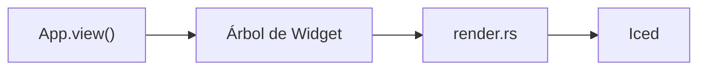
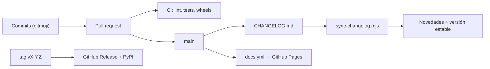

La web está hecha con [Astro Starlight](https://starlight.astro.build) y vive en `docs/`.
Se publica en GitHub Pages en cada push a `main` y en cada release.

```
docs/
├── astro.config.mjs              # secciones (topics), redirecciones, tema, idiomas
├── screenshots/                  # capturas grandes (examples/screenshots.py)
├── scripts/
│   ├── api_docs_en.py            # descripciones de la API en inglés
│   ├── api_docs_es.py            # descripciones de la API en español
│   ├── gen_api.py                # genera reference/*.md en ambos idiomas
│   ├── library_data.py           # la biblioteca de componentes: una entrada por componente
│   ├── gen_library.py            # genera library/*.mdx en ambos idiomas
│   ├── library_shots.py          # genera src/assets/library/*.png
│   ├── component_shots.py        # genera src/assets/components/*.png
│   ├── example_shots.py          # genera capturas de ejemplos y tutoriales
│   └── sync-changelog.mjs        # CHANGELOG.md → página de novedades (ambos idiomas) + versión estable
└── src/content/docs/             # las páginas (Markdown / MDX)
    ├── guides/ ...               # inglés (idioma por defecto, raíz de la web)
    └── es/                       # traducciones al español, mismas rutas
```

## Previsualizar

```bash
cd docs
npm install
npm run dev        # http://localhost:4321/pyzed/
```

## Idiomas

La documentación es multilingüe. El inglés es el idioma por defecto y se sirve en la raíz de la
web; cada traducción vive en una carpeta con el nombre de su idioma:

| Idioma | Archivo | URL |
| --- | --- | --- |
| Inglés | `src/content/docs/guides/canvas.md` | `/pyzed/guides/canvas/` |
| Español | `src/content/docs/es/guides/canvas.md` | `/pyzed/es/guides/canvas/` |

- Una traducción usa **la misma ruta** que la página en inglés, dentro de `es/`.
- Cuando añadas una página, créala en los dos idiomas. Si falta la traducción, Starlight muestra la
  página en inglés con un aviso en lugar de un 404.
- Los enlaces internos llevan el idioma: `/pyzed/guides/...` en las páginas en inglés y
  `/pyzed/es/guides/...` en las de español.
- Las rutas relativas a imágenes y ejemplos llevan un `../` más en los archivos en español, porque
  están una carpeta más abajo.

## Secciones y navegación

Las secciones principales (Aprender, Biblioteca, Diseñador, Shading, Temas, Distribuir, Showcase, Integraciones,
IA y Referencia) son la lista `topics` de `astro.config.mjs`, con el plugin
[starlight-sidebar-topics](https://starlight-sidebar-topics.netlify.app). Cada una es un enlace en la barra de
navegación de la cabecera (`src/components/Header.astro`) y tiene su propia barra lateral; en el móvil aparecen
arriba del menú. Una página pertenece a la sección cuya barra lateral la lista, normalmente por la carpeta donde
está:

| Sección | Carpetas |
| --- | --- |
| Aprender | `getting-started/`, `tutorials/{basic,intermediate,advanced}/`, `guides/`, `why/`, `examples`, `faq` |
| Biblioteca | `library/`, `blocks/` (y la antigua `components/`) |
| Diseñador | `editor/`, `download` |
| Shading, Temas, Distribuir | `shading/`, `theming/`, `packaging/` |
| Showcase | `showcase/`, `games/` |
| Integraciones, IA | `integrations/`, `ai/` |
| Referencia | `reference/`, `changelog`, `contributing/` |

- La página de inicio de una sección lleva un hero cuando su frontmatter tiene `section: { eyebrow, icon, lead }`
  (`src/components/PageTitle.astro`).
- Enlaza páginas con `<NavCards>` (`src/components/NavCards.astro`); una tarjeta sin `href` se muestra como
  "próximamente".
- Muestra capturas y grabaciones cortas con `<Media>` (`src/components/Media.astro`): una imagen de `src/assets`
  (opcionalmente con una versión `light`) o un bucle mp4/webm con `poster`, más un pie de foto.
- Los comandos van en `<Tabs syncKey="pkg">` con una pestaña `uv` y otra `pip`, con bloques de código con título
  para Windows y para macOS/Linux cuando cambian.
- **Mover una página:** muévela con `git mv` en los dos idiomas, añade la ruta antigua a `MOVED` en
  `astro.config.mjs` para que la URL antigua redirija, y actualiza los enlaces (busca la ruta antigua con
  `git grep`, también en `docs/scripts` y `python/`).

## Diagramas

Escribe los diagramas como bloques de código `mermaid`; la integración `astro-mermaid` los dibuja
en la página y respeta el tema claro/oscuro:

````md

````

## Regenerar la referencia y las imágenes

Necesitan Pyzed instalado (`uv sync`, o `maturin develop --release`). Para un componente nuevo, sigue
[Documentar un componente](/pyzed/es/contributing/documenting-components/).

```bash
python docs/scripts/gen_api.py              # referencia de la API, ambos idiomas
python docs/scripts/gen_api.py --lang es    # solo español (o --lang en)
python docs/scripts/gen_api.py --check      # informa de nombres públicos sin documentar
python docs/scripts/component_shots.py      # ilustraciones de componentes
python docs/scripts/example_shots.py        # capturas de ejemplos y tutoriales
python examples/screenshots.py              # capturas grandes
```

Cuando añadas una función pública, describe sus parámetros en `docs/scripts/api_docs_en.py` y
`docs/scripts/api_docs_es.py`, y vuelve a generar la referencia. La CI ejecuta `gen_api.py --check`.

## Novedades y versiones



`docs/scripts/sync-changelog.mjs` genera la página [Novedades](/pyzed/es/changelog/) en ambos
idiomas desde `CHANGELOG.md` (raíz del repositorio) en cada build. Cada versión es un encabezado
`## [X.Y.Z] - AAAA-MM-DD`; las que llevan sufijo (`1.0.0-rc.1`, `0.2.0b1`) se marcan como
preliminares. La más reciente sin sufijo aparece como **última estable** en la cabecera, la portada
y la página de novedades.
