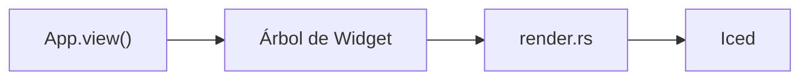
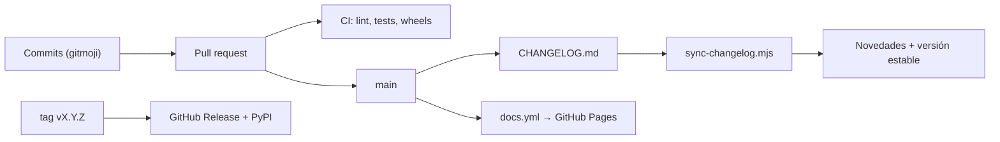

La web está hecha con [Astro Starlight](https://starlight.astro.build) y vive en `docs/`.
Se publica en GitHub Pages en cada push a `main` y en cada release.

```
docs/
├── astro.config.mjs              # secciones (topics), redirecciones, tema, idiomas
├── screenshots/                  # capturas grandes (examples/screenshots.py)
├── scripts/
│   ├── api_docs_en.py            # descripciones de la API en inglés
│   ├── api_docs_es.py            # descripciones de la API en español
│   ├── gen_api.py                # genera reference/*.md en ambos idiomas
│   ├── library_data.py           # la biblioteca de componentes: una entrada por componente
│   ├── gen_library.py            # genera library/*.mdx en ambos idiomas
│   ├── shading_nodes_data.py     # textos y ejemplos del catálogo de nodos (en/es)
│   ├── gen_shading_nodes.py      # genera shading/nodes/*.mdx en ambos idiomas
│   ├── anim_webp.py              # graba capturas WebP animadas (biblioteca compartida + CLI)
│   ├── library_anim.py           # qué hace la vista previa animada de cada componente
│   ├── library_shots.py          # genera public/library/*.webp (vistas previas animadas)
│   ├── component_shots.py        # genera src/assets/components/*.png
│   ├── example_shots.py          # genera capturas de ejemplos y tutoriales
│   └── sync-changelog.mjs        # CHANGELOG.md → página de novedades (ambos idiomas) + versión estable
└── src/content/docs/             # las páginas (Markdown / MDX)
    ├── guides/ ...               # inglés (idioma por defecto, raíz de la web)
    └── es/                       # traducciones al español, mismas rutas
```

## Previsualizar

```bash
cd docs
npm install
npm run dev        # http://localhost:4321/pyzed/
```

## Idiomas

La documentación es multilingüe. El inglés es el idioma por defecto y se sirve en la raíz de la
web; cada traducción vive en una carpeta con el nombre de su idioma:

| Idioma | Archivo | URL |
| --- | --- | --- |
| Inglés | `src/content/docs/guides/canvas.md` | `/pyzed/guides/canvas/` |
| Español | `src/content/docs/es/guides/canvas.md` | `/pyzed/es/guides/canvas/` |

- Una traducción usa **la misma ruta** que la página en inglés, dentro de `es/`.
- Cuando añadas una página, créala en los dos idiomas. Si falta la traducción, Starlight muestra la
  página en inglés con un aviso en lugar de un 404.
- Los enlaces internos llevan el idioma: `/pyzed/guides/...` en las páginas en inglés y
  `/pyzed/es/guides/...` en las de español.
- Las rutas relativas a imágenes y ejemplos llevan un `../` más en los archivos en español, porque
  están una carpeta más abajo.

## Secciones y navegación

Las secciones principales (Aprender, Biblioteca, Diseñador, Shading, Temas, Distribuir, Showcase, Integraciones,
IA y Referencia) son la lista `topics` de `astro.config.mjs`, con el plugin
[starlight-sidebar-topics](https://starlight-sidebar-topics.netlify.app). Cada una es un enlace en la barra de
navegación de la cabecera (`src/components/Header.astro`) y tiene su propia barra lateral; en el móvil aparecen
arriba del menú. Una página pertenece a la sección cuya barra lateral la lista, normalmente por la carpeta donde
está:

| Sección | Carpetas |
| --- | --- |
| Aprender | `getting-started/`, `tutorials/{basic,intermediate,advanced}/`, `guides/`, `why/`, `examples`, `faq` |
| Biblioteca | `library/`, `blocks/` (y la antigua `components/`) |
| Diseñador | `editor/`, `download` |
| Shading, Temas, Distribuir | `shading/`, `theming/`, `packaging/` |
| Showcase | `showcase/`, `games/` |
| Integraciones, IA | `integrations/`, `ai/` |
| Referencia | `reference/`, `changelog`, `contributing/` |

- La página de inicio de una sección lleva un hero cuando su frontmatter tiene `section: { eyebrow, icon, lead }`
  (`src/components/PageTitle.astro`).
- Enlaza páginas con `<NavCards>` (`src/components/NavCards.astro`); una tarjeta sin `href` se muestra como
  "próximamente".
- Muestra capturas y grabaciones cortas con `<Media>` (`src/components/Media.astro`): una imagen de `src/assets`
  (opcionalmente con una versión `light`) o un bucle mp4/webm con `poster`, más un pie de foto.
- Escribe los comandos de terminal con `` <Commands uv={`...`} pip={`...`} python={`...`} /> ``
  (`src/components/Commands.astro`, en una página `.mdx`). Dibuja las pestañas `uv`, `pip` y `python`
  (sincronizadas en todo el sitio) y separa cada una en bloques para macOS/Linux y para Windows PowerShell cuando
  cambian. Escribe `{py}`, `{venv}`, `{activate}`, `{vpy}` y `{env NOMBRE=valor}` donde los sistemas difieren; el
  componente pone `python3`/`py`, `source .venv/bin/activate`/`.venv\Scripts\Activate.ps1`, etc. Los comandos
  que solo existen en un sistema van en `<Tabs syncKey="os">`.
- Los colores de los tokens de tema salen de `src/components/theme-tokens.json` (lo escribe
  `docs/scripts/gen_theme_tokens.py`), y las capturas de temas de `docs/scripts/theming_shots.py`.
- **Mover una página:** muévela con `git mv` en los dos idiomas, añade la ruta antigua a `MOVED` en
  `astro.config.mjs` para que la URL antigua redirija, y actualiza los enlaces (busca la ruta antigua con
  `git grep`, también en `docs/scripts` y `python/`).

## Diagramas

Escribe los diagramas como bloques de código `mermaid`; la integración `astro-mermaid` los dibuja
en la página y respeta el tema claro/oscuro:

````md

````

## Regenerar la referencia y las imágenes

Necesitan Pyzed instalado (`uv sync`, o `maturin develop --release`). Para un componente nuevo, sigue
[Documentar un componente](/pyzed/es/contributing/documenting-components/).

```bash
python docs/scripts/gen_api.py              # referencia de la API, ambos idiomas
python docs/scripts/gen_api.py --lang es    # solo español (o --lang en)
python docs/scripts/gen_api.py --check      # informa de nombres públicos sin documentar
python docs/scripts/gen_shading_nodes.py    # catálogo de nodos de shader, ambos idiomas
python docs/scripts/gen_shading_nodes.py --check  # falla si las páginas no están al día o un ejemplo falla
python docs/scripts/library_shots.py        # vistas previas animadas de la biblioteca
python docs/scripts/component_shots.py      # ilustraciones de componentes
python docs/scripts/example_shots.py        # capturas de ejemplos y tutoriales
python examples/screenshots.py              # capturas grandes
```

Cuando añadas una función pública, describe sus parámetros en `docs/scripts/api_docs_en.py` y
`docs/scripts/api_docs_es.py`, y vuelve a generar la referencia. La CI ejecuta `gen_api.py --check`.

## Capturas animadas

`docs/scripts/anim_webp.py` graba una vista de Pyzed como un WebP animado en bucle, con un puntero,
un teclado y un reloj guionizados. Todos los componentes de la [biblioteca](/pyzed/es/library/) se
graban con él (`library_shots.py`), y cualquier otra página puede usarlo para sus propios clips:
animaciones, widgets de audio, un formulario rellenándose.

Usa el mismo renderizador fuera de pantalla que `pz.screenshot` (sin ventana, pantalla ni GPU), a
través de `pyzed._core.record`: cada fotograma recibe la posición del puntero, así que se ven los
estados al pasar por encima y al pulsar y los tooltips; los eventos (pulsar, soltar, rueda, teclas,
texto) llegan a los widgets entre fotogramas; y el tiempo avanza exactamente un fotograma por
fotograma (las animaciones, spinners, cursores de texto y presencias lo siguen), así que un clip sale
igual en cualquier máquina, tarde lo que tarde cada fotograma.

```python
import pyzed as pz
from pyzed import ui
from anim_webp import record_webp, hover, press, type_text, drag, wait, leave


class Login(pz.App):
    def __init__(self):
        self.email = ""

    def view(self):
        return pz.column([
            ui.input(self.email, lambda v: setattr(self, "email", v), placeholder="Email"),
            ui.button("Sign in", lambda: None, variant="solid"),
        ], spacing=8, width=280)


record_webp(
    Login(),
    [press("input"), type_text("ada@example.com"), hover("Sign in"), press(), wait(600), leave()],
    out="docs/public/media/login.webp",
    size=(360, 160),          # lienzo, en píxeles lógicos (se graba a 2x)
    theme="One Light",
    crop="content",           # recorta a lo que cambia, más un margen
    poster="docs/public/media/login.still.webp",
)
```

`record_webp` recibe una `App` (instancia o clase) o una función que devuelve el widget. Pasos:

| Paso | Qué hace |
| --- | --- |
| `wait(ms)` | pasa el tiempo (se mueven animaciones, spinners y cursores) |
| `move(target, ms)`, `hover(target, ms, hold)` | el puntero se desliza hasta `target` (y se queda) |
| `press(target=None, hold)`, `click` | un clic izquierdo, mantenido `hold` ms |
| `drag(start, end, ms)` | pulsar, deslizar, soltar (deslizadores, divisores, campos de color) |
| `type_text(text, cps)` | escribe en el campo con el foco |
| `key(name, mods="")` | una tecla: `"Enter"`, `"Tab"`, `"Down"`, `"a"` con `"ctrl"`... |
| `scroll(lines, target=None)` | la rueda sobre `target` |
| `leave(ms)` | el puntero se va (terminan los estados de hover) |
| `call(fn)`, `set_state(**attrs)` | cambian el estado de la app entre fotogramas |
| `theme(name)` | cambia el tema de la app |

Un **target** es un punto `(x, y)`, un texto visible en la vista (`"Sign in"`: su centro), `"input"` /
`"input:1"` (el primer / segundo campo de texto), `"center"` (el centro de lo dibujado), `"@0.25,0.5"`
(un punto relativo a lo dibujado), `(target, dx, dy)` para apuntar al lado de uno, o
`fn(ctx) -> (x, y)`. A los widgets que se dibujan sin texto (interruptores, deslizadores, opciones de
un desplegable) se apunta con puntos.

Codificación: los fotogramas consecutivos idénticos se funden en uno más largo, el clip se repite
sin fin y cada fotograma es con pérdida (`quality=80`, `method=6`) o sin pérdida, lo que ocupe menos
(`allow_mixed` de WebP), lo que mantiene nítido el texto. Apunta a **150 KB o menos** por clip y nunca
más de **400 KB**; acorta el clip, recórtalo o baja `fps` (20 por defecto) si crece. Las vistas pueden
leer `clip_time()` (segundos desde que empezó el clip) para mover cosas que si no estarían quietas.

También están las piezas de más bajo nivel: `record_frames()` (los fotogramas, en RGBA), `images()`,
`crop_box()`, `encode_webp()`, `fit_webp()` (baja la calidad hasta que el archivo cabe en un tamaño;
`record.py` codifica con ella sus clips `anim=True`), `info(path)` (fotogramas, duración y tamaño de un
WebP). Desde la línea de comandos:

```bash
python docs/scripts/anim_webp.py out.webp --code 'ui.button("Save", None, variant="solid")' \
    --steps 'hover("Save"); press(); wait(500)' --size 320x120 --crop --theme "One Light"
```

**En una página**, sirve los archivos tal cual desde `docs/public/`: el procesado de imágenes de
Astro convertiría un WebP animado en una imagen quieta. `src/components/AnimatedImage.astro` escribe el
marcado: el `` con su `width`, `height`, `alt`, `loading="lazy"` y `decoding="async"`, y el
fotograma quieto para quien pida movimiento reducido:

```html
<picture>
  <source srcset="/pyzed/media/login.still.webp" media="(prefers-reduced-motion: reduce)" />
  
</picture>
```

`<Media clip="...">` lo usa para los clips de `public/media/`, y `src/components/library/Clip.astro`
de la biblioteca para los de `public/library/` (tamaños de `public/library/manifest.json`). Lo que hace cada vista previa está en `docs/scripts/library_anim.py`;
`library_shots.py --probe <slug>` imprime los textos y campos a los que puede apuntar un guion.

## Novedades y versiones



`docs/scripts/sync-changelog.mjs` genera la página [Novedades](/pyzed/es/changelog/) en ambos
idiomas desde `CHANGELOG.md` (raíz del repositorio) en cada build. Cada versión es un encabezado
`## [X.Y.Z] - AAAA-MM-DD`; las que llevan sufijo (`1.0.0-rc.1`, `0.2.0b1`) se marcan como
preliminares. La más reciente sin sufijo aparece como **última estable** en la cabecera, la portada
y la página de novedades.
