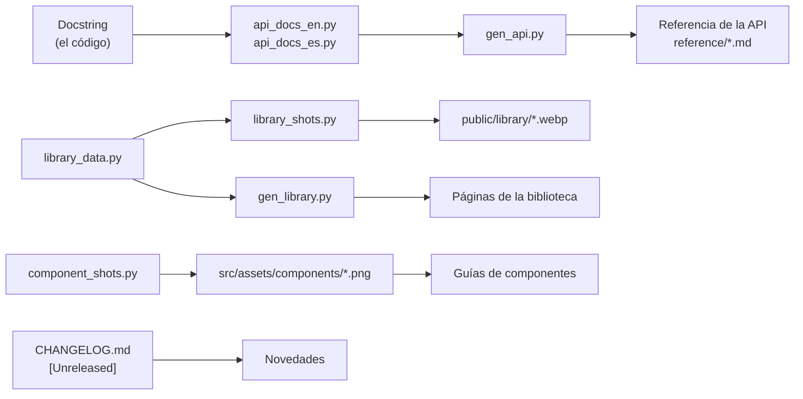

Un componente está terminado cuando la gente puede encontrarlo y aprender a usarlo sin leer su código.
Documéntalo en el mismo pull request que lo añade; en la revisión se comprueba. Esta página continúa el
ejemplo de Rating de [Añadir un componente al editor](/pyzed/es/contributing/adding-components/).



| Qué | Dónde | Lo genera |
| --- | --- | --- |
| Docstring | la función o clase en `python/pyzed/` | se escribe a mano |
| Referencia de la API | `docs/src/content/docs/[es/]reference/*.md` | `docs/scripts/gen_api.py` a partir de `api_docs_en.py` / `api_docs_es.py` |
| Biblioteca de componentes | la sección *Biblioteca de componentes* de la web | `docs/scripts/gen_library.py` a partir de `docs/scripts/library_data.py` |
| Vistas previas de la biblioteca (animadas) | `docs/public/library/*.webp` | `docs/scripts/library_shots.py` |
| Ilustraciones de las guías | `docs/src/assets/components/*.png` | `docs/scripts/component_shots.py` |
| Capturas del editor | `docs/screenshots/*.png` | `examples/screenshots.py` |
| Notas de versión | `CHANGELOG.md` → [Novedades](/pyzed/es/changelog/) | `docs/scripts/sync-changelog.mjs` en cada compilación |

Instala antes Pyzed en tu entorno (`uv sync` o `maturin develop --release`): todos los scripts importan el
paquete, así que las firmas y las imágenes siempre coinciden con el código.

## 1. Docstrings

Los docstrings son la fuente de verdad: los muestra el editor, los muestra el autocompletado y la referencia
de la API los usa cuando falta una descripción. El estilo del repositorio (en inglés, como el código):

- **La primera línea es una frase completa** que dice qué es o qué hace, en presente: *"A row of ``max``
  stars with the first ``value`` lit, in the ``tint`` color."* El primer párrafo es el resumen que usa
  `gen_api.py`.
- Después, si hace falta, un párrafo corto sobre **los callbacks y el comportamiento**: qué recibe
  `on_change` y qué pasa sin él.
- Al final, una **sección `Events:`** que enumera cada parámetro `on_*` con lo que recibe su handler,
  escrito como una llamada (``` ``on_change(stars)`` ```, ``` ``on_press()`` ```). Los editores la muestran al
  pasar el ratón, y es la misma lista que la sección **Eventos** de la página de la biblioteca.
- Los nombres de código van entre comillas invertidas dobles de reST (```` ``value`` ````) y los ejemplos en
  un bloque `::`; `gen_api.py` convierte las dos cosas a Markdown (código en línea y un bloque `python`).
- Sin secciones `Args:`/`Returns:`: los parámetros se describen en `api_docs_*.py` (abajo), así el docstring
  sigue siendo corto.
- Las `Prop` del diseñador no tienen docstring: la `description` del `Component` (una frase) es el tooltip de
  la caja de herramientas y el subtítulo del panel de propiedades.

```python
def rating(value: float, on_change: Any = None, *, max: int = 5, size: float = 16,
           tint: str = "accent", theme: Optional[Theme] = None) -> _core.Widget:
    """A row of ``max`` stars with the first ``value`` lit, in the ``tint`` color.

    ``on_change`` is called with the number of the clicked star (1 to ``max``);
    without it the stars are read only.

    Events:
        ``on_change(stars)``: Called with the number of the clicked star.
    """
```

Los widgets escritos en Rust (`pz.button`, `pz.slider`…) llevan el mismo texto en comentarios `///` sobre su
`#[pyfunction]`; `scripts/gen_stubs.py` los copia a `_core.pyi` después de `maturin develop`.

## 2. Referencia de la API

Las páginas de la [Referencia de la API](/pyzed/es/reference/ui/) se generan. No edites nunca
`docs/src/content/docs/reference/*.md` a mano: describe la función en `docs/scripts/api_docs_en.py` y su
traducción en `docs/scripts/api_docs_es.py`, y vuelve a generar.

Cada archivo tiene una lista `PAGES`; cada página tiene `sections`, una lista de pares
`(título, {nombre: entrada})`. Añade la entrada a la sección que le corresponde (para los componentes de
`pyzed.ui`: `Basics`, `Forms`, `Lists, tree and menus`, `Navigation`, `Workspace`, `Overlays`, `Code`; en
`api_docs_es.py` los títulos están traducidos: `Básicos`, `Formularios`…):

```python
# docs/scripts/api_docs_en.py, page "ui", section "Forms"
"pyzed.ui.rating": {
    "desc": "A row of stars to rate something.",
    "params": {
        "max": "Number of stars.",
        "size": "Size of each star, in pixels.",
        "on_change": "Called with the number of the clicked star (1 to `max`). Without it the stars are read only.",
    },
},
```

```python
# docs/scripts/api_docs_es.py, page "ui", section "Formularios"
"pyzed.ui.rating": {
    "desc": "Una fila de estrellas para valorar algo.",
    "params": {
        "max": "Número de estrellas.",
        "size": "Tamaño de cada estrella, en píxeles.",
        "on_change": "Recibe el número de la estrella pulsada (de 1 a `max`). Sin él, las estrellas son de solo lectura.",
    },
},
```

- **La firma no se escribe a mano**: `gen_api.py` la lee con `inspect`, tanto de Python como de las
  funciones de Rust (PyO3 expone sus firmas).
- Los parámetros que faltan en `params` se buscan en `COMMON`, al principio del archivo (`value`, `tint`,
  `theme`, `width`, `on_press`…), así que describe solo lo específico.
- Una entrada también puede tener `"example"` (un bloque de código) y `"extra"` (Markdown después de la
  tabla).
- Las entradas de la API del diseñador (`pyzed.designer.*`) se listan con `_doc(...)`, que usa el docstring.

```bash
python docs/scripts/gen_api.py              # los dos idiomas
python docs/scripts/gen_api.py --lang es    # solo español (o --lang en)
python docs/scripts/gen_api.py --check      # lista los nombres públicos sin documentación
```

`--check` revisa todo lo exportado en `__all__` de `pyzed`, `pyzed.ui` y `pyzed.designer`. La CI lo ejecuta y
muestra lo que falta como avisos, así que una exportación nueva sin entrada se ve en el PR.

## 3. La biblioteca de componentes

La [Biblioteca de componentes](/pyzed/es/library/) tiene una página por componente, al estilo de shadcn/ui o
Chakra UI: una descripción, una vista previa en los dos temas con pestañas **Vista previa/Código**, «Cuándo
usarlo», uso, ejemplos, consejos, una tabla de la API y componentes relacionados, además de una galería con
todos ellos agrupados por categoría. Las páginas se generan a partir de un único archivo de datos,
`docs/scripts/library_data.py`, con `docs/scripts/gen_library.py`; no edites nunca `library/*.mdx` a mano.

Documenta primero la función en la referencia de la API (paso 2): las tablas de la API de la biblioteca
reutilizan `gen_api.py`, así que la firma y las descripciones de los parámetros salen de
`api_docs_<idioma>.py`. Después añade una entrada con `add(...)` a `library_data.py` (el orden del archivo da
igual; las páginas se ordenan por nombre). Cada texto es un par `T(en, es)`:

```python
add(
    slug="rating",
    name="Rating",
    category="forms",
    api=["pyzed.ui.rating"],
    blurb=T("A row of stars to rate something.", "Una fila de estrellas para valorar algo."),
    desc=T(
        "Stars the user clicks to give a score. `on_change` receives the number of the clicked star; "
        "without it the stars are read only.",
        "Estrellas en las que el usuario hace clic para puntuar. `on_change` recibe el número de la "
        "estrella pulsada; sin él, las estrellas son de solo lectura.",
    ),
    when=T(
        ["To collect a quick score (reviews, feedback).",
         "To show a score next to an item, read only."],
        ["Para recoger una puntuación rápida (reseñas, opiniones).",
         "Para mostrar una puntuación junto a un elemento, en solo lectura."],
    ),
    preview={"code": """pz.column([
    ui.rating(4, on_rate),
    ui.rating(3, on_rate, tint="warning", size=20),
    ui.rating(7, max=10),
], spacing=10)""", "size": (720, 200)},
    usage="""class Review(pz.App):
    def __init__(self):
        self.stars = 0

    def view(self):
        return ui.rating(self.stars, lambda stars: setattr(self, "stars", stars))""",
    related=["slider", "segmented"],
    badge="new",
)
```

| Clave | Significado |
| --- | --- |
| `slug` | URL y nombre de archivo: `library/<slug>.mdx` y `public/library/<slug>.*.webp`. |
| `name` | Título de la página y de su tarjeta en la galería. |
| `category` | Una clave de `CATEGORIES` (`actions`, `display`, `forms`, `feedback`, `data`, `lists`, `navigation`, `overlays`, `dialogs`, `workspace`, `code`, `layout`, `content`). |
| `api` | Los nombres públicos que documenta la página, el principal primero. |
| `blurb`, `desc`, `when` | La línea de la galería, el párrafo inicial y las viñetas de «Cuándo usarlo». |
| `preview` | `{"code": ..., "size": (w, h), "fill": False, "start": None}`: el fragmento que se muestra en la pestaña Código **y** que se dibuja como vista previa. |
| `usage` | Opcional: un fragmento más completo, normalmente una `App` que muestra dónde vive el estado. |
| `examples` | Lista opcional de `{"title": T(...), "text": T(...), "code": ..., "size": (w, h)}`, cada uno con su imagen (`"shot": False` para mostrar solo el código). |
| `notes` | «Consejos» opcionales (Markdown). |
| `related`, `badge` | Slugs relacionados opcionales; `"new"` añade una insignia en la barra lateral y en la galería. |

**Eventos.** Cada página tiene una sección **Eventos**, también generada: una tabla con los eventos propios
del componente (sus parámetros `on_*`, con la descripción de la referencia de la API), los eventos comunes de
`.on()` y un ejemplo **Manejar los eventos** en tres pestañas: imperativo, declarativo y funcional. Lo que
recibe cada handler (`(text)`, `(x, y)`…) y los tres ejemplos están en `docs/scripts/library_events.py`:

```python
HANDLERS = {"on_change": "(value)", "ui.rating.on_change": "(stars)", ...}

ex("rating",
   """class Review(pz.App): ...""",               # imperativo: los métodos cambian self
   """@dataclass\nclass Rate: ...""",             # declarativo: mensajes y update()
   """@dataclass(frozen=True)\nclass State: ...""")  # funcional: view(state, set_state)
```

Los ejemplos imperativo y declarativo terminan con una clase `App`; el funcional define `view(state, set_state)`
y un `State` congelado. `tests/test_library_events.py` ejecuta los tres de cada página, y `--check` falla si un
componente con eventos no tiene ejemplos. La página [Eventos](/pyzed/es/library/events/) enumera cada
componente con su número de eventos.

Los fragmentos se ejecutan con `pz`, `ui` y `draw` ya importados; cualquier otro nombre libre (`on_rate`,
`save`…) es un callback que no hace nada, así que escríbelos como los escribiría alguien en su aplicación;
**la última expresión es el widget**. Los textos son Markdown dentro de MDX: escribe `{`, `}` y `<` solo entre
comillas invertidas.

Dibuja las vistas previas, genera las páginas y compruébalas:

```bash
python docs/scripts/library_shots.py rating      # public/library/rating.dark.webp y rating.light.webp
python docs/scripts/gen_library.py               # library/*.mdx en los dos idiomas
python docs/scripts/gen_library.py --check       # cobertura y coherencia, no escribe nada
```

Las vistas previas son WebP animados grabados sin pantalla a escala 2 con
[`anim_webp.py`](/pyzed/es/contributing/docs/#capturas-animadas), centrados sobre el fondo del tema, en Pyzed
Dark y Pyzed Light (ejemplos: `<slug>-<n>.<tema>.webp`; cada uno con un `*.still.webp` quieto para el
movimiento reducido). Por defecto el puntero pasa por encima del centro de la vista previa y lo pulsa, y
cada variante se sobrevuela y se pulsa (o se hace clic y se escribe si tiene un campo de texto); un clip en
el que nada cambia recorre algunos temas. Dale al componente nuevo un guion en
`docs/scripts/library_anim.py` cuando haga algo más (abrir un menú, arrastrar un deslizador, escribir una
búsqueda); `library_shots.py --probe rating` imprime a qué puede apuntar un guion. `--check` falla cuando un
nombre de `pyzed.ui.__all__` no está en ninguna página de la biblioteca, cuando una entrada apunta a un
nombre, categoría, slug relacionado o clip desconocidos, cuando falta un clip o no está animado, o cuando una
página generada no está al día. Sube los clips y `public/library/manifest.json` junto con el archivo de
datos.

## 4. Capturas para las guías

Las guías temáticas de *Componentes* (`docs/src/content/docs/components/*.md`) muestran una imagen por página,
dibujada por `docs/scripts/component_shots.py`. Para ilustrar ahí el componente nuevo, añade una función que
devuelva los widgets y una entrada en `SHOTS` con el tamaño de la imagen en píxeles lógicos:

```python
def rating():
    return pz.column([
        ui.rating(3, noop),
        ui.rating(4, noop, tint="warning", size=20),
        ui.rating(2, max=10),
    ], spacing=10)


SHOTS = {
    # ...
    "rating": (rating, (300, 140)),
}
```

```bash
python docs/scripts/component_shots.py rating     # docs/src/assets/components/rating.png
```

y enlázala desde la página con una ruta relativa:
`` (en la página en inglés, un `../` menos).

Las capturas grandes del editor (`docs/screenshots/`) las hace `examples/screenshots.py`. Su
`designer-components.png` coloca **todos los componentes registrados** en un formulario, así que vuelve a
generarla cuando añadas uno a la caja de herramientas:

```bash
python examples/screenshots.py
```

Consejos para buenas imágenes:

- Muestra el componente **en contexto y en sus estados** (vacío, seleccionado, deshabilitado, cada variante),
  no solo el valor por defecto.
- Usa textos realistas («How was your stay?»), nunca «foo» o «test».
- Ajusta el tamaño: los scripts dibujan a escala 2, así que 300×140 píxeles lógicos son una imagen de 600×280.
- Pyzed Dark es el tema por defecto de las imágenes; las páginas de la biblioteca también tienen Pyzed Light.

## 5. Guías y documentación del editor

Además de las páginas generadas, actualiza las escritas a mano a las que afecta el componente:

- La página de la guía de **Componentes** de su familia (`components/forms.md`, `components/controls.md`…):
  añádelo al ejemplo y a la tabla *Componente / Para qué sirve*.
- La lista de controles integrados del [Diseñador visual](/pyzed/es/guides/designer/) y la página
  [Caja de herramientas y lienzo](/pyzed/es/editor/toolbox-and-canvas/) del manual de Pyzed Design, cuando se
  une a la caja de herramientas.
- El manual de [Pyzed Design](/pyzed/es/editor/), si el control añade comportamiento al editor (un editor de propiedades nuevo, un
  tipo de contenedor nuevo).

## 6. Traducciones

La web está primero en inglés, con la traducción al español en `docs/src/content/docs/es/` en las mismas
rutas. Para cada página que añadas o cambies:

- Escribe la página en inglés y después la española con el mismo nombre de archivo.
- Los enlaces incluyen el idioma: `/pyzed/guides/designer/` en inglés, `/pyzed/es/guides/designer/` en español.
- Las rutas relativas de las imágenes llevan **un `../` más** en las páginas en español, porque están una
  carpeta más abajo.
- Las anclas salen del texto del título, así que un enlace a una sección de una página en español usa el título
  en español (`/pyzed/es/guides/components/#en-el-diseñador`).
- El contenido generado tiene los dos idiomas en sus datos: `api_docs_es.py`, los textos en español de
  `library_data.py` y los textos del propio editor en `python/pyzed/designer/locales/es.json`.

Si no puedes escribir la versión en español, dilo en el PR: una página que falta se muestra en inglés con un
aviso, y alguien del equipo u otra persona puede traducirla en un PR 🌐.

## 7. El changelog

Las notas de cada versión se generan a partir de los títulos de los PR al publicarla, así que un título
`✨ Add a Rating component` suele bastar. Para un cambio que merece más de una línea, escribe la nota a mano
bajo `## [Unreleased]` en `CHANGELOG.md`, en la sección que le corresponde (en inglés):

```markdown
## [Unreleased]

### Features

- **Rating**: a row of stars in `pyzed.ui` (`ui.rating`) and in the designer's toolbox, with a `change` event.
```

Las notas escritas bajo `[Unreleased]` se conservan y se combinan al publicar la versión. La página
[Novedades](/pyzed/es/changelog/) de la web se regenera a partir de este archivo en cada compilación.

## 8. Compilar y comprobar la web

```bash
cd docs
npm install
npm run dev        # http://localhost:4321/pyzed/, se recarga mientras editas
npm run build      # la web estática en docs/dist, tal como se publica en GitHub Pages
```

Antes de abrir el PR:

- `npm run build` termina sin errores (falla con Markdown o MDX roto o con imágenes que no existen).
- `python docs/scripts/gen_api.py --check` no lista tus nombres nuevos, y
  `python docs/scripts/gen_library.py --check` pasa.
- Las páginas nuevas aparecen en la barra lateral en los dos idiomas, y sus enlaces e imágenes funcionan en
  los dos.
- Las imágenes se regeneraron con los scripts, no se capturaron a mano.

Lee [Editar la documentación](/pyzed/es/contributing/docs/) para la estructura de la web, los diagramas de
mermaid y el flujo de publicación.
